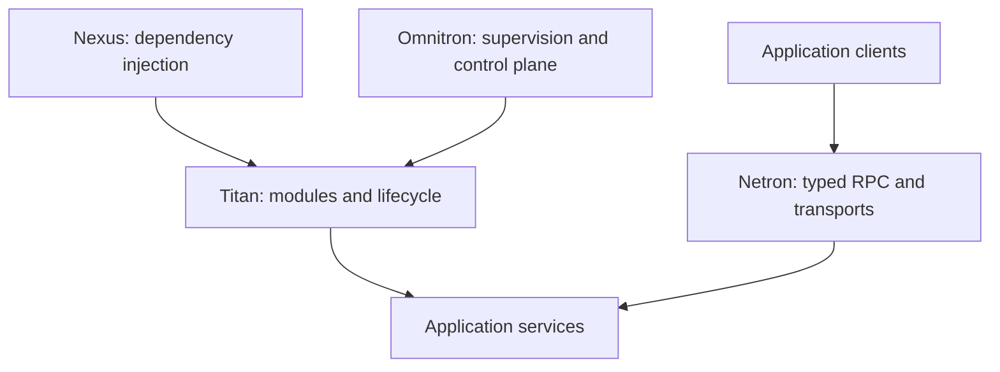

# vs alternatives

Use the application requirements to compare stacks. The contracts below describe
Omnitron itself; they do not establish the origin of its design or a historical
relationship with another project. Similar APIs are not evidence of derivation.

If you're migrating from one of these, the
[migration guides](./titan/migrations) cover the mechanical
parts. This page covers **fit**.

## The big picture {#the-big-picture}

Omnitron is organized around distinct responsibilities:

Titan composes providers and application lifecycle hooks. Netron exposes service
methods through configured transports. Omnitron manages application processes and
provides operational APIs. A Titan application can run without the Omnitron daemon.
See [architecture](./foundations/architecture.md) for the package boundaries.

## vs NestJS {#vs-nestjs}

When evaluating an application that uses NestJS, map its contracts to Titan
explicitly rather than assuming that similarly named decorators are compatible.

| Concern | Omnitron contract | Migration check |
| --- | --- | --- |
| Injection | Nexus tokens, providers and scopes | Provider visibility and request context |
| Application composition | Titan modules and dynamic factories | Initialization and shutdown order |
| Service exposure | Netron services and public methods | Client contract, transport and authentication |
| Validation | Titan validation decorators and schemas | Input/output validation and error translation |
| Infrastructure | Opt-in [Titan modules](./titan/modules) | Actual options, adapters and ownership of connections |
| Operations | Optional Omnitron daemon | Process configuration and deployment requirements |

No footprint or throughput ranking is implied. Measure the same workload with
the dependencies, transports and production settings the application will use.

### Pick NestJS when… {#pick-nestjs-when}

Retaining an existing NestJS application can avoid a migration when its current
behavior already meets the requirements. Inventory its integrations and operating
procedures before estimating a replacement.

### Pick Omnitron when… {#pick-omnitron-when}

Evaluate Titan when the application needs its module/DI contracts, Netron service
model or Omnitron's process control. Exercise a representative endpoint and its
startup/shutdown path before migrating the rest.

→ Migration: [from NestJS](./titan/migrations/from-nestjs.md)

## vs tRPC {#vs-trpc}

For a project using tRPC, compare the service contract and client requirements.
Netron clients use shared TypeScript service interfaces; transport configuration,
authentication and serialization remain explicit parts of the application.

| Concern | Netron/Titan path to evaluate |
| --- | --- |
| Contract | Shared service interfaces and public methods |
| Transports | HTTP, WebSocket, TCP and Unix implementations; check the required feature on the selected transport |
| Streaming | Supported streaming calls and cancellation behavior |
| Authentication | Configured Netron authentication plus application authorization |
| React clients | `netron-react` providers, hooks and query cache |
| Server composition | Standalone Netron or Titan-managed services |

See [Netron](./titan/netron.md) and [React integration](./frontend/netron/react.md).
These are architectural choices, not claims of compatibility with tRPC APIs.

### Pick tRPC when… {#pick-trpc-when}

For an existing tRPC application, assess whether changing the RPC boundary solves
a concrete requirement. Include client hooks, middleware, error contracts and
subscriptions in the migration cost.

### Pick Omnitron when… {#pick-omnitron-when-1}

Evaluate Netron when its service model or required transport fits the application.
Add Titan for DI and lifecycle management, then select infrastructure modules by
the behavior they implement. The Omnitron daemon is a separate operational choice.

## vs Fastify / Express / Hono {#vs-fastify--express--hono}

Compare the HTTP contract the application needs with Netron's service-method
contract. A path-oriented API and an RPC method interface have different client,
authentication and error-handling requirements.

Omnitron does not establish a throughput or bundle-size advantage over these
projects. Use a reproducible benchmark with the same routing, validation,
serialization and connection settings before making a performance claim.

### Pick the HTTP server when… {#pick-the-http-server-when}

Keep the current HTTP boundary when its routes and middleware already implement
the required contract. Account for external clients that depend on paths, status
codes, headers and body formats.

### Pick Omnitron when… {#pick-omnitron-when-2}

Evaluate a Netron service boundary when clients can consume typed RPC methods.
Titan can manage the service's providers and lifecycle. Test custom HTTP behavior
separately where the application still needs it.

## vs PM2 / systemd / Docker Compose {#vs-pm2--systemd--docker-compose}

Omnitron provides process supervision and operational RPC APIs. Its configuration,
application lifecycle and access controls must be evaluated against the existing
deployment manager; similar process-management responsibilities do not imply a
shared design origin.

Check restart policy, shutdown deadlines, environment delivery, log handling,
resource limits, persistence and failure recovery on the actual deployment path.
An option's presence in a type does not prove enforcement at runtime.

### Pick PM2 when… {#pick-pm2-when}

If a deployment currently uses PM2, inventory its process definitions and restart
behavior before replacing them. Confirm that an Omnitron deployment preserves the
specific operational guarantees the application relies on.

### Pick systemd when… {#pick-systemd-when}

For systemd-managed deployments, account for service ordering, credentials,
permissions and host-level policy. Application supervision and OS service
management are separate responsibilities that can coexist.

### Pick Docker Compose / k8s when… {#pick-docker-compose--k8s-when}

For container-based deployments, keep container networking, volumes and orchestration
requirements explicit. Verify how the Omnitron process owner and the container
orchestrator interact during startup, restart and shutdown.

### Pick Omnitron when… {#pick-omnitron-when-3}

Evaluate Omnitron when applications need its registration, process control,
inspection and operational APIs. Run the normal deployment and recovery path;
a successful direct RPC call alone does not validate supervision.

## vs the typical "modern TypeScript stack" {#vs-the-typical-modern-typescript-stack}

Map each application responsibility independently:

| Responsibility | Package or application-owned integration |
| --- | --- |
| DI and lifecycle | Nexus and Titan |
| Service RPC | Netron |
| React client state | `netron-react` |
| UI components | Prism |
| Database integration | `titan-database`, Kysely and Kysera |
| JWT verification/resource tokens | `titan-auth`; login/session/OAuth flows need application code |
| Infrastructure | Selected Titan modules and their configured adapters |
| Process operations | Omnitron daemon and clients |

Package composition does not automatically wire authentication, cache invalidation,
health endpoints or external telemetry backends. Review each integration boundary
in the [module map](./titan/modules/module-map.mdx).

## Honest tradeoffs {#honest-tradeoffs}

Using these packages introduces contracts the application must own: service
interfaces, DI visibility, transport behavior and lifecycle cleanup. Adapters may
be required for existing databases, notification providers or telemetry sinks.

Check the module pages for implemented behavior and known gaps. There is no
blanket guarantee that every declared option is active, every backend is durable,
or every decorator is automatically wired. Performance, footprint and deployment
suitability require evidence from the intended application.

## See also {#see-also}

- [Migration / from NestJS](./titan/migrations/from-nestjs.md)
- [Migration / from Express](./titan/migrations/from-express.md)
- [Migration / from prom-client](./titan/migrations/from-prom-client.md)
- [Principles](./foundations/principles.md) — why this stack looks like this
- [Architecture](./foundations/architecture.md) — the layer composition
