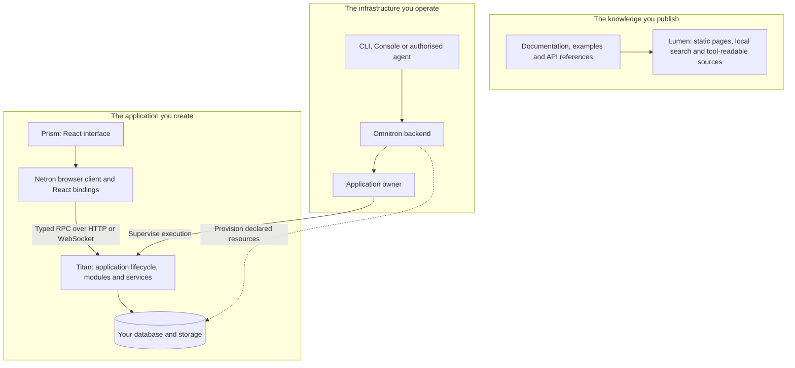

# One platform, from application to operation

Omnitron is a full stack with explicit boundaries. You can develop an
application, connect its clients, document its contracts and operate its
processes using the same platform. You choose where it runs and where data
is stored. [Privacy and ownership](./privacy.md) explains why that is the
starting point of the design.

## The layers {#the-layers}

**Titan runs inside an application. Omnitron supervises applications.** Netron
is the communication core used at both levels, with different services and
permissions. A user's application session does not grant access to the
management API. Lumen publishes knowledge independently; reading a static
manual does not require a running supervisor.

The operations diagram shows resident execution. The detailed
[node and fleet architecture](../omnitron/architecture.md) explains the
backend, owner, guardian, OS supervision and update boundaries.

## A request, end to end {#a-request-end-to-end}

1. A Prism interface uses the Netron browser client, directly or through React bindings.
2. The client sends a service call to the application's configured HTTP or WebSocket endpoint.
3. The service boundary authenticates the caller, authorises the operation and validates inputs according to the registered application contract.
4. Titan resolves the service and its dependencies; application code performs the work.
5. Netron returns a result or a structured error. React bindings update the interface.

A shared TypeScript service interface gives the caller compile-time types.
Runtime validation and authorisation still need their configured schemas and
policies. Types alone do not validate an arbitrary network message. The
[quickstart](../getting-started/quickstart.md) supplies runnable registration
and transport setup.

A management request follows a separate path: operator → backend → owner or
infrastructure provider. Keeping these paths distinct allows application
permissions and infrastructure permissions to evolve independently.

## Package responsibilities {#where-each-package-lives-in-this-picture}

| Layer | Package | Owns |
| --- | --- | --- |
| Application runtime | `@omnitron-dev/titan` | Modules, dependency injection, lifecycle and server-side Netron |
| Browser communication | `@omnitron-dev/netron-browser` | Browser RPC transports and client contracts |
| React integration | `@omnitron-dev/netron-react` | Query, mutation and subscription bindings |
| Interface | `@omnitron-dev/prism` | Shared components, themes, layouts and interaction patterns |
| Knowledge | `@omnitron-dev/lumen` and companion packages | Document compilation, navigation, local search, interactive islands and exports |
| Operations | `@omnitron-dev/omnitron` | Projects, stacks, processes, releases, infrastructure, CLI, Console and MCP |
| Capabilities | `@omnitron-dev/titan-*` | Optional database, authentication, scheduling, metrics and other modules |
| Shared primitives | Common, CUID, events, MessagePack and testing packages | Reusable building blocks used across the platform |

[Xec](https://xec.sh/) provides the execution and automation foundation used
by Omnitron workflows. Titan's database integration uses
[Kysera](https://kysera.dev/) for its database abstractions. These related
projects have their own APIs and release boundaries; they do not require a
hosted Omnitron control plane.

## Cross-cutting contracts {#cross-cutting-concerns}

- **Privacy:** configured destinations determine where data goes; running the
  control plane does not require vendor analytics or a cloud account.
- **Security:** typed APIs, input validation, authentication and operation
  authority work together. A private network alone is not authorisation.
- **Reliability:** lifecycle ownership, readiness, durable state and observed
  recovery results have separate contracts. Starting a process is not the same
  as accepting a healthy deployment.
- **Reuse:** client interfaces, server modules, operator surfaces and
  documentation share the same platform components instead of maintaining
  independent implementations of their contracts.

Use the [monorepo map](./monorepo.md) to locate implementations and
[Titan vs Omnitron](./titan-vs-omnitron.md) to choose a supervision boundary.
