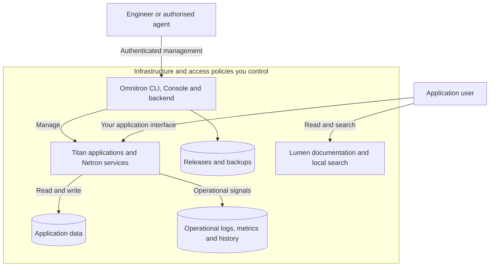

# Your system. Your boundary.

Omnitron exists for people who want to build and operate a complete system
without handing its control plane or operational data to a software vendor.
You choose the machines, storage, network and people who can administer it.
There is no required Omnitron cloud account or vendor-hosted control service.

This is the reason for the full stack. **Titan** runs application logic,
**Netron** connects it, **Prism** builds its interface, **Lumen** publishes its
knowledge, and the **Omnitron supervisor** operates its processes and
infrastructure. The same system can run on a development machine, private
servers or cloud machines you administer. The hosting choice remains yours.

## Privacy is an architectural boundary {#privacy-is-an-architectural-boundary}

The built-in operational telemetry is for **your operators**: application
logs, process measurements and deployment history. The local relay writes to
the configured Omnitron log collector. Fleet replication sends records to your
configured controller. These paths do not require a product-analytics account
or an Omnitron-operated collection endpoint.

Self-hosting makes this boundary inspectable; it does not automatically keep
every application private. Your application code, integrations, hosting
provider and network policy determine the rest of its data flows.

## Know where each kind of data goes {#know-where-each-kind-of-data-goes}

| Data | Owner and destination | What you decide |
| --- | --- | --- |
| Application records and media | Your application's database and object storage | Access, retention, encryption and backups |
| Application stdout, stderr and lifecycle events | Local delivery journal, configured log storage and optional fleet replication | What the application emits, who can read it and how long it is kept |
| Process metrics and control history | Node storage and the configured controller database | Fleet membership, access and retention |
| Source and release artifacts | Working trees, installed runtime directories and configured release storage | Registry, build machines, artifact access and release selection |
| Backups | The destination selected in your backup configuration | Schedule, retention, recovery access and deletion |
| Credentials | The configured secret provider and credentials needed by authorised processes | Provider, keys, rotation and process access |
| Documentation search | The static search index in the reader's browser | Which content is published; private content must be excluded before publication |

Operational records can contain sensitive data. A private destination does not
make a password safe to log. Limit capture at the source and grant diagnostic
access deliberately. See [observability](../omnitron/observability.md),
[secrets](../omnitron/cli.md#secrets-encrypted-at-rest) and [backups](../omnitron/cli.md#backups).

## Connections are part of the design {#connections-are-part-of-the-design}

Running the control plane does not require contact with an Omnitron cloud.
Other connections have specific purposes:

- **Installation and provisioning** can download packages, Node.js, source or
  container images from the configured registries and upstream distribution
  services. A self-hosted runtime is not the same as an offline installer.
- **Remote administration** connects to nodes you register. SSH host identity
  and RPC authority are separate checks. A successful SSH login alone does not
  authorise every operation in Console.
- **Fleet observability** connects nodes to the controller and storage you
  configure. A controller can be a workstation or a server in a management
  network; its location is not prescribed by the software vendor.
- **Optional integrations** can contact external mail, storage, monitoring or
  application services when configured. Review their destinations as part of
  your own deployment.

This manual serves its fonts and search index with the site. Search runs
locally. Following an external source link leaves the site, and opening a
map example can contact the tile provider selected by that example. Static
hosting also has its own access-log policy.

## Control must remain accountable {#control-must-remain-accountable}

Privacy, security and reliability address different questions:

| Question | Mechanism |
| --- | --- |
| Who receives the data? | Explicit storage and network destinations under your control |
| Who may change the system? | Authenticated RPC, operator roles, private local sockets and trusted node identities |
| What did an operation actually change? | Scoped plans, recorded revisions, release identities and operation receipts |
| What survives a control-plane interruption? | In resident mode, independent application ownership, durable journals and supervised backend recovery |
| How do we recover from an update? | Retained artifacts, reviewed rollback and observed readiness; application data migrations need their own recovery plan |

CLI, Console and agent integrations use the same backend services. An agent
must receive the authority appropriate to its task. Connecting an agent or
using typed RPC does not make its instructions trustworthy or its actions
infallible. The [access model](../omnitron/auth-rbac.md) and
[operation scopes](../omnitron/projects.md) define the concrete boundaries.

## Full stack, without mandatory adoption of every layer {#full-stack-without-mandatory-adoption-of-every-layer}

Use the complete platform when you want one coherent route from application
code to operation. Use individual packages when they solve a narrower problem:
a Titan service can run under Node.js directly, and a Lumen manual can be served
as static files. The supervisor is optional for those uses.

The platform uses open-source dependencies and system facilities; it does not
claim to eliminate the software supply chain or the need to secure the host.
Its responsibility is to make its own boundaries explicit and reviewable.
The [full-stack map](./architecture.md) shows how the packages fit together;
[inside a node](../omnitron/architecture.md) shows where control and execution live.
