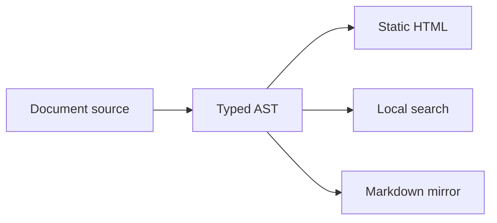

# Authoring with Lumen

Keep the document useful as static HTML. Add an island where interaction helps the reader inspect a result.

## Stable routes and headings

```markdown
---
title: Connection lifecycle
slug: /manual/connections
---
# Connection lifecycle

## Shutdown {#shutdown}

Close the client after the last request.
```

A leading slash makes `slug` an absolute site route. A relative slug is resolved from the document directory. An `index.md` uses its parent route. `id` names the document in the corpus and sidebar; it is separate from the public route.

Use explicit heading IDs when other pages or external readers depend on a link. Repeated automatic headings receive unique numeric suffixes. Duplicate explicit IDs are errors.

## One source, multiple readers

:::note{title="Keep the contract visible"}
State ownership, prerequisites, failure behavior and cleanup next to the example. Search and agent exports see the same public document tree.
:::



Mermaid diagrams use the real browser engine, including its ELK layouts. Static
HTML retains readable diagram source. The client registers `MermaidDiagram` and
loads the engine when the island becomes visible; invalid diagrams show an error
and retain their source. The shared helper is available from
`@omnitron-dev/lumen-ast/diagrams`. It requires a browser DOM for SVG rendering;
PDF and Markdown exports currently retain diagram source. Put labels with punctuation in quotes, for example `A["Infrastructure (Docker / bare-metal)"]`. Mermaid escape codes use `#quot;` or `#40;`, without an HTML `&` prefix. On narrow screens, scroll the diagram horizontally or expand its source.

## File trees

Use the built-in file tree block for directory layouts. Keep filenames in inline
code and descriptions in ordinary Markdown; folders with children use native
keyboard-accessible disclosure controls and start expanded.

```markdown
:::filetree{title="my-service/"}
- `src/` — application source
  - `main.ts` — entry point
  - `modules/`
    - `users.module.ts` — feature module
- `package.json` — dependencies and commands
:::
```

The block renders as static HTML. Nested lists, filenames and annotations remain
readable in search, Markdown and PDF exports; files are not pretend links.
This is a Lumen build directive. Prism ResearchEditor preserves it as opaque
source; the standalone ResearchDocument reader reports an unknown directive
rather than rendering a file tree.

## Selective React islands

A PDX widget declares literal props. The site's client entry registers its React component with `LumenShell`; the shared portal runtime activates it at the declared trigger.

```jsx
<ApiExplorer hydrate="load" />
```

This site's [API explorer](../reference/api-index.mdx) is a working island backed by a generated public export inventory. The rest of the document remains server-rendered and readable without JavaScript.

Supported activation triggers are `load`, `idle`, `visible` and `interaction`.
Props cross a strict JSON boundary shared by SSR and the browser through
`@omnitron-dev/lumen-ast/islands`. Unsupported values, cycles and oversized props
fail explicitly; they are not silently converted to different values. Arbitrary document expressions are not application code. Import and register application components in the trusted client entry.

## Inspect inferred types

A `typescript twoslash` fence requests analysis from the actual TypeScript language service. The caret points to the symbol on the preceding line:

```typescript twoslash
const doubled = [1, 2, 3].map(value => value * 2);
//    ^?
```

The annotation above is generated during this site's build. It is not a handwritten type label. Analysis uses the compiler's packaged standard libraries in a standalone virtual file; it does not execute the code or import this website's workspace dependencies.

## Mathematical documents

Inline mathematics such as $E = mc^2$ and display equations use KaTeX:

$$
\sum_{i=1}^{n} i = \frac{n(n+1)}{2}
$$

This site's client entry imports `@omnitron-dev/prism/components/research/styles.css`, so Vite publishes the shared math stylesheet and its fonts with the other local assets. No font CDN is required.

For a paper, set `pdf.paperSections` to the document IDs or source paths you want, then run:

```bash
lumen pdf --outDir papers
```

The command writes one PDF per selected public document using the offline Typst compiler. Unsupported mathematical commands fail explicitly. HTML `katexMacros` do not define PDF macros; diagram blocks retain their source in PDF output.

## Run an isolated example

This JavaScript snippet runs inside a dedicated browser worker with a capability-free
QuickJS runtime. It has no network, DOM, filesystem or host credentials. Editing the
snippet changes only this local example; it does not call an Omnitron service.

<Playground hydrate="visible" code="return [1, 2, 3].map(value => value * 2)" />

Try returning an object, then try `while (true) {}` to inspect the timeout. A failed
run is reported as an error. Recorded output is never substituted for execution.

## Verify the result

Run `lumen check` while authoring, then build and inspect the actual output. A parser accepting a widget is not evidence that its registered component loaded; exercise it in the production preview. Check keyboard focus, narrow viewports and both color themes.
