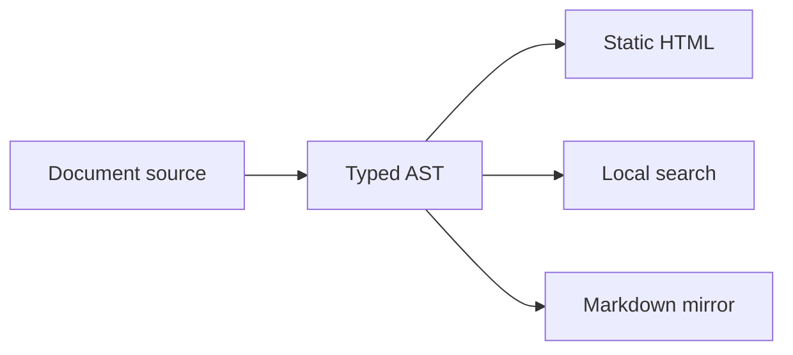

# Authoring with Lumen

Keep the document useful as static HTML. Add an island where interaction helps the reader inspect a result.

## Stable routes and headings

```markdown
---
title: Connection lifecycle
slug: /manual/connections
---
# Connection lifecycle

## Shutdown {#shutdown}

Close the client after the last request.
```

A leading slash makes `slug` an absolute site route. A relative slug is resolved from the document directory. An `index.md` uses its parent route. `id` names the document in the corpus and sidebar; it is separate from the public route.

Use explicit heading IDs when other pages or external readers depend on a link. Repeated automatic headings receive unique numeric suffixes. Duplicate explicit IDs are errors.

## One source, multiple readers

:::note{title="Keep the contract visible"}
State ownership, prerequisites, failure behavior and cleanup next to the example. Search and agent exports see the same public document tree.
:::



## Selective React islands

A PDX widget declares literal props. The site's client entry registers its React component with `LumenShell`; the shared portal runtime activates it at the declared trigger.

```jsx
<ApiExplorer hydrate="load" />
```

This site's [API explorer](../reference/api-index.mdx) is a working island backed by a generated public export inventory. The rest of the document remains server-rendered and readable without JavaScript.

Supported activation triggers are `load`, `idle`, `visible` and `interaction`. Arbitrary document expressions are not application code. Import and register application components in the trusted client entry.

## Run an isolated example

This JavaScript snippet runs inside a dedicated browser worker with a capability-free
QuickJS runtime. It has no network, DOM, filesystem or host credentials. Editing the
snippet changes only this local example; it does not call an Omnitron service.

<Playground hydrate="visible" code="return [1, 2, 3].map(value => value * 2)" />

Try returning an object, then try `while (true) {}` to inspect the timeout. A failed
run is reported as an error. Recorded output is never substituted for execution.

## Verify the result

Run `lumen check` while authoring, then build and inspect the actual output. A parser accepting a widget is not evidence that its registered component loaded; exercise it in the production preview. Check keyboard focus, narrow viewports and both color themes.
