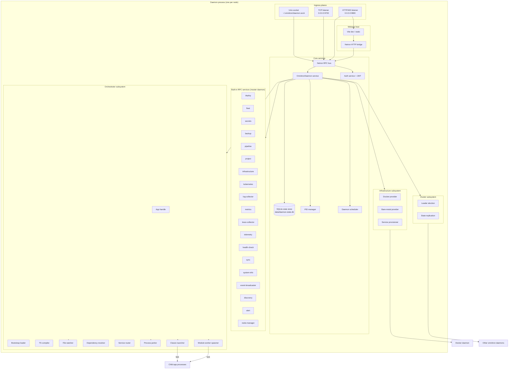
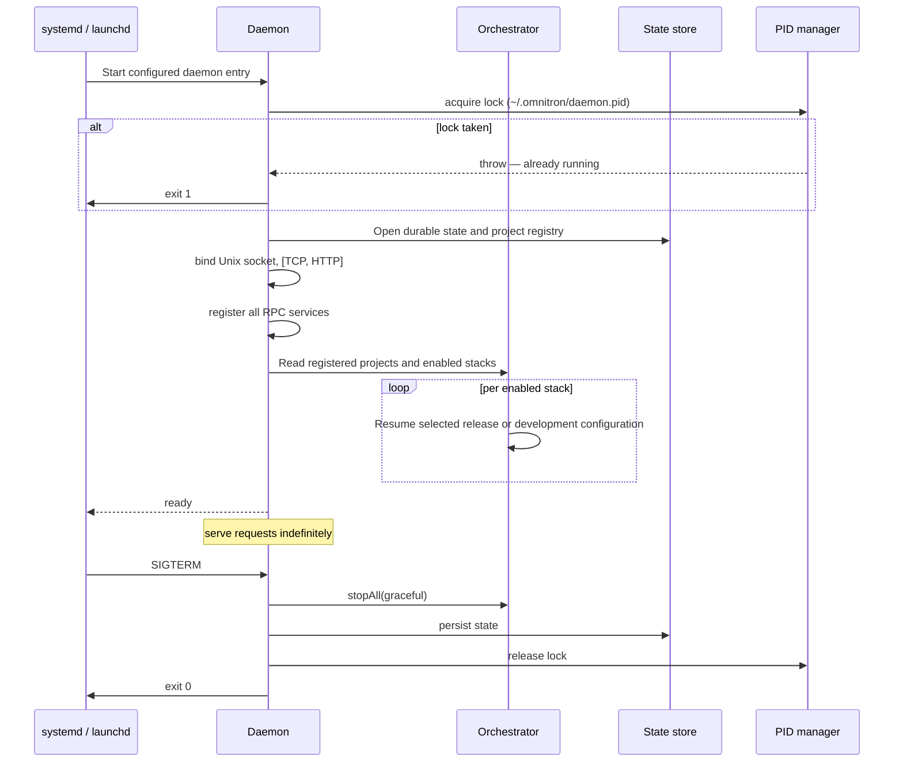
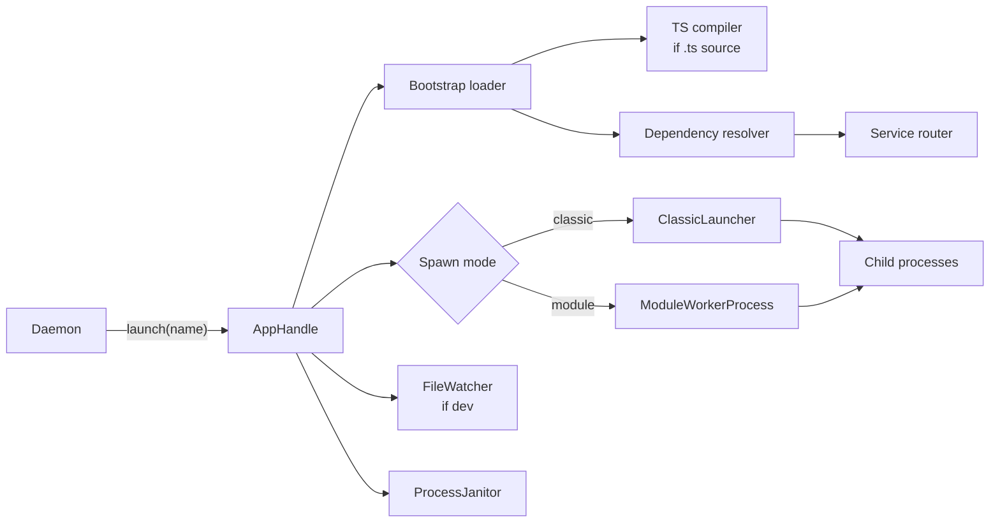
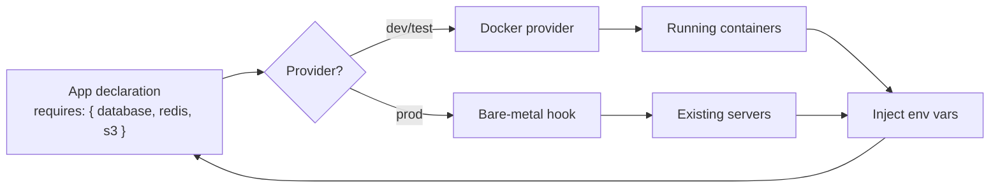
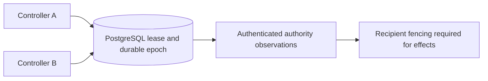
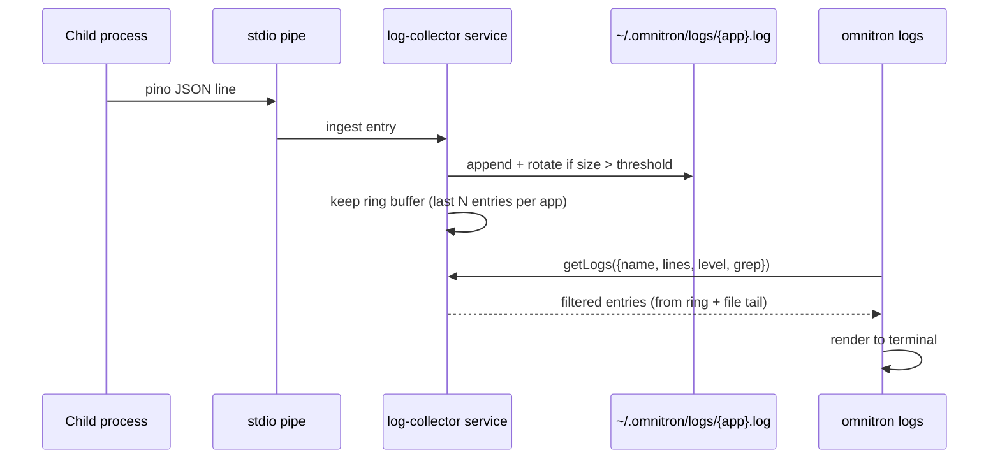
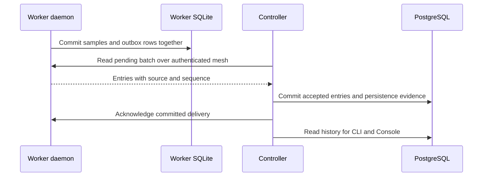
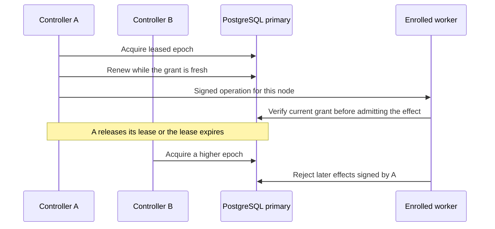

# Architecture

Omnitron exposes one control plane per node through Netron RPC. Its backend
provides authentication, project ownership, infrastructure management and
observability. In coupled mode it also owns application processes. In
[resident execution mode](./backend-handoff.md), a separate process owns forks,
workers, pools and local topology while the backend uses a fenced private RPC
contract. The diagram below describes the default coupled deployment.

See the [resilient control-plane design](./resilient-control-plane.md) for the target
contracts for environment promotion, placement, recovery and scaling. Its capability
gates distinguish implemented behavior from planned autonomous operations.

## Component map {#component-map}



## The three planes {#the-three-planes}

Omnitron exposes three independent transports — same Netron RPC
surface, different network shape.

### 1. Management plane — `unix://~/.omnitron/daemon.sock` {#1-management-plane--unixomnitrondaemonsock}

Unix domain socket, file mode `0o600` (owner-only). The **trust
boundary**: if you can open the socket, you've already passed the
OS-level identity check. CLI calls auth-bypass through this
socket for ergonomics.

| Carries                       | Used by                                  |
| ----------------------------- | ---------------------------------------- |
| All built-in RPC services     | `omnitron` CLI                           |
| The `OmnitronDaemon` service  | Webapp dev (when running locally)        |
| MCP server requests           | Agent processes spawned by the CLI       |

### 2. Public TCP plane — `tcp://0.0.0.0:9700` {#2-public-tcp-plane--tcp00009700}

Opt-in. Disabled by default; enable when:
- You run a fleet (other daemons connect for cluster membership).
- You operate `omnitron remote` (alias-addressed daemons).
- You expose a programmatic API to an external CI/CD.

JWT is **required** on this plane. RBAC roles
(`viewer` / `operator` / `admin`) gate every method.

### 3. HTTP / WS plane — `http://0.0.0.0:9800` {#3-http--ws-plane--http00009800}

Opt-in. The daemon's HTTP plane is the **Netron HTTP + WebSocket
bridge** that browser clients use. With the default `httpPort`
of `9800`, the daemon binds the HTTP bridge on `httpPort + 1`
(`:9801`) and the WebSocket transport on `httpPort + 2`
(`:9802`); the public `:9800` is fronted by the `omnitron-nginx`
container, which serves the static bundle and reverse-proxies
`/netron/*` and `/ws` to those daemon ports.

JWT is required for RPC, except for static asset routes (served
by nginx) and the unauthenticated `signIn` / `validateToken` /
`refreshSession` methods.

## Daemon lifecycle {#daemon-lifecycle}



The state-store is the **persistent intent** — what should be
running. On crash + restart, the daemon reads `state.json` and
relaunches anything that was alive at last write.

## State store — `state.json` {#state-store--statejson}

A single JSON file capturing:

```typescript
interface DaemonState {
  apps: Record<string, {
    name:        string;
    status:      'starting' | 'running' | 'stopped' | 'crashed';
    pid?:        number;
    startedAt?:  number;
    lastError?:  string;
    restarts:    number;
    processes:   Record<string, ChildProcessState>;
  }>;
  cluster?: {
    role:    'master' | 'follower';
    leader?: string;
    term:    number;
  };
}
```

Persisted on every status transition, atomic-rename style
(`write tmp → rename → fsync` parent). If the file is corrupt at
boot, the daemon starts fresh — empty apps map — and logs a
warning.

## PID manager {#pid-manager}

Owns `~/.omnitron/daemon.pid`. Responsibilities:

- **Lock acquisition** at boot: open exclusive, write `process.pid`.
  If lock fails, another daemon is running — abort.
- **Liveness sweep**: periodically check whether the lock-holding
  PID is still alive; if not, reclaim the lock.
- **Atomic ownership transfer** during `cluster.step-down` — the
  outgoing leader explicitly releases.

Child process PIDs are owned by the orchestrator (per `IAppHandle`),
not the PID manager.

## Daemon scheduler {#daemon-scheduler}

A small in-process scheduler bound to the daemon's lifecycle.
Runs periodic tasks:

| Task                                  | Default interval |
| ------------------------------------- | ---------------- |
| Health probe sweep across all apps    | 15 s             |
| Metrics aggregation tick              | 5 s              |
| State persistence flush               | on transition + 30 s baseline |
| Crash-loop backoff timer              | per-app, exponential |
| Cluster heartbeat (if cluster.enabled)| 2 s              |
| Health-monitor sweep (cluster nodes)  | 60 s             |

All scheduler timers are `.unref()`-ed so they don't block
shutdown.

## Orchestrator subsystem {#orchestrator-subsystem}

Owns the per-app launch pipeline. One `AppHandle` per running
app:



Two launch modes:

- **Classic launcher** — `node bootstrap.js` is forked once;
  bootstrap is responsible for creating all `Application`s and
  running its own subprocess management. Used for legacy apps.
- **Module-worker spawner** — one fork per `IProcessEntry`. Each
  child imports a single module file and runs `Application.create`
  directly. Default for new apps; lower memory, faster boot.

→ Full pipeline: [Orchestrator](./orchestrator.md).

## Built-in RPC services {#built-in-rpc-services}

A daemon exposes services according to its configured role. A worker registers a reduced core set —
the PostgreSQL-backed services (`OmnitronAuth`, `OmnitronAlerts`,
`OmnitronTelemetry`, `OmnitronFleet`, `OmnitronDiscovery`,
`OmnitronPipelines`, `OmnitronTraces`, `OmnitronDeploy`,
`OmnitronNodes`) are master-only. All services share
authentication / authorization with the `OmnitronDaemon` service.

The first column is the **Netron service name** (the identifier
clients resolve, e.g. `daemon.OmnitronAuth.signIn(...)`).

| Service               | Purpose                                                    |
| --------------------- | ---------------------------------------------------------- |
| `OmnitronDaemon`      | App lifecycle — start / stop / restart / status / inspect  |
| `OmnitronAuth`        | JWT issue / verify / RBAC                                  |
| `OmnitronSecrets`     | Encrypted secret CRUD                                      |
| `OmnitronInfra`       | Docker container management (Postgres / Redis / etc.)      |
| `OmnitronDeploy`      | Legacy operation history; per-app mutations refuse          |
| `OmnitronFleet`       | Cross-node fleet operations                                |
| `OmnitronPipelines`   | CI/CD pipeline runs                                        |
| `OmnitronBackups`     | Database backup / restore                                  |
| `OmnitronProject`     | Project + stack registry                                   |
| `OmnitronKubernetes`  | k8s integration (apply / scale / observe)                  |
| `OmnitronNodes`       | Infrastructure node inventory (node-manager)               |
| `OmnitronLogs`        | Per-app log streaming + filtering                          |
| `OmnitronMetrics`     | Metrics aggregation (from `titan-metrics`)                 |
| `OmnitronTraces`      | Distributed trace ingestion                                |
| `OmnitronTelemetry`   | Telemetry-relay (`titan-telemetry-relay`) aggregator       |
| `OmnitronHealth`      | Active health-check runs                                   |
| `OmnitronDiscovery`   | Service discovery state                                    |
| `OmnitronEvents`      | Cross-process event bus (WebSocket subscriptions)          |
| `OmnitronAlerts`      | Alert rules + delivery                                     |
| `OmnitronSync`        | Cross-daemon state synchronisation                         |
| `OmnitronSystemInfo`  | Host CPU / RAM / disk inventory                            |
| `OmnitronCluster`     | Daemon participation and enrolled controller election              |

→ Full reference: [Services reference](./services-reference.md).

## Infrastructure subsystem {#infrastructure-subsystem}

When an app's `omnitronConfig.infrastructure` declares a
requirement, the daemon's infrastructure subsystem:

1. Checks if the requirement is already satisfied (running
   container, registered bare-metal service).
2. Resolves connection parameters (host / port / credentials).
3. Provisions if missing — Docker for dev/test, bare-metal hooks
   for prod.
4. Injects resolved env vars (`DATABASE_URL`, `REDIS_URL`, …) into
   the app at startup.



→ Reference: `omnitron infra status` shows current containers;
the [Infra CLI section](./cli.md#infrastructure) covers commands.

## Cluster subsystem {#cluster-subsystem}

Optional programmatic `cluster.enabled: true` uses the same writable PostgreSQL
as the fleet registry to arbitrate controller leases. The store commits owner,
incarnation and epoch before acknowledging authority. There is no peer gossip
protocol, anonymous voting or independent consensus log.



The lease lasts 15 seconds by default and is renewed every 2 seconds. Loss of
confirmation demotes the controller. Database mutations can be fenced in the same
transaction; remote effects need durable recipient-side fencing. Normal master/slave
fleet operation is independent of this optional mode. See [cluster coordination](./cluster.md)
and the [release delivery gates](./release-readiness.md) for implemented boundaries.

## Webapp host {#webapp-host}

The React console is served by a dedicated `omnitron-nginx`
container — **not** by the daemon process itself. The daemon's
HTTP plane carries only the Netron RPC bridge; nginx serves the
static bundle and proxies RPC to the daemon:

| Mode             | Served by                                          | Command               |
| ---------------- | -------------------------------------------------- | --------------------- |
| **Production**   | `omnitron-nginx` container fronting `apps/omnitron/webapp/dist/` | `omnitron webapp build` then `omnitron webapp start` |
| **Dev**          | Vite dev server with HMR                            | `pnpm dev` in `apps/omnitron/webapp/` |

nginx (`:9800`) proxies `/netron/*` to the daemon's HTTP listener
(`httpPort + 1`, default `:9801`) and `/ws` to the daemon's Netron
WebSocket transport (`httpPort + 2`, default `:9802`). In dev mode
Vite serves the console on `:9810` and proxies the same two paths to
the same daemon ports, so the browser asks for `/netron/*` and `/ws`
on its own origin either way and the client hard-codes neither. See
[Console](./console.md) for the full port map.

## Auth model — three roles {#auth-model--three-roles}

The `OmnitronDaemon` service and others use role-based access:

| Role         | What they can do                                                     |
| ------------ | -------------------------------------------------------------------- |
| `viewer`     | Read-only: list / status / inspect / metrics / health / logs        |
| `operator`   | Viewer + lifecycle: start / stop / restart / reload / scale / exec  |
| `admin`      | Operator + destructive: shutdown / reloadConfig / setMetricsEnabled |

The local Unix socket bypasses auth — local CLI calls run as the
implicit `admin` (OS-level trust). TCP/HTTP planes always require
JWT.

## Data flow — log shipping {#data-flow--log-shipping}



Logs flow through the daemon — no separate log shipper. The
ring buffer means `omnitron logs --follow` returns recent entries
immediately even if the file has been rotated.

## Data flow — metrics aggregation {#data-flow--metrics-aggregation}



The controller stores its own samples directly through Titan's PostgreSQL adapter. Each source retains unacknowledged worker entries. See [replication and receipts](./cluster.md).

## Data flow — leader election (cluster mode) {#data-flow--leader-election-cluster-mode}



An administrator can request a transfer with `omnitron cluster step-down`. The current controller demotes and releases its epoch. A successor reports leadership after PostgreSQL confirms its grant.

## Database and diagnostics boundaries {#database-and-diagnostics-boundaries}

Kysera implements reusable database mechanisms. Titan supplies module lifecycle,
connection and transaction context. Omnitron exposes application-facing migration
commands and operational diagnostics. Applications provide schema definitions
and domain policies; Console displays the same health data as CLI.

See [migrations](./migrations.md) for adopting existing journals and
[diagnostics](./diagnostics.md) for error capture and notification adapters.

## Putting it together {#putting-it-together}

Read these in order for a complete picture:

1. **[Daemon](./daemon.md)** — the always-on process; its
   internals.
2. **[Orchestrator](./orchestrator.md)** — how apps launch.
3. **[Services reference](./services-reference.md)** — every RPC
   method.
4. **[CLI](./cli.md)** — the operator's daily interface.
5. **[Console](./console.md)** — the web UI.
