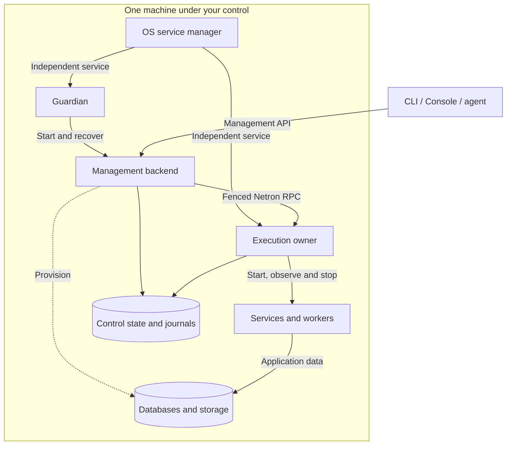
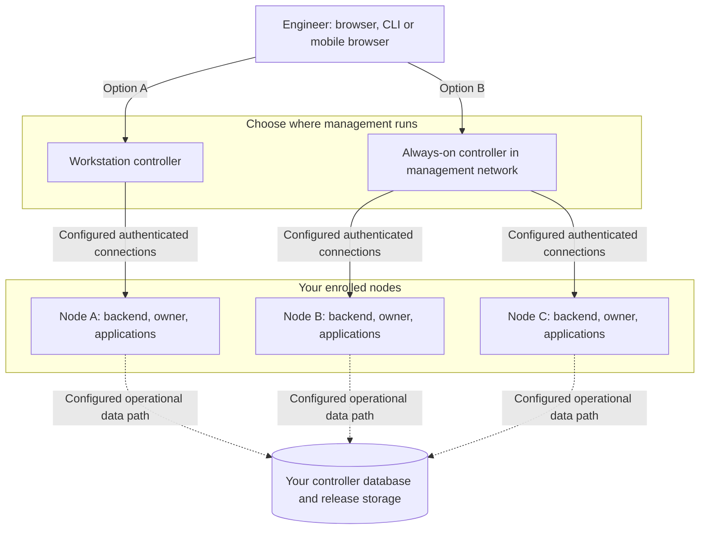
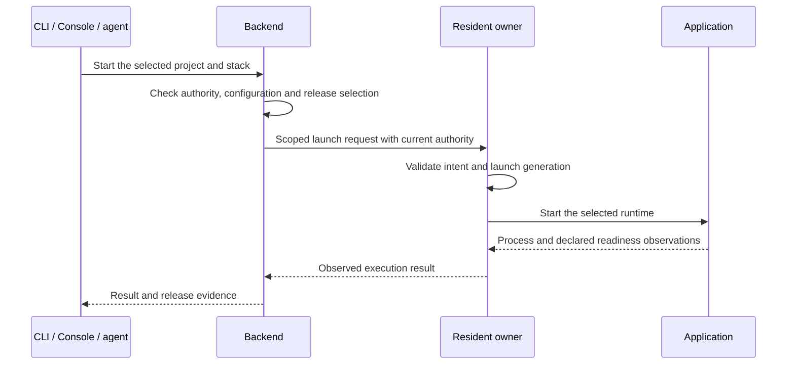
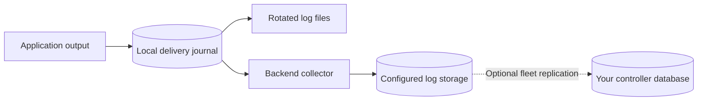

# Inside a node. Across your fleet.

A **node** is a machine running an Omnitron instance. A **stack** is a selected
set of applications and infrastructure for a project. Your workstation can
manage its own stacks and remote nodes; a dedicated management server can do
the same without depending on an open laptop.

The control plane belongs to your installation. No Omnitron-operated cloud is
required between you and those machines. See [privacy and ownership](../foundations/privacy.md)
for where operational data goes, and the [full-stack map](../foundations/architecture.md)
for how Titan, Netron, Prism and Lumen fit around the supervisor.

## One node, three distinct jobs {#component-map}

In **resident mode**, the backend accepts management requests, the owner
supervises applications, and the guardian supervises the backend. Separating
these jobs lets a compatible backend update preserve running application
processes.

The state cylinder groups several stores; it is not one shared transaction.
Each component owns its own durable records. Docker, PostgreSQL and application
data have their own lifecycles.

| Component | Plain-language job | Does not mean |
| --- | --- | --- |
| **Backend** | Receives commands, checks authority, manages projects, releases and diagnostics | The process that must parent every application |
| **Owner** | Holds application processes, workers, pools and development watches | An administrator account or a project owner |
| **Guardian** | Keeps the selected backend generation supervised and coordinates its replacement | A second machine or a high-availability cluster |
| **OS service manager** | Supervises owner and guardian independently on the host | Protection against losing the host or its disk |
| **Console** | Shows backend observations and sends authorised requests | An independent source of application state |

Default **coupled mode** keeps execution in the backend process. It does not
have resident mode's application-preserving backend replacement. Enabling
resident mode initially requires an application restart. Managed resident
supervision currently targets macOS and Linux. Read the
[handoff contract](./backend-handoff.md) before choosing an update path.

## Explore the failure boundaries {#failure-boundaries}

<RuntimeArchitecture hydrate="visible" />

These are explanatory scenarios, not a live connection to your machines.
A lost control connection means **unknown**, not stopped. Replacing the owner
is a separate operation from replacing only the backend and requires an
application maintenance window.

## Read the execution card in Console {#console-execution-card}

For a card such as `Owner PID 12871 · epoch 134 · active`:

| Field | Meaning | How to use it |
| --- | --- | --- |
| **Owner PID** | The owner process ID on that machine | Diagnose that process; a PID alone is not a durable identity |
| **Epoch** | A generation of the local owner/controller authority grant | Distinguish old authority from the currently accepted grant; it is not a package version or an application restart counter |
| **Active** | The phase of that execution-control grant | It does not prove that every application is healthy |
| **Independent OS supervision** | The owner and guardian have separate host service supervision | A backend restart need not tear down the application process tree |
| **Guardian PID** | The local process supervising backend generations | Diagnose backend supervision separately from application supervision |
| **Last owner observation** | When the backend last obtained an owner observation | Judge freshness; a stale observation is not evidence that processes have stopped |

Application and stack names are chosen by their projects. They are not extra
roles in this diagram. Application health, release confirmation and controller
connectivity are separate observations.

## From a workstation to a private fleet {#cluster-subsystem}

These are placement options, not an instruction to create two competing
controllers. Choose a controller topology and authority policy. A controller
in a DMZ needs explicit firewall routes to its enrolled nodes; putting a host
in a DMZ does not itself create a security boundary.

**Fleet** supplies inventory and remote operations. **Cluster coordination**
optionally supplies a PostgreSQL-backed authority lease. Neither automatically
moves a database, migrates running processes to another host or makes all
operations safe under network partition. Each operation needs recipient-side
authority checks and an observed outcome. The [cluster guide](./cluster.md)
describes the implemented contracts.

Closing a browser or losing a workstation connection does not by itself stop
resident applications on a remote node. Live management and observations need
the connection to return. Applications also remain subject to their own data
and network dependencies.

## Follow a launch request {#orchestrator-subsystem}

The orchestrator resolves the selected application graph and launches its
processes. Development mode can build sources and watch changes; a selected
release runs its retained artifact. A successful fork, a passing health probe
and a confirmed release are different claims. Use the resulting observations
rather than treating a submitted command as success.

## Connections to the node {#the-three-planes}

Netron supplies the RPC contracts. Transports and caller identity determine
how a client reaches them; an application RPC service and the management API
have separate authority boundaries.

### Local management socket {#1-management-plane--unixomnitrondaemonsock}

The local management path is normally `~/.omnitron/daemon.sock`. Its filesystem
permissions restrict access to the instance account. Local socket access is
privileged; do not share it with an untrusted process merely because that
process is local.

### Remote RPC {#2-public-tcp-plane--tcp00009700}

The configured TCP listener serves authenticated remote clients. The default
host setting is `127.0.0.1`; a usable remote deployment needs an intentional
listener and network policy. RPC authentication is not transport encryption:
configure the secure network or transport appropriate to the deployment.

### Browser RPC {#3-http--ws-plane--http00009800}

In the standard hosted Console setup, nginx serves the web bundle and proxies
Netron HTTP and WebSocket requests to the backend. With `httpPort: 9800`, the
public Console is on `9800` and backend bridge ports are `9801` and `9802`.
Use the [configuration guide](./configuration.md) for the selected host and
ports; these numbers do not prescribe public Internet exposure.

### Authentication and roles {#auth-model--three-roles}

The daemon's `viewer`, `operator` and `admin` roles control management methods.
Authentication endpoints have their own policy. The same backend checks apply
whether the request originates in CLI, Console or an agent adapter. See
[authentication and RBAC](./auth-rbac.md).

## Start, replace and recover {#daemon-lifecycle}

A resident startup establishes the owner, guardian and selected backend,
reconciles durable project intent and observes applications. A compatible
backend handoff checks the candidate, records a checkpoint, transfers control
and verifies recovery while the owner remains alive.

An **owner update** stops and recreates the application execution host. Its
plan must name the stacks to restart, those to leave stopped, infrastructure
to retain and the previous artifacts needed for recovery. A backend rollback
cannot undo an application database migration. Full host failure requires
restoring the host and its durable data, not just reconnecting Console.

### Process identity {#pid-manager}

PID files and private runtime records identify local processes. Operations
also bind to owner identity, authority generation and runtime evidence. A
reused PID must not be treated as proof that the previous process survived.

### Durable state {#state-store--statejson}

Control state is SQLite-backed. The backend's `data/daemon-state.db` stores
registries and intent; resident execution has its own `execution/state.db`.
The runtime selector has a separate `runtime/state.db`. Log delivery uses
separate journals. The old `state.json` setting is an import path for legacy
state, not the current authoritative storage model.

Persisted intent says what should run. Process observations say what was
actually seen. A saved observation cannot prove a process is alive now.
Do not erase control state to resolve an unknown outcome.

### Scheduled work {#daemon-scheduler}

Scheduled diagnostics, backups and reconciliation have their own execution
and resource costs. The update admission checks outstanding operations before
retiring their controller. Long-running work needs bounded execution and a
recorded outcome; a periodic timer alone is not durable scheduling.

## Infrastructure stays a separate lifecycle {#infrastructure-subsystem}

The backend resolves declared resources and calls their infrastructure
provider. Docker manages containers and volumes; a database manages its own
durable records. The application owner manages application execution.

A reviewed application restart can retain the existing containers and data.
An infrastructure declaration change may require a separate container update.
Check native resource identity, volume retention and backup recovery in the
plan rather than assuming all restarts have the same effect. See
[infrastructure](./infrastructure.md) and [release readiness](./release-readiness.md).

## Operator services and Console {#built-in-rpc-services}

Project, release, backup, file, terminal and monitoring services expose scoped
backend operations. The [service reference](./services-reference.md) lists
their method contracts; availability depends on the daemon role and configuration.

### Console hosting {#webapp-host}

Console is a Prism/React client. Its frontend can be replaced independently
of an application release, but the frontend/backend contract must remain
compatible. Its tables and health cards show backend observations, including
whether those observations are fresh.

## Follow operational data {#data-flow--log-shipping}

Delivery consumers acknowledge their own progress. Records must remain until
required consumers confirm delivery. A disconnected collector can therefore
leave a backlog and consume disk space. This is operational data under your
storage policy, not a required vendor analytics feed.

### Metrics {#data-flow--metrics-aggregation}

Process observations enter local history and a replication outbox. The
controller pulls pending records and persists the resulting history. A chart
should distinguish missing samples from a healthy zero. The
[observability guide](./observability.md) covers collection, retention and storage diagnostics.

### Cluster authority {#data-flow--leader-election-cluster-mode}

When enabled, PostgreSQL serializes acquisition and renewal of the controller
lease. Its epoch belongs to cluster authority and is distinct from the local
owner epoch shown in Console. Supported recipients validate authority before
performing protected effects. This is not an independent consensus quorum or
a general guarantee of automatic failover. See
[authority and effect fencing](./cluster.md#authority-and-effect-fencing).

### Control storage and application storage {#database-and-diagnostics-boundaries}

A control-plane database stores operations and observations. An application
database stores that application's records. Select the project and stack when
diagnosing a database; a green controller database does not establish that a
project database is reachable, healthy or backed up.

## Put the pieces together {#putting-it-together}

Start with the [configuration](./configuration.md) and
[project/stack model](./projects.md), then choose a
[release workflow](./releases.md). Use [backend replacement](./backend-handoff.md)
for controller updates and its separate owner-transition procedure when the
execution host must change. The [resilient control-plane design](./resilient-control-plane.md)
marks proposals and capability gaps explicitly; it is not a list of guarantees
already provided by every installation.
