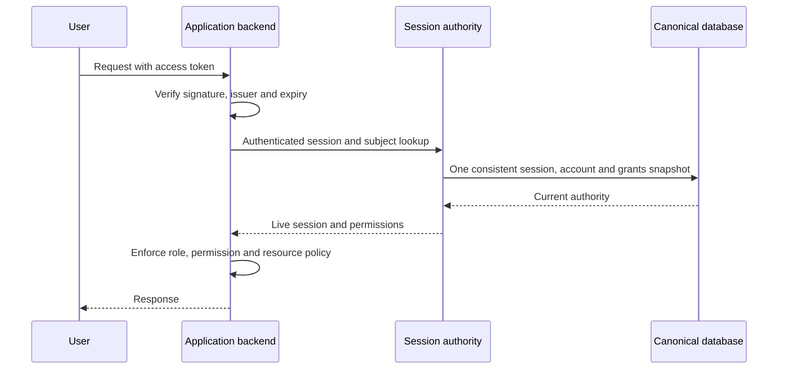

# Auth & RBAC

:::info
This page covers the **operator-flavoured** auth surface
(CLI, webapp, MCP, service-to-service). For the framework-
agnostic authorisation primitives (permission grammar,
per-user overrides, ABAC conditions, RLS bridge, audit
trail), start at [Authentication & Authorisation](../auth/index.md).
:::

Omnitron authenticates human operators and machine identities on the control plane. [Console access](./access.md) documents the implemented account-management flow shared by webapp and CLI. Examples about end-user identity below are application integration patterns; they are not additional Console login methods.

## Three identity surfaces

| Surface | Trust source | Auth flow |
| ------- | ------------ | --------- |
| Local CLI | OS-level file permission (Unix socket `0o600`) | Implicit admin — no JWT needed |
| Webapp / remote CLI | JWT issued by `OmnitronAuth.signIn` | Bearer token on every HTTP/TCP call |
| Service-to-service (cluster, fleet, sync) | Node-specific signing secret reached over the registered SSH connection | Short-lived `service_role` JWT on an authenticated peer |

Apps in your ecosystem add a **fourth** surface — end users
authenticating against one of your apps. The recommended
pattern (used by the production reference) is:

| Your surface | Trust source | Auth flow |
| ------------ | ------------ | --------- |
| End-user HTTP / WS calls | JWT issued by *your* identity app | Same JWT verified by every app in the fan-out |

## Three RBAC roles

| Role | Inherits | What they can do |
| ---- | -------- | ---------------- |
| `viewer` | — | Read-only: list / inspect / status / metrics / health / logs |
| `operator` | `viewer` | Viewer + lifecycle: start / stop / restart / reload / scale |
| `admin` | `operator`, `viewer` | Operator + arbitrary execution, SSH, automation, shutdown / reloadConfig / secrets / setMetricsEnabled |

Replication ingestion and outbox acknowledgements require administrator or
service authority. Operators can inspect diagnostics but cannot forge persistence
evidence or release queued records.

Methods declare explicit role lists through `VIEWER_ROLES`, `OPERATOR_ROLES` and `ADMIN_ROLES`. The shared hierarchy in `@omnitron-dev/access/roles` also supports live principal checks at account and terminal boundaries. Unknown roles receive no implicit grants.

Human token validation on the master reads the current account role from PostgreSQL. An old JWT role claim cannot preserve a demoted role. `OmnitronAccess.describe()` derives the UI catalog from the running services' decorators and Titan authorization rules. See [revocation behavior](./access.md#change-roles-and-revoke-sessions).

```typescript
// From the daemon RPC service:
@Public({ auth: { roles: VIEWER_ROLES } })   // ['admin','operator','viewer']
async list(): Promise<ProcessInfoDto[]> { /* ... */ }

@Public({ auth: { roles: OPERATOR_ROLES } }) // ['admin','operator']
async startApp(...) { /* ... */ }

@Public({ auth: { roles: ADMIN_ROLES } })    // ['admin']
async shutdown(...) { /* ... */ }

@Public({ auth: { allowAnonymous: true } })  // no token required
async ping() { /* ... */ }
```

→ See [Daemon / RPC surface](./daemon.md#rpc-surface--omnitrondaemon-service)
for the full method-by-method role map.

## Shared JWT across fan-out apps

One identity owner issues user tokens; each backend verifies their signature
and asks the owner for the current session and grants. Signature validity alone
does not establish current authority. Keep human and service credentials under
explicit issuer control, and isolate signing credentials by trust boundary.



## Shared auth factory pattern

Use the shipped [shared-session preset](../titan/modules/shared-session.md)
and provide an application-owned `sessionAuthority(sessionId, userId)` adapter.
The owner reads its database directly; other backends call the protected
`SessionAuthority` service. Share bootstrap wiring in one workspace package,
while keeping policy definitions in the browser-safe Access layer.

Registry compatibility mode supports `sessionRedis` and `sessionLookup`, but
never restores cache entries automatically. Cache restoration and revocation
must share a serialization protocol. A Redis hit does not prove that a newer
database revocation or permission edit was propagated.

## Token cache

The shared-session preset and Omnitron daemon disable authentication-result
caching. Signature verification can be cached independently. Netron revalidates
persistent token-backed peers before each invocation, so a live role change
reaches the method gate without reconnecting. Expiry also bounds cached results
when a different application explicitly enables caching.

Authority-store failures remain 503. They do not permit stale authorization.
In-flight operations retain the context they were admitted with; critical
mutations must additionally use transaction-level ownership and authority checks.

## Token binding via `cnf.fp`

Standard JWT auth has one weakness: a stolen short-lived token
works until it expires. **`cnf.fp` binds the JWT to a refresh
chain** — if the chain rotates or revokes, the JWT becomes
invalid immediately even before expiry.

How it works:

1. Identity app issues a refresh token, records its id `rtid`.
2. When minting the access JWT, it stamps
   `cnf.fp = HMAC(secret, rtid)` into the JWT claims.
3. Every backend, after verifying signature + session, also:
   a. Looks up the session's **currently active** refresh-token id
      from the canonical authority snapshot.
   b. Computes `HMAC(secret, currentRtid)`.
   c. If `cnf.fp` doesn't match → reject as 401.

Result: if the refresh chain rotates (user signed in elsewhere)
or revokes (user changed password), the JWT immediately stops
working without waiting for `exp`.

```typescript
createJwtAuthManager({
  // ...
  cnfHmacSecret: process.env.JWT_SECRET,  // typically the same JWT signing key
});
```

The HMAC secret is conventionally the same as the JWT signing
key — one rotation surface handled by the `kid` mechanism.

## Refresh token rotation

```mermaid
sequenceDiagram
  participant Client
  participant Auth as identity app

  Client->>Auth: POST /sign-in
  Auth-->>Client: { access: JWT(short), refresh: rtid_1 }
  Note over Client: rtid_1 stored in HttpOnly cookie

  loop access expires
    Client->>Auth: POST /refresh (rtid_1)
    Auth->>Auth: mark rtid_1 used; create rtid_2
    Auth-->>Client: { access: JWT(cnf.fp = HMAC(rtid_2)), refresh: rtid_2 }
    Note over Client: rtid_1 now used; only rtid_2 is presentable
  end

  Note over Client: token stolen and used after refresh
  Note over Auth: stolen JWT carries cnf.fp(rtid_1); session's<br/>currently-active is rtid_2 → mismatch → 401
```

Refresh tokens are **one-use** — using `rtid_N` invalidates it
and produces `rtid_N+1`. Reuse of an old refresh token is a
strong signal of token theft.

## Multi-key JWT verification (rotation without downtime)

```typescript
JwtModule.forRoot({
  algorithm: 'HS256',
  jwtSecret: 'current-key',                  // legacy / fallback
  verificationKeys: {
    'k2025-01': 'older-key-still-valid',
    'k2025-04': 'current-key',
    'k2025-07': 'next-key',
  },
});
```

When issuing, set `kid: 'k2025-04'` in the JWT header. Verifiers
pick the matching key by `kid`. Rotate by:

1. Add new key under a new `kid`.
2. Start signing with new `kid` (everywhere — coordinated deploy).
3. Wait for all old-key tokens to expire (`exp`).
4. Remove old key from `verificationKeys`.

Zero downtime, zero forced sign-outs.

## RLS context propagation

The Netron auth manager populates `authContext` in invocation
metadata; the **invocation wrapper** maps that into a kysera RLS
scope so Postgres policies see the right session variables.

```typescript
// Shared wrapper:
import { mapAuthToRLSContext } from '@omnitron-dev/titan/netron/auth';
import { rlsContext }          from '@omnitron-dev/titan-database/rls';

export function createRlsInvocationWrapper() {
  return async (metadata: Map<string, unknown>, fn: () => Promise<unknown>) => {
    const authCtx = metadata.get('authContext') as AuthContext | undefined;
    if (authCtx) {
      const rlsCtx = mapAuthToRLSContext(authCtx, {
        defaultTenantId: (authCtx.metadata as any)?.tenantId ?? 'default',
      });
      return rlsContext.runAsync(rlsCtx, fn);
    }
    return fn();
  };
}

// In every app's bootstrap:
auth: {
  jwt: { enabled: true, tokenCacheTtl: 60_000 },
  invocationWrapper: createRlsInvocationWrapper(),
},
```

Now every database query — from any `@Service` method, over any
transport — runs inside an AsyncLocalStorage scope that exposes
`user_id`, `is_system`, `tenant_id` to RLS policies. Repositories
pick this up automatically via the kysera RLS plugin.

:::note One wrapper, two places that apply it
`transport/http/server.ts` applies it per request. Every socket
transport — WebSocket, TCP, Unix — dispatches through
`remote-peer.ts`, which applies it per invocation on the `CALL`
branch and builds a metadata map of the same shape, so a wrapper
written against HTTP works unchanged.

Until recently only the HTTP half existed, and a call arriving
over WebSocket ran with **no RLS context**. That failed closed
rather than open — kysera gives `SELECT` an impossible predicate
and lets `UPDATE` / `DELETE` touch no rows — so it surfaced as a
realtime page that was simply empty, which is why it lasted: the
wrong answer looked like no data rather than an error.
:::

## Role hierarchy patterns for end-user RBAC

For your application's own role system (separate from the
operator roles above), declare a hierarchy and let library
functions handle precedence:

```typescript
// packages/auth-utils/src/role-hierarchy.ts
export const ROLE_PRIORITY = {
  guest:     0,
  user:      10,
  contributor: 20,
  moderator: 50,
  admin:     100,
} as const;

export type RoleName = keyof typeof ROLE_PRIORITY;

export function effectiveLevel(roles: readonly RoleName[]): number {
  return Math.max(0, ...roles.map(r => ROLE_PRIORITY[r] ?? 0));
}

export function canModerateUserWithRole(
  actor: readonly RoleName[],
  target: readonly RoleName[],
): boolean {
  return effectiveLevel(actor) > effectiveLevel(target);
}

export function visibleRolesFor(viewerRoles: readonly RoleName[]): RoleName[] {
  const cap = effectiveLevel(viewerRoles);
  return (Object.keys(ROLE_PRIORITY) as RoleName[]).filter(r => ROLE_PRIORITY[r] <= cap);
}
```

Centralised hierarchy = no per-feature ad-hoc checks. Tiered
visibility (search results, profile views) and tiered moderation
(who can ban whom) compose from these primitives.

## Anonymous and service-to-service endpoints

Three auth shapes per method:

```typescript
// 1. Public — anyone with socket access
@Public({ auth: { allowAnonymous: true } })
async ping() { /* ... */ }

// 2. Authenticated user — any logged-in user
@Public({ auth: { roles: ['user', 'admin'] } })
async getProfile() { /* ... */ }

// 3. Service-to-service — for inter-app calls
@Public({ auth: { roles: ['admin', 'operator', 'service_role'] } })
async receiveBatch(data: SyncBatch) { /* ... */ }
```

The master-to-node path is implemented in `cluster/mesh-link.ts` and `cluster/slave-connector.ts`. It uses the node's registered SSH connection to obtain that node's signing secret, mints an HS256 JWT with issuer `omnitron` and role `service_role` (five-minute default lifetime), then authenticates the persistent peer. Each RPC must explicitly permit that identity. `CONTROL_PLANE_ROLES` and `CONTROL_PLANE_READ_ROLES` make the distinction reusable.

Machine identity is outside the human role hierarchy. It does not grant account administration or interactive SSH. Do not create a human account with `service_role`, reuse a Console session as a machine credential, or infer machine access from a role rank.

## API key pattern (for headless integrations)

For CI agents, partner integrations, or scripted clients that
shouldn't go through interactive sign-in:

```typescript
// In your identity app:
async createApiKey(userId: string, scopes: string[], expiresAt?: Date) {
  const apiKey = `pk_${crypto.randomBytes(32).toString('base64url')}`;
  const hash   = await argon2.hash(apiKey);
  await db.insertInto('api_keys').values({ userId, hash, scopes, expiresAt }).execute();
  return apiKey;     // returned ONCE; not stored in plaintext anywhere
}

async verifyApiKey(presented: string): Promise<AuthContext | null> {
  // Look up by prefix (first 8 chars) for fast filter
  const candidates = await db.selectFrom('api_keys')
    .where('hashPrefix', '=', presented.slice(3, 11))
    .selectAll().execute();
  for (const row of candidates) {
    if (await argon2.verify(row.hash, presented)) {
      return buildAuthContext(row.userId, row.scopes);
    }
  }
  return null;
}
```

Then in your auth manager, accept either JWT or API key:

```typescript
if (token.startsWith('pk_')) return verifyApiKey(token);
return verifyJwt(token);
```

API keys carry their own scope list — narrower than JWT roles —
so a compromised key only opens the doors you've granted it.

## TOTP / WebAuthn second factor

For human users (especially admins), require a second factor on
sign-in:

```typescript
async signIn({ email, password, totpCode }) {
  const user = await this.users.verifyPassword(email, password);
  if (!user) throw Errors.unauthorized('invalid credentials');

  if (user.totpEnabled) {
    if (!totpCode) return { requires2fa: true };
    const ok = await verifyTotp(user.totpSecret, totpCode, /* window */ 1);
    if (!ok) throw Errors.unauthorized('invalid 2FA code');
  }

  return this.createSession(user);
}
```

WebAuthn / passkeys are stronger; same flow shape.

Console currently has no MFA enrollment or verification flow. The stored `totpEnabled` / `pgpEnabled` fields do not implement one. `requiresMfa` is not an enforced Titan RPC option. A future second-factor gate must verify proof server-side, bind it to the current session and enforce it in the shared authorization path before a UI can advertise it.

## Auth in WebSockets

WS auth is verified on the **upgrade request** only:

```typescript
ws.on('upgrade', async (req) => {
  const token = extractBearer(req) ?? extractCookieToken(req);
  if (!token) return ws.reject(401);
  const authCtx = await authManager.verify(token);
  ws.context = authCtx;
});
```

After upgrade, Netron retains the credential privately and revalidates its
authority before each invocation. Changed roles reach the method gate; revoked
or expired credentials are refused. Authentication credentials are never exposed
in the serialized context.

For token rotation while a socket is open: the client receives
a `token.expiring-soon` push, refreshes the token via HTTP, and
reconnects WS. The application may also use an explicitly enabled authentication task;
HTTP cookie-only applications should retain their established refresh flow.

## Private runtime storage

On POSIX systems, runtime directories are sealed to `0700` and state, backup and
journal files to `0600`. Sealing opens the target without following a leaf symlink,
checks its type and owner, changes permissions on that open file and verifies the
result. Shared hard-linked files and incompatible owners are refused. A failed
permission change is an operation failure, not a successful insecure backup.

The main file must exist. Missing optional SQLite `-wal`/`-shm` companions are
allowed; other access errors propagate. Do not use symlinks as substitutes for
private runtime files. These checks are POSIX-specific; Windows deployments need
an equivalent owner-only ACL policy. They do not turn a writable parent directory
into a sandbox against a privileged local process.

## Audit logging

The daemon stores control-plane events through `AuditService`. The current wire fields are `action`, `resourceType`, `resourceId` and `details`; actor identity comes from the request context. Read events through Console's **Audit** page or `omnitron audit`.

Account creation, role changes and session revocation write their audit rows in the same PostgreSQL transaction as the mutation. An audit failure rolls them back. Interactive SSH requires a successful audit write before host trust changes or session opening; lifecycle completion is best effort. Many older operational paths still use best-effort audit to preserve availability. These guarantees differ and must not be represented as a universal fail-closed audit policy.

Tokens, passwords, SSH keys, commands and terminal transcripts are excluded from the new account/terminal audit details. The database trail is not a tamper-evident external archive; deployments requiring that property need a separately controlled audit sink.

## Anti-patterns

- **Auth check in custom HTTP routes that's weaker than the RPC
  surface.** Always call the same access predicate (`assertAccess`,
  `requireRole`) from both paths.
- **Tokens in URLs.** Show up in proxy logs, browser history,
  referer headers. Always use `Authorization: Bearer`.
- **No `cnf.fp` on high-value operations.** A 15-min JWT is fine
  for read APIs; for destructive actions, prefer token-binding so
  rotation invalidates immediately.
- **Skipping RLS for "internal" services.** Internal callers
  carry their own AuthContext; even the identity app's own
  queries benefit from RLS as defense in depth.
- **API keys without scopes.** A scope-less API key is a
  full-power credential in disguise. Always require a scope list.
- **One key for everything.** Separate keys per integration so
  rotation / revocation is granular.
- **Logging tokens.** Even at debug level, JWTs in logs let
  anyone with log access impersonate users. Log `kid` + `code`
  on failures, never the full token.
- **`allowAnonymous: true` on a mutating endpoint.** Be explicit;
  read-only auto-discovery is fine, but anything that writes
  state should require auth.

## See also

- [Daemon / Auth flow](./daemon.md#auth-flow) — the daemon's own auth
- [Console access](./access.md) — account management and effective permissions
- [SSH workspace](./terminal.md) — pinned terminals and ownership
- [Services reference](./services-reference.md) — `OmnitronAuth`, `OmnitronAccess` and terminal methods
- [Best practices / Shared authentication](./best-practices.md#shared-authentication-across-apps)
- [`titan-auth`](../titan/modules/auth.mdx) — JWT module reference
- [`titan-database`](../titan/modules/database.mdx) — RLS plugin
