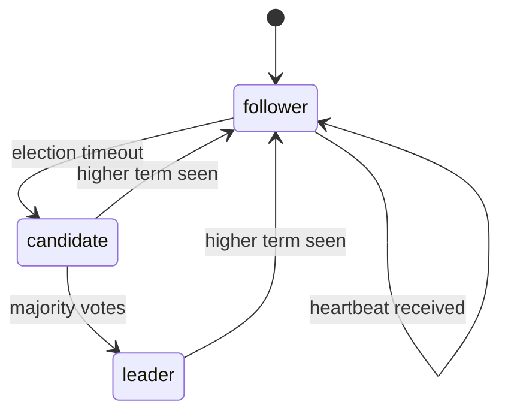
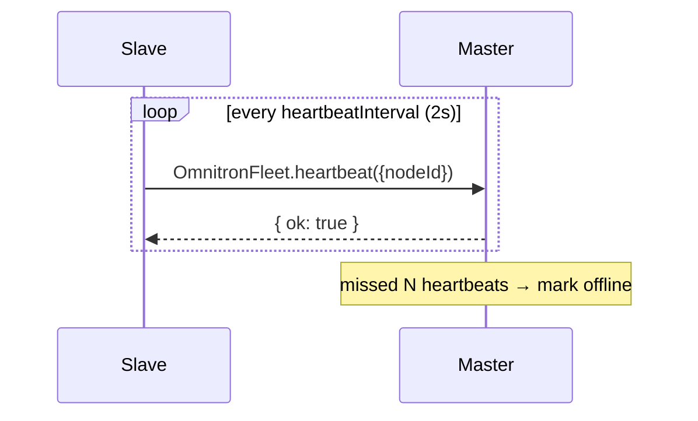
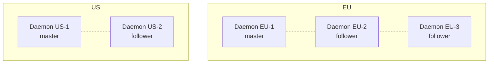

# Cluster + fleet

When you run Omnitron on more than one node, two subsystems
coordinate them: **cluster** (leader election, control-plane
consistency) and **fleet** (node inventory, cross-node queries).

This page covers both. Single-node operators can skip — none of
this runs without `cluster.enabled: true` or fleet nodes
registered.

Verified against `apps/omnitron/src/cluster/` and
`apps/omnitron/src/services/{fleet,sync,node-manager}.rpc-service.ts`.

## Two roles, two layers

| Layer | Concept | Service id |
| ----- | ------- | ---------- |
| Cluster | Leader / follower among a small set of daemons | `OmnitronCluster` |
| Fleet | Node inventory, cross-node fleet ops | `OmnitronFleet`, `OmnitronNodes` |
| State sync | Daemon-to-daemon batch replication | `OmnitronSync` |

A daemon in `role: master` is the control plane. A daemon in
`role: slave` runs autonomously and syncs back to master via
`OmnitronSync`. Within a cluster, a single master is elected at
any moment via `OmnitronCluster`.

## When to use what

| Setup | Use |
| ----- | --- |
| Single machine, no HA needed | Neither — default `role: master`, no cluster |
| Multiple machines, no leader concept (each daemon independent) | Fleet — register nodes, query across them |
| Multiple machines, one needs to be the canonical master with auto-failover | Cluster — leader election, state replication |
| Multi-region with autonomous edges syncing to a central master | Fleet + master-slave role pattern (no cluster needed) |

## Leader election — `LeaderElection`

A simplified Raft variant designed for small clusters (2–5
daemons), with longer timeouts than classic Raft because the
infrastructure-control workload doesn't need millisecond
consensus.

### State machine



### Election parameters

| Parameter | Default |
| --------- | ------- |
| `electionTimeout` | `5 000 – 15 000 ms` (jittered) |
| `heartbeatInterval` | `2 000 ms` |
| Election majority | `floor(N/2) + 1` |

Defaults from
`apps/omnitron/src/cluster/leader-election.ts`:

```typescript
const DEFAULT_CONFIG: ElectionConfig = {
  electionTimeout:    { min: 5_000, max: 15_000 },
  heartbeatInterval:  2_000,
};
```

### Election sequence

```mermaid
sequenceDiagram
  participant F as Follower
  participant Peers as Peer daemons
  participant Fleet as Fleet registry

  Note over F: heartbeat absent for electionTimeout
  F->>F: state := candidate; term++
  F->>Peers: VoteRequest{candidateId, term}
  Peers-->>F: VoteResponse{granted, term}
  alt majority granted
    F->>F: state := leader
    F->>Fleet: write role := master
    loop heartbeatInterval (2s)
      F->>Peers: LeaderHeartbeat{leaderId, term, configHash}
    end
    F->>F: emit 'leader:elected'
  else higher term seen
    F->>F: state := follower; term := higherTerm
  end
```

### Configuration

```typescript
// IDaemonConfig.cluster
cluster: {
  enabled:           true,
  discovery:         'redis' | 'static',
  peers?:            ['10.0.1.10:9700', '10.0.1.11:9700'],
  electionTimeout?:  { min: 5_000, max: 15_000 },
  heartbeatInterval?: 2_000,
}
```

Discovery providers:
- **`'redis'`** — peers register in a shared Redis key; auto-discovery.
- **`'static'`** — explicit `peers` array.

### Events emitted by `LeaderElection`

```typescript
'state:changed':  (state, previousState) => void;
'leader:elected': (leaderId, term)       => void;
'leader:lost':    (previousLeaderId)     => void;
'term:changed':   (term)                 => void;
```

Subscribe via `daemon.cluster.on(...)` for cluster-aware app
behaviour.

## `OmnitronCluster` RPC service

Five methods, all related to election + state:

| Method | Auth | Effect |
| ------ | ---- | ------ |
| `getClusterState()` | anonymous | Current election state — `{nodeId, state, term, leaderId, votedFor, peers, uptime}` |
| `requestVote({candidateId, term})` | anonymous | Inter-daemon vote request |
| `leaderHeartbeat({leaderId, term, configHash?})` | anonymous | Leader-to-follower heartbeat |
| `stepDown()` | operator | Force the local leader to step down → triggers new election |
| `isLeader()` | operator | `{leader, nodeId, term}` — quick leadership check |

All five carry `@Public({ auth: { allowAnonymous: true } })` except
the operator-facing methods. Anonymous methods are for
daemon-to-daemon comm; operator methods are for human / CLI use.

### CLI

```bash
omnitron cluster status        # → getClusterState()
omnitron cluster step-down     # → stepDown()
```

Sample `getClusterState()` output:

```json
{
  "nodeId":   "node-1",
  "state":    "leader",
  "term":     7,
  "leaderId": "node-1",
  "votedFor": "node-1",
  "peers":    3,
  "uptime":   1843200
}
```

### Step-down semantics

`stepDown()` is graceful:
1. Stop sending heartbeats.
2. Transition local state to `follower`.
3. Followers detect missing heartbeats, elect a new leader.

Total downtime: typically ≤ one `electionTimeout` window
(5–15 s).

## Config sync — `ConfigSyncService`

The leader replicates ecosystem config to followers so they hold
a consistent view. On every config change:

1. Leader computes a content hash.
2. Heartbeats carry the hash.
3. Followers compare; if mismatched, pull the fresh config from
   the leader.
4. Followers apply locally (replacing their own).

Conflict resolution: **leader always wins** for config. Follower
local changes are overwritten — followers are not expected to be
the source of truth.

## `OmnitronFleet` RPC service — node inventory

Distinct from clusters. A fleet is any set of registered nodes;
they don't need leader election.

| Method | Auth | Effect |
| ------ | ---- | ------ |
| `listNodes()` | viewer | All registered fleet nodes |
| `getNode({nodeId})` | viewer | One node by id |
| `getSummary()` | viewer | Aggregate health, counts |
| `registerNode(registration)` | operator | Add a node to the fleet |
| `removeNode({nodeId})` | operator | Remove |
| `setRole({nodeId, role})` | operator | Promote / demote |
| `drainNode({nodeId})` | operator | Drain workloads off this node |
| `heartbeat({nodeId})` | anonymous | Daemon-to-daemon liveness ping |

### `FleetNode`

```typescript
interface FleetNode {
  id:       string;
  hostname: string;
  address:  string;
  role:     'master' | 'slave';
  status:   'online' | 'offline' | 'draining';
  lastSeen: number;
  // ... metadata (CPU/RAM snapshots, app counts)
}
```

### Heartbeat flow



The fleet's offline-detection threshold is driven by
`DEFAULT_DAEMON_CONFIG.healthMonitor.offlineTimeoutMs`
(`90_000 ms` default).

## `OmnitronNodes` — extended node management

The fleet service holds the live registry; `OmnitronNodes` holds
the **registered inventory** (declared nodes, SSH credentials,
health history). They overlap but serve different purposes.

Key method categories:

- **Inventory**: `listNodes`, `getNode`, `addNode`,
  `updateNode`, `removeNode`.
- **Connectivity**: `checkNodeStatus`, `checkAllNodes`,
  `triggerNodeCheck`.
- **History**: `getCheckHistory`, `getUptimeBar`,
  `getNodeHealthSummaries`.
- **SSH**: `listSshKeys`.
- **Check config**: `getCheckConfig`, `setCheckConfig`
  (ping/SSH/omnitron timeouts).

### Uptime bars

`getUptimeBar({nodeId, bucketCount?, intervalMs?})` returns
historical health bucketed into time segments. The webapp uses
this for the green/yellow/red availability bars.

| Param | Default (RPC method) |
| ----- | -------------------- |
| `bucketCount` | `60` |
| `intervalMs` | `300_000` (5 min per bucket) |

Each bucket reports ping / omnitron uptime as a `0.0–1.0`
percentage. (The daemon's health-monitor worker keeps a longer
retention window — `retentionDays: 90`, `uptimeIntervalMs:
86_400_000` — but those govern check storage, not this method's
default windowing.)

## State sync — `OmnitronSync` service

The master-slave replication mechanism. Slaves locally collect
metrics, logs, traces and alert events. The master pulls batches over the
authenticated Netron connection every 15 seconds, ingests them, then acknowledges
the accepted, duplicate or explicitly discarded IDs. Failed entries remain pending.

| Method | Effect |
| ------ | ------ |
| `receiveBatch(batch)` | Master accepts a sync batch from a slave |
| `drainBuffer({limit?})` | Slave-side: pull pending data without waiting for periodic sync |
| `ackDrained({ids, receipt?})` | Atomically release IDs and record their committed, discarded or unverified outcome |
| `getSyncStatus()` | Measured queue bytes/age, durable receipt history, contiguous progress and recorded losses |

### Connection credentials

The built-in mesh dialer mints a five-minute `service_role` credential for each node. It renews that credential on the same Netron peer 30 seconds before expiry, coalescing concurrent calls and heartbeat reads. The SSH tunnel and running operations remain in place. The node independently checks the signed identity and its expiry on every invocation.

Credential renewal has a ten-second deadline. Failure prevents dispatch of the waiting operation and reconnects with a fresh credential; it does not replay an application mutation. A rejected signature clears the cached node signing secret, while a transport timeout does not claim the secret is wrong. Mesh status exposes `credentialExpiresAt`, `credentialRefreshedAt` and `lastCredentialError`, without credential material. CLI and Console distinguish an expired identity from a healthy authenticated connection.

Update the master before nodes when introducing per-call token expiry: older masters cannot renew an admitted peer's identity. A custom dialer can provide `refreshCredential` and `expiresAt`; non-renewable credentials require a new connection after expiry. A plain unauthenticated connection can probe liveness but cannot replicate.

### Sync config — `ISyncConfig`

```typescript
interface ISyncConfig {
  interval?:  number;     // 30_000 ms — optional slave push cadence, not the master pull interval
  batchSize?: number;     // 1_000 entries per batch
}
```

Designed for **eventually consistent** replication:
- Slaves buffer enabled data categories in local SQLite WAL with `synchronous=FULL`. The configured byte budget can evict the oldest undelivered entries; these losses are recorded.
- Master pull resumes after authenticated reconnect; failed entries remain buffered.
- Connection retry uses exponential backoff; application processes continue independently.
- Idempotent batches — safe to retry.
- Conflict resolution: master timestamp wins for config; slave
  data is append-only.

### Sync flow

```mermaid
sequenceDiagram
  participant Slave
  participant Buffer as Slave buffer
  participant Master

  loop continuously
    Slave->>Buffer: append metric/log/trace/alert
  end
  loop master heartbeat (15s default)
    Master->>Slave: drainBuffer({limit: 1000})
    Slave->>Buffer: read pending entries
    Slave-->>Master: batch (entries remain pending)
    Master->>Master: ingest with deduplication
    alt confirmed outcome
      Master->>Slave: ackDrained({ids})
      Slave->>Buffer: acknowledge confirmed IDs
    else failure
      Master->>Master: retain diagnostic cause; retry later
    end
  end
```

If the master is offline, slave applications continue independently. Replication
retains data up to the configured buffer budget. When the master returns, pending
data drains on subsequent sweeps; the status also preserves evidence of any loss.

### Reading connection, backlog and delivery separately

`omnitron node check <id>` and the Console node details use the same interpretation.
A connected RPC channel proves reachability, not replication. A fresh status is
required before the master reports progress. An empty queue is drained; a recent
acknowledgement with a young queue is keeping up. Old pending data is catching up,
and a queue without a recent acknowledgement is behind. Durations are measured
on the source node so host clock skew does not invent lag.

New nodes report exact UTF-8 payload bytes. `bufferSize` covers pending payloads;
`retainedBufferSize` also includes released entries awaiting retention. Neither
is the filesystem size of SQLite, its indexes or WAL. A singleton maintained by
transactional triggers plus indexed seeks supplies status without scanning the
whole queue on each poll. Legacy schemas use a measured fallback.

The optional `evidence` object survives daemon replacement and normal retention:

| Field | Meaning |
| ----- | ------- |
| `epoch`, `since`, `firstTrackedId` | Scope of the recorded history; no guarantee is inferred for earlier data |
| `producedThrough` | Highest local sequence generated in this buffer |
| `releasedThrough` | Contiguous sequence no longer pending; may include discards or evictions |
| `committedThrough` | Contiguous durable payload receipts from `firstTrackedId`; stops at a pending, unverified or lost entry |
| `committedRows` | Entries confirmed by an initial database commit or later payload-bound reconciliation |
| `discardedRows` | Permanently rejected entries released after recording the refusal |
| `unverifiedRows` | Released entries without durable payload proof |
| `evictedRows` | Undelivered entries removed by local buffer limits |
| `lastCommittedAt`, `lastLossAt` | Persisted timestamps for confirmed commits and known loss |
| `reconciliation` | Later `verifiedRows`, `restoredRows`, `lastReconciledAt` and proof scope (`master` or `source`) |

A zero `unverifiedRows` count covers this recorded epoch from `firstTrackedId`.
Older buffered rows can have `syncOutcome = NULL` because their receiver predates
receipt accounting. That absence does not establish either persistence or loss;
they are outside this reconciliation frontier and are not silently certified.

These sequence fields are strings, preserving integer precision. The frontier
before the first tracked entry means no contiguous receipt has been proven yet.
Counters apply to the stated tracking epoch. Losses remain visible even when the
queue becomes empty; a restart or retention pass must not erase them.

The master persists each receipt's outcome in the same transaction as its data.
A lost reply and a repeated batch retain that outcome: a previous discard never
becomes a committed duplicate. If recording a discard fails, the source keeps
that entry pending. Starting with migration `015_persistent_metrics`, metrics are
written through Titan's PostgreSQL adapter in that same transaction. Successful
receipts therefore prove both the payload and its ledger entry committed. The
original measurement timestamp and authenticated source node are preserved.

On updated slave daemons, Titan's SQLite adapter writes chart history and the
replication outbox in one transaction. A failed outbox write rolls both back;
retries with the same sample IDs do not enqueue duplicates. This replaces the
polling watermark that could skip delayed samples. Chart retention never removes
undelivered outbox entries.

Historical `unverifiedRows` are not automatically promoted by an upgrade. An older
in-memory destination may have received values without persisting their original
samples. Older nodes can receive new durable receipts immediately, but need their
own backend update to gain the atomic local outbox. Buffer limits and known loss
counters continue to apply; see [metrics persistence diagnostics](./observability.md#metric-persistence-and-confirmation).

### Reconcile historical metric receipts

Use `omnitron --json node reconcile <node>` to inspect retained, released metric
entries. Add `--restore` when repairing the identified history is intended.
Pages are bounded by entries and bytes, fix the source epoch/frontier, and return
a keyset cursor. Normal collection and replication continue independently.

A sample matches only when its metric name, application, source node, labels,
original timestamp and value match. Resampled charts are not exact source samples.
Reusing an identity with different content fails the transaction. Missing history
is restored using the same stable sample identity and Titan PostgreSQL adapter as
normal ingestion. Restoring an old point does not replace the latest gauge value.

The master's `sync_reconciliations` journal records a new `present` or `restored`
proof, payload hash, sample identity, source epoch, original ledger outcome,
receipt ID and verification time. Restored samples, proofs and summary counters
commit together. The original `sync_ingested` claim is preserved: a repair today
does not prove that the legacy receiver committed data at its original delivery.

On the source, proof must match the still-retained immutable payload and epoch.
Its journal, the decrement of `unverifiedRows` and increase of `committedRows`
commit in one SQLite WAL/FULL transaction. The acknowledgement reserves the
SQLite writer before reading the source snapshot, so concurrent live ingestion
cannot invalidate a deferred read-to-write upgrade. Original `syncOutcome` and `syncedAt`
are unchanged. Repeated pages and lost responses cannot count or restore an entry
twice. Retry the same cursor after failure; no queue reset or database restore is
needed. Other categories, pruned payloads, rejected entries, conflicting content
and another epoch cannot be certified by this metric recovery path.

The optional journal has its own checksummed `sync_reconciliation_migrations`
history, using the public Omnitron migration runner through Titan/Kysera. It adds
two tables and leaves the core registry unchanged. A reviewed worker built with
the same code can reconcile an older node alongside its running daemon, without
changing application ownership or service units. Pin and verify the worker, use
the node's existing native dependencies, and test reopening its database with the
older runtime first. The normal CLI uses RPC and never installs a worker implicitly.

Restore respects `monitoring.metrics.historyMaxAge`; already committed data missing
after retention is not silently resurrected. A proof records a past commit, not
indefinite payload retention or replica/backup availability. Proof journals retain
hashes and identities independently of chart and queue retention, without full
payloads. While any unresolved historical gap or recorded loss remains, the
contiguous frontier is conservative and can stay at its former boundary. It
advances beyond that uncertainty only when all gaps are settled and no known loss
remains. CLI and Console distinguish verified/restored counts from unresolved
history; an unreadable proof journal remains an explicit diagnostic error.

### Reproducible native node bundles

Prepare native daemon updates beside the running version. A bundle that includes `package-lock.json` is installed with `npm ci --omit=dev`; the installer refuses any change to that lock before publishing the candidate directory. Older bundles without a lock retain their installation path, but their transitive dependency versions are not frozen. Include and validate a lock when preparing a repeatable fleet rollout.

Installation and activation are separate. Installation verifies the archive hash, installs into a fresh sibling, executes its CLI, and records the resulting dependency tree. Reusing that version verifies its complete installation receipt. It does not repair a running release in place. Native dependencies must be built and tested against the target's OS, architecture and Node runtime; a macOS frozen runtime is not a Linux bundle.

A daemon that still owns application processes needs a controlled restart for a full node update. Capture the exact running and stopped application inventory, project boot policy, current framework version, service unit, private state and replication queue first. Each application must declare whether its dependencies are independent or provide a reversible framework-binding contract. Verify both the candidate binding and restoration of the previous binding on isolated copies before maintenance. Preserve application releases, credentials and data during rollback; never restore an old replication database over entries collected after the backup.

Update one node at a time. Verify every previously running application's health, RPC authentication and replication progress before moving to the next node. A running daemon alone does not satisfy this check. The [backend handoff workflow](./backend-handoff.md) becomes available only after a separately prepared resident-owner transition; a normal bundle upgrade does not silently change process ownership or the system account.

### Rolling upgrades and database replacement

Upgrade the master and nodes independently. New masters attach a versioned receipt
with `committedIds` and `discardedIds`; old nodes ignore the extra field. New nodes
still accept old acknowledgements, recording them as unverified. A legacy push
response with only counts releases data only when those counts cover the complete
batch. Partial or ambiguous responses leave the batch pending.

Existing pending IDs stay unchanged during the SQLite migration. Newly appended
entries use a persistent random buffer epoch and sequence on the wire. A new local
database therefore cannot collide with the previous database's IDs in the master
ledger. A receipt from another epoch is refused. Restoring a database snapshot is
not equivalent to creating a new database: restore its entire state together and
coordinate replay with the master. Do not copy tables or reset sequences manually.

SQLite evidence uses the public Omnitron migration runner, backed by Titan and
Kysera. Schema changes and migration history commit together. The migration is
additive and has no destructive automatic rollback. Older masters can acknowledge
new node batches, but their receipts remain unverified. After a node starts emitting
epoch-qualified IDs, downgrading its binary requires an explicit compatibility
plan: an older producer would revert to numeric IDs and could resend a pending
entry under a different ledger key. Backend compatibility checks cover both
master and local-node migration registries. Master migration `014_replication_receipts`
marks historical outcomes unverified because previous discards cannot be inferred
reliably. The deduplication ledger has a retention window; it is not an unlimited
exactly-once archive.

## Multi-region patterns

### Pattern A — one cluster per region



Each region elects its own leader. No cross-region election —
keeps quorum local. Cross-region calls go through ingress; each
region's webapp shows its own state.

### Pattern B — single global cluster


One global cluster with all daemons as peers. Pros: single source
of truth. Cons: cross-region election latency, more sensitive to
partitions.

Pattern A is almost always the right answer above 2 regions.

### Pattern C — fleet without cluster

Each daemon runs as `role: master` independently. Use the
`OmnitronFleet` service to query across them via aliased
addresses. No leader, no global state. Suitable when each
daemon's domain is independent (per-tenant deployments).

## Split-brain handling

Cluster mode's main failure mode: a network partition where both
sides think the other is dead and both elect leaders.

Mitigations:
- **Majority required.** Election requires `floor(N/2) + 1`
  votes — a minority partition cannot elect.
- **Term monotonicity.** Higher-term leader wins; the lower-term
  one steps down on first higher-term message.
- **Operator `step-down`.** If both sides somehow elected, the
  operator can force one side to step down.

For 2-node clusters, prefer manual leader assignment (one
permanent master) rather than auto-election — 2 nodes can't form
a majority when split.

## Operations

| Goal | Command |
| ---- | ------- |
| Check cluster state | `omnitron cluster status` |
| Force re-election | `omnitron cluster step-down` |
| Register a node | `omnitron node add --name N --host H ...` |
| Check all nodes | `omnitron node check` |
| Drain a node | `omnitron --json` then `OmnitronFleet.drainNode` (no CLI shortcut yet) |
| Per-node connectivity | `omnitron node check <id>` |
| Fleet status | `omnitron fleet status` |
| Fleet health | `omnitron fleet health` |
| Fleet metrics | `omnitron fleet metrics` |

## Anti-patterns

- **`cluster.enabled: true` with two daemons.** No majority on
  partition. Use three or skip cluster mode.
- **Mixed roles inside a cluster.** Cluster expects symmetric
  peers. Master / slave roles are for the `OmnitronSync` pattern,
  not cluster election.
- **Heartbeat interval > election timeout.** Followers always
  detect timeout before a heartbeat arrives — perpetual elections.
  Keep `heartbeatInterval` ≤ `electionTimeout.min / 2`.
- **Cross-region cluster without good ICMP.** Frequent split-brain
  symptoms. Use pattern A (one cluster per region).
- **Treating `OmnitronSync` as low-latency RPC.** It's batch
  replication with a 15 s master pull cadence (optional slave push defaults to 30 s). For real-time
  cross-daemon coordination, use direct RPC to the relevant
  service.
- **Editing a slave's `state.json` and expecting it to propagate.**
  Slaves are downstream of master config. Edits get overwritten on
  next sync.

## See also

- [Architecture](./architecture.md#cluster-subsystem) — where
  cluster fits
- [CLI](./cli.md#cluster-leader-election) — `omnitron cluster ...`
- [Services reference](./services-reference.md) — `OmnitronFleet`,
  `OmnitronSync`, `OmnitronNodes`, `OmnitronCluster`
- [Daemon](./daemon.md#daemon-configuration) — cluster config fields
