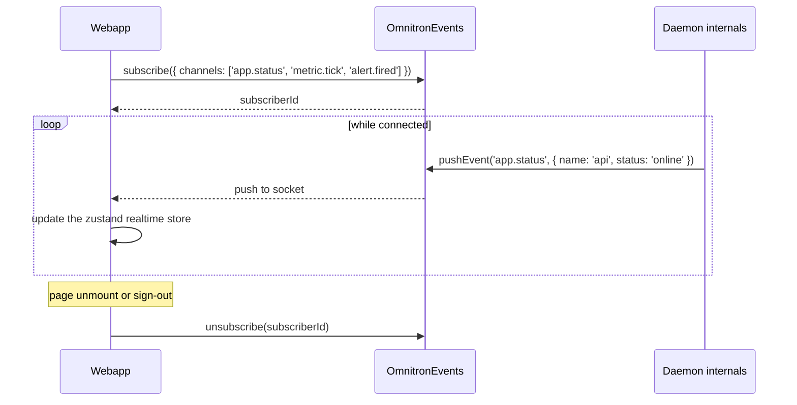

# Web console

The Omnitron webapp at `apps/omnitron/webapp/` (package
`@omnitron/console`) is the visual counterpart of the CLI. It's a
React 19 + Vite + MUI SPA that talks to the daemon via the
`@omnitron-dev/prism/netron` client — the same Netron RPC surface
the CLI uses.

Verified against `apps/omnitron/webapp/src/`.

## One keyboard model

Console uses three levels of focus: **Console → workspace region → control**.
The visible focus ring marks the active control; file selection is independent of
the cursor. The command palette uses the same authorized navigation as the sidebar.
Keyboard commands invoke the existing actions and preserve permission checks,
confirmation dialogs and disabled states.

| Scope | Keys | Action |
| --- | --- | --- |
| Console | Ctrl/Cmd+K | Find an available page or command |
| Console | Ctrl/Cmd+/ | Open the keyboard guide |
| Regions | F6 / Shift+F6 | Move forward / backward between navigation, tools, tables and workspaces |
| Current view | `/`, R | Focus the available search; refresh the current view |
| Controls | Tab / Shift+Tab | Move between controls; arrows operate tabs and menus |
| Tables | Up/Down, Home/End, Page Up/Down | Browse rows; Enter opens, Space selects, Escape returns to the viewport |
| File list | Tab / Shift+Tab | Switch between panels A and B, including on narrow screens |
| File list | Shift+Up/Down, Space, Ctrl/Cmd+A | Extend selection, toggle a file, select loaded entries |
| Files | Enter, Alt+Up, Alt+Left/Right | Open, parent directory, directory history |
| Files | Ctrl/Cmd+L | Edit the current path |
| Files | F2, F4, F5, Delete | Rename, open/edit, copy to the other panel, move to trash |
| Logs | Home | Jump to the latest displayed logs |
| Topology | 0, 1 | Fit the graph, restore readable scale |

Tab switches file panels **only while the file list has focus**. Escape returns to
its tools, where ordinary Tab navigation remains available. F6 also exits an SSH
terminal or editor. Their other shortcuts and text input stay with that surface;
Console does not intercept typed commands, composing text or handled key events.
Dialogs suspend background commands. A retained, hidden Files or SSH workspace
cannot execute shortcuts for another page.

The command palette uses Prism `CommandPalette`; shared table and search behavior
comes from Prism `TableViewport` and `SearchInput`. New Console sections should use
these primitives and `data-keyboard-region` for meaningful regions. Existing
search/refresh buttons can expose `data-console-command`; specialized workspaces
register context actions with `useConsoleActions`, enabled only while visible.
Avoid installing another global keydown listener. Keep each command's callback
shared with its pointer control, and recheck permissions at the RPC boundary.

## Dependency evidence in topology

Topology combines measured process/container status with configured relationships.
`OmnitronProject.getTopology` uses the same application definitions, infrastructure
resolver, environment precedence and stack vault references as the launch builder.
Read-only diagnostics use captured bootstrap metadata and configuration files;
they never import application bootstraps or compile application source. Metadata
is preserved across backend handoffs. When no captured declaration is available,
file/environment dependencies are still shown and coverage is marked incomplete.
It extracts database, Redis, S3 and declared service endpoints plus `dependsOn`.
No separate graph configuration is required. Shared services receive links from
each consumer; external endpoints are separate nodes with **configured / unknown**
status until there is independent runtime evidence.
A local loopback endpoint can match a shared container in another project on the
same daemon when its service and published port identify exactly one provider.
Remote loopback addresses stay within their deployment; ambiguous matches remain
configured endpoints. The system view limits app-specific coverage warnings to
the applications it displays, while project views retain their stack coverage.

Select a node and open **Connections** to inspect providers, consumers and the
configuration keys establishing each relationship. Arrows point from consumer to
provider; ownership links say **Provisioned for**. Dashed dependency links describe
configuration, not measured traffic. Userinfo, URL paths, query parameters, hashes
and credentials never enter this topology response. Missing definitions or
unavailable backend support produce an incomplete-data message rather than an
apparently complete empty graph.

The system workspace shows this daemon's applications and containers; a project
workspace shows that project's stacks. This is not a packet trace: arbitrary
connections created only inside application code are not inferred, and current
configuration may differ from a process that has not yet been restarted. A green
container confirms its reported health, not every consumer's connection to it.

The CLI returns the same evidence:

```bash
omnitron project topology
omnitron project topology sample --stack dev
omnitron --json project topology sample
```

Consumer/provider lanes leave space for links and reflow to one column on narrow
screens. Selecting a node emphasizes its connections; the inspector also provides
a textual representation. The control plane appears once as the system workspace,
not as an empty application project. Package identity distinguishes it from a user
application that happens to be named `omnitron`.

## Tech stack

| Layer | Choice |
| ----- | ------ |
| Framework | React 19 |
| Build | Vite 8 with `@vitejs/plugin-react-swc` |
| Routing | `react-router-dom` 7 |
| UI components | `@mui/material` (Emotion), with select components from `@omnitron-dev/prism` |
| RPC client | `@omnitron-dev/prism/netron` (`createMultiBackendClient`) over HTTP + WebSocket |
| Charts | Prism `Chart` / `useChart` (lazy-loaded ApexCharts) |
| Graphs | `@xyflow/react` (topology, dependency graphs) |
| State | `zustand` stores in `src/stores/` |
| Code splitting | Per-page `React.lazy()`; xterm loads with SSH; Prism components use explicit subpaths |

## Filesystem layout

```text
webapp/
├── index.html
├── vite.config.ts
├── package.json
├── public/                   # static assets shipped as-is
└── src/
    ├── main.tsx              # entrypoint
    ├── app.tsx               # <App/> root
    ├── routes/               # router definition
    ├── layouts/              # ConsoleLayout, AuthLayout
    ├── pages/                # 20+ pages, lazy-loaded
    ├── components/           # shared UI building blocks
    ├── hooks/                # custom React hooks
    ├── netron/               # RPC client + DaemonWsClient wiring
    ├── auth/                 # AuthGuard, GuestGuard, ProjectGuard, auth store
    ├── stores/               # zustand state stores
    ├── assets/               # icons
    ├── utils/
    └── stubs/                # fs/path stubs for Node builtins pulled in by Prism
```

## Route map

All routes other than `/auth/sign-in` are gated by `AuthGuard`.
A session-keyed access provider retrieves effective RPC permissions, gates page entry and hides unavailable actions. See [Console access](./access.md).
Routes marked **project-scoped** require an active project (via
`ProjectGuard`) — selected from the project switcher in the
sidebar.

| Path | Page | Scope | Backing RPC |
| ---- | ---- | ----- | ----------- |
| `/access` | `AccessPage` | daemon | `OmnitronAccess` |
| `/files` | `FilesPage` | daemon | `OmnitronFiles`, `OmnitronNodes` |
| `/terminal` | `TerminalPage` | daemon | `OmnitronTerminal`, `OmnitronNodes` |
| `/auth/sign-in` | `SignInPage` | guest | `OmnitronAuth.signIn` |
| `/` | `DashboardPage` | global | aggregate from many services |
| `/nodes` | `NodesPage` | global | `OmnitronNodes` |
| `/projects` | `ProjectsPage` | global | `OmnitronProject` |
| `/system` | `SystemInfoPage` | global | `OmnitronSystemInfo` |
| `/settings` | `SettingsPage` | global | `OmnitronAuth` + config |
| `/logs` | `LogsPage` | global | `OmnitronLogs` |
| `/apps` | `AppsListPage` | project | `OmnitronDaemon.list` |
| `/apps/:name` | `AppDetailPage` | project | `OmnitronDaemon.getApp` + many |
| `/stacks` | `StacksPage` | project | `OmnitronProject.listStacks` |
| `/stacks/:name` | `StackDetailPage` | project | `OmnitronProject.getStackStatus` |
| `/metrics` | `MetricsPage` | project | `OmnitronMetrics` (`querySeries` / `getStorageStatus`) |
| `/topology` | `TopologyPage` | project | stack deployments, daemon processes and runtime containers |
| `/containers` | `ContainersPage` | project | `OmnitronInfra` |
| `/deployments` | `DeploymentsPage` | project | `OmnitronDeploy` |
| `/alerts` | `AlertsPage` | project | `OmnitronAlerts` |
| `/pipelines` | `PipelinesPage` | project | `OmnitronPipelines` |
| `/traces` | `TracesPage` | project | `OmnitronTraces` |
| `/dashboard-builder` | `DashboardBuilderPage` | project | custom dashboard composer |
| `*` | redirect to `/` | — | — |

## Page-by-page

### Dashboard

The landing page shows the selected project's deployments, including remote stacks,
or this daemon's applications when no project is selected. It provides:

- Online/total application and stack counts, summed process CPU and resident memory.
- A ranked resource snapshot for the six largest applications, switchable between
  CPU and memory. The graph compares readings; it does not imply a capacity limit.
- Compact application cards grouped by stack, with status, CPU, memory, uptime,
  restarts and process counts. Local application names open their detail pages.
- Links to metrics and topology from the breadcrumb actions.

Refreshes retain the last received data on partial failures and name the source
that failed. CPU may exceed 100% when processes use several cores; resident memory
has no warning threshold without a known capacity. Zero is a valid measurement;
invalid negative or non-finite readings render as unknown. Polling pauses while
the browser tab is hidden.

Pages fetch through the typed Netron client directly (the
`daemon` / `metrics` proxies from `src/netron/client.ts`) inside
`useEffect` + polling intervals, and subscribe to a shared
`zustand` realtime store (`src/stores/realtime.store.ts`) for
live pushes. There is no TanStack/React Query layer.

### Apps list & detail

`/apps` — table view of every managed app: status, instances,
CPU, memory, restart count, mode (classic vs bootstrap),
critical flag. Search matches application and stack names; the status filter and
result count share Prism’s `FilterToolbar`. Reset restores the current stack’s
complete inventory. Wide tables scroll inside their own keyboard-focusable region.

`/apps/:name` — single-app deep dive:
- Live status with restart history timeline.
- Per-process breakdown (sub-processes for bootstrap mode).
- Resource graphs (CPU / RSS / event-loop lag).
- Health probes summary.
- DI dependency graph (renders Mermaid via daemon's
  `getDependencyGraph`).
- Log stream with filter (level, grep).
- Resolved environment variables.
- Action buttons: Start / Stop / Restart / Reload / Scale.
- Inspect button → drills into `OmnitronDaemon.inspect`.

### Stacks

`/stacks` — projects' stacks side-by-side with status, app count,
runtime (Docker container count).

`/stacks/:name` — per-stack view: which apps run here, which
infrastructure, runtime status. Start / stop the whole stack.

### Logs

The global viewer includes local and replicated application logs. Select one exact
application handle and, optionally, a registered remote node. The default remains
the daemon's log; choosing **All Apps** removes that application filter.

**Nodes → Diagnostics → Running on this node → Logs** carries both the application
and registry node into `/logs?app=…&node=…`. This works for applications whose
production project is not registered on the local machine. The same diagnostics
show each application's health verdict and individual checks, separately from its
process status: an online process can still have an unhealthy mail queue.

Diagnostics reports RPC transport, authentication, heartbeat freshness and retry timing separately from replication backlog and acknowledgements. Read failures retain their cause instead of appearing as an empty queue or an unexamined node. Historical repairs show separate verified/restored counts; an unreadable reconciliation journal remains a warning. The same interpretation is available through `omnitron node check <id>`; see [operational diagnostics](./diagnostics.md#rpc-connection-and-replication).

Diagnostics separates the replication channel from the optional telemetry relay.
A slave can replicate normally without exposing the master-only
`OmnitronTelemetry` service. Console explains that absence as **not exposed**;
authentication and connectivity failures remain **unavailable** with their actual
reason. On a master, a missing relay requires checking its startup logs.

Live mode polls `OmnitronLogs.streamLogs`; time ranges and older pages use
`queryLogs`. Both apply the same node, application, level and label filters.
Application, node and message search remain visible. **Filters** expands labels,
levels, time ranges and the copyable CLI command; its count shows active advanced
filter groups even while collapsed. Collapsing this panel does not reset the query.
Messages occupy a separate line on narrow screens and expand with Enter, Space or
a pointer, including entries without structured metadata. Text and severity colors
follow the active light or dark theme.
Search matches literal message text in stored records. Level chips select exact
levels; CLI `--level` selects that level and higher. Neither mode infers success
from an empty result. Expanding a row reveals its source node and structured metadata.

The copy control provides `omnitron logs '<project>/<stack>/<app>' --node '<id>' -n 100`
for the selected application/node scope. Search, level and time filters are not
included in that base command; CLI `--grep` is a regular expression.

### Metrics

`/metrics` uses Prism charts for CPU and resident memory, with 5-minute,
15-minute and 1-hour windows. Buckets are 10-second, 30-second and 1-minute
averages respectively. Time labels use the browser's local timezone; byte values
use binary units (KiB, MiB, GiB). CPU is not capped at 100%.

The cards count applications in the selected project and stack, from the same
inventory as the applications page. Histories preserve metric, application and
reporting-node identity. Remote stack aliases are resolved from stack deployments
and the node registry; a matching application name on another machine is not
included. Application totals are the default; child-process lines are opt-in and
must not be added to the parent totals.

- Select a series chip with the pointer or keyboard to hide/show it.
- **Data** opens a keyboard-scrollable table of latest value, mean, peak, sample
  count and last sample time. Mean and peak describe returned buckets, not raw
  event-level extrema.
- Missing buckets break the line. An empty window and a failed query have different
  states; failed refreshes retain the previous graph with a visible warning.
- **Live** controls the 10-second poll. Manual refresh remains available. Changing
  scope or window loads that selection once even when Live is paused.
- Log ingestion is explicitly daemon-wide. The optional **Log store** panel shows
  cumulative counts for all projects, independently of the selected time window.
  Its store scan runs only while expanded, at most once per minute automatically.

`/dashboard-builder` composes and saves custom panels. Its CPU/memory graphs also
use Prism; their history consists of readings collected while the page is open,
not the persisted history queried by `/metrics`.

### Topology

`/topology` is a deployment diagram built from `OmnitronProject.listStacks`,
`OmnitronProject.getTopology`,
`OmnitronDaemon.list` / `status` and `OmnitronInfra.listContainers`. It shows the
machines, applications, provisioned services and gateway of the selected stack.
Edges represent declared service ownership/dependencies, not observed network
traffic. An incomplete read is labelled explicitly.

The graph opens at a readable scale (100% when one card fits), rather than
shrinking every deployment into the window. Compact Prism cards show a name,
state and key readings; process lists, image identifiers and full configuration
remain in the inspector. Dependency graphs use consumer/provider lanes with a clear routing gutter;
on narrow screens they become one column. Graphs without dependency evidence
use a compact grid. The Connections inspector explains the evidence for each link.

The wrapping toolbar provides node search, graph/list view, zoom, fit, position
locking, fullscreen and refresh. **Fit graph** gives an overview of all nodes;
click the percentage to return to a readable view. Scroll or drag to pan, pinch
to zoom, or hold Ctrl/Command while scrolling to zoom. The minimap appears on
wide windows. While the canvas has focus, arrow keys pan, `+` / `-` zoom, `0`
fits the graph and `1` restores a readable view. These shortcuts do not intercept
typing or browser shortcuts.

Positions are locked initially. After unlocking and dragging a node, the manual
layout survives polling and resizing for this page session; **Arrange nodes**
restores responsive placement. Polling never resets a manual pan or zoom.
Searching or selecting a node brings it into view at readable scale, including
after closing its inspector. Resizing adapts the column count and available space.

Selecting a node opens an inspector beside the graph on wide windows and a modal
sheet on narrow windows. Prism tabs offer the available overview, connections, config, metrics
and logs. CPU/memory history for local apps comes from the metrics service, not
from samples invented when the drawer opens. Readings update with polling; changing
scope clears the old selection. Unknown host capacity is not rendered as a gauge.
Local lifecycle controls follow Console permissions; remote applications remain
managed through their owning stack.

### Containers

`/containers` — Docker container inventory from `OmnitronInfra`.
Shows status, image, ports, resource use. Per-container actions:
restart, logs, exec (when daemon has Docker socket access).

### Deployments

`/deployments` — deployment history from `OmnitronDeploy`. List
of past deploys, strategy, version, deployer, duration. Trigger
new deploys or rollbacks here too.

### Alerts

`/alerts` — alert rule manager + event log. Rules tab: list,
edit, create. Events tab: fired alerts, ack / resolve actions.

### Pipelines

`/pipelines` — CI/CD pipeline list, definition editor, run
history, live run view.

### Traces

`/traces` — distributed trace viewer. Trace list with filters,
single-trace waterfall, service-map view. Backed by
`OmnitronTraces`.

### Nodes

`/nodes` — fleet node inventory. Per-node:
- Status, hostname, last-seen timestamp.
- Uptime bar (90 days of green/yellow/red segments — backed by
  `getUptimeBar`).
- Latest recorded health-check time refreshes with node status, independently of the slower historical aggregation. An unavailable history read retains the last evidence and shows a warning.
- SSH connectivity test.
- Per-node actions: drain, remove, edit.

### Projects

`/projects` — registered project list. Add / scan / remove
projects. Project switcher in sidebar mirrors this.

### System info

`/system` — host inventory: OS, CPU, RAM, disk, network
interfaces. Refreshes on demand.

### Settings

`/settings` — current account, change-password, system
preferences.

## Auth flow

```mermaid
sequenceDiagram
  participant U as User
  participant W as Webapp
  participant D as Daemon
  participant A as OmnitronAuth

  U->>W: visit /
  W->>W: AuthGuard checks token
  alt no token
    W->>U: redirect to /auth/sign-in
    U->>W: enter credentials
    W->>D: HTTP POST /netron/...
    D->>A: signIn(credentials)
    A-->>D: { token, sessionId, roles }
    D-->>W: response
    W->>W: store token; redirect to /
  end
  W->>D: every subsequent call carries Authorization: Bearer ...
  D->>A: validateToken(token)
  A-->>D: claims | reject
```

The access token is held in `sessionStorage` under the key
`omnitron_token` (via Prism's `SessionTokenStorage`). Logout
clears it and calls `OmnitronAuth.signOut({ sessionId })`. The
`signIn`, `validateToken`, `validateSession`, `refreshSession` and `signOut` methods declare anonymous transport access. Session IDs remain bearer credentials; authenticated sign-out additionally checks ownership.

## RBAC in the UI

The webapp uses the daemon's three human roles (`viewer`, `operator`, `admin`) through `OmnitronAccess.describe()`. The response is built from the active RPC decorators and authorization rules. There is no independently maintained role matrix in the browser.

| Surface | Behavior |
| --- | --- |
| Navigation and protected pages | Show only when the backing read method is granted |
| Mutation controls and dialogs | Hide when the corresponding RPC capability is absent |
| Access | Show the current account's method grants; administrator account controls require their own grants |
| SSH workspace | Administrator only, with live session and ownership checks on every operation |
| Settings | Current account/session preferences and password changes |

`useAccess()` and `Can` consume typed `service.method` capabilities; `AccessBoundary` uses Prism's guard-only auth entry. Missing or failed verification grants nothing. The daemon independently enforces every request. See [Console access](./access.md) for limits and extension points.

## Real-time event flow

The webapp uses `OmnitronEvents` for live updates:



The webapp subscribes through a single `DaemonWsClient`
(`src/netron/ws-client.ts`) that feeds the shared realtime store,
so the dashboard reflects state changes essentially instantly —
without per-component polling for the events that the daemon
already pushes.

## Build / run modes

### Dev mode

```bash
cd apps/omnitron/webapp
pnpm dev                    # Vite dev server with HMR (port 9810)
```

The RPC client uses a relative `baseUrl`, so the Vite dev server
proxies the daemon for it (see `vite.config.ts`): `/netron/*` →
`http://localhost:9801` (daemon HTTP) and `/ws` → the daemon's
Netron WebSocket transport on `:9802`. The daemon must already be
running (`omnitron up`).

The dev server deliberately sits at `9810`, outside `9800`–`9803`.
It used to ask for `9802` — the daemon's WebSocket port — so it
could not start while the daemon it exists to talk to was running,
and its own `/ws` proxy pointed back at itself. Sign in with the same account you use against the
production build — the `001_initial_schema` migration seeds a single
`admin` user with password `admin` on first daemon start, and the
password must be changed through Settings → Security before external exposure. The existing Console startup falls back to loopback while this seed remains in use; fleet TCP publication only warns, so it still requires operator control.

### Production build

```bash
cd apps/omnitron/webapp
pnpm build                  # tsc -b && vite build → dist/
```

The compiled bundle lands in `webapp/dist/`. It is **not** served
by the daemon directly — `omnitron webapp start` launches an
`omnitron-nginx` container that mounts `dist/`, serves it on
`:9800`, and reverse-proxies `/netron/*` to the daemon's HTTP
listener (`:9801`) and `/ws` to its WebSocket transport (`:9802`).

A running nginx container reads this directory directly. Building into `dist/`
changes the live frontend immediately, even if the daemon still runs an older
build. For validation while Console is serving traffic, use a separate output:

```bash
cd apps/omnitron/webapp
pnpm typecheck
pnpm exec vite build --outDir node_modules/.console-validation
```

Activate backend and frontend together when a change adds RPC services.
`OmnitronAccess` and `OmnitronTerminal` are registered during master startup;
copying browser assets cannot activate them. Plan the daemon restart around
supervised workloads, verify the new services through CLI, then switch the
served assets. Keep the previous frontend available for rollback.

Before the restart, record each application's status and child-process state,
not only the aggregate online count. Check that native executables still exist,
that the installed dependency graph resolves the intended Titan instance, and
that immutable runtime checks pass. Long-running processes can remain healthy
after their on-disk dependencies have become incompatible with a fresh start.

Preserve the previous backend, frontend, configuration, consistent database
snapshot, lockfiles and actual dependency artifacts. A source revision or a
hash manifest alone cannot reconstruct an unarchived development-linked runtime.
Do not replace an experiment's old integrity hash to admit new dependencies;
register a distinct continuation and retain its previous results.

After activation, verify effective permissions with `omnitron access show`,
compare every previously running process with the baseline, and check application
health in addition to process status. Exercise admin, operator and viewer views,
session revocation and an independently verified SSH connection. Verify that
trust changes and terminal lifecycle events appear in Audit. Remove temporary
test accounts and close test shells after verification.

### Open the webapp

| Command | Effect |
| ------- | ------ |
| `omnitron webapp build` | Compile the bundle (`vite build` → `dist/`) |
| `omnitron webapp start [-f]` | Start the `omnitron-nginx` container serving static + gateway (`-f`/`--force` recreates it) |
| `omnitron webapp stop` | Stop and remove the nginx container |
| `omnitron webapp status` | Report whether the console container is running / healthy |
| `omnitron webapp open` | Open the running webapp in the system browser (starts it first if stopped) |

## Project switcher

The sidebar carries a project dropdown — switching projects
re-scopes every project-scoped page to that project's apps /
stacks / etc. Stored in the auth context; persists across
sessions.

## Empty / error states

Every page is built around three states:

- **Loading** — skeleton with shimmer (`<LoadingScreen />` from
  Prism).
- **Empty** — friendly empty state with the primary action
  ("Add your first project", "Connect a node", …).
- **Error** — error card with retry button + JSON of the underlying
  error (operators love seeing the actual error).

## Performance characteristics

- **Code-splitting** — each page is `React.lazy`'d.
- **HMR** — Vite + SWC; instant in dev.
- **Polling + push** — pages poll the daemon on an interval and
  the shared `zustand` realtime store applies pushed events; no
  TanStack/React Query cache layer.
- **WebSocket** for `OmnitronEvents` subscribers — one
  `DaemonWsClient` socket per tab.

## Adding a new page

The pattern is mechanical:

1. Add `apps/omnitron/webapp/src/pages/my-page.tsx` exporting a
   default React component.
2. Add a lazy import + `<Route path="my-page" ...>` in the router
   (`src/routes/index.tsx`), wrapping in `<ProjectRoute>` if the
   page is project-scoped.
3. Add a nav entry in `src/layouts/console-layout.tsx`.
4. Import the typed service proxy from `src/netron/client.ts`
   (e.g. `import { daemon, metrics } from 'src/netron/client'`)
   and call it from `useEffect`; for live updates, read from the
   `src/stores/realtime.store.ts` zustand store.

No separate API layer to wire — the daemon already exposes
everything as typed Netron services.

## Anti-patterns

- **Storing secrets in `localStorage`.** Use the auth token only;
  for actual secrets, the daemon's `OmnitronSecrets` is the right
  place.
- **Polling instead of subscribing.** When `OmnitronEvents`
  already emits the change, use it — saves the daemon a lot of
  RPC roundtrips.
- **Bypassing `AuthGuard`.** Every protected route should sit
  under the `<AuthGuard>` wrapper; ad-hoc auth checks per page
  drift.
- **Calling the daemon directly with `fetch`.** Use the typed
  service proxies from `src/netron/client.ts` — they carry the
  bearer token and give you end-to-end types from the daemon DTOs.

## See also

- [CLI](./cli.md) — the same operator surface from the terminal
- [Services reference](./services-reference.md) — every RPC the
  webapp consumes
- [Architecture](./architecture.md) — where the webapp sits
- [Prism](../frontend/prism/index.md) — provides the
  `@omnitron-dev/prism/netron` RPC client the webapp uses, plus
  select UI components (the bulk of the UI is MUI)
- [netron-browser](../frontend/netron/browser.md) — the underlying
  browser RPC transport that Prism's netron client builds on

## SSH and role administration

[SSH workspace](./terminal.md) provides independent terminal tabs, split view, search, paste review and a shared CLI/backend lifecycle through Xec. It is lazily loaded and stays mounted across navigation after first use.

[Access](./access.md) shows the running daemon’s policy to every human role. Administrators can create accounts, change roles and revoke sessions. Account changes and their audit rows commit together; account directory queries never return password hashes or second-factor secrets.

## Compact navigation and scrolling

Console pages use a single breadcrumb trail for location and navigation. A hidden level-one heading and the browser tab title retain the page name for accessibility. Parent crumbs use client-side routing, so navigating between sections preserves mounted workspaces and their SSH sessions. Page actions remain beside the trail; content headings still identify cards and subsections.

Application cards on the global dashboard open details by their full daemon
handle, without requiring a project selection. The detail page retains role
checks and links back to Overview when no project is selected.

The application shell occupies the available viewport. Its header, navigation and status bar stay within the window, while ordinary pages scroll in the main region. SSH panes and the topology canvas own their internal scrolling. The status bar progressively hides secondary details on narrow screens while retaining connection and application health. Prism theme tokens supply terminal background, text, cursor and selection colors.


### Tables, filters and overlays

The shared Prism `Table` and `AdminDataTable` contain horizontal scrolling inside
`TableViewport`. Focus a named table region to scroll with the keyboard; rows with
`onRowClick` also accept Enter and Space without intercepting nested links or
buttons. Pagination stays outside the scrolling rows and rearranges when its
container is narrow. `maxHeight` constrains the rows, not pagination. Console gives
wide operational tables a minimum readable width instead of squeezing their
columns into the window.

Audit is a reading surface: at narrow widths, time, actor and origin move into the
event cell. Details and resource identifiers wrap without overlapping other
records. Access uses a compact account-action menu, a collapsible role reference
and a clearable permission search with an explicit no-match state. Permissions
continue to come from the daemon; visual rearrangement does not change policy.

Forms and menus inherit Prism’s MUI overrides. Dialogs fill small viewports using
`100dvh`; their content scrolls while action buttons remain reachable. Long menu
labels wrap, form pairs stack on small windows, and secondary account actions
return keyboard focus to their trigger when dismissed. Open a confirmation dialog
to review an operation; merely opening a menu or form does not execute it.

Workspace selection uses the same MUI menu and Prism spacing as row actions,
Select controls and context menus. Menu groups have symmetric divider spacing,
and the menu scrolls within the viewport as a single keyboard region. Arrow keys
move between items; Home/End reach its ends. **Add project** opens the existing
registration form and is offered only with `OmnitronProject.addProject`; opening
the form does not register anything.

Run all Console tests with `pnpm --dir apps/omnitron/webapp test`. This command
includes both `test/webapp` and colocated `webapp/src` tests using the same aliases
as the package suite, including real topology node connection points.

`src/theme.ts` defines Console’s light and dark surfaces through `PrismProvider`
`themeOverrides`. Component geometry and interaction remain in Prism rather than
being reimplemented in each page. For frontend-only changes, rebuild the Console
assets and reload the browser; a daemon or application restart is unnecessary.

## Automation workspace

The [Pipelines workspace](./automation.md) uses Prism tabs and data tables with responsive MUI editors and a run-details drawer. Step controls include local/registered-node selection, working directory, dependencies, timeout and advanced retry/environment settings. Execution requires review of the displayed source and targets. Run history loads summaries; step output is fetched only for the opened run, with stale-data and truncation indicators.

This workspace is restricted to administrators because its scripts execute with infrastructure privileges. Embedded provider sessions and delegated agent controls are specified in the [agent architecture](./agents.md); they are not live Console features yet.

## Watch configuration

Re-enabling watch uses the daemon’s last accepted boot or reload configuration, including a configuration selected from a registered project. It does not rediscover an unrelated configuration from the caller’s working directory. Build watchers for registered applications appear in the same watch status as classic file watchers.


## File workspace

[Files](./files.md) provides two independent, tabbed node locations, version-checked text editing and durable cross-node copies. Prism tabs and table viewports share the Console shell; CodeMirror loads only when a document is opened. Narrow windows retain both panels behind an A/B switch. The default export is `/`, limited by administrator authorization and the daemon OS account; node configuration can restrict roots, make them read only or disable access.


## Shared API contracts

Console and CLI share the wire contracts exported by `@omnitron-dev/omnitron/dto/services`. Backup coverage, audit queries, node health, rollout progress and release build progress are declared in the common DTO layer; the daemon implementations consume the same definitions. Existing service type exports remain available for compatibility. Console typechecking does not load daemon, database or service implementations, and a compiler-graph regression test enforces that boundary.

## Publishing Console updates

From a source checkout, `pnpm --filter @omnitron/console build` typechecks and
builds into a temporary directory before publishing. `omnitron webapp build`
uses the same path. It never lets Vite empty the directory nginx is serving.

Hashed assets are admitted before the new HTML is replaced atomically, while the
mounted directory stays in place. Existing URLs cannot change their bytes.
The publisher retains at least three generations and a seven-day grace period;
cleanup only removes files recorded in its publication ledger whose bytes are
unchanged. It never prunes unrelated files. The ledger and an exclusive writer
lock sit beside `dist`, outside the web root. A killed publisher leaves a lock
with its PID for inspection; verify the process has stopped before removing it.

Open tabs continue to use their loaded generation. A compact notification offers
**Reload** when a new build is available; it never automatically discards file
edits or terminal sessions. Notifications use the Prism header slot inside the
viewport, preserving space for the status bar and workspaces. The file editor's existing unsaved-change guard also
applies to an explicit reload. Tabs older than the retention window may need to
reload before opening a new route.

Prepare a reviewable build or publish one already verified:

```bash
node apps/omnitron/scripts/build-console.mjs --out-dir /absolute/path/to/candidate
node apps/omnitron/scripts/build-console.mjs --publish-from /absolute/path/to/candidate
```

The candidate directory must not already exist. Keep a previous build for rollback
and publish it with the same command. A Console-only update does not restart the
daemon, applications or experiment workers. Updating backend code remains a
separate [daemon maintenance operation](./daemon.md#updating-a-source-runtime).

Console configures the chart engine used by Prism with the line/area and bar
renderers, legends, keyboard interaction, toolbar, exports and annotations.
Other Prism consumers keep their default engine. Add further chart imports in
Console's `src/charts.ts` when introducing another chart type. MUI/Emotion chunks
preserve source initialization order; test the built app in a browser after
changing chunking rules, not only with a successful bundler exit code.

The publisher regression suite includes interrupted HTML replacement, existing
open-tab assets, immutable URL conflicts and bounded retention. Run it with
`pnpm --filter @omnitron-dev/omnitron test:console-publication`.

### Historical coverage in node diagnostics

The replication reading separates a healthy current queue from coverage before
durable receipts existed. Expand **History before receipts · coverage and gaps**
for each audited source range, checked/expected rows, existing and restored
records, verification time, retained precision and unavailable earlier history.
This uses the same evidence as `omnitron node check`; see the
[recovery procedure](./cluster.md#history-before-delivery-receipts).

When a reviewed recovery closes a known gap, the disclosure shows its explanation,
verification time and separate proof source. The original audit remains available;
no unresolved warning is cleared by a successful current queue reading.


### Live log tail and complete history

The live tail polls at two-second intervals with a bounded window of up to 50
matching events per poll and retains up to 2,000 rows in the browser. A filled
window is marked explicitly: a burst can exceed what the tail displays. Use a
historical time range and pagination for the complete retained database record,
including late-arriving events with earlier source timestamps. The capture/journal
and database acknowledgement indicators describe durable storage independently of
this bounded display. A healthy ingestion indicator is not a claim that every
stored row is currently on screen.
