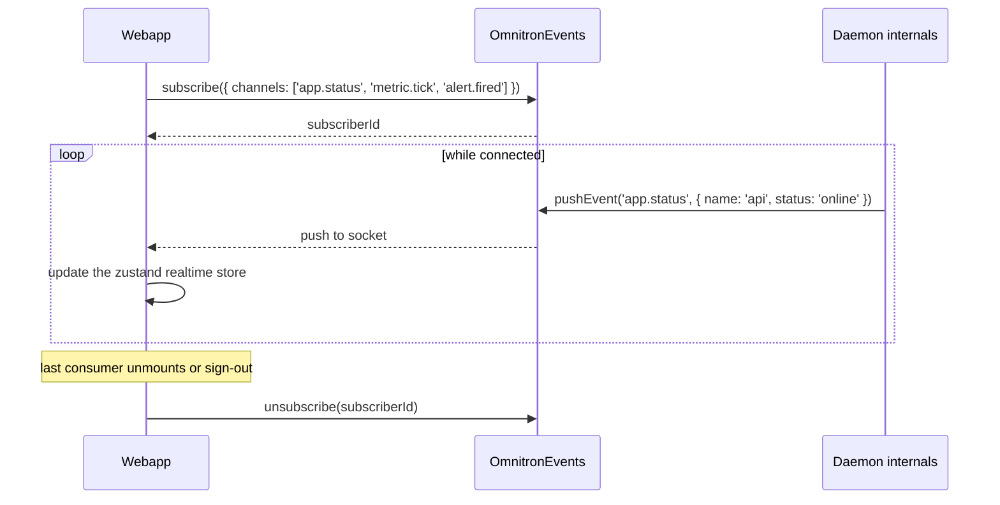

# Web console

The Omnitron webapp at `apps/omnitron/webapp/` (package
`@omnitron/console`) is the visual counterpart of the CLI. It's a
React 19 + Vite + MUI SPA that talks to the daemon via the
`@omnitron-dev/prism/netron` client — the same Netron RPC surface
the CLI uses.

Verified against `apps/omnitron/webapp/src/`.

## Workspace and stack scope {#workspace-and-stack-scope}

The header selects a project and an explicit **All stacks** or **Stack: name**
filter. The compact menu supports keyboard selection and stays bounded when a
project has many stacks. This choice filters stack-aware views such as Dashboard,
Applications, Metrics, Containers and Topology, and the application/stack counts
in the bottom status bar. The workspace badge always counts all configured stacks
in the project; the footer names its narrower scope when a stack is selected.

Opening `/stacks/test` is navigation to that stack's details, not a change to the
workspace filter. Direct links, stack cards and links from Releases preserve the
same selected scope. Returning to another section therefore keeps your explicit
filter. Choose **All stacks** to return to the whole project; even a project with
one stack keeps that choice. Stack lists and release/deployment targets remain
project inventories, and detail pages show the resource named in their route.

The selection is saved for the current workspace across reloads. Switching
projects clears the stack filter. A successful inventory refresh also clears a
selection whose stack was removed or renamed. Failed reads keep the last choice
and mark cached menu state as stale; they never invent an empty inventory or
silently switch to another stack.

## Consistent action placement {#consistent-action-placement}

Horizontal card and row controls put removal at the leading edge, with extra
spacing before ordinary commands. Card footers keep those ordinary commands
together at the trailing edge, and groups wrap on narrow screens. Icon-only
controls identify their action and resource for assistive technology.

Overflow menus use the shared `RowActions` component: ordinary commands first,
destructive commands last behind a separator. Keyboard navigation follows that
order and Escape returns to its trigger. Confirmation dialogs keep Cancel
before the explicit destructive confirmation. Reordering controls never removes
role checks, ownership restrictions, disabled states or confirmation steps.

## One keyboard model {#one-keyboard-model}

Console uses three levels of focus: **Console → workspace region → control**.
The visible focus ring marks the active control; file selection is independent of
the cursor. The command palette uses the same authorized navigation as the sidebar.
Keyboard commands invoke the existing actions and preserve permission checks,
confirmation dialogs and disabled states.

| Scope | Keys | Action |
| --- | --- | --- |
| Console | Ctrl/Cmd+K | Find an available page or command |
| Console | Ctrl/Cmd+/ | Open the keyboard guide |
| Regions | F6 / Shift+F6 | Move forward / backward between navigation, tools, tables and workspaces |
| Current view | `/`, R | Focus the available search; refresh the current view |
| Controls | Tab / Shift+Tab | Move between controls; arrows operate tabs and menus |
| Tables | Up/Down, Home/End, Page Up/Down | Browse rows; Enter opens, Space selects, Escape returns to the viewport |
| File list | Tab / Shift+Tab | Enter a panel at its file list; switch A/B, including on narrow screens |
| Files | Escape | Switch between the file list and its controls |
| File list | Shift+Up/Down, Space, Ctrl/Cmd+A | Extend selection, toggle a file, select loaded entries |
| Files | Enter, Left/Right, Alt+Left/Right | Open, parent/selected directory, directory history |
| Files | Ctrl/Cmd+L | Edit the current path |
| Files | F2, F4, F5, Delete | Rename, open/edit, copy to the other panel, move to trash |
| Logs | Home | Jump to the latest displayed logs |
| Topology | 0, 1 | Fit the graph, restore readable scale |

Entering a file panel by Tab from the sidebar, F6 or programmatic focus lands on
its file list, just like selecting a row with the pointer. Tab then switches A/B.
Escape enters the panel tools, where ordinary Tab navigation is available; Escape
returns to the list. Clicking an input or selector intentionally preserves its
native behavior. F6 moves between workspace regions, excluding nested breadcrumbs.
It also exits SSH input; in an editor dialog it cycles that dialog's tabs, tools
and document, never background controls. Their other shortcuts and text input stay with that surface;
Console does not intercept typed commands, composing text or handled key events.
Dialogs suspend background commands. A retained, hidden Files or SSH workspace
cannot execute shortcuts for another page.

The command palette uses Prism `CommandPalette`; shared table and search behavior
comes from Prism `TableViewport` and `SearchInput`. New Console sections should use
these primitives and `data-keyboard-region` for meaningful regions. Existing
search/refresh buttons can expose `data-console-command`; specialized workspaces
register context actions with `useConsoleActions`, enabled only while visible.
Avoid installing another global keydown listener. Keep each command's callback
shared with its pointer control, and recheck permissions at the RPC boundary.

## Dependency evidence in topology {#dependency-evidence-in-topology}

Topology combines measured process/container status with configured relationships.
`OmnitronProject.getTopology` uses the same application definitions, infrastructure
resolver, environment precedence and stack vault references as the launch builder.
Read-only diagnostics use captured bootstrap metadata and configuration files;
they never import application bootstraps or compile application source. Metadata
is preserved across backend handoffs. When no captured declaration is available,
file/environment dependencies are still shown and coverage is marked incomplete.
It extracts database, Redis, S3 and declared service endpoints plus `dependsOn`.
No separate graph configuration is required. Shared services receive links from
each consumer; external endpoints are separate nodes with **configured / unknown**
status until there is independent runtime evidence.
A local loopback endpoint can match a shared container in another project on the
same daemon when its service and published port identify exactly one provider.
Remote loopback addresses stay on their physical node; ambiguous matches remain
configured endpoints. The system view limits app-specific coverage warnings to
the applications it displays, while project views retain their stack coverage.

Select a node and open **Connections** to inspect providers, consumers and the
configuration keys establishing each relationship. Arrows point from consumer to
provider; ownership links say **Provisioned for**. Dashed dependency links describe
configuration, not measured traffic. Userinfo, URL paths, query parameters, hashes
and credentials never enter this topology response. Missing definitions or
unavailable backend support produce an incomplete-data message rather than an
apparently complete empty graph.

The system workspace combines this daemon's applications and containers with remote
stack observations across projects; a project workspace narrows that inventory. This is not a packet trace: arbitrary
connections created only inside application code are not inferred, and current
configuration may differ from a process that has not yet been restarted. A green
container confirms its reported health, not every consumer's connection to it.

The CLI returns the same evidence:

```bash
omnitron project topology
omnitron project topology sample --stack dev
omnitron --json project topology sample
```

Consumer/provider lanes leave space for links and reflow to one column on narrow
screens. Selecting a node emphasizes its connections; the inspector also provides
a textual representation. The control plane appears once as the system workspace,
not as an empty application project. Package identity distinguishes it from a user
application that happens to be named `omnitron`.

## Tech stack {#tech-stack}

| Layer | Choice |
| ----- | ------ |
| Framework | React 19 |
| Build | Vite 8 with `@vitejs/plugin-react-swc` |
| Routing | `react-router-dom` 7 |
| UI components | `@mui/material` (Emotion), with select components from `@omnitron-dev/prism` |
| RPC client | `@omnitron-dev/prism/netron` (`createMultiBackendClient`) over HTTP + WebSocket |
| Charts | Prism `Chart` / `useChart` (lazy-loaded ApexCharts) |
| Graphs | `@xyflow/react` (topology, dependency graphs) |
| State | `zustand` stores in `src/stores/` |
| Code splitting | Per-page `React.lazy()`; xterm loads with SSH; Prism components use explicit subpaths |

## Filesystem layout {#filesystem-layout}

```text
webapp/
├── index.html
├── vite.config.ts
├── package.json
├── public/                   # static assets shipped as-is
└── src/
    ├── main.tsx              # entrypoint
    ├── app.tsx               # <App/> root
    ├── routes/               # router definition
    ├── layouts/              # ConsoleLayout, AuthLayout
    ├── pages/                # 20+ pages, lazy-loaded
    ├── components/           # shared UI building blocks
    ├── hooks/                # custom React hooks
    ├── netron/               # RPC client + DaemonWsClient wiring
    ├── auth/                 # AuthGuard, GuestGuard, ProjectGuard, auth store
    ├── stores/               # zustand state stores
    ├── assets/               # icons
    ├── utils/
    └── stubs/                # fs/path stubs for Node builtins pulled in by Prism
```

## Route map {#route-map}

All routes other than `/auth/sign-in` are gated by `AuthGuard`.
A session-keyed access provider retrieves effective RPC permissions, gates page entry and hides unavailable actions. See [Console access](./access.md).
Routes marked **project-scoped** require an active project (via
`ProjectGuard`) — selected from the project switcher in the
sidebar.

| Path | Page | Scope | Backing RPC |
| ---- | ---- | ----- | ----------- |
| `/access` | `AccessPage` | daemon | `OmnitronAccess` |
| `/files` | `FilesPage` | daemon | `OmnitronFiles`, `OmnitronNodes` |
| `/terminal` | `TerminalPage` | daemon | `OmnitronTerminal`, `OmnitronNodes` |
| `/auth/sign-in` | `SignInPage` | guest | `OmnitronAuth.signIn` |
| `/` | `DashboardPage` | global | aggregate from many services |
| `/nodes` | `NodesPage` | global | `OmnitronNodes` |
| `/projects` | `ProjectsPage` | global | `OmnitronProject` |
| `/system` | `SystemInfoPage` | global | `OmnitronSystemInfo`, `OmnitronNodes.getNodeSystemSnapshot` |
| `/settings` | `SettingsPage` | global | `OmnitronAuth` + config |
| `/logs` | `LogsPage` | global | `OmnitronLogs` |
| `/apps` | `AppsListPage` | project | `OmnitronDaemon.list` |
| `/apps/:name` | `AppDetailPage` | project | `OmnitronDaemon.getApp` + many |
| `/stacks` | `StacksPage` | project | `OmnitronProject.listStacks` |
| `/stacks/:name` | `StackDetailPage` | project | `OmnitronProject.getStackStatus` |
| `/metrics` | `MetricsPage` | project | `OmnitronMetrics` (`querySeries` / `getStorageStatus`) |
| `/topology` | `TopologyPage` | project | stack deployments, daemon processes and runtime containers |
| `/containers` | `ContainersPage` | project | `OmnitronInfra` |
| `/deployments` | `DeploymentsPage` | project | `OmnitronDeploy` |
| `/alerts` | `AlertsPage` | global | `OmnitronAlerts` |
| `/pipelines` | `PipelinesPage` | system | `OmnitronPipelines` |
| `/traces` | `TracesPage` | project | `OmnitronTraces` |
| `/dashboard-builder` | `DashboardBuilderPage` | both | scoped application inventory, retained metric series and controller alerts |
| `*` | redirect to `/` | — | — |

## Page-by-page {#page-by-page}

### Dashboard {#dashboard}

The landing page shows the selected project's deployments, including remote stacks,
or this daemon's applications when no project is selected. It provides:

- Online/total application and stack counts, summed process CPU and resident memory.
- A ranked resource snapshot for the six largest applications, switchable between
  CPU and memory. The graph compares readings; it does not imply a capacity limit.
- Compact application cards grouped by stack, with status, CPU, memory, uptime,
  restarts and process counts. Local application names open their detail pages.
- Links to metrics and topology from the breadcrumb actions.

Refreshes retain the last received data on partial failures and name the source
that failed. CPU may exceed 100% when processes use several cores; resident memory
has no warning threshold without a known capacity. Zero is a valid measurement;
invalid negative or non-finite readings render as unknown. Polling pauses while
the browser tab is hidden.

Pages fetch through the typed Netron client directly (the
`daemon` / `metrics` proxies from `src/netron/client.ts`) inside
`useEffect` + polling intervals, and subscribe to a shared
`zustand` realtime store (`src/stores/realtime.store.ts`) for
live pushes. There is no TanStack/React Query layer.

### Apps list & detail {#apps-list--detail}

`/apps` — table view of every managed app: status, instances,
CPU, memory, restart count, mode (classic vs bootstrap),
critical flag. Search matches application and stack names; the status filter and
result count share Prism’s `FilterToolbar`. Reset restores the current stack’s
complete inventory. Wide tables scroll inside their own keyboard-focusable region.

`/apps/:name` — single-app deep dive:
- Live status with restart history timeline.
- Per-process breakdown (sub-processes for bootstrap mode).
- The Metrics tab loads interactive history on demand. The application overview and categorical resource rankings load independently of the chart engine.
- Health probes summary.
- DI dependency graph (renders Mermaid via daemon's
  `getDependencyGraph`).
- Log stream with filter (level, grep).
- Resolved environment variables.
- Action buttons: Start / Stop / Restart / Reload / Scale.
- Inspect button → drills into `OmnitronDaemon.inspect`.

### Stacks {#stacks}

`/stacks` — projects' stacks side-by-side with status, app count,
runtime (Docker container count).

`/stacks/:name` — per-stack view: which apps run here, which
infrastructure, runtime status. Start / stop the whole stack.

A stack with a confirmed signed stop offers **Resume installed apps** to operators. The detail page shows each target's receipt, confirmed applications and failure reason. After a partial recovery or a legacy receipt, **Review new stop…** opens the inventory for a fresh review. See [Resume installed applications](./projects.md#resume-installed-applications).

**Diagnose**, on a stack card or its detail page, opens an on-demand readiness
report. It is separate from Start: it never provisions services, starts apps,
executes container health commands or applies migrations. The progress indicator
appears immediately; results carry an observation time, individual reasons and
next actions. **Needs attention** hides verified checks. A failed refresh retains
the previous report and marks it stale.

The report distinguishes **Verified**, **Planned change**, **Blocked** and
**Not verified**. An absent PostgreSQL container can be a planned creation;
a name owned by another stack or an occupied port is a blocker. Missing images
require a pull; missing named volumes will start empty. Missing bind mounts block
startup instead of being treated as a usable empty configuration directory.

Read-only diagnosis uses saved bootstrap declarations and current static app
configuration. Missing or changed declarations remain unverified. Administrators
can use **Refresh declarations…**, which explicitly imports trusted project code
in isolated processes, and then repeat the diagnosis. This is an independent
permission from viewing the report.

The first implementation checks local Docker prerequisites. For remote stacks,
it validates configuration and placement but explicitly leaves target-host
prerequisites unverified; it never uses this workstation's Docker as evidence for
a remote node. Use Nodes diagnostics and `omnitron infra inspect project/stack`
for the complementary RPC and host-service evidence. Database credentials,
schema, migrations and successful application startup remain outside this check.

Stack and application ratios mean **running / configured** and **online /
configured deployments**, respectively. A project with one running remote stack
and one stopped local stack shows `1/2 stacks`, and six apps declared in both
stacks show `6/12 apps`. Selecting only the local stack gives `0/1` and `0/6`.
The footer and dashboard read stacks and apps from the same inventory response;
late answers cannot replace another workspace's counters. Failed observations
retain their counts with a stale marker. The workspace menu shows configured
stack totals for inactive projects rather than presenting unobserved status as live.

A local stack's release card labels its durable choice **Selected**. Open **Deploy
release…** to check a release. **Prepare release** verifies its files before a
maintenance window. The dialog reports when the application processes must stop.
After a confirmed stop, **Deploy** starts the selected code. **Use working tree…**
appears on stopped local stacks that permit source launches. It starts the stack
from its registered directory and changes the choice for future restarts.

In **Review stop…**, enable **Keep infrastructure** to stop only the
applications. The confirmation becomes **Stop applications**, and the inventory
labels retained resources **Containers kept**. With the option off,
**Stop stack** removes the listed **Containers to remove** after application exit.
Switching modes discards the previous review and obtains a new digest; confirmation
stays disabled while the replacement review is loading, incomplete or not supported
by the controller. A viewer can inspect the same inventory but cannot execute either
stop. Retained containers remain visible in runtime diagnostics even when application
status is **Stopped**. Neither mode clears the selected release, and both disable
automatic application resume until an explicit start.

The selected ID is launch intent. Current application health and any release
evidence from the owner describe actual execution. A transfer record or a
selected ID alone cannot establish that every running process loaded that release.
See [Pin a local stack](./releases.md#pin-a-local-stack) for the CLI and data
recovery boundaries.

### Logs {#logs}

The global viewer includes local and replicated application logs. Select one exact
application handle and, optionally, a registered remote node. The default remains
the daemon's log; choosing **All Apps** removes that application filter.

**Nodes → Diagnostics → Running on this node → Logs** carries both the application
and registry node into `/logs?app=…&node=…`. This works for applications whose
production project is not registered on the local machine. The same diagnostics
show each application's health verdict and individual checks, separately from its
process status: an online process can still have an unhealthy mail queue.

Diagnostics reports RPC transport, authentication, heartbeat freshness and retry timing separately from replication backlog and acknowledgements. Read failures retain their cause instead of appearing as an empty queue or an unexamined node. Historical repairs show separate verified/restored counts; an unreadable reconciliation journal remains a warning. The same interpretation is available through `omnitron node check <id>`; see [operational diagnostics](./diagnostics.md#rpc-connection-and-replication).

Diagnostics separates the replication channel from the optional telemetry relay.
Every updated node exposes its relay observation: a controller can report a local
database aggregator; a worker explicitly reports **not applicable** and points to
durable replication. A missing endpoint on an older backend stays **unavailable**,
as do authentication and connectivity errors. CLI and Console interpret the same
contract; absence never becomes an invented healthy or zero-loss reading.

Live mode polls `OmnitronLogs.streamLogs`; time ranges and older pages use
`queryLogs`. Both apply the same node, application, level and label filters.
Application, node and message search remain visible. **Filters** expands labels,
levels, time ranges and the copyable CLI command; its count shows active advanced
filter groups even while collapsed. Collapsing this panel does not reset the query.
Messages occupy a separate line on narrow screens and expand with Enter, Space or
a pointer, including entries without structured metadata. Text and severity colors
follow the active light or dark theme.
Search matches literal message text in stored records. The level filter matches each selected level exactly in live and historical views. Choose `unknown` to find messages whose source supplied no recognizable severity. For the same selection on a remote node, use `omnitron logs <app> --node <node> --level unknown`. A ranked CLI filter such as `--level warn` also includes higher severities. Expand a row to inspect its source node and structured metadata.

The copy control provides `omnitron logs '<project>/<stack>/<app>' --node '<id>' -n 100`
for the selected application/node scope. Search, level and time filters are not
included in that base command; CLI `--grep` is a regular expression.

### Metrics {#metrics}

`/metrics` uses Prism charts for CPU and resident memory, with 5-minute,
15-minute and 1-hour windows. Buckets are 10-second, 30-second and 1-minute
averages respectively. Time labels use the browser's local timezone; byte values
use binary units (KiB, MiB, GiB). CPU is not capped at 100%.

The cards count applications in the selected project and stack, from the same
inventory as the applications page. Histories preserve metric, application and
reporting-node identity. Remote stack aliases are resolved from stack deployments
and the node registry; a matching application name on another machine is not
included. Application totals are the default; child-process lines are opt-in and
must not be added to the parent totals.

- Select a series chip with the pointer or keyboard to hide/show it.
- **Data** opens a keyboard-scrollable table of latest value, mean, peak, sample
  count and last sample time. Mean and peak describe returned buckets, not raw
  event-level extrema.
- Missing buckets break the line. An empty window and a failed query have different
  states; failed refreshes retain the previous graph with a visible warning.
- **Live** controls the 10-second poll. Manual refresh remains available. Changing
  scope or window loads that selection once even when Live is paused.
- Log ingestion is explicitly daemon-wide. The optional **Log store** panel shows
  cumulative counts for all projects, independently of the selected time window.
  Its store scan runs only while expanded, at most once per minute automatically.

Use [Dashboard Builder](#dashboard-builder) in either workspace to compose panels.
Its CPU and memory charts use the same retained observations as `/metrics`.

### Topology {#topology}

The **Workspace** action opens the [target editor](./topology.md): versioned drafts,
placement validation, connection evidence and reviewed acceptance. Accepted targets
are separate from deployment and restart configuration; runtime migrations are not
executed by the editor.

`/topology` is a deployment diagram built from `OmnitronProject.listStacks`,
`OmnitronProject.getTopology`, `OmnitronProject.getTopologyInventory`,
`OmnitronDaemon.list` / `status` and `OmnitronInfra.listContainers`. It shows the
machines, applications, provisioned services and gateway of the selected stack.
Edges represent declared service ownership/dependencies, not observed network
traffic. An incomplete read is labelled explicitly.

The graph opens at a readable scale (100% when one card fits), rather than
shrinking every deployment into the window. Compact Prism cards show a name,
state and key readings; process lists, image identifiers and full configuration
remain in the inspector. Dependency graphs use consumer/provider lanes with a clear routing gutter;
on narrow screens they become one column. Graphs without dependency evidence
use a compact grid. The Connections inspector explains the evidence for each link.

The toolbar provides node search, graph and list views, zoom, placement lock,
fullscreen and refresh. **Fit graph** shows every node. Click the percentage to
return to a readable scale. Drag the canvas to pan, pinch to zoom, or hold
Ctrl/Command while scrolling to zoom. When the canvas has focus, arrow keys pan,
`+` and `-` zoom, `0` fits the graph and `1` restores a readable view.
The minimap has an inset around its viewport and appears when the canvas has
enough space, including when an inspector is open.

Drag a card to reposition it. A focused card moves with the arrow keys. Hold
Shift to move it farther. **Lock node positions** prevents accidental movement.
Placements persist across polling and reloads in this browser for the selected
project and stack. **Arrange nodes** clears those placements and restores
responsive layout. Searching or selecting a node brings it into view at a
readable scale. Moving a card changes only its position on the map.

Declared links use distinct ports and bend around intervening cards. Shared
dependencies use separate tracks. Connections between cards in the same column
use the free space beside them. Wide canvases place deployment groups side by
side. Narrow screens present one column. Select a node to highlight its immediate links or choose **Focus links**
to isolate them. Open **Connections** for the recorded evidence. If a card
blocks a route, its relationship remains available in this list.

Selecting a node opens an inspector beside the graph on wide windows and a modal
sheet on narrow windows. Prism tabs offer the available overview, connections, config, metrics
and logs. CPU/memory history for local apps comes from the metrics service, not
from samples invented when the drawer opens. Readings update with polling; changing
scope clears the old selection. Unknown host capacity is not rendered as a gauge.
Local lifecycle controls follow Console permissions; remote applications remain
managed through their owning stack.

### Containers {#containers}

`/containers` reads the Docker engine attached to this controller through
`OmnitronInfra`. **Local node** and **Local total** explicitly describe that scope;
these counts are not fleet totals. On narrow screens the summary uses a compact
two-column grid so the inventory stays in view. The workspace filter selects labelled project
containers, while the Scope column distinguishes shared control-plane and
unassigned containers that remain visible. Remote infrastructure belongs to each
stack's page, where its node reports it; inline links lead to those stacks.

Direct entry loads missing stack locations through the shared project store.
Unknown locations show a loading state; failed reads explain the failure and offer
Retry. The page never treats unavailable stack metadata as proof that no remote
stacks exist. The status bar owns continued refresh, and concurrent readers share
one request.

The inventory shows observed status, image, health, published ports and scope.
**Not reported** does not establish health. Inspect logs from a row. Start, stop,
remove and log loading show progress on the affected container and prevent
concurrent duplicate actions. After a lifecycle request, Console refreshes the
observed inventory before enabling another action. A timeout or disconnected RPC
means the acknowledgement is unavailable: the operation may already have completed.
Console shows that uncertainty and never replays the mutation automatically. If
the refresh also fails, the table retains the last inventory with a separate read
error; inspect the current state before retrying. Other failures retain their
reported reason. Lifecycle actions still obey roles and ownership. A **Read only** indicator
explains cluster or platform restrictions; focus it to inspect the reason.

### Deployments {#deployments}

`/deployments` follows transfer observations and recorded stack starts in the
selected workspace. **Releases** selects a build and its target stack;
**Stacks** shows configuration and observed execution; **Deployments** explains
what operations were recorded; **Audit** retains the full event trail.

The default table shows the latest recorded start per stack, including its
source, actor and release when recorded. It does not prove what is running now.
The separate legacy app table preserves older records, whose requested version
labels and success statuses did not establish an artifact deployment. Its old
mutation path is disabled in RPC as well as Console; use the release/stack
workflow for deployment or returning to a previous release.

Transfer observations follow the selected project and stack, including imported
configurations. Each row shows the node, app, last phase and diagnostic message.
**Transfer details** exposes the operation ID, observation time and any release
ID. A stale or interrupted observation shows that completion is unknown.
Earlier controllers can return unattributed observations, which have a separate
expandable list. The page requests only the views permitted for the current user.
The CLI exposes the same observations through `omnitron stack progress`.

### Alerts {#alerts}

Open **Alerts** in the global navigation to view alerts across all workspaces.
When the status bar shows a firing count, select it to go directly to **Active
Alerts** at `/alerts#firing`. This also works from a project workspace. The
status bar link requires permission to read the alert summary, active alerts
and rules.

Desktop and sound notifications use the active-alert read permission. The first
successful read records what is already firing. Subsequent alerts at or above
the severity selected in **Settings** can notify you from any page, including a
background tab. Revoking access or signing out discards pending reads. A newly
authorized session starts with its own list of active alerts.

The active list shows up to the 100 most recent firing alerts, with their
severity, message and firing time. An acknowledged alert remains in the list
until it resolves. If the alerts clear before you open the link, the section
shows that there are no active alerts. Acknowledging an alert and editing its
rule each require the corresponding permission.

### Pipelines {#pipelines}

`/pipelines` — CI/CD pipeline list, definition editor, run
history, live run view.

### Traces {#traces}

`/traces` — distributed trace viewer. Trace list with filters,
single-trace waterfall, service-map view. Backed by
`OmnitronTraces`.

### Nodes {#nodes}

`/nodes` — fleet node inventory. Per-node:
- Status, hostname, last-seen timestamp.
- Uptime bar (90 days of green/yellow/red segments — backed by
  `getUptimeBar`).
- Latest recorded health-check time refreshes with node status, independently of the slower historical aggregation. An unavailable history read retains the last evidence and shows a warning.
- SSH connectivity test.
- Per-node actions: drain, remove, edit.
- **Diagnose** reports cluster participation and the recipient operations advertised by that backend. Missing participation evidence from an older daemon is shown as unknown.

In **Nodes → Managed backend updates**, an administrator chooses the build and
server order. **Stage from controller catalog** distributes a matching sealed runtime
to each server. Preparation returns a link immediately and shows qualification
progress. Review each server's candidate, owner and rollback target before choosing
**Apply reviewed plan**. Viewers can reopen the receipt to see what completed and
where execution stopped. See [fleet handoff](./backend-handoff.md#upgrade-a-fleet-of-managed-backends)
for artifact staging, CLI commands and recovery.

### Projects {#projects}

`/projects` — registered project list. Add / scan / remove
projects. Project switcher in sidebar mirrors this.

### System {#system}

Open `/system` to inspect the host that runs a daemon. **Host** selects the connected daemon or a registered mesh node when your role permits remote reads. The selected node and detail tab are in the URL. Each reading identifies the reporting host, collection time and duration. **Live** polls every five seconds while the tab is visible. Pause it to compare numbers or use **Refresh system snapshot** for one observation.

The controller asks the selected node for its own snapshot over the authenticated mesh. Both ends must support this read. If an older node refuses the mesh credential, the page names the node and permission to check. A viewer can select a node. The node credential can answer for its own host only.

CPU load, committed memory, the fullest mount and network throughput share a compact summary. **Overview** includes host and daemon uptime, process memory, the reported build and expandable per-core load. **Storage** lists all reported mounts by utilization with their available bytes. **Network** lists the reported external interfaces with both IP families and link speed. On updated peers the rate aggregates active external interfaces once samples are available. Older peers report their original network sampling scope.

A partial snapshot names each missing collector and its reason. An unavailable peer keeps its own last observation with a warning. Switching hosts clears the previous reading. A snapshot over 15 seconds old is marked stale. A remote clock more than 15 seconds ahead is reported separately. CLI and agents can obtain the same snapshot with `omnitron --json system --node <id>`.

### Dashboard Builder {#dashboard-builder}

Open `/dashboard-builder`, select a dashboard, then choose **Edit layout**. **Add panel** lets you choose application counts and resource totals, retained CPU or memory history, failures and restarts, controller runtime, or firing alerts. Set the title, width and optional exact application name. An application panel follows the selected project and stack. Controller panels identify their scope explicitly.

Use a panel’s options to edit it, move it earlier or later, or remove it. These actions work from the keyboard. Cards reflow to a single column on narrow screens. A chart’s **Data** action opens the exact observations behind it. Historical charts use retained samples with their original timestamps. Missing samples leave gaps. An unavailable source or missing permission appears on the affected panel. A failed alert request cannot turn into a zero count.

With **Live** paused, selecting another data source or history window reads it once. **Refresh** requests another observation.

**Dashboard options → Settings** changes the name, refresh interval and history window. **New dashboard** starts an empty board. **Duplicate** creates an independent layout. **Export layout** and **Import layout** transfer versioned JSON between browsers. Imports validate the layout and create a separate dashboard. Layout edits are saved in this browser. If storage refuses a write, export the session layout before closing. The document contains panel definitions and filters. Measurements and permissions come from the receiving Console.

### Settings {#settings}

`/settings` — current account, change-password, system
preferences.

## Auth flow {#auth-flow}

```mermaid
sequenceDiagram
  participant U as User
  participant W as Webapp
  participant D as Daemon
  participant A as OmnitronAuth

  U->>W: visit /
  W->>W: AuthGuard checks token
  alt no token
    W->>U: redirect to /auth/sign-in
    U->>W: enter credentials
    W->>D: HTTP POST /netron/...
    D->>A: signIn(credentials)
    A-->>D: { token, sessionId, roles }
    D-->>W: response
    W->>W: store token; redirect to /
  end
  W->>D: every subsequent call carries Authorization: Bearer ...
  D->>A: validateToken(token)
  A-->>D: claims | reject
```

The access token is held in `sessionStorage` under the key
`omnitron_token` (via Prism's `SessionTokenStorage`). Logout
clears it and calls `OmnitronAuth.signOut({ sessionId })`. The
`signIn`, `validateToken`, `validateSession`, `refreshSession` and `signOut` methods declare anonymous transport access. Session IDs remain bearer credentials; authenticated sign-out additionally checks ownership.

## RBAC in the UI {#rbac-in-the-ui}

The webapp uses the daemon's three human roles (`viewer`, `operator`, `admin`) through `OmnitronAccess.describe()`. The response is built from the active RPC decorators and authorization rules. There is no independently maintained role matrix in the browser.

| Surface | Behavior |
| --- | --- |
| Navigation and protected pages | Show only when the backing read method is granted |
| Mutation controls and dialogs | Hide when the corresponding RPC capability is absent |
| Access | Show the current account's method grants; administrator account controls require their own grants |
| SSH workspace | Administrator only, with live session and ownership checks on every operation |
| Settings | Current account/session preferences and password changes |

`useAccess()` and `Can` consume typed `service.method` capabilities; `AccessBoundary` uses Prism's guard-only auth entry. Missing or failed verification grants nothing. The daemon independently enforces every request. See [Console access](./access.md) for limits and extension points.

## Real-time event flow {#real-time-event-flow}

The webapp uses `OmnitronEvents` for live updates:



The Console uses two transports for one Netron API. Typed calls such as `OmnitronLogs.queryLogs` and `OmnitronNodes.getKernelRollout` use the HTTP transport under `/netron/`. Push events use the WebSocket transport at `/ws`. The browser authenticates its Netron peer and subscribes through `OmnitronEvents`.

The webapp subscribes through a single `DaemonWsClient`
(`src/netron/ws-client.ts`) that feeds the shared realtime store.
The status bar holds a subscription throughout the authenticated Console,
including direct entry into Access, Files or Terminal. Page subscriptions share
the same connection; leaving a page does not disconnect the status bar.

**Live** means authentication and event subscription have both succeeded.
**Polling** means push is unavailable and bounded polling supplies updates.
Releasing the last consumer resets connection state immediately; a previously
connected page cannot leave a stale Live indicator behind. Sign-out and revoked
sessions close their subscriptions. These rules apply to every authorized role.

## Build / run modes {#build--run-modes}

### Dev mode {#dev-mode}

```bash
cd apps/omnitron/webapp
pnpm dev                    # Vite dev server with HMR (port 9810)
```

The RPC client uses a relative `baseUrl`, so the Vite dev server
proxies the daemon for it (see `vite.config.ts`): `/netron/*` →
`http://localhost:9801` (daemon HTTP) and `/ws` → the daemon's
Netron WebSocket transport on `:9802`. The daemon must already be
running (`omnitron up`).

The dev server deliberately sits at `9810`, outside `9800`–`9803`.
It used to ask for `9802` — the daemon's WebSocket port — so it
could not start while the daemon it exists to talk to was running,
and its own `/ws` proxy pointed back at itself. Sign in with the same account you use against the
production build — the `001_initial_schema` migration seeds a single
`admin` user with password `admin` on first daemon start, and the
password must be changed through Settings → Security before external exposure. Console startup falls back to loopback while this seed remains in use. A master refuses public TCP/HTTP/WebSocket registration until the credential check confirms the seed is no longer accepted; an unavailable check also refuses publication.

### Production build {#production-build}

```bash
cd apps/omnitron/webapp
pnpm build                  # tsc -b && vite build → dist/
```

The compiled bundle lands in `webapp/dist/`. It is **not** served
by the daemon directly — `omnitron webapp start` launches an
`omnitron-nginx` container that mounts `dist/`, serves it on
`:9800`, and reverse-proxies `/netron/*` to the daemon's HTTP
listener (`:9801`) and `/ws` to its WebSocket transport (`:9802`).

A running nginx container reads this directory directly. Building into `dist/`
changes the live frontend immediately, even if the daemon still runs an older
build. For validation while Console is serving traffic, use a separate output:

```bash
cd apps/omnitron/webapp
pnpm typecheck
pnpm exec vite build --outDir node_modules/.console-validation
```

Activate backend and frontend together when a change adds RPC services.
`OmnitronAccess` and `OmnitronTerminal` are registered during master startup;
copying browser assets cannot activate them. Plan the daemon restart around
supervised workloads, verify the new services through CLI, then switch the
served assets. Keep the previous frontend available for rollback.

Before the restart, record each application's status and child-process state,
not only the aggregate online count. Check that native executables still exist,
that the installed dependency graph resolves the intended Titan instance, and
that immutable runtime checks pass. Long-running processes can remain healthy
after their on-disk dependencies have become incompatible with a fresh start.

Preserve the previous backend, frontend, configuration, consistent database
snapshot, lockfiles and actual dependency artifacts. A source revision or a
hash manifest alone cannot reconstruct an unarchived development-linked runtime.
Do not replace an experiment's old integrity hash to admit new dependencies;
register a distinct continuation and retain its previous results.

After activation, verify effective permissions with `omnitron access show`,
compare every previously running process with the baseline, and check application
health in addition to process status. Exercise admin, operator and viewer views,
session revocation and an independently verified SSH connection. Verify that
trust changes and terminal lifecycle events appear in Audit. Remove temporary
test accounts and close test shells after verification.

### Open the webapp {#open-the-webapp}

| Command | Effect |
| ------- | ------ |
| `omnitron webapp build` | Compile the bundle (`vite build` → `dist/`) |
| `omnitron webapp start [-f]` | Start the `omnitron-nginx` container serving static + gateway (`-f`/`--force` recreates it) |
| `omnitron webapp stop` | Stop and remove the nginx container |
| `omnitron webapp status` | Report whether the console container is running / healthy |
| `omnitron webapp open` | Open the running webapp in the system browser (starts it first if stopped) |

All Console lifecycle commands support `--json` with one structured result and
no progress prose. A failed follow-up after successful startup is reported as
`outcome: "applied"`, rather than implying the Console was stopped again.
Use `omnitron --json webapp status` to inspect the observed container state;
see [CLI output and lifecycle outcomes](./cli.md#webapp-console-ui).


## Project switcher {#project-switcher}

The sidebar carries a project dropdown — switching projects
re-scopes every project-scoped page to that project's apps /
stacks / etc. Stored in the auth context; persists across
sessions.

## Empty / error states {#empty--error-states}

Every page is built around three states:

- **Loading** — skeleton with shimmer (`<LoadingScreen />` from
  Prism).
- **Empty** — friendly empty state with the primary action
  ("Add your first project", "Connect a node", …).
- **Error** — error card with retry button + JSON of the underlying
  error (operators love seeing the actual error).

## Performance characteristics {#performance-characteristics}

- **Code-splitting** — each page is `React.lazy`'d.
- **HMR** — Vite + SWC; instant in dev.
- **Polling + push** — pages poll the daemon on an interval and
  the shared `zustand` realtime store applies pushed events; no
  TanStack/React Query cache layer.
- **WebSocket** for `OmnitronEvents` subscribers — one
  `DaemonWsClient` socket per tab.

## Adding a new page {#adding-a-new-page}

The pattern is mechanical:

1. Add `apps/omnitron/webapp/src/pages/my-page.tsx` exporting a
   default React component.
2. Add a lazy import + `<Route path="my-page" ...>` in the router
   (`src/routes/index.tsx`), wrapping in `<ProjectRoute>` if the
   page is project-scoped.
3. Add a nav entry in `src/layouts/console-layout.tsx`.
4. Import the typed service proxy from `src/netron/client.ts`
   (e.g. `import { daemon, metrics } from 'src/netron/client'`)
   and call it from `useEffect`; for live updates, read from the
   `src/stores/realtime.store.ts` zustand store.

No separate API layer to wire — the daemon already exposes
everything as typed Netron services.

## Anti-patterns {#anti-patterns}

- **Storing secrets in `localStorage`.** Use the auth token only;
  for actual secrets, the daemon's `OmnitronSecrets` is the right
  place.
- **Polling instead of subscribing.** When `OmnitronEvents`
  already emits the change, use it — saves the daemon a lot of
  RPC roundtrips.
- **Bypassing `AuthGuard`.** Every protected route should sit
  under the `<AuthGuard>` wrapper; ad-hoc auth checks per page
  drift.
- **Calling the daemon directly with `fetch`.** Use the typed
  service proxies from `src/netron/client.ts` — they carry the
  bearer token and give you end-to-end types from the daemon DTOs.

## See also {#see-also}

- [CLI](./cli.md) — the same operator surface from the terminal
- [Services reference](./services-reference.md) — every RPC the
  webapp consumes
- [Architecture](./architecture.md) — where the webapp sits
- [Prism](../frontend/prism/index.md) — provides the
  `@omnitron-dev/prism/netron` RPC client the webapp uses, plus
  select UI components (the bulk of the UI is MUI)
- [netron-browser](../frontend/netron/browser.md) — the underlying
  browser RPC transport that Prism's netron client builds on

## SSH and role administration {#ssh-and-role-administration}

[SSH workspace](./terminal.md) provides independent terminal tabs, split view, search, paste review and a shared CLI/backend lifecycle through Xec. It is lazily loaded and stays mounted across navigation after first use.

[Access](./access.md) shows the running daemon’s policy to every human role. Administrators can create accounts, change roles and revoke sessions. Account changes and their audit rows commit together; account directory queries never return password hashes or second-factor secrets.

## Compact navigation and scrolling {#compact-navigation-and-scrolling}

Console pages use a single breadcrumb trail for location and navigation. A hidden level-one heading and the browser tab title retain the page name for accessibility. Parent crumbs use client-side routing, so navigating between sections preserves mounted workspaces and their SSH sessions. Page actions remain beside the trail; content headings still identify cards and subsections.

Application cards on the global dashboard open details by their full daemon
handle, without requiring a project selection. The detail page retains role
checks and links back to Overview when no project is selected.

The application shell occupies the available viewport. Its header, navigation and status bar stay within the window, while ordinary pages scroll in the main region. SSH panes and the topology canvas own their internal scrolling. The status bar progressively hides secondary details on narrow screens while retaining connection and application health. Prism theme tokens supply terminal background, text, cursor and selection colors.


### Feedback for operations {#feedback-for-operations}

User-triggered work responds immediately at its point of action. Console's shared
`OperationStatus` shows the operation name, relevant context and elapsed waiting
time; MUI loading buttons prevent repeated submissions. After ten seconds, the
status explicitly says it is still waiting for confirmation. These are waiting
indicators, not progress estimates. Screen readers receive the operation status
without a spoken update every second; reduced-motion preferences are respected.

SSH connection/closure, file opening and saving, transfer controls, account and
role changes, stack imports, topology reads/plans/changes, automation definition
saves, release cleanup and manual node refresh use this feedback. Errors remain
in the dialog or workspace where the operation was requested. Mutations are not
automatically retried. A request timeout must not be described as proof that the
remote operation failed or was cancelled.

Background polling retains the last successful data without constantly displaying
a foreground spinner. An explicit refresh shows its own waiting state. Transfers
keep byte/file progress from the daemon; an upload waiting for publication does
not imply completion merely because all bytes have been transmitted.

The design contract for every new action is the same: immediate acknowledgement,
a truthful waiting state, a confirmed result or an actionable failure, and details
on demand. Keep primary feedback beside the initiating control; avoid duplicate
banners and dialogs. Unknown completion is a distinct state, never success or a
fabricated percentage. Keyboard focus and accessible status announcements are
part of the action, not an additional interaction mode.

CLI and agents must receive the same outcome categories and diagnostic IDs as the
Console. In HTTP RPC, stable numeric errors distinguish denied access (403), lost
identity (401), conflicts (409) and unavailable authority (503). Neither a spinner
nor an English error string is an automation contract.

### Reading an expanded log event {#reading-an-expanded-log-event}

An expanded event continues the selected row on one surface, with a narrow level
accent and aligned context separated by thin dividers. Multiline messages retain
line breaks and long tokens wrap inside the viewport. On narrow windows the
message moves below its time, application and level, and metadata fields stack.

**Enter** or **Space** on the row expands it. **Escape** collapses the event and
returns focus to the disclosure. Application fields, event and capture times,
source stream, trace and labels remain readable without opening a JSON card.
**Raw event** exposes the complete original record, including capture sequence
and receipt metadata. **Copy JSON** copies that record and reports clipboard
failure with a selectable-text fallback.

### Tables, filters and overlays {#tables-filters-and-overlays}

The shared Prism `Table` and `AdminDataTable` contain horizontal scrolling inside
`TableViewport`. Focus a named table region to scroll with the keyboard; rows with
`onRowClick` also accept Enter and Space without intercepting nested links or
buttons. Pagination stays outside the scrolling rows and rearranges when its
container is narrow. `maxHeight` constrains the rows, not pagination. Console gives
wide operational tables a minimum readable width instead of squeezing their
columns into the window.

Audit is an administrator-only history of control-plane actions across projects;
the workspace selector does not narrow it. Resource, action and actor filters
are explicit. Each row shows a compact timestamp, action, outcome and actor.
Expand it with a click, Enter or Space to read exact time, resource, origin and
structured details through the same field renderer as application logs. Escape
collapses the details. Long identifiers wrap within the row.

Actor badges retain the distinction between **Local client** (`omnitron-local`,
CLI or MCP admitted through the private Unix socket), **System** (the daemon's
own action), **Service** (another control-plane principal) and **User** (a Console
account). The full stored identity stays available in details; a badge does not
invent a username or merge distinct principals.

**Load older** freezes the visible page and follows the last entry's ID. The
server orders timestamp ties by ID and compares timestamps inside PostgreSQL,
so JavaScript's lower timestamp precision cannot skip records. **Resume** or
**Refresh** returns to the newest page. A deleted cursor requires refreshing;
an unavailable history is not represented as an empty healthy trail. Structured
details are bounded and credentials are redacted on both write and read,
including nested arrays from older records. Historical `[object]` placeholders
cannot recover information that was never stored.

Access uses a compact account-action menu, a collapsible role reference and a
clearable permission search with an explicit no-match state. Permissions continue
to come from the daemon; visual rearrangement does not change policy.

Forms and menus inherit Prism’s MUI overrides. Dialogs fill small viewports using
`100dvh`; their content scrolls while action buttons remain reachable. Long menu
labels wrap, form pairs stack on small windows, and secondary account actions
return keyboard focus to their trigger when dismissed. Open a confirmation dialog
to review an operation; merely opening a menu or form does not execute it.

Workspace selection uses the same MUI menu and Prism spacing as row actions,
Select controls and context menus. Menu groups have symmetric divider spacing,
and the menu scrolls within the viewport as a single keyboard region. Arrow keys
move between items; Home/End reach its ends. **Add project** opens the existing
registration form and is offered only with `OmnitronProject.addProject`; opening
the form does not register anything.

Run all Console tests with `pnpm --dir apps/omnitron/webapp test`. This command
includes both `test/webapp` and colocated `webapp/src` tests using the same aliases
as the package suite, including real topology node connection points.

`src/theme.ts` defines Console’s light and dark surfaces through `PrismProvider`
`themeOverrides`. Component geometry and interaction remain in Prism rather than
being reimplemented in each page. For frontend-only changes, rebuild the Console
assets and reload the browser; a daemon or application restart is unnecessary.

## Automation workspace {#automation-workspace}

The [Pipelines workspace](./automation.md) uses Prism tabs and data tables with responsive MUI editors and a run-details drawer. Step controls include local/registered-node selection, working directory, dependencies, timeout and advanced retry/environment settings. Execution requires review of the displayed source and targets. Run history loads summaries; step output is fetched only for the opened run, with stale-data and truncation indicators.

This workspace is restricted to administrators because its scripts execute with infrastructure privileges. Embedded provider sessions and delegated agent controls are specified in the [agent architecture](./agents.md); they are not live Console features yet.

## Watch configuration {#watch-configuration}

Re-enabling watch uses the daemon’s last accepted boot or reload configuration, including a configuration selected from a registered project. It does not rediscover an unrelated configuration from the caller’s working directory. Build watchers for registered applications appear in the same watch status as classic file watchers.

Definition reads, initial builds and watch rebuilds resolve compiler source labels
and diagnostics relative to the source entry. They do not depend on the
controller process's working directory. Workspace package source is compiled
under the same resolution policy; installed packages retain their runtime
dependency identity.


## File workspace {#file-workspace}

[Files](./files.md) provides two independent, tabbed node locations, version-checked text editing and durable cross-node copies. Prism tabs and table viewports share the Console shell; CodeMirror loads only when a document is opened. Narrow windows retain both panels behind an A/B switch. The default export is `/`, limited by administrator authorization and the daemon OS account; node configuration can restrict roots, make them read only or disable access. Selecting one directory exposes explicit archive-file and pack-and-restore modes, with formats probed on the chosen nodes. Transfer progress distinguishes snapshots, encoding, network bytes, restoration and incomplete publication; cleanup failures retain a dedicated retry action.


## Shared API contracts {#shared-api-contracts}

Console and CLI share the wire contracts exported by `@omnitron-dev/omnitron/dto/services`. Backup coverage, audit queries, node health, rollout progress and release build progress are declared in the common DTO layer; the daemon implementations consume the same definitions. Existing service type exports remain available for compatibility. Console typechecking does not load daemon, database or service implementations, and a compiler-graph regression test enforces that boundary.

## Publishing Console updates {#publishing-console-updates}

From a source checkout, `pnpm --filter @omnitron/console build` typechecks and
builds into a temporary directory before publishing. `omnitron webapp build`
uses the same path. It never lets Vite empty the directory nginx is serving.

Hashed assets are admitted before the new HTML is replaced atomically, while the
mounted directory stays in place. Existing URLs cannot change their bytes.
The publisher retains at least three generations and a seven-day grace period;
cleanup only removes files recorded in its publication ledger whose bytes are
unchanged. It never prunes unrelated files. The ledger and an exclusive writer
lock sit beside `dist`, outside the web root. A killed publisher leaves a lock
with its PID for inspection; verify the process has stopped before removing it.

The runtime freezer refuses a package that contains a `webapp` directory without
`webapp/dist/index.html`. Include the complete prebuilt Console before freezing;
an intentionally headless package omits `webapp` entirely. Never alter a sealed
runtime to add missing assets: prepare a complete artifact, verify it, then
activate it through the [backend handoff](./backend-handoff.md) workflow and
reconcile the Console container with `omnitron webapp start`.

Only successful asset responses are cached: content-hashed URLs are immutable;
unhashed assets require revalidation after an hour. Failed responses, including
missing chunks (404), use `Cache-Control: no-store`. This prevents a temporary
missing file from keeping a browser on a failed route after recovery. Browsers
that cached such failures from older versions may require a hard reload.

Open tabs continue to use their loaded generation. A compact notification offers
**Reload** when a new build is available; it never automatically discards file
edits or terminal sessions. Notifications use the Prism header slot inside the
viewport, preserving space for the status bar and workspaces. The file editor's existing unsaved-change guard also
applies to an explicit reload. Tabs older than the retention window may need to
reload before opening a new route.

Prepare a reviewable build or publish one already verified:

```bash
node apps/omnitron/scripts/build-console.mjs --out-dir /absolute/path/to/candidate
node apps/omnitron/scripts/build-console.mjs --publish-from /absolute/path/to/candidate
```

The candidate directory must not already exist. Keep a previous build for rollback
and publish it with the same command. A Console-only update does not restart the
daemon, applications or experiment workers. Updating backend code remains a
separate [daemon maintenance operation](./daemon.md#updating-a-source-runtime).

Console configures the chart engine used by Prism with the line/area and bar
renderers, legends, keyboard interaction, toolbar, exports and annotations.
Other Prism consumers keep their default engine. Add further chart imports in
Console's `src/charts.ts` when introducing another chart type. MUI/Emotion chunks
preserve source initialization order; test the built app in a browser after
changing chunking rules, not only with a successful bundler exit code.

The publisher regression suite includes interrupted HTML replacement, existing
open-tab assets, immutable URL conflicts and bounded retention. Run it with
`pnpm --filter @omnitron-dev/omnitron test:console-publication`.

### Historical coverage in node diagnostics {#historical-coverage-in-node-diagnostics}

The replication reading separates a healthy current queue from coverage before
durable receipts existed. Expand **History before receipts · coverage and gaps**
for each audited source range, checked/expected rows, existing and restored
records, verification time, retained precision and unavailable earlier history.
This uses the same evidence as `omnitron node check`; see the
[recovery procedure](./cluster.md#history-before-delivery-receipts).

When a reviewed recovery closes a known gap, the disclosure shows its explanation,
verification time and separate proof source. The original audit remains available;
no unresolved warning is cleared by a successful current queue reading.


### Live log tail and complete history {#live-log-tail-and-complete-history}

The live tail polls at two-second intervals with a bounded window of up to 50
matching events per poll and retains up to 2,000 rows in the browser. A filled
window is marked explicitly: a burst can exceed what the tail displays. Use a
historical time range and pagination for the complete retained database record,
including late-arriving events with earlier source timestamps. The capture/journal
and database acknowledgement indicators describe durable storage independently of
this bounded display. A healthy ingestion indicator is not a claim that every
stored row is currently on screen.


### Releases and current deployments {#releases-and-current-deployments}

The **Deployment state** view on Releases and stack details combines the existing
project inventory with deployment history. It shows each stack's actual
running/configured application count and node reachability. The last recorded
deployment is dated and linked separately. The controller's stored artifact count
uses the selected project filter. Building an artifact does not start a stack.

**History: test** is a neutral historical label. **Git: no remote branch** describes
a build-time source-control observation, not a local deployment. Processes that
do not attest their current release show **Current release not reported**. Failed
reads and unreachable nodes remain unknown. Inventory refreshes reuse the shared
workspace store; changing projects discards late answers from the old workspace.

Verified launch receipts appear separately from deployment history, with per-node
coverage and concrete reasons for missing or conflicting evidence. **Inspect
installed files** starts an explicit read-only comparison with retained archives.
The action shows progress and keeps its timestamped result separate from launch
identity: modified installed files, ambiguous base releases and unsupported node
backends do not become a verified running release. Matching entry points are
labelled as partial checks, not full installation integrity.

`omnitron release status <project>` uses the same read model; add
`--inspect-installed` for the same on-demand disk comparison. See
[Releases and verification](./releases.md#understand-what-is-built-and-what-is-running)
for the evidence boundaries, JSON and exit codes.
