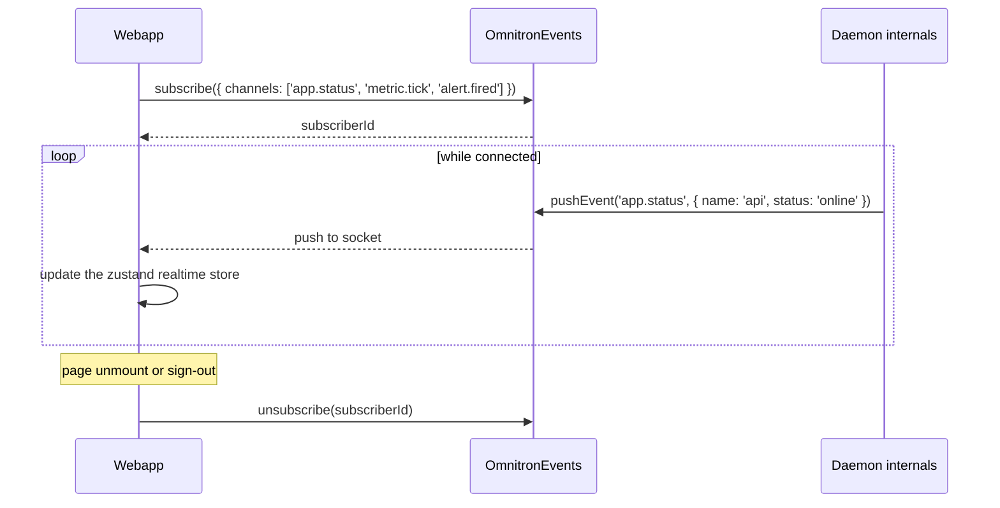

# Web console

The Omnitron webapp at `apps/omnitron/webapp/` (package
`@omnitron/console`) is the visual counterpart of the CLI. It's a
React 19 + Vite + MUI SPA that talks to the daemon via the
`@omnitron-dev/prism/netron` client — the same Netron RPC surface
the CLI uses.

Verified against `apps/omnitron/webapp/src/`.

## Tech stack

| Layer | Choice |
| ----- | ------ |
| Framework | React 19 |
| Build | Vite 8 with `@vitejs/plugin-react-swc` |
| Routing | `react-router-dom` 7 |
| UI components | `@mui/material` (Emotion), with select components from `@omnitron-dev/prism` |
| RPC client | `@omnitron-dev/prism/netron` (`createMultiBackendClient`) over HTTP + WebSocket |
| Charts | `react-apexcharts` |
| Graphs | `@xyflow/react` (topology, dependency graphs) |
| State | `zustand` stores in `src/stores/` |
| Code splitting | Per-page `React.lazy()`; xterm loads with SSH; Prism components use explicit subpaths |

## Filesystem layout

```text
webapp/
├── index.html
├── vite.config.ts
├── package.json
├── public/                   # static assets shipped as-is
└── src/
    ├── main.tsx              # entrypoint
    ├── app.tsx               # <App/> root
    ├── routes/               # router definition
    ├── layouts/              # ConsoleLayout, AuthLayout
    ├── pages/                # 20+ pages, lazy-loaded
    ├── components/           # shared UI building blocks
    ├── hooks/                # custom React hooks
    ├── netron/               # RPC client + DaemonWsClient wiring
    ├── auth/                 # AuthGuard, GuestGuard, ProjectGuard, auth store
    ├── stores/               # zustand state stores
    ├── assets/               # icons
    ├── utils/
    └── stubs/                # fs/path stubs for Node builtins pulled in by Prism
```

## Route map

All routes other than `/auth/sign-in` are gated by `AuthGuard`.
A session-keyed access provider retrieves effective RPC permissions, gates page entry and hides unavailable actions. See [Console access](./access.md).
Routes marked **project-scoped** require an active project (via
`ProjectGuard`) — selected from the project switcher in the
sidebar.

| Path | Page | Scope | Backing RPC |
| ---- | ---- | ----- | ----------- |
| `/access` | `AccessPage` | daemon | `OmnitronAccess` |
| `/terminal` | `TerminalPage` | daemon | `OmnitronTerminal`, `OmnitronNodes` |
| `/auth/sign-in` | `SignInPage` | guest | `OmnitronAuth.signIn` |
| `/` | `DashboardPage` | global | aggregate from many services |
| `/nodes` | `NodesPage` | global | `OmnitronNodes` |
| `/projects` | `ProjectsPage` | global | `OmnitronProject` |
| `/system` | `SystemInfoPage` | global | `OmnitronSystemInfo` |
| `/settings` | `SettingsPage` | global | `OmnitronAuth` + config |
| `/logs` | `LogsPage` | global | `OmnitronLogs` |
| `/apps` | `AppsListPage` | project | `OmnitronDaemon.list` |
| `/apps/:name` | `AppDetailPage` | project | `OmnitronDaemon.getApp` + many |
| `/stacks` | `StacksPage` | project | `OmnitronProject.listStacks` |
| `/stacks/:name` | `StackDetailPage` | project | `OmnitronProject.getStackStatus` |
| `/metrics` | `MetricsPage` | project | `OmnitronMetrics` (`getSnapshot` / `querySeries`) |
| `/topology` | `TopologyPage` | project | derived from `OmnitronDiscovery` + services |
| `/containers` | `ContainersPage` | project | `OmnitronInfra` |
| `/deployments` | `DeploymentsPage` | project | `OmnitronDeploy` |
| `/alerts` | `AlertsPage` | project | `OmnitronAlerts` |
| `/pipelines` | `PipelinesPage` | project | `OmnitronPipelines` |
| `/traces` | `TracesPage` | project | `OmnitronTraces` |
| `/dashboard-builder` | `DashboardBuilderPage` | project | custom dashboard composer |
| `*` | redirect to `/` | — | — |

## Page-by-page

### Dashboard

The landing page after sign-in. Shows:

- Daemon status card (version, uptime, PID).
- Total apps / online / errored counts.
- Aggregate CPU / memory.
- Recent alerts.
- Recent deployments.
- Cluster status when cluster mode is enabled.

Pages fetch through the typed Netron client directly (the
`daemon` / `metrics` proxies from `src/netron/client.ts`) inside
`useEffect` + polling intervals, and subscribe to a shared
`zustand` realtime store (`src/stores/realtime.store.ts`) for
live pushes. There is no TanStack/React Query layer.

### Apps list & detail

`/apps` — table view of every managed app: status, instances,
CPU, memory, restart count, mode (classic vs bootstrap),
critical flag. Search matches application and stack names; the status filter and
result count share Prism’s `FilterToolbar`. Reset restores the current stack’s
complete inventory. Wide tables scroll inside their own keyboard-focusable region.

`/apps/:name` — single-app deep dive:
- Live status with restart history timeline.
- Per-process breakdown (sub-processes for bootstrap mode).
- Resource graphs (CPU / RSS / event-loop lag).
- Health probes summary.
- DI dependency graph (renders Mermaid via daemon's
  `getDependencyGraph`).
- Log stream with filter (level, grep).
- Resolved environment variables.
- Action buttons: Start / Stop / Restart / Reload / Scale.
- Inspect button → drills into `OmnitronDaemon.inspect`.

### Stacks

`/stacks` — projects' stacks side-by-side with status, app count,
runtime (Docker container count).

`/stacks/:name` — per-stack view: which apps run here, which
infrastructure, runtime status. Start / stop the whole stack.

### Logs

The global viewer includes local and replicated application logs. Select one exact
application handle and, optionally, a registered remote node. The default remains
the daemon's log; choosing **All Apps** removes that application filter.

**Nodes → Diagnostics → Running on this node → Logs** carries both the application
and registry node into `/logs?app=…&node=…`. This works for applications whose
production project is not registered on the local machine. The same diagnostics
show each application's health verdict and individual checks, separately from its
process status: an online process can still have an unhealthy mail queue.

Live mode polls `OmnitronLogs.streamLogs`; time ranges and older pages use
`queryLogs`. Both apply the same node, application, level and label filters.
Application, node and message search remain visible. **Filters** expands labels,
levels, time ranges and the copyable CLI command; its count shows active advanced
filter groups even while collapsed. Collapsing this panel does not reset the query.
Messages occupy a separate line on narrow screens and expand with Enter, Space or
a pointer, including entries without structured metadata. Text and severity colors
follow the active light or dark theme.
Search matches literal message text in stored records. Level chips select exact
levels; CLI `--level` selects that level and higher. Neither mode infers success
from an empty result. Expanding a row reveals its source node and structured metadata.

The copy control provides `omnitron logs '<project>/<stack>/<app>' --node '<id>' -n 100`
for the selected application/node scope. Search, level and time filters are not
included in that base command; CLI `--grep` is a regular expression.

### Metrics

Time-series view backed by the daemon's metrics aggregator. Per
app, per metric name, per label combination. Built on
ApexCharts.

Predefined panels:
- CPU per app, stacked.
- RSS per app.
- Event-loop lag p95.
- RPC latency p95 per service.
- Error rate per app.

The `/dashboard-builder` page lets operators compose custom
panels and save them.

### Topology

`/topology` — XYFlow service graph derived from
`OmnitronDiscovery` plus the live Netron service mesh. Nodes are
services; edges are observed calls. Useful to see "who actually
talks to whom" vs the static declaration.

### Containers

`/containers` — Docker container inventory from `OmnitronInfra`.
Shows status, image, ports, resource use. Per-container actions:
restart, logs, exec (when daemon has Docker socket access).

### Deployments

`/deployments` — deployment history from `OmnitronDeploy`. List
of past deploys, strategy, version, deployer, duration. Trigger
new deploys or rollbacks here too.

### Alerts

`/alerts` — alert rule manager + event log. Rules tab: list,
edit, create. Events tab: fired alerts, ack / resolve actions.

### Pipelines

`/pipelines` — CI/CD pipeline list, definition editor, run
history, live run view.

### Traces

`/traces` — distributed trace viewer. Trace list with filters,
single-trace waterfall, service-map view. Backed by
`OmnitronTraces`.

### Nodes

`/nodes` — fleet node inventory. Per-node:
- Status, hostname, last-seen timestamp.
- Uptime bar (90 days of green/yellow/red segments — backed by
  `getUptimeBar`).
- SSH connectivity test.
- Per-node actions: drain, remove, edit.

### Projects

`/projects` — registered project list. Add / scan / remove
projects. Project switcher in sidebar mirrors this.

### System info

`/system` — host inventory: OS, CPU, RAM, disk, network
interfaces. Refreshes on demand.

### Settings

`/settings` — current account, change-password, system
preferences.

## Auth flow

```mermaid
sequenceDiagram
  participant U as User
  participant W as Webapp
  participant D as Daemon
  participant A as OmnitronAuth

  U->>W: visit /
  W->>W: AuthGuard checks token
  alt no token
    W->>U: redirect to /auth/sign-in
    U->>W: enter credentials
    W->>D: HTTP POST /netron/...
    D->>A: signIn(credentials)
    A-->>D: { token, sessionId, roles }
    D-->>W: response
    W->>W: store token; redirect to /
  end
  W->>D: every subsequent call carries Authorization: Bearer ...
  D->>A: validateToken(token)
  A-->>D: claims | reject
```

The access token is held in `sessionStorage` under the key
`omnitron_token` (via Prism's `SessionTokenStorage`). Logout
clears it and calls `OmnitronAuth.signOut({ sessionId })`. The
`signIn`, `validateToken`, `validateSession`, `refreshSession` and `signOut` methods declare anonymous transport access. Session IDs remain bearer credentials; authenticated sign-out additionally checks ownership.

## RBAC in the UI

The webapp uses the daemon's three human roles (`viewer`, `operator`, `admin`) through `OmnitronAccess.describe()`. The response is built from the active RPC decorators and authorization rules. There is no independently maintained role matrix in the browser.

| Surface | Behavior |
| --- | --- |
| Navigation and protected pages | Show only when the backing read method is granted |
| Mutation controls and dialogs | Hide when the corresponding RPC capability is absent |
| Access | Show the current account's method grants; administrator account controls require their own grants |
| SSH workspace | Administrator only, with live session and ownership checks on every operation |
| Settings | Current account/session preferences and password changes |

`useAccess()` and `Can` consume typed `service.method` capabilities; `AccessBoundary` uses Prism's guard-only auth entry. Missing or failed verification grants nothing. The daemon independently enforces every request. See [Console access](./access.md) for limits and extension points.

## Real-time event flow

The webapp uses `OmnitronEvents` for live updates:



The webapp subscribes through a single `DaemonWsClient`
(`src/netron/ws-client.ts`) that feeds the shared realtime store,
so the dashboard reflects state changes essentially instantly —
without per-component polling for the events that the daemon
already pushes.

## Build / run modes

### Dev mode

```bash
cd apps/omnitron/webapp
pnpm dev                    # Vite dev server with HMR (port 9810)
```

The RPC client uses a relative `baseUrl`, so the Vite dev server
proxies the daemon for it (see `vite.config.ts`): `/netron/*` →
`http://localhost:9801` (daemon HTTP) and `/ws` → the daemon's
Netron WebSocket transport on `:9802`. The daemon must already be
running (`omnitron up`).

The dev server deliberately sits at `9810`, outside `9800`–`9803`.
It used to ask for `9802` — the daemon's WebSocket port — so it
could not start while the daemon it exists to talk to was running,
and its own `/ws` proxy pointed back at itself. Sign in with the same account you use against the
production build — the `001_initial_schema` migration seeds a single
`admin` user with password `admin` on first daemon start, and the
password must be changed through Settings → Security before external exposure. The existing Console startup falls back to loopback while this seed remains in use; fleet TCP publication only warns, so it still requires operator control.

### Production build

```bash
cd apps/omnitron/webapp
pnpm build                  # tsc -b && vite build → dist/
```

The compiled bundle lands in `webapp/dist/`. It is **not** served
by the daemon directly — `omnitron webapp start` launches an
`omnitron-nginx` container that mounts `dist/`, serves it on
`:9800`, and reverse-proxies `/netron/*` to the daemon's HTTP
listener (`:9801`) and `/ws` to its WebSocket transport (`:9802`).

A running nginx container reads this directory directly. Building into `dist/`
changes the live frontend immediately, even if the daemon still runs an older
build. For validation while Console is serving traffic, use a separate output:

```bash
cd apps/omnitron/webapp
pnpm typecheck
pnpm exec vite build --outDir node_modules/.console-validation
```

Activate backend and frontend together when a change adds RPC services.
`OmnitronAccess` and `OmnitronTerminal` are registered during master startup;
copying browser assets cannot activate them. Plan the daemon restart around
supervised workloads, verify the new services through CLI, then switch the
served assets. Keep the previous frontend available for rollback.

Before the restart, record each application's status and child-process state,
not only the aggregate online count. Check that native executables still exist,
that the installed dependency graph resolves the intended Titan instance, and
that immutable runtime checks pass. Long-running processes can remain healthy
after their on-disk dependencies have become incompatible with a fresh start.

Preserve the previous backend, frontend, configuration, consistent database
snapshot, lockfiles and actual dependency artifacts. A source revision or a
hash manifest alone cannot reconstruct an unarchived development-linked runtime.
Do not replace an experiment's old integrity hash to admit new dependencies;
register a distinct continuation and retain its previous results.

After activation, verify effective permissions with `omnitron access show`,
compare every previously running process with the baseline, and check application
health in addition to process status. Exercise admin, operator and viewer views,
session revocation and an independently verified SSH connection. Verify that
trust changes and terminal lifecycle events appear in Audit. Remove temporary
test accounts and close test shells after verification.

### Open the webapp

| Command | Effect |
| ------- | ------ |
| `omnitron webapp build` | Compile the bundle (`vite build` → `dist/`) |
| `omnitron webapp start [-f]` | Start the `omnitron-nginx` container serving static + gateway (`-f`/`--force` recreates it) |
| `omnitron webapp stop` | Stop and remove the nginx container |
| `omnitron webapp status` | Report whether the console container is running / healthy |
| `omnitron webapp open` | Open the running webapp in the system browser (starts it first if stopped) |

## Project switcher

The sidebar carries a project dropdown — switching projects
re-scopes every project-scoped page to that project's apps /
stacks / etc. Stored in the auth context; persists across
sessions.

## Empty / error states

Every page is built around three states:

- **Loading** — skeleton with shimmer (`<LoadingScreen />` from
  Prism).
- **Empty** — friendly empty state with the primary action
  ("Add your first project", "Connect a node", …).
- **Error** — error card with retry button + JSON of the underlying
  error (operators love seeing the actual error).

## Performance characteristics

- **Code-splitting** — each page is `React.lazy`'d.
- **HMR** — Vite + SWC; instant in dev.
- **Polling + push** — pages poll the daemon on an interval and
  the shared `zustand` realtime store applies pushed events; no
  TanStack/React Query cache layer.
- **WebSocket** for `OmnitronEvents` subscribers — one
  `DaemonWsClient` socket per tab.

## Adding a new page

The pattern is mechanical:

1. Add `apps/omnitron/webapp/src/pages/my-page.tsx` exporting a
   default React component.
2. Add a lazy import + `<Route path="my-page" ...>` in the router
   (`src/routes/index.tsx`), wrapping in `<ProjectRoute>` if the
   page is project-scoped.
3. Add a nav entry in `src/layouts/console-layout.tsx`.
4. Import the typed service proxy from `src/netron/client.ts`
   (e.g. `import { daemon, metrics } from 'src/netron/client'`)
   and call it from `useEffect`; for live updates, read from the
   `src/stores/realtime.store.ts` zustand store.

No separate API layer to wire — the daemon already exposes
everything as typed Netron services.

## Anti-patterns

- **Storing secrets in `localStorage`.** Use the auth token only;
  for actual secrets, the daemon's `OmnitronSecrets` is the right
  place.
- **Polling instead of subscribing.** When `OmnitronEvents`
  already emits the change, use it — saves the daemon a lot of
  RPC roundtrips.
- **Bypassing `AuthGuard`.** Every protected route should sit
  under the `<AuthGuard>` wrapper; ad-hoc auth checks per page
  drift.
- **Calling the daemon directly with `fetch`.** Use the typed
  service proxies from `src/netron/client.ts` — they carry the
  bearer token and give you end-to-end types from the daemon DTOs.

## See also

- [CLI](./cli.md) — the same operator surface from the terminal
- [Services reference](./services-reference.md) — every RPC the
  webapp consumes
- [Architecture](./architecture.md) — where the webapp sits
- [Prism](../frontend/prism/index.md) — provides the
  `@omnitron-dev/prism/netron` RPC client the webapp uses, plus
  select UI components (the bulk of the UI is MUI)
- [netron-browser](../frontend/netron/browser.md) — the underlying
  browser RPC transport that Prism's netron client builds on

## SSH and role administration

[SSH workspace](./terminal.md) provides independent terminal tabs, split view, search, paste review and a shared CLI/backend lifecycle through Xec. It is lazily loaded and stays mounted across navigation after first use.

[Access](./access.md) shows the running daemon’s policy to every human role. Administrators can create accounts, change roles and revoke sessions. Account changes and their audit rows commit together; account directory queries never return password hashes or second-factor secrets.

## Compact navigation and scrolling

Console pages use a single breadcrumb trail for location and navigation. A hidden level-one heading and the browser tab title retain the page name for accessibility. Parent crumbs use client-side routing, so navigating between sections preserves mounted workspaces and their SSH sessions. Page actions remain beside the trail; content headings still identify cards and subsections.

The application shell occupies the available viewport. Its header, navigation and status bar stay within the window, while ordinary pages scroll in the main region. SSH panes and the topology canvas own their internal scrolling. The status bar progressively hides secondary details on narrow screens while retaining connection and application health. Prism theme tokens supply terminal background, text, cursor and selection colors.


### Tables, filters and overlays

The shared Prism `Table` and `AdminDataTable` contain horizontal scrolling inside
`TableViewport`. Focus a named table region to scroll with the keyboard; rows with
`onRowClick` also accept Enter and Space without intercepting nested links or
buttons. Pagination stays outside the scrolling rows and rearranges when its
container is narrow. `maxHeight` constrains the rows, not pagination. Console gives
wide operational tables a minimum readable width instead of squeezing their
columns into the window.

Audit is a reading surface: at narrow widths, time, actor and origin move into the
event cell. Details and resource identifiers wrap without overlapping other
records. Access uses a compact account-action menu, a collapsible role reference
and a clearable permission search with an explicit no-match state. Permissions
continue to come from the daemon; visual rearrangement does not change policy.

Forms and menus inherit Prism’s MUI overrides. Dialogs fill small viewports using
`100dvh`; their content scrolls while action buttons remain reachable. Long menu
labels wrap, form pairs stack on small windows, and secondary account actions
return keyboard focus to their trigger when dismissed. Open a confirmation dialog
to review an operation; merely opening a menu or form does not execute it.

`src/theme.ts` defines Console’s light and dark surfaces through `PrismProvider`
`themeOverrides`. Component geometry and interaction remain in Prism rather than
being reimplemented in each page. For frontend-only changes, rebuild the Console
assets and reload the browser; a daemon or application restart is unnecessary.
