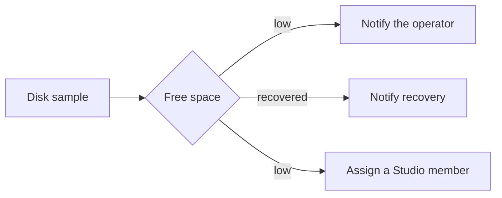
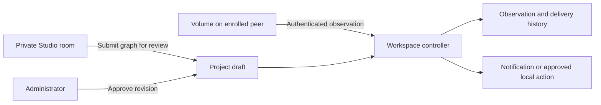

# Event flows

A flow turns an observation into a decision on the controller that owns the workspace. An administrator can draw it in **Flows**. A Studio lead can propose the same graph in a team room. Both open in the same editor, with the same component catalog, validator and sample-event preview.

:::info{title="Availability"}
The flow editor and controller runtime are on Omnitron main after 0.4.14.
:::

## Build a disk-space monitor {#disk-space}

Start with the disk-space template. Choose a volume on the controller, set the interval and enter a low threshold and a higher recovery threshold. The default outputs record a local notification when space runs low and another on recovery.

The recorded example below enters the low state under 10 GiB and recovers at 12 GiB. Move through the observations to see when an action is due. The samples were evaluated by Omnitron's flow engine.

<DiskFlowTrace hydrate="visible" />

Choose the source, enter a sample event and inspect the highlighted connections. The preview lists the data and effects that would reach each destination. Save the draft, check the target workspace and activate its reviewed revision. The controller records subsequent observations and deliveries in its local history. A project operator can preview a team proposal and use **Submit for administrator review** to send its definition to the project's administrators. The operator receives a receipt for that revision. The private room, provider conversations and connectors stay with the team. An administrator opens the submitted draft in the target workspace and reviews it before activation.

## Choose an action {#actions}

| Component | Outcome |
| --- | --- |
| Local notification | Records an operator-visible notification in the flow workspace. |
| Assign a Studio task | Sends the configured assignment to the specific team and member. The delivery identifies the resulting turn. |
| Request pipeline review | Prepares the selected pipeline revision for an administrator to inspect. |
| Run approved release pipeline | Starts the pinned project maintenance pipeline using bounded local release steps. Disk readings and incoming messages never become command parameters. |

To automate cleanup, first publish and qualify a project maintenance task that knows which data it owns. Bind its local release pipeline and revision to the low branch. A second signal during the same low-space interval keeps the incident open. The next cleanup becomes eligible after recovery and a new drop. An administrator can pause the flow and inspect individual deliveries. [Pipeline execution and recovery](./automation.md)

## Connect an event source {#sources}

A manual source accepts a test input. An incoming-event source selects an event type. Authenticated Netron clients submit an event to a particular activation, and the controller can observe live stack lifecycle events in its workspace. An offline controller misses local broadcasts. Backpressure before admission is reported by the controller. The disk source reads available filesystem bytes under the controller's operating-system account.

An event identifies its source node, type and named values. Use **Select fields** to limit the data that reaches an output. Branches can act independently. The controller commits the processed event, condition and delivery IDs together. Repeating the same submitted event returns the original receipt. Changing its content under the same identity raises a conflict.

## Monitor a mesh from one controller {#mesh}

Choose **Enrolled node** as the disk source. Pick the node from the fleet registry and the exact mount reported by its daemon. The revision binds the node identifier, management endpoint and approved SSH host key. A fresh, authenticated reading carries the node ID, mount and available bytes into the graph. The controller that activated the flow owns its thresholds, notifications and delivery receipts.

A disconnected peer, a missing mount or a changed host key appears as a source error. The previous threshold state stays in place until a valid sample arrives. Replacing the registration or changing its trusted identity requires a new review. Multiple flows on the same controller share a peer snapshot during a sampling pass.

Open **Recent events** on a saved flow to see **Sampling interrupted** and **Sampling resumed**. The first failed observation opens a gap. Repeated failures keep that gap open. When a controller restarts after skipping an interval, history also identifies the missed deadline. The next valid measurement drives the decision. Historical values inside a gap are unknown.

Place a disk monitor and its qualified cleanup pipeline on the volume's own controller when cleanup must continue through a network partition. For central oversight, select the enrolled peer as the source and keep notifications on the operator's controller. Fleet deployment and recovery have their own target-specific receipts. Each Studio room and flow journal has one owning controller. [Node and fleet architecture](./architecture.md)

## Extend a controller {#components}

Each component declares its version, fields and output ports. Developers can install a bounded JSON component pack at `$OMNITRON_HOME/flow-components.json` and load it at controller startup. Compose the built-in field transformations and an optional final decision. The resulting component appears in the human editor and the lead's MCP catalog. Its fingerprint contributes to the reviewed flow revision.

For example, a **Disk reserve** component can select `freeBytes` and apply a threshold with operator-defined floor and recovery values. It exposes the same **low** and **recovered** ports in every project. A malformed pack produces a diagnostic while the built-in components remain available. The versioned registry is also available to custom hosts through `@omnitron-dev/omnitron/flows`. [Work with a Studio team](./studio.md#team-room)
