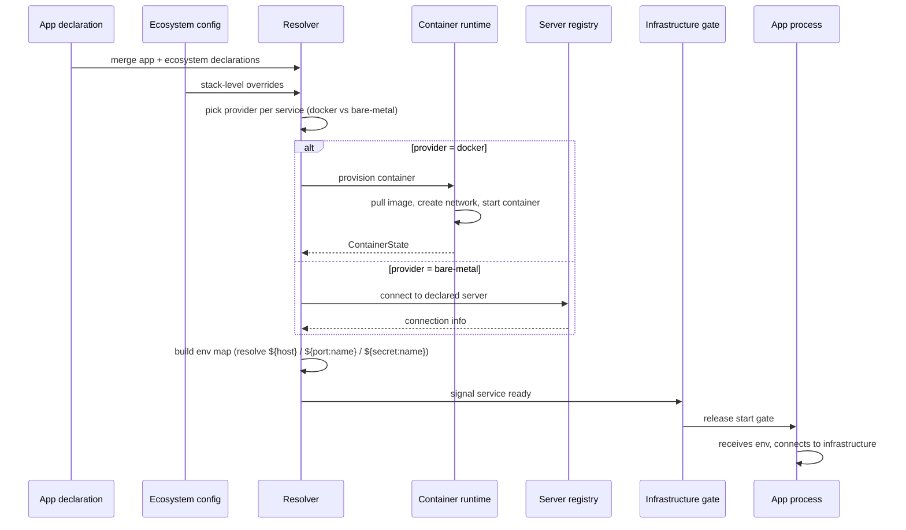
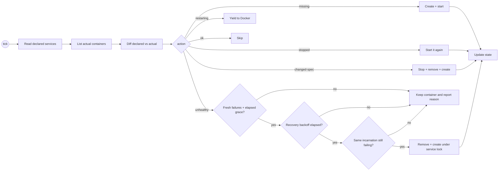
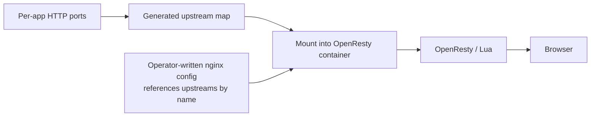

# Infrastructure

Omnitron treats infrastructure as **declarative dependencies of
your apps**. An app declares what it needs (a Postgres database,
a Redis instance, a custom blockchain daemon, anything). The
owning stack provisions missing services, resolves connection parameters and
injects them at app startup. A node allocation or externally managed stack uses
explicit connection settings without provisioning another copy of those services.

Use the [topology workspace](./topology.md) to inspect placements and bindings.
Cross-node repair, resource-aware placement and data recovery follow the
[control-plane design](./resilient-control-plane.md); provisioning a container alone
does not implement those guarantees.

Verified against `apps/omnitron/src/infrastructure/`:

```
infrastructure/
├── infrastructure.service.ts   — orchestrator service
├── service-resolver.ts         — picks the right provider per stack
├── container-runtime.ts        — Docker provider
├── stack-infra-manager.ts      — per-stack lifecycle
├── server-registry.ts          — bare-metal connection registry
├── config-normalizer.ts        — schema validation
├── gateway-generator.ts        — OpenResty config materialisation
├── infrastructure-gate.ts      — readiness barrier (block app start until deps healthy)
├── phantom-endpoint-janitor.ts — clean up dead resolutions
├── presets/                    — built-in presets (postgres, redis, minio, openresty, tor)
├── runtime/                    — runtime helpers (Docker compose builder, env injectors)
└── types.ts                    — public types
```

## Two layers of declaration

| Layer | What you declare | Where |
| ----- | ---------------- | ----- |
| **Ecosystem** | What services exist for the whole project | `omnitron.config.ts` → `infrastructure: { ... }` |
| **App** | What this specific app needs | `config/default.json` → `omnitron: { ... }` |

The ecosystem layer says "we run Postgres at port 5432 with these
databases"; the app layer says "I need access to the `main`
database with these env vars". The resolver wires the two
together.

## Infrastructure ownership

Dependency discovery answers what an application needs. It does not grant every
node permission to provision that dependency or run its migrations. A stack's
`infrastructureOwnership` declares that responsibility:

| Mode | Responsibility |
| --- | --- |
| `stack` (default) | The stack merges discovered requirements with infrastructure declarations, provisions services and owns their migrations |
| `controller` | A generated local node allocation starts applications using controller-supplied connection settings; its `managedOrigin` identifies the source project/stack |
| `external` | The stack starts applications against explicitly configured existing services; an external operator owns provisioning and migrations |

Generated allocations include both fields together:

```typescript
stacks: {
  deployed: {
    type: 'local',
    apps: ['api'],
    infrastructureOwnership: 'controller',
    managedOrigin: { project: 'sample', stack: 'test' },
  },
}
```

The controller remains responsible for the source stack's infrastructure. Restarting
its node allocation must not reinterpret application requirements as new
`sample/deployed` containers, substitute default database/Redis endpoints or rerun
migrations. The generated allocation retains resolved application configuration
and its explicit source binding. This governs Omnitron's provisioning and migration
stages; application-owned startup hooks still follow the application's own
configuration and must respect the same ownership policy.

Non-owning modes apply only to local application allocations, not the controller's
remote/cluster stack. They reject stack-level infrastructure declarations and
`serviceOverrides`, and ignore ecosystem defaults belonging to other stacks;
supply application connections explicitly. An owning
stack can still use per-service external overrides when only some dependencies
are external. Ownership diagnostics distinguish these cases from an unavailable
Docker daemon. External readiness remains **unknown** until endpoint reachability,
credentials and schema are verified by appropriate checks; skipping provisioning
is not proof that a database is ready.

An ownership refresh can release obsolete in-process monitors when a stack becomes
non-owning. It does not stop or remove containers, alter volumes or run migrations.
A legacy allocation with `managedOrigin` but no explicit ownership mode fails
closed until migrated. An older unbound generated configuration cannot be identified
from its name; it needs an audited source binding and compatible runtime. The new
generator does not retroactively fix running nodes.

## Readiness includes required service setup

A running container, a successful native health probe, and completed service setup
are separate facts. Omnitron retains all three. A preset with `postProvision` must
finish successfully before the infrastructure becomes ready. PostgreSQL database
creation and required extensions, and MinIO bucket creation with anonymous access
disabled, are required setup. Partial success does not allow the stack to report
ready; the diagnostic identifies the failed declaration.

Use `omnitron infra status --stack <project>/<stack>` or `omnitron stack status
<project> <stack>` to see the setup state and reason. Console shows the same evidence
in Containers and stack infrastructure. The Docker health column remains the native
probe result; it can say `healthy` beside a failed setup. `pending` means setup has
not completed, `ready` confirms completion for the observed container generation,
and `failed` includes its reason. An absent setup observation is **not verified**;
an older daemon or a native-only listing cannot prove setup succeeded. When the
local daemon is unavailable, `infra status` explicitly labels its native-only view.

Failed setup is retried with bounded backoff while native health permits it. This
does not restart an otherwise healthy container. New container identity, restart
time or changed setup declarations invalidate the previous confirmation. Backend
handoff preserves observations; native polling cannot erase a failed setup. An
older backend does not enforce these new setup diagnostics after rollback.

Custom preset hooks must be idempotent and throw on any required step failure.
PostgreSQL extensions must exist in the selected image. MinIO setup retries restore
`anonymous=none` even for a bucket created by an older configuration. Setup errors
use Titan diagnostics and redact known service credentials before limiting text.
An infrastructure readiness result does not attest application schema migrations,
external services or end-to-end application health; those have separate checks.

The native regression check `node test/runtime/preset-readiness.mjs dist` (from
`apps/omnitron` after building) requires cached PostgreSQL and MinIO preset images.
It creates only private containers with no network or published ports, bounded
CPU/memory and memory-backed data, and removes those exact containers afterward.

## Ecosystem layer — `InfrastructureConfig`

```typescript
// omnitron.config.ts
export default defineEcosystem({
  // ...
  infrastructure: {
    services: {
      db:      { preset: 'postgres', config: { databases: { main: {}, ledger: {} } } },
      cache:   { preset: 'redis' },
      storage: { preset: 'minio', config: { buckets: ['uploads'] } },
      gateway: { preset: 'openresty', config: { configDir: './infra/nginx' } },
    },
  },
});
```

Two forms supported per entry:

- **Preset shorthand** — `{ preset: 'postgres', config?: {...} }`. The
  preset registry expands to a full `IServiceRequirement`.
- **Full requirement** — direct `IServiceRequirement` object for
  custom services.

### Built-in presets

| Preset | Type | Default ports | Notes |
| ------ | ---- | ------------- | ----- |
| `postgres` | database | `5432` | Configurable extensions, databases, version |
| `redis` | cache | `6379` | Configurable maxmemory policy |
| `minio` | storage | `9000` (API), `9001` (console) | Buckets, quota, public/private |
| `openresty` | gateway | `8080` | Mounts `configDir`, hot-reloadable Lua |
| `tor` | daemon | configurable | Hidden service support |

Presets are versioned: bumping the omnitron version may change
preset defaults, but each project pins its own ecosystem config.

### Legacy shape

```typescript
infrastructure: {
  postgres:   { ... },
  redis:      { ... },
  minio:      { ... },
  gateway:    { ... },
  tor:        { ... },
  containers: { my-service: { ... } },
}
```

Still works for backward compatibility, but the unified
`services: { ... }` map is the canonical form going forward.

## App layer — `OmnitronAppConfig`

In each app's `config/default.json`:

```json
{
  "omnitron": {
    "database": true,
    "redis":    true,
    "s3":       { "bucket": "uploads", "quota": "10gb" },
    "services": {
      "discovery":     true,
      "notifications": true
    },
    "infrastructure": {
      "search": {
        "type": "daemon",
        "ports": { "http": 9200 },
        "env":   { "SEARCH_URL": "http://${host}:${port:http}" },
        "docker": { "image": "elasticsearch:8.11.0" }
      }
    }
  }
}
```

The resolver merges this with the ecosystem-level declaration
and produces the per-app env injection.

### Shorthand booleans

| Declaration | Effect |
| ----------- | ------ |
| `"database": true` | Auto-create one database for this app in the shared Postgres; inject `DATABASE_URL` |
| `"database": { "dedicated": true }` | Provision a dedicated Postgres container |
| `"database": { "dialect": "mysql" }` | Dialect hint (the preset architecture supports alternatives; only `postgres` ships built-in today) |
| `"redis": true` | Auto-assign a Redis DB index; inject `REDIS_URL` |
| `"redis": { "dedicated": true }` | Dedicated Redis container |
| `"s3": true` | Default bucket on the shared MinIO |
| `"s3": { "bucket": "X", "quota": "10gb" }` | Named bucket with quota |

### Custom infrastructure

For apps that need infrastructure beyond the presets, declare a
full `IServiceRequirement` under `infrastructure: { <name>: {...} }`.

## `IServiceRequirement` — the universal shape

```typescript
interface IServiceRequirement {
  description?: string;
  type?: 'database' | 'cache' | 'daemon' | 'gateway' | 'storage' | 'sidecar' | 'tool';

  // Named ports this service exposes
  ports: Record<string, number>;

  // Env vars to inject INTO THE APP (not the service container)
  env: Record<string, string>;

  // Optional health check definition
  healthCheck?: IServiceHealthCheck;

  // Other services this service depends on
  dependsOn?: string[];

  // Secrets injected via ${secret:name} templates
  secrets?: Record<string, string | SecretRef>;

  // Docker provisioning (dev/test)
  docker?: IDockerServiceConfig;

  // Bare-metal provisioning (prod)
  bareMetal?: IBareMetalServiceConfig;

  version?:        string;
  networkMode?:    string;       // 'regtest' | 'testnet' | 'mainnet' | custom
  critical?:       boolean;      // default true; app blocks on this
  startupTimeout?: number;       // default 120 000
}
```

### Env variable templating

The `env` values support three template placeholders:

| Template | Resolves to |
| -------- | ----------- |
| `${host}` | Provisioner-resolved hostname / IP |
| `${port:<name>}` | Resolved port for the named port |
| `${secret:<name>}` | Decrypted secret value at runtime |

Example:

```json
{
  "infrastructure": {
    "search": {
      "type": "daemon",
      "ports": { "http": 9200 },
      "env": {
        "SEARCH_URL":      "http://${host}:${port:http}",
        "SEARCH_API_KEY":  "${secret:searchApiKey}"
      },
      "docker": { "image": "elasticsearch:8.11.0" }
    }
  }
}
```

The app receives a literal `SEARCH_URL=http://localhost:9200` and
`SEARCH_API_KEY=<decrypted value>` at startup.

### Network modes

`networkMode` lets one declaration provision differently per
environment:

```json
{
  "ledger-daemon": {
    "type": "daemon",
    "ports": { "rpc": 18443 },
    "env":   { "LEDGER_URL": "http://${host}:${port:rpc}" },
    "docker": {
      "variants": {
        "regtest": { "image": "ledger:latest", "command": ["--regtest"] },
        "testnet": { "image": "ledger:latest", "command": ["--testnet"] },
        "mainnet": { "image": "ledger:latest", "command": ["--mainnet"] }
      }
    }
  }
}
```

Set `networkMode` at the stack level or via env var; the
resolver picks the matching variant.

## Provisioning flow



The **infrastructure gate** (`infrastructure-gate.ts`) blocks app
start until every `critical: true` service is healthy. Non-critical
services are best-effort.

## Stack-level overrides

```typescript
stacks: {
  dev: {
    type: 'local',
    serviceOverrides: {
      // All apps using 'search' connect to a dev cluster:
      search: { external: { host: '10.0.1.5', ports: { http: 9200 } } },
    },
  },
  prod: {
    type: 'cluster',
    serviceOverrides: {
      // Use specific image in prod:
      search: { docker: { image: 'elasticsearch:8.11.0-secured' } },
    },
  },
}
```

`IServiceOverride` shape:

- `external: { host, ports }` — disable provisioning, point at an
  existing server.
- `docker: { ... }` — override the Docker config.
- `bareMetal: { ... }` — override the bare-metal config.
- `disabled: true` — skip this service entirely for this stack.

Overrides can also be app-scoped using `<appName>/<serviceName>`
keys:

```typescript
serviceOverrides: {
  // Only the analytics app's search uses a custom image:
  'analytics/search': { docker: { image: 'opensearch:2.x' } },
}
```

## Docker provider

Docker is the default for `dev` / `test` stacks. The provider:

1. Pulls the image (if not local).
2. Creates the container network if missing.
3. Starts the container with declared ports / volumes / env.
4. Polls Docker's healthcheck until healthy (or `startupTimeout`).
5. Reports `ContainerState` to the resolver.

Container lifecycle is reconciled — the provider periodically
verifies declared services match running containers. Drifted
containers are restarted; orphaned ones are removed.

### `IDockerServiceConfig`

```typescript
interface IDockerServiceConfig {
  image?:        string;                              // required unless `build` given
  build?:        { context: string; dockerfile?: string; args?: Record<string,string>; tag?: string };
  portMappings?: Record<string, number>;              // host-port overrides, keyed by port name
  bindHost?:     string;                              // default '127.0.0.1'
  environment?:  Record<string, string>;              // env for the SERVICE container
  volumes?:      Record<string, string | IVolumeMount>; // name → mount path | full spec
  command?:      string[];
  entrypoint?:   string[];
  user?:         string;
  healthCheck?:  ContainerHealthCheck;
  resources?:    ResourceLimits;
  restart?:      string;                              // default 'unless-stopped'
  shmSize?:      string;
  network?:      string | IDockerNetworkConfig;
  extraHosts?:   string[];                            // e.g. 'host.docker.internal:host-gateway'
  labels?:       Record<string, string>;
  variants?:     Record<string, Partial<IDockerServiceConfig>>;   // for networkMode
}
```

Note `volumes` is a **map** (`name → path | spec`), not an array,
and container env is `environment` (not `env`). There is no
`privileged` / `capabilities` field.

### Container resource limits

`docker.resources` applies to service containers and Docker applications through
the same allocator:

```typescript
resources: {
  memory: '512m',
  memoryReservation: '256m',
  cpus: 0.5,
  shmSize: '64m',
}
```

Memory sizes use Docker's binary units. A positive RAM limit or reservation
must be at least 6 MiB; a reservation cannot exceed a nonzero hard limit. The
reservation is a soft target, not a hard cap. Zero memory or CPU removes that
limit; it does not configure swap. CPU values must be finite, nonnegative and
exactly representable in nano CPUs. A zero shared-memory size selects Docker's
default. Top-level `docker.shmSize`, when present, overrides
`docker.resources.shmSize`.

Validation runs before creating networks, volumes or containers. After creation,
Omnitron checks the actual Docker `HostConfig`, including CPU-quota overrides;
a desired-spec label alone is not proof that the limits are enforced. The same
observation participates in infrastructure reconciliation and handoff adoption.

**Existing deployments:** earlier versions could retain resource declarations
without passing them to Docker. Reconciliation now reports those containers as
requiring recreation, including stateful services. Inspect the plan, named
volumes, image pins and actual limits before a maintenance window. A backend
handoff must reject mismatched infrastructure instead of silently accepting it;
replacement container IDs are expected when recreation is required. Existing
named volumes are reused, but container replacement interrupts the service.

### `IVolumeMount`

```typescript
interface IVolumeMount {
  source:    string;     // host path (bind mount) or named volume
  target:    string;     // path inside the container
  readonly?: boolean;
}
```

Named volumes are created on demand and survive container
restarts. Bind mounts read from host paths verbatim.

## Bare-metal provider

For `prod` stacks (or wherever you don't want Docker), declare
bare-metal provisioning hints. These tell Omnitron how to
install / locate / validate the service on the target host:

```typescript
{
  type: 'database',
  ports: { tcp: 5432 },
  env: { DATABASE_URL: 'postgres://${secret:db_user}:${secret:db_pass}@${host}:${port:tcp}/main' },
  bareMetal: {
    systemdUnit:     'postgresql',
    dataDir:         '/var/lib/postgresql/data',
    validateCommand: 'pg_isready',
  },
  secrets: {
    db_user: { secret: 'db_user' },
    db_pass: { secret: 'db_pass' },
  },
}
```

For an external host you don't manage, prefer a stack
`serviceOverride` with `external: { host, ports }` (see below) —
that disables provisioning and just wires up the connection.

### `IBareMetalServiceConfig`

```typescript
interface IBareMetalServiceConfig {
  apt?:             { latest: string[]; repository?: string };
  installCommand?:  string;   // install the service executable
  systemdUnit?:     string;   // systemd service name
  configFile?:      string;   // config path on the target machine
  configTemplate?:  string;   // template (uses ${...} syntax)
  dataDir?:         string;   // data dir; omnitron ensures it exists
  user?:            string;   // user to run the service as
  bindAddress?:     string;   // bind address for remote/cluster stacks
  validateCommand?: string;   // check whether the service is installed
  variants?:        Record<string, Partial<IBareMetalServiceConfig>>; // per networkMode
}
```

There is no service-discovery layer here (no `consul` / `k8s`
provider) — bare-metal config describes install + on-disk layout.
Live external endpoints are wired via `serviceOverrides.external`.

### Tracking host packages

Declare host dependencies under the bare-metal variant that consumes them. For example, a service that uses a system Tor proxy can track the stable release for the host distribution.

```json
{
  "apt": {
    "latest": ["tor", "tor-geoipdb"],
    "repository": "https://deb.torproject.org/torproject.org"
  }
}
```

The optional HTTPS repository selects its `<VERSION_CODENAME>/main` binary channel. Configure it on the node with a scoped `Signed-By` key. Without a repository, the host's APT policy selects the candidate. A systemd dependency such as `Requires=tor@default.service` orders services and carries no package version constraint.

`omnitron infra inspect <project>/<stack>` reads local indices and reports installed and candidate versions, package holds and source mismatches. Administrators can read the same evidence under **Stacks → Diagnose → Inspect hosts** in Console. Stack provisioning refreshes the indices before resolving versions. The preview lists any new transitive dependencies. Provisioning checks the selection again and refuses removals, downgrades, changes to other installed packages or a changed dependency set. Package maintainer scripts can restart services, so review a live upgrade in a maintenance window. Package checks run on inspection and provisioning. Configure scheduled patch maintenance on the host when you need updates between deployments.

The Docker `tor` preset has a separate package lifecycle. Its Alpine 3.24 entrypoint resolves Tor from the stable branch at startup, including when the container already has a package installed. Running processes keep their current binaries until restarted. Inspect the system proxy and the onion gateway independently.

## Container state

The `OmnitronInfra` RPC service exposes:

```typescript
interface ContainerState {
  name:        string;
  image:       string;
  status:      'not_found' | 'created' | 'running' | 'paused' | 'restarting' | 'exited' | 'dead';
  containerId?: string;
  ports?:      Record<string, number>;
  health?:     'healthy' | 'unhealthy' | 'starting' | 'none';
  healthCheck?: { completedAt: string; exitCode: number };
  startedAt?:  string;
  error?:      string;
}

interface InfrastructureState {
  services:        Record<string, ContainerState>;
  ready:           boolean;
  lastReconciled?: string;
}
```

`omnitron infra status` / `omnitron infra ps` print this.

Health is a current Docker probe only while the container is `running`. A stopped,
paused or restarting container reports its lifecycle status and `health: none`;
Docker's saved probe from its previous run is not reused as a current verdict.
Exit failures, OOM kills and their reasons remain available in `error`. The same
reading feeds CLI, Console and topology.

## Reconcile loop

A periodic reconciler runs inside the daemon:



The reconciler runs every 30 s, plus on demand (`omnitron infra up` /
`infra down`).

### Applying changed declarations

After rereading a project's configuration, starting its stopped or failed stack
resolves the current infrastructure declaration again. The local manager and
receiving node apply this plan through the same provisioning path. An existing
observer is reused; its first declaration is not a permanent cache. Starting an
already running stack remains idempotent and does not deploy configuration changes.

A changed image, environment, mount, command or native health check goes through
normal specification reconciliation. Only affected containers are recreated;
unchanged services keep their native identities. Named volumes remain in place.
Changing database or bucket setup invalidates its previous readiness result even
if the container specification is unchanged, and required setup must succeed again.
Container replacement can interrupt the affected service: plan that interruption
and verify data/schema compatibility before applying a changed declaration.

The complete candidate is resolved before replacing the previous definition.
Earlier health sweeps, native reconciliation and endpoint cleanup drain first.
Concurrent provisioning, stop, ownership refresh or backend handoff cannot silently
acknowledge a conflicting operation for the same stack. A failed retry retains the
observer and the accepted desired state for diagnosis and retry. Invalid resolution
leaves the previous definition intact.

Removing a declaration releases its observer; it does **not** delete that
container or its data. Explicit removal still requires the ordinary reviewed stop
path for the resources owned by the stack. Monitoring-only ownership refresh also
remains separate: it cannot change the specification of a retained container.

Run `node test/runtime/stack-infrastructure-reconfiguration.mjs dist receipt.json`
from `apps/omnitron` after building to exercise native reconfiguration, idempotent
retry and reviewed stop/start with a retained volume sentinel. The fixture uses
two isolated containers from cached `alpine:3.24`, publishes no ports, and removes
only its own containers and temporary volume after verification.

### A container you stopped comes back

This is the branch operators meet first and it is easy to mistake for
something else. **A declared service that is not running is started again
within one tick** — up to 30 seconds after you stopped it, `docker stop`
looks undone. The daemon logs `Service not running — auto-restarting`.

It is worth knowing before you try to reproduce an outage against
infrastructure: `docker stop sample-dev-redis` lasts only until the next
reconciliation tick, rather than holding the service down. The container's own `RestartCount`
stays `0` — Docker did not do it — while `StartedAt` moves, which is how you
tell this apart from a Docker restart policy. To hold a service down, stop it
through `omnitron infra down` (which is a declared intent, not a drift the
reconciler corrects), or run a throwaway container the daemon does not manage.

### When it stops trying

A failed restart enters exponential backoff: 30 seconds, doubling to a ceiling
of 15 minutes. Recovery of a running **unhealthy** container uses the same delay
and counts every recreation attempt, including a successful creation whose new
container has not become healthy. `starting`, unknown health and a successful
create call do not establish recovery. A running container observed as `healthy`
(or declaring no native probe), with no failed required setup, clears the delay.
Backoff remains visible in the daemon's diagnostic log.

Unhealthy recovery requires all of the following:

- Different completed, failed Docker probes for the same full container ID and
  `StartedAt`; rereading one cached result does not count as another failure.
- At least 60 seconds since the first valid observation of that unhealthy
  incarnation, with a new failure at or after the deadline.
- A last probe no older than 60 seconds, not dated in the future or before the
  current container start. Missing or invalid native evidence leaves the
  container in place and logs why recovery is waiting.
- An expired retry delay and a fresh native inspection immediately before
  removal. A recovered, restarted or replaced container cancels that decision.

Docker's own `restarting` state is left to its native restart policy. Automatic
health recovery and ordinary provisioning use the same per-container mutation
lock, and both drain before monitoring ownership is handed off. Only the exact
native ID with matching Omnitron allocation labels can be removed. Probe command
output is excluded from `healthCheck`; the metadata contains only completion
time and exit code, so command output cannot leak through this diagnostic field.

Backend handoff retains native failure evidence and retry delays. Importing an
older snapshot starts a new confirmation window: historical poll counts cannot
prove distinct failures. A rollback to an older backend restores that version's
recovery policy; it does not retain the newer safety guarantees.

To verify Docker's real probe timestamps and elapsed grace, run
`node test/runtime/native-health-recovery.mjs dist` from `apps/omnitron` after
building. It uses a cached `alpine:3.24` image in one disposable container with
0.25 CPU, 32 MiB memory, no network, ports or volumes. It observes actual failure
and recovery for at least 60 seconds, then removes only its own container.

## Phantom endpoint janitor

Apps that crash or are removed leave behind stale env injections
in the state store. The phantom janitor sweeps these:

- Endpoints referenced only by removed apps → marked phantom.
- Phantom endpoints older than the retention window are dropped
  from the state store.
- Underlying Docker containers are not removed unless explicitly
  requested (operator might want to keep data around).

## Secrets in infrastructure

Declared via `secrets` per service:

```json
{
  "secrets": {
    "db_password": { "secret": "production_db_password" },
    "api_key":     { "secret": "search_api_key" }
  },
  "env": {
    "DB_PASS": "${secret:db_password}",
    "API_KEY": "${secret:api_key}"
  }
}
```

The string before `:` is the logical name used in templates; the
`{ secret: 'X' }` refers to a key in the daemon's encrypted
secret store (`omnitron secret set X ...`). Secrets are resolved
**at injection time** — never written to disk.

## Health checks per service

A health check is a single discriminated `{ type, target }` pair,
not a set of nested probe blocks:

```typescript
interface IServiceHealthCheck {
  type:    'http' | 'tcp' | 'command' | 'jsonrpc';
  target:  string;        // http: URL path · tcp: port name · command: shell cmd · jsonrpc: method
  interval?:    string;   // default '30s'
  timeout?:     string;   // default '10s'
  retries?:     number;   // default 5
  startPeriod?: string;   // grace before first check; default '30s'
  jsonrpc?: { port: string; method: string; path?: string; auth?: {...} };
}
```

```json
{ "healthCheck": { "type": "command", "target": "pg_isready -U postgres", "interval": "5s", "retries": 10 } }
{ "healthCheck": { "type": "tcp",  "target": "tcp" } }
{ "healthCheck": { "type": "http", "target": "/healthz", "timeout": "10s" } }
```

Four probe types — `http`, `tcp`, `command`, and `jsonrpc` (the
last for blockchain daemons). The infrastructure gate uses these
to decide when to release the start gate for dependent apps.

## API gateway integration

When `gateway` is configured (preset or custom), Omnitron
materialises an OpenResty config from your `configDir` plus
auto-generated upstream maps. The `gateway-generator.ts` does this.



This means your app process can move ports and the operator-
written nginx config doesn't change — the generated upstream map
always points at the current location.

## CLI surface

| Command | Effect |
| ------- | ------ |
| `omnitron infra up` | Provision all infrastructure |
| `omnitron infra down` | Stop and remove owned standalone containers by their observed Docker IDs. Their volumes are retained. The legacy `--volumes` flag returns an error. |
| `omnitron infra status` (`ps`) | Container inventory |
| `omnitron infra logs [service] [-f] [-n N]` | Tail container logs |
| `omnitron infra psql [database]` | Open psql against the managed Postgres |
| `omnitron infra redis-cli` | Open redis-cli against the managed Redis |
| `omnitron infra migrate [app] [--dry-run]` | Resolve and run workspace package migration scripts in dependency order. Use `--dry-run` to inspect the packages. |
| `omnitron infra reset --yes` | Recreate owned standalone containers and reuse their existing volumes. |

→ Full reference: [CLI / Infrastructure](./cli.md#infrastructure).

## Failure modes

| Symptom | Cause | Fix |
| ------- | ----- | --- |
| App stuck "waiting for infrastructure" | Critical service unhealthy or timing out | `omnitron infra status` to check; bump `startupTimeout` |
| `omnitron infra up` reports port collision | Two stacks competing for the same port | Use `portOffsets` in stack settings |
| Reconciler keeps recreating a container | Image changed but cache stale | `docker pull` or `omnitron infra reset` |
| Phantom env vars in app | Old service declaration not cleaned | Phantom janitor handles automatically; rerun after retention window |
| Health check passes but app can't connect | Network firewall / Docker network mismatch | Verify the container is on the right network; check `omnitron infra logs <service>` |

## Anti-patterns

- **Hardcoding `DATABASE_URL` in app code.** The whole point of
  the subsystem is to inject it. Read `process.env.DATABASE_URL`.
- **Skipping `critical: true` on essential services.** Without it,
  the app starts before the database is ready and crashes
  hard. Default is `true`; leave it.
- **Sharing a `redis` instance between dev and staging without DB
  offsets.** Keyspaces collide. Use `portOffsets` and
  `redisDbOffset`.
- **Using container reset to clear a database.** Reset retains named volumes. Use the database’s own reviewed maintenance procedure to change its contents.
- **Embedding secrets in env templates as literals.** Use the
  `${secret:X}` template; the daemon decrypts at injection time.
- **Bypassing the resolver to write Docker compose by hand.**
  Drifts from `omnitron.config.ts` cause reconciler thrashing.

## See also

- [Configuration](./configuration.md) — where `infrastructure: { ... }` lives
- [CLI](./cli.md#infrastructure) — `omnitron infra ...`
- [Services reference](./services-reference.md) — `OmnitronInfra` methods
- [Architecture](./architecture.md#infrastructure-subsystem) — where this fits

## Readiness before provisioning

Use `omnitron stack diagnose <project> <stack>` or **Stacks → Diagnose** before
starting an environment. This is an observation, not a dry-run execution of
application hooks. It resolves the local infrastructure plan using the same
resolver as provisioning, without reserving ports or registering a new owner.

Automatically inferred database and bucket requirements survive explicit port
or credential overrides. Conflicting declarations for the same container refuse
the plan instead of silently choosing the first application's specification.
An invalid service preset fails resolution rather than falling back to a different
legacy plan. See [Console readiness reports](./console.md#stacks) for coverage and
[CLI exit codes](./cli.md#stack-management) for automation.
