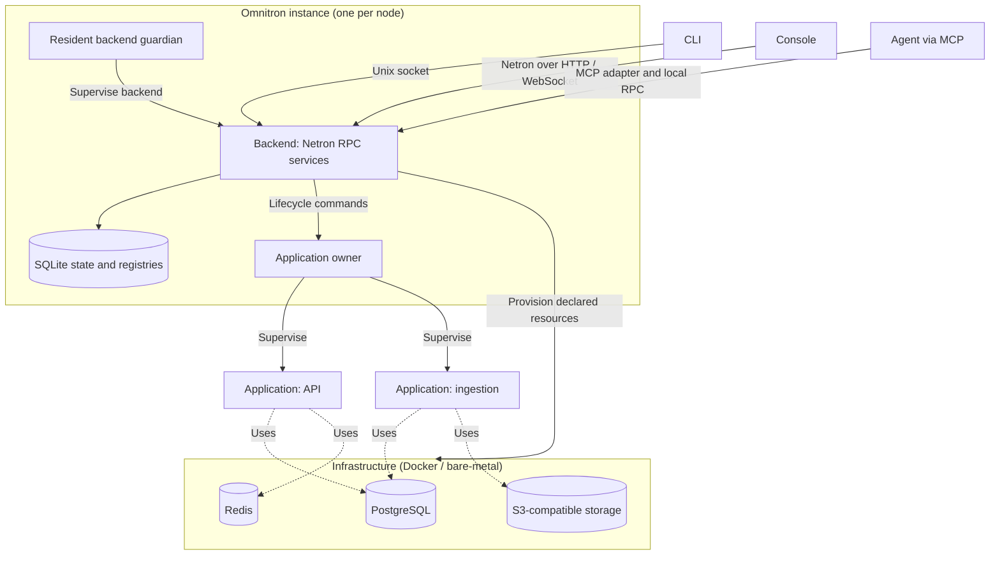
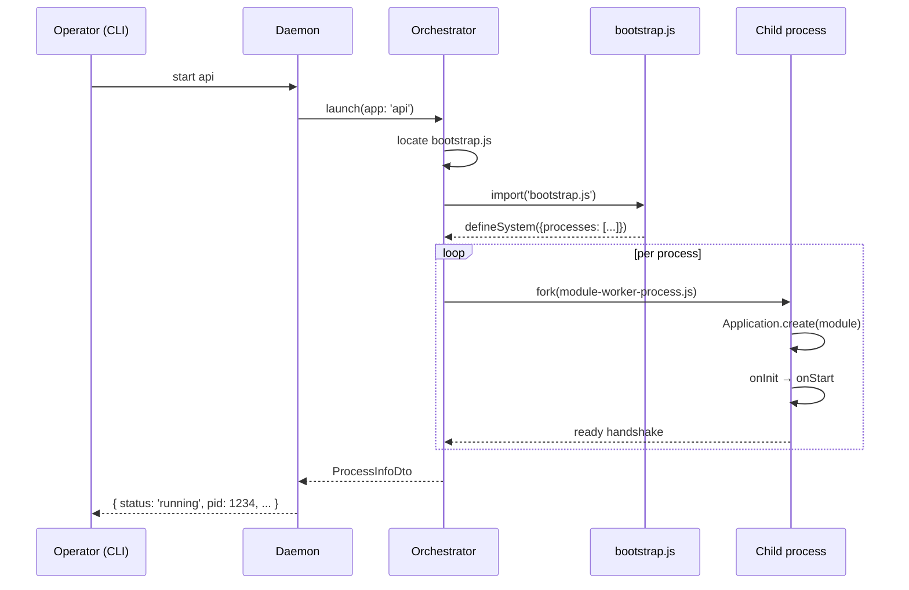

# Omnitron

> **Omnitron is opt-in.** Titan apps run perfectly well without
> it as plain Node processes — see
> [Titan vs Omnitron](../foundations/titan-vs-omnitron.md) for
> the precise boundary. This page describes what you gain by
> adding the Omnitron supervisor on top.

**Omnitron is the supervisor, control plane, and operator surface
for Titan applications.** One long-running daemon manages many
processes across many apps across many projects, exposes a typed
RPC plane for inspection, ships a CLI and a web console, and
provisions the infrastructure your apps need.

It's itself a Titan app — supervising other Titan apps. Built on
the same primitives the apps it supervises use.

```bash
pnpm add -g @omnitron-dev/omnitron
omnitron up                          # start daemon + all configured apps
omnitron status                      # see what's running
omnitron logs --grep error           # tail filtered logs
omnitron webapp open                 # open the web console
```

## What you get {#what-you-get}

| Layer | Responsibility |
| ----- | -------------- |
| **CLI** | One `omnitron` entry point for applications, stacks, deployments, infrastructure, diagnostics and backend updates. |
| **Daemon** | Typed Netron control plane with durable local state. Coupled mode owns applications directly; resident mode keeps them in an independent owner. |
| **Orchestrator** | Per-app launch pipeline: TS compile / module load / fork process / wire DI / start lifecycle / watch files in dev |
| **Process tree** | One OS process per `IProcessEntry` you declare; ≥ 1 instances per process; auto-restart with exponential backoff |
| **Services** | Role-protected daemon RPC for authentication, deployment, fleet inventory, secrets, infrastructure and diagnostics. Availability depends on daemon role. |
| **Webapp** | React + Vite single-page console — same RPC surface; lives at `apps/omnitron/webapp/` |
| **Infrastructure** | Provisions Postgres / Redis / S3-compatible / custom containers via Docker (dev) or bare-metal hooks (prod) |
| **MCP** | Built-in Model Context Protocol surface — let agents (IDE assistants, CI bots) read state and trigger operations |

## When you reach for Omnitron {#when-you-reach-for-omnitron}

- **You have ≥ 2 Titan apps** and want one place to start, watch,
  inspect, and shut them down together.
- **You need a typed control plane**, not bash scripts. Every
  operator action goes through Netron RPC with auth, RBAC, and
  audit.
- **You want dev / staging / prod parity** with declarative infra
  — the same `omnitron.config.ts` boots Docker locally and
  bare-metal remote, with secrets resolved per environment.
- **You operate a fleet** — multiple nodes, leader election,
  remote daemons addressed by alias, cross-node health and
  metrics.
- **You want the console UI for free** — `omnitron webapp open`
  serves the React console talking to the same daemon.

If you only ever run **one** Titan app on **one** machine, `node
my-app.js` may be enough. Omnitron starts to pay back at two apps
or two machines.

## The mental model {#the-mental-model}



The diagram shows **resident mode**: the owner retains applications while the
guardian replaces the backend. In default coupled mode, the backend also owns
the application lifecycle. Moving from coupled to resident mode requires an
initial application restart; later compatible backend handoffs can preserve
those processes. See [backend replacement](./backend-handoff.md).

Ordinary CLI invocations are short-lived RPC clients. Follow and watch commands
keep their connection or polling loop for as long as the operator needs it.

## Filesystem layout {#filesystem-layout}

By default, Omnitron stores its control-plane files in `~/.omnitron/`.
`OMNITRON_HOME` selects another instance directory. This is a selected layout:

:::filetree{title="~/.omnitron/"}
- `daemon.sock` — Private management socket
- `daemon.pid` — Backend process identity
- `data/`
  - `daemon-state.db` — Registries, execution intent and persisted state
  - `application-logs.sqlite` — Application log delivery journal
  - `backend-logs.sqlite` — Backend log delivery journal
- `runtime/`
  - `releases/` — Verified, installed backend runtimes
- `execution/` — Resident owner and guardian control files
- `secrets.enc` — Encrypted file-provider secrets
- `logs/`
  - `omnitron.log` — Backend log
  - `omnitron.error.log` — Backend errors
- `projects/` — Project and stack state, including application log archives
:::

The current state store is SQLite; `state.json` is only an import source for
older installations. Project builds, configured backup destinations, container
volumes and native service definitions have their own locations. The
[observability guide](./observability.md#putting-it-together--what-the-daemon-stores)
distinguishes query storage from delivery journals and log archives.

## Default endpoints {#default-endpoints}

| Plane | Endpoint | Purpose |
| ----- | -------- | ------- |
| Management | `unix://~/.omnitron/daemon.sock` (mode `0o600`, owner-only) | CLI ↔ daemon — `OmnitronDaemon` service + the rest of the built-in services |
| TCP | `tcp://127.0.0.1:9700` by default | Authenticated daemon RPC; configure the bind address for remote access |
| Console | `http://localhost:9800` by default | Browser interface; publication and backend endpoints follow the configured gateway |

The Unix socket is the **trust boundary** — owner-only file
permissions make local CLI calls implicit-auth. TCP and HTTP
require JWT.

## A minimal `omnitron.config.ts` {#a-minimal-omnitronconfigts}

The single configuration file at the repo root:

```typescript
import { defineEcosystem } from '@omnitron-dev/omnitron';
import { fileURLToPath } from 'node:url';
import path from 'node:path';

const __dirname = path.dirname(fileURLToPath(import.meta.url));

export default defineEcosystem({
  apps: [
    {
      name:        'api',
      bootstrap:   path.join(__dirname, 'apps/api/dist/bootstrap.js'),
      cwd:         path.join(__dirname, 'apps/api'),
      env:         { NODE_ENV: 'production' },
      watch:       { enabled: true, paths: ['src/**/*.ts'] },
    },
    {
      name:        'worker',
      bootstrap:   path.join(__dirname, 'apps/worker/dist/bootstrap.js'),
      cwd:         path.join(__dirname, 'apps/worker'),
    },
  ],
  supervision: {
    strategy: 'one_for_one',
    maxRestarts: 5,
    window: 60_000,
    backoff: { type: 'exponential', initial: 1_000, max: 30_000, factor: 2 },
  },
});
```

Each app's `bootstrap.ts` exports a `defineSystem(...)` that
declares the **processes** (one OS process per `IProcessEntry`).

## How an app launches {#how-an-app-launches}



Each `IProcessEntry` declared in `defineSystem(...)` becomes
exactly one fork (or a pool when `instances > 1`). The child
imports **only** that module's file — no full bootstrap re-load —
so dependencies stay process-isolated.

## Multi-project / multi-stack {#multi-project--multi-stack}

A **project** owns one or more **stacks**. Each stack selects application
configuration, infrastructure and placement for an environment:

| Project | Stack | Applications |
| --- | --- | --- |
| `monorepo-A` | `dev` | `api`, `worker` |
| `monorepo-A` | `staging` | `api`, `worker`, `batch` |
| `monorepo-A` | `prod` | `api`, `worker`, `batch`, `scheduler` |
| `monorepo-B` | `prod` | `gateway`, `events` |

Stack-aware commands (`omnitron stack status <project> <stack>`)
operate on that stack. Environments can share a node or target different
nodes; they remain configurations of the same project. See
[projects and stacks](./projects.md) for placement and lifecycle commands.

## Built-in observability {#built-in-observability}

The supervisor captures process state and output. Additional signals depend on
application instrumentation and configured collectors:

| Signal | Where |
| ------ | ----- |
| Application output and structured logs | Durable capture and rotated per-application files; see [logs](./observability.md#logs) |
| Per-process metrics | aggregated by daemon, exposed via RPC + Prometheus text |
| Health probes | Application-provided checks and declared readiness probes |
| Crash tracking | Restart count, last error, backoff state |
| Distributed traces | Configured application tracing and collectors |

Both the CLI and webapp read these through the daemon — there's no
separate metrics agent to deploy.

## Webapp (Omnitron Console) {#webapp-omnitron-console}

The console is a React + Vite + MUI SPA that lives at
`apps/omnitron/webapp/` and talks to the daemon via the
`@omnitron-dev/netron-react` integration and browser client. It gives you:

- Project + stack view with per-app status cards
- Live log streams with filtering
- Metric charts (CPU / RSS / event-loop lag / RPC latency)
- Health probes and restart history
- Infrastructure inventory (Docker containers)
- Secret editor (against the daemon's encrypted store)
- Fleet view across remote daemons

The published package includes Console assets. `omnitron webapp start`
reconciles the serving gateway; `omnitron webapp open` opens the configured
address. `omnitron webapp build` is for a source checkout. For development, run `pnpm dev` in `apps/omnitron/webapp/`
for a Vite dev server with HMR.

→ Full webapp reference: [console](./console.md).

## Compatibility {#compatibility}

| Component | Requirement |
| --------- | ----------- |
| Node.js | Use a supported runtime from the [compatibility reference](../reference/compatibility.md); native dependencies are qualified for the target Node and OS |
| OS | macOS, Linux. Windows works for CLI + non-supervisor commands; daemon assumes Unix sockets |
| Docker | Required for `infra` commands (provisioning Postgres / Redis / etc.) |
| Bun / Deno | Apps may run on Bun/Deno individually, but the daemon expects Node |

## Where to go next {#where-to-go-next}

- **Architecture deep-dive:** [Architecture](./architecture.md) —
  every component, every plane, every data flow.
- **CLI reference:** [CLI](./cli.md) — every command, every flag.
- **Daemon internals:** [Daemon](./daemon.md) — PID, state-store,
  scheduler, lifecycle.
- **Orchestrator:** [Orchestrator](./orchestrator.md) —
  bootstrap, file watcher, dependency resolver.
- **RPC services:** [Services reference](./services-reference.md) —
  all built-in services and their methods.
- **Console UI:** [Console](./console.md).
