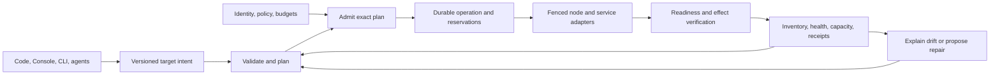

# Resilient control plane

Omnitron should turn operational intent into verified infrastructure state. A
developer, operator, security engineer or agent chooses the outcome and its allowed
constraints. The platform owns planning, admission, execution, recovery and evidence.
Adding a convenient button around an untracked shell command does not satisfy this contract.

:::info Design status — 31 October 2026
This is the target architecture and implementation acceptance contract. The
[topology workspace](./topology.md) implements observation, portable target drafts,
validation and durable acceptance. Existing release verification, resident process
ownership, Xec execution and monitoring are reusable foundations.

Fleet-wide automatic placement, admitted topology migrations, delegated agent
execution and stateful failover are not implemented by that workspace. The following
models and policies specify their development; they are not new configuration
options that can already be enabled in `omnitron.config.ts`.
:::

## One lifecycle, explicit responsibility

The reconciliation loop is event-driven, with bounded periodic inventory repair.
A missed event must delay convergence, not permanently hide drift. Events wake the
controller; the authoritative state and operation journal decide what it may do.

Every mutation follows the same lifecycle. Domain adapters determine what execution
and verification mean. A process restart, PostgreSQL promotion and route change share
authorization, journaling and observability; they do not share a fictional universal rollback.

| Layer | Owns | Must not duplicate |
| --- | --- | --- |
| Kysera | Database transactions, query facilities and migration machinery | Infrastructure placement or node lifecycle |
| Titan database | Application integration, database lifecycle, migration facade and provider capabilities | A second migration engine |
| Titan core / Netron | Contracts, principal propagation, transport, lifecycle, diagnostics and reusable dependency planning | Project/environment policy |
| Titan PM | Local processes, pools, supervision, readiness and in-process workflows | Fleet scheduling or data failover |
| Optional durable workflow facility | Persisted operation transitions, effect reconciliation, cancellation and compensation contracts | Provider-specific SSH, SQL or container management |
| Xec | Local/remote execution, SSH, streaming, scripts and cancellation | Deployment admission or permission policy |
| Omnitron | Environment intent, resources, placement, release admission, repair policy, adapters and operator read models | Another process supervisor, SSH stack or generic role engine |
| Prism / Console / CLI | Accessible interaction, review, progress and evidence | Independent scheduling or authorization decisions |
| Application | Workload/resource declarations, readiness, domain recovery and compatibility contracts | Private deployment or retry frameworks |

Keep optional capabilities independently importable. The basic local daemon should
not require a consensus service, agent SDK, cloud account or container runtime.
Unsupported capabilities are discoverable and cause a precise plan refusal.

## Audit of the existing foundations

These findings determine the implementation sequence rather than a parallel replacement platform.

| Existing implementation | Reuse | Boundary to close before autonomous execution |
| --- | --- | --- |
| Release manifests, gates, `verifiedOn`, attestations and artifact checksums | Promote verified immutable artifacts | Attest the complete placement/runtime combination; current on-node attestation deliberately refuses multi-node coverage it has not measured |
| Resident owner and backend handoff | Keep application processes alive while replacing the backend | Local owner fencing is not evidence that a lost remote server stopped writing |
| Stack deployment and node execution leases | Serialize existing host deployment effects | Legacy `project/deployed/app` identity and per-project node configuration cannot isolate arbitrary stacks/allocations on one host |
| Titan PM pools | Local concurrency, backoff and health | Host pools do not decide fleet capacity or failure-domain placement |
| Titan PM workflows | Stages, dependency ordering and compensation | Execution state is in memory; it is not a durable recovery journal |
| Pipeline execution | Reviewed revisions, bounded output, cancellation and interrupted-run reporting | Interrupted external effects are not automatically replayable |
| SQLite state store and telemetry outboxes | Local durability and independently acknowledged delivery | A telemetry receipt is neither a control-plane quorum nor proof of a workload's database recovery |
| Cluster election and configuration sync | Discovery/status compatibility during migration | Election terms/votes are in memory; configuration sync is not a replicated command log; anonymous vote/heartbeat endpoints are not authenticated machine authority |
| Existing roles and `@omnitron-dev/access` | Shared role hierarchy and permission matching | Resource-scoped delegation, live budgets and per-step grants need enforcement; role names alone do not provide them |

Relevant source boundaries are `project/topology-control.ts`, `project/topology-state.ts`,
`project/stack-placement.ts`, `release/manifest.ts`, `services/node-deploy-lease.ts`,
`project/node-app-config.ts`, `cluster/leader-election.ts`, `cluster/cluster.rpc-service.ts`
and `packages/titan-pm/src/process-workflow.ts`.

The current remote stop path also needs a node-confirmed lifecycle contract: disconnecting
the master's peer or clearing its local status cannot count as stopping remote processes.
No automatic migration may depend on that shortcut. All accepted target edits are
isolated from executable configuration until an execution path satisfies these boundaries.

## Resource model

Use one canonical environment model. Existing stacks become its compatibility surface;
do not maintain an unrelated environment scheduler beside the stack manager.

| Resource | Stable identity and meaning |
| --- | --- |
| Project | Ownership boundary; display names can change without changing identity |
| Environment | `dev`, `test`, `stage`, `prod` or another name; release policy, quotas, bindings and availability goals |
| Workload | Logical application/service, artifact reference, runtime adapter, resources, readiness and state contract |
| Replica / allocation | A particular workload revision placed on a node incarnation with resource reservations |
| Node | Registered machine identity, current incarnation, verified capabilities and measured capacity; its address is replaceable |
| Node pool | Eligible resources, failure domains, reserve policy, trust boundaries and acquisition budget |
| Service binding | A logical consumer/provider relationship resolved to actual endpoints and secret references at execution |
| Data resource | Storage identity, replication/backup ownership, recovery evidence, RPO and RTO |
| Route | Traffic or publication relationship, update strategy and readiness conditions |
| Operation | Durable attempt to realize a reviewed plan, with steps, receipts and recovery state |

Node ID, node incarnation, workload ID, replica slot and process PID are distinct.
Reusing an IP address must not inherit a dead server's execution authority or writer
identity. A replacement node enrolls as a new incarnation and is verified before admission.

Desired, admitted and observed state are separate revisions:

- **Desired** describes the target an authorized actor accepted.
- **Admitted** identifies the exact plan, artifact set, policy revision and resource
  reservations allowed to produce effects.
- **Observed** contains evidence from an owner/runtime, its observation time and
  freshness. Missing evidence is `unknown`, not zero, healthy or stopped.

Each resource has explicit field ownership. Git-managed intent cannot be silently
rewritten by Console or an agent. Console can propose a change to it, or operate
fields assigned to runtime policy. Admission resolves conflicts rather than relying
on whichever controller wrote last.

## From a laptop to production

Development uses local source and fast feedback. Test/stage/prod consume immutable
releases under environment policy. Production promotion references the same verified
artifact identity instead of rebuilding from the developer's current working tree.
Reuse the existing [release manifest and verification](./releases.md) contracts.

An artifact set must identify source revisions, dependency lock, platform/architecture,
runtime compatibility, application artifacts, migration set and configuration schema.
Secrets remain versioned references. A secret rotation or policy change can invalidate
an outstanding plan without exposing values in its digest or UI.

Static frontends require an explicit choice: runtime configuration with one immutable
bundle, or separately built and attested variants within one release manifest. A test
bundle with baked-in endpoints cannot be claimed byte-identical to a different production
bundle. Multi-architecture builds similarly keep distinct checksums in the same release.

Promotion proceeds through environment-specific gates: artifact verification, capacity,
data compatibility, candidate readiness, smoke tests and traffic checks. A result from
one node cannot attest every replica. Persist the exact measurements and freshness
conditions used to admit the next environment.

Run schema migrations once under the existing Titan database/Kysera coordination
contract, not once per replica. Prefer expand/contract changes that allow old and new
application revisions to overlap. A release rollback must explicitly assess schema and
data compatibility; changing an application symlink cannot undo an irreversible migration.

## Placement and reserve capacity

Separate feasibility from ranking. A lightly loaded but incompatible machine is not
a candidate. This distinction also appears in [Nomad's scheduling model](https://developer.hashicorp.com/nomad/docs/concepts/scheduling/how-scheduling-works):
logical work and node allocations are separate, candidate constraints precede scoring,
and concurrent plans require admission conflict checks.

Feasibility checks include:

- Environment/pool permissions, node identity and incarnation, maintenance/quarantine state.
- OS, architecture, runtime version and required execution/storage/network capabilities.
- CPU, memory, disk, I/O and other declared resources, including outstanding reservations.
- Reachability of required services, data locality and storage attachment constraints.
- Failure-domain spread, anti-affinity, required co-location, ports and availability budget.
- Sufficiently fresh capacity and health evidence; missing measurements do not mean idle.

Rank only feasible candidates using a versioned, deterministic policy. Consider
effective headroom, pressure, locality, failure-domain spread, expected startup cost
and operational cost. Expose each score component and rejected constraint in the plan.
Stable tie-breaking prevents unexplained movement between equivalent nodes.

Resource accounting must distinguish managed reservations from unmanaged load. Do not
subtract both reservation and usage for the same workload twice. Reserve operating-system
headroom and account for temporary overlap during rollout. Refresh measured unmanaged
load and reject stale plans before committing reservations in the authoritative store.

A CPU percentage alone is insufficient: 90% on different core counts is not the same
capacity, and a memory-constrained service cannot be placed because CPU is idle. Distinguish
hard enforcement from advisory accounting. A node without the required isolation/resource
enforcement capability cannot host a workload whose policy requires that guarantee.

Warm reserve nodes are enrolled, authenticated, healthy, compatible and included in
inventory before an incident. Cold/unreachable machines are not immediately usable
capacity. Pool policy distinguishes emergency reserve from ordinary scaling capacity
and records when recovery consumes the reserve.

If no preferred node qualifies, a bounded emergency policy may allow temporary placement
on a different eligible node with a named expiry, resource ceiling and remediation task.
It must still satisfy security, data and minimum-availability constraints. Never silently
evict another critical service or exceed its quota to make the plan appear successful.

## Recovery without competing owners

Loss of RPC means loss of observation. A network partition may leave the original
application serving users or writing to its database. Starting a replacement single
writer from that evidence alone is unsafe. Kubernetes documents the same identity
hazard when [force-deleting an unreachable stateful instance](https://kubernetes.io/docs/tasks/run-application/force-delete-stateful-set-pod/).

The recovery sequence is explicit:

1. Detect a failed SLO or stale observation; classify process failure, host failure,
   dependency failure, control-plane failure or unknown connectivity.
2. Apply debounce, backoff and a shared failure budget. Quarantine a crashing revision
   or failed dependency instead of repeatedly moving every dependent application.
3. Obtain the authority required by the workload's state contract. Fence the previous
   writer where necessary; an expired controller lease alone does not prove that its
   process or external write stopped.
4. Select and atomically reserve a feasible replacement allocation.
5. Materialize verified artifacts and configuration. Recover/attach data only through
   the owning adapter and its declared recovery evidence.
6. Start and verify readiness, identity, dependencies and data consistency.
7. Publish routes/endpoints, drain old traffic where reachable, and confirm the change.
8. Record the observed result, release obsolete reservations and report any retained
   resources or unresolved effects. Cleanup is its own admitted action.

An old node returning from a partition is quarantined for reconciliation. It cannot
reclaim its old allocation or write authority just because it has the same address.
Avoid automatic failback oscillation; moving from an emergency placement to its final
home requires another plan and availability-budget check.

### State contracts

| Workload class | Required recovery evidence |
| --- | --- |
| Stateless request handler | Verified artifact, ready replica, routing membership and duplicate-safe request behavior |
| Queue/periodic worker | Lease/claim ownership, acknowledgment semantics and idempotency or deduplication for effects |
| Single writer | Fencing proof accepted by the data/resource authority before another writer starts |
| Replicated database | Adapter-confirmed term/leader, replication position, quorum policy and old-primary fencing |
| Backup-restored service | Verified backup/checksum, restore completion, replay position and explicit accepted data-loss bound |
| Node-local state with no recovery source | Placement blocked with a precise missing-data reason |

RPO and RTO are declared objectives, not promises inferred from a container's health.
Measure achievable recovery against them. PostgreSQL, Redis, object storage and other
stateful services keep their own recovery protocols. Do not replace those protocols
with a generic volume copy or confuse monitoring replication with application-data replication.

## Scaling at the correct level

Titan PM controls local pool concurrency. Omnitron controls fleet allocations and
aggregate workload capacity. Each decision variable has one owner. The fleet policy
sets a per-allocation worker budget so independent local and global controllers cannot
multiply one another's scale decisions.

Use workload signals as well as resource pressure: latency percentiles, queue age/depth,
throughput, event-loop saturation, startup cost and error budget. Policies bound minimum
and maximum replicas, rate of change, stabilization windows, cooldown and total resource
cost. A growing queue caused by an unavailable database must not trigger unlimited workers.

Unknown/stale metrics block scale-down. Warm-up and readiness determine whether a new
replica is eligible for measurement. Multiple signals require explicit combination rules.
Kubernetes HPA provides a useful [reference for missing-metric conservatism and stabilization](https://kubernetes.io/docs/concepts/workloads/autoscaling/horizontal-pod-autoscale/);
Omnitron must expose its own decision inputs and limits rather than copying a percentage formula blindly.

Separate workload scale from node acquisition. First use suitable registered capacity;
then consume approved reserves. Provider-specific machine provisioning is optional and
requires its own cost, credential and failure-domain policy. Bare-metal, virtual and
container-based workloads remain expressible without a mandatory cloud integration.

## Durable operations and control-plane availability

An operation journal records immutable intent and every state transition. The minimal
record includes operation/step IDs, actor/delegation, target IDs and incarnations, desired
generation, artifact and argument digests, policy revision, resource reservations,
authority epoch, deadline, attempt, expected effects and recovery contract.

Persist admission, reservations, operation state and dispatch-outbox entry atomically.
A lost response is reconciled by operation ID. Retrying transport delivery may repeat a
request; the node's durable receipt makes that distinguishable from a new effect.
Do not promise exactly-once external execution: adapters must either deduplicate a
stable effect ID or determine its existing outcome before another attempt.

Useful operation states are `planned`, `admitted`, `executing`, `verifying`, `succeeded`,
`failed`, `cancelling`, `cancelled`, `compensating`, `compensated`, `unknown` and
`needs-intervention`. A deadline may produce `unknown`. Cancellation is a request until
the executor confirms what stopped. Compensation is a separate operation with its own
receipts and failures; it must not run concurrently with an unresolved effect.

Reuse and extract the existing Titan workflow mechanisms into an optional durable
execution facility as their storage/reconciliation contracts are implemented. Keep
the existing in-process PM facade compatible. Do not introduce another DAG runner in
Omnitron, another scheduler in Console, or a persistent-workflow claim backed by an in-memory map.

The authority store supports two explicit modes:

| Mode | Guarantee and limitation |
| --- | --- |
| Local / single controller | SQLite transactions and durable receipts on one authority; existing workloads survive controller restart, but authority-machine loss requires restore |
| HA controller | One authoritative transactional history, compare-and-swap admission, monotonic fencing epochs and certified failover semantics; no mutations without authority |

The HA provider can use an independently operated PostgreSQL deployment through
Titan database/Kysera when its replication/failover configuration meets that contract.
An optional established consensus-backed provider is another implementation, not a
new mandatory dependency. Do not build a second simplified consensus algorithm around
the current election class. Store capabilities must be verified, not inferred from
the product name. [etcd's documented guarantees](https://etcd.io/docs/v3.6/learning/api_guarantees/)
illustrate why authoritative reads, committed writes and asynchronous watches are different guarantees.

Execution epochs are checked and persisted by the effect owner. A valid JWT or a
controller's belief that it is leader is insufficient. State rollback on a node,
authority-store restore and node re-enrollment require explicit incarnation/epoch
reconciliation. The control store and its bootstrap path cannot depend solely on an
application that the unavailable controller must first start.

## Security and agent parity

Extend the existing role/permission system; do not add an agent-only allowlist. Resource
scope covers organization/project, environment, workload, node pool, data resource and
operation. Capabilities distinguish reading, designing, admitting, executing, cancelling,
promoting, draining, changing policy and destroying retained resources.

An agent's effective authority is the intersection of its owner's current rights,
delegation, run-specific scope, expiry, budgets and policy. Approval satisfies a required
approval condition; it does not grant a missing permission. Recheck authority at admission
and every privileged effect. Revocation prevents future effects and invokes the declared
containment policy for work already executing. See [delegated operations](./agents.md).

The node enrolls with a machine identity and a verified trust relationship. Bind transport
identity to sender node ID; authenticate election/control messages; scope short-lived
execution credentials to audience, resources, operation and epoch. Replace reliance on
anonymous membership claims and broadly reusable node-signing secrets before HA automation.

Plans expose effects and resource identities without secret values. Secrets are resolved
by the privileged broker at execution and redacted from logs, receipts and exports. An
arbitrary SSH/script operation carries the OS authority of its target account; it cannot
inherit a narrow “repair one service” permission merely by being wrapped in an API call.

Audit intent precedes effects and outcome follows verification. A searchable audit copy
may be temporarily unavailable if the durable authority journal records the operation;
failure of the authoritative journal blocks new effects. Export security audit to an
independent sink under retention policy. A local append-only table is not tamper-proof
against a host administrator.

## Product interaction

The Console environment workspace should keep scope, desired generation and current
health visible without duplicating large headings. Offer logical workload, physical
placement, data dependency and route views over the same resource model. Line styles
and inspector evidence distinguish declared, observed and unknown relationships.

Selecting an environment shows its verified release, availability, capacity/reserve
pressure and active operations. Editing a workload opens a compact inspector for
replicas, resource requirements, runtime, bindings and policy. Dragging a placement
creates a draft proposal; only a reviewed, admitted plan can execute it.

The review presents chosen and rejected nodes, resource deltas, affected traffic,
availability impact, data-recovery requirements and compensation limits. Execution
shows real step progress, timestamps and receipts. Unknown work remains visible with
the next safe diagnostic action. There is no fake percentage for an operation whose
duration cannot be estimated.

Use Prism/MUI focus management, responsive inspectors and keyboard commands. The same
semantic operation IDs and structured errors drive CLI JSON and agent tools. Saved
views, keyboard shortcuts and topology layout are user preferences; they do not mutate
infrastructure. Prefer incremental event updates and coalesced inventory reads over
polling the whole fleet separately from every panel.

## Distributed ingress and service publication

The model supports gateways, origin services, protection workers and publication
controllers as ordinary typed workloads and relationships. Separate a traffic edge
from a control/publication edge: an Onionbalance publisher is not an HTTP proxy in the
request path. Its [design](https://tpo.pages.torproject.net/onion-services/onionbalance/design/)
informs that adapter boundary. Tor introduction-point defenses and an HTTP proof-of-work
challenge are different mechanisms, with different metrics and policies.

Route adapters declare safe update/rollback, propagation and readiness checks. Reserve
capacity and independent failure domains apply to protection workers too. Protection
load must not consume the control plane's last resources or silently bypass origin
isolation. Each optional adapter reports the capabilities it actually implements.

## Delivery gates

| Stage | Required result before enabling it |
| --- | --- |
| Observation and target workspace | Node-qualified evidence; unknown states; closed schemas; concurrent-edit protection; no implicit runtime mutation |
| Durable execution | Shared workflow kernel, persisted steps/outbox/receipts, explicit uncertainty, node-authenticated effect ownership, allocation-safe names and scoped remote lifecycle |
| Stateless placement and repair | Reservations, fresh capacity, failure domains, readiness/routing, fenced execution, bounded reserve use and restart recovery |
| Stateful recovery | Per-service adapters; tested backups/replication; RPO/RTO evidence; old-writer fencing; refusal when evidence is insufficient |
| HA authority | Certified store semantics, multi-controller contention tests, durable epochs, partition handling and independent bootstrap/restore |
| Adaptive scaling and acquisition | Stabilized multi-signal policy, local/global budget coordination, cost limits, scale-down safety and explainable decisions |

Default to observation and reviewed plans. Enable bounded automatic actions per
environment only after the corresponding adapter and policy pass their gate. An
unsupported operation remains an explicit capability refusal, not an incomplete
“successful” deployment.

The verification matrix must include lost requests/responses, duplicate delivery,
crash before/after commit, node replacement at the same address, partitions and stale
leaders, clock skew, full disks, expired/revoked grants, stale metrics, port conflicts,
concurrent reservations, bad artifacts, failing migrations, late handlers, failed
compensation and return of an old writer. Exercise the same scenarios through CLI and
Console, and prove unrelated applications remain running during control-plane upgrades.

An initial implementation is releasable when its advertised capability set is verified,
its unsupported cases are explicit, and recovery procedures reproduce the stored
evidence. Industrial quality is the strength and clarity of those guarantees, not the
number of controls or adapters exposed at once.
