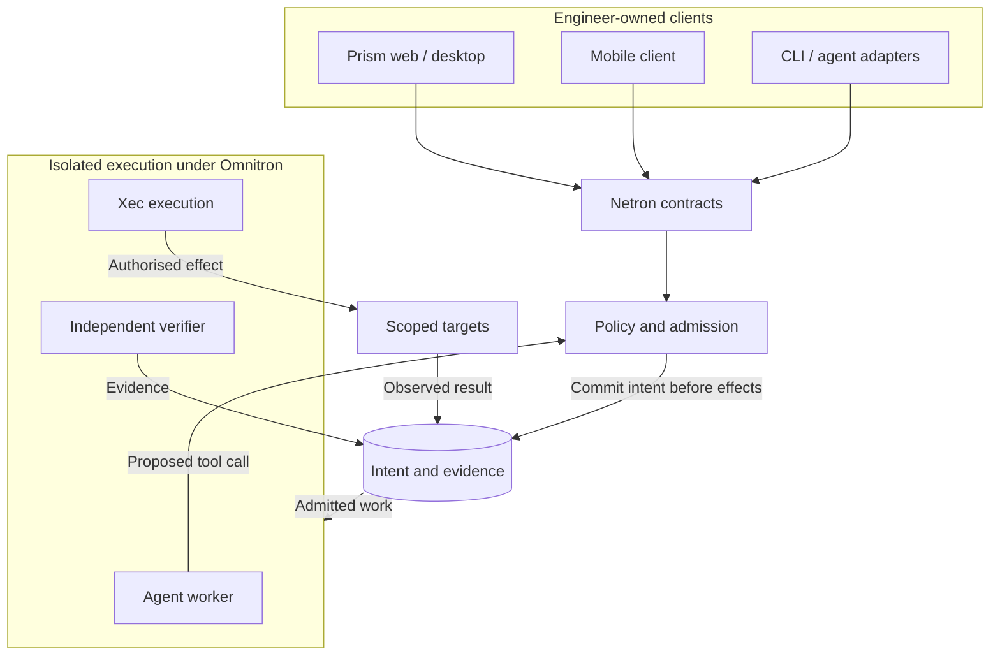
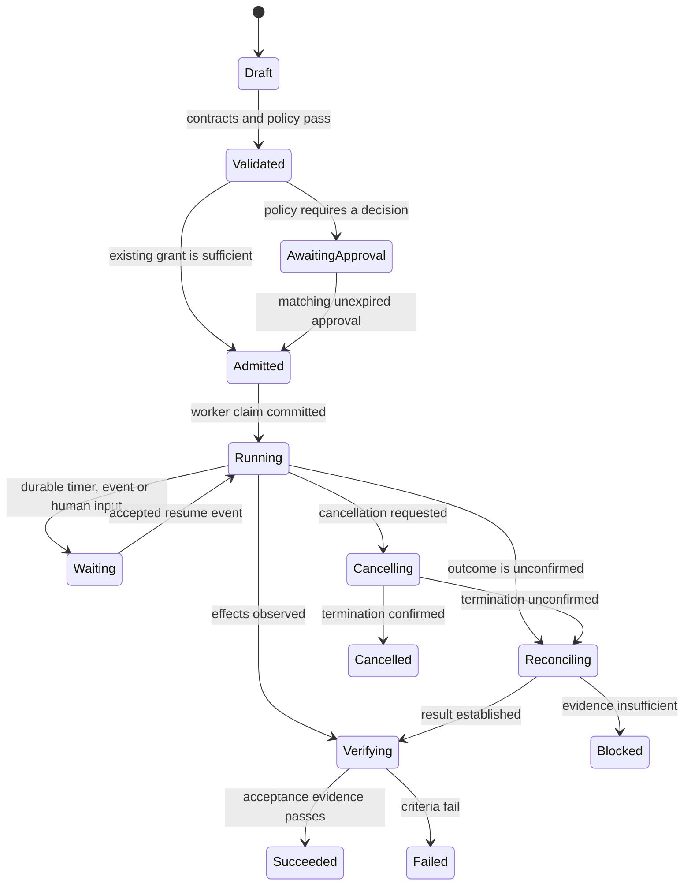

# Create, automate and operate one system

:::info{title="Availability"}
Team rooms, local subscription connectors, the visual flow editor and reviewed project starters are available on Omnitron `main` after 0.4.14. Federation, native mobile clients and device operations in the architecture sections are development targets.
:::

## Work with a team {#team-room}

Open **Agent Studio → New team** in the project workspace. Give the room a name. Select a lead with room tool support and choose which other providers may participate. Set a maximum member count, delegation count and cost tier. You can inspect the empty team before sending the first message.

Connect the installed adapters with the commands shown in Studio. Run `omnitron studio doctor` on the controller to inspect their availability. Codex and supported signed-in Claude Code installations can lead a room. Antigravity can complete an assignment using its strict headless adapter. Studio reports Kimi's qualification status through the same doctor.

To connect your own inference service, run a connector on the controller under its administrator's authority. The connector calls `OmnitronStudio.connectAdapter` and advertises its models for one Console account and project under a name such as `example.org/research`. Select it as the lead when it supplies room tools, or enable it under **Team limits → Allowed adapters** before assigning it work. Existing teams keep their approved providers as new connectors arrive.

| You want to | Where to do it | What you can verify |
| --- | --- | --- |
| Send a question to one member | Select the recipient in **Chat** | The journal names the sender, recipient and provider result |
| Split work between two models | **Members → Add member**, then **Tasks**, or ask the lead to delegate | Independent assignments, status and returned results |
| Retain an agreed constraint | **Memory → Add note** | Author and revision, including a conflict if someone edited the note first |
| Turn a suggestion into an automation | **Flows → Open in flow editor** | Original workspace, editable graph, sample event and proposed deliveries |

A lead can inspect connected model catalogs and ask the controller to enlist a qualified specialist. Model choice respects the room's provider and price limits. A connector's advertised model name alone gives no information about its cost or skill. When assigned workers finish, their results become available to the lead for a synthesis in its original provider conversation.

Teammates can read explicitly shared turns and notes. Local subscriptions, provider conversations and the operator session stay private. To hand a proposal to a different administrator, choose **Submit for administrator review** in the room and copy the review link. It opens the shared graph in the project workspace. The administrator can inspect its parameters and sample effects before activation. [Build a disk-space flow](./flows.md)

## Try Agent Studio {#try-agent-studio}

1. Open **Workspace → Agent Studio** as an operator or administrator. Select Codex or Antigravity. Under **Connection details**, copy the connection command and run it on the daemon host as the OS user who owns the subscription. Leave that process running.
2. Choose **Plan a project** in the system workspace. Describe the work and one result you could observe. For example, “Record the result of a local check so I can inspect it tomorrow.” The analyst asks for missing details such as whether the check runs on demand or needs a resident service.
3. Open **Review project starter** when the recommendation is ready. The form shows the workspace destination, exact dependencies, commands, effects and source files. You can change any selection. The server derives a new review when the plan changes.
4. An administrator can select **Create project** to write and register the reviewed files. The generated README gives the installation and first-run commands. The same form is available directly in **Projects**.

For an existing registered project, select its workspace and open a conversation there. The connector discovers models from the installed provider CLI. Pick a model explicitly, or supply a qualified policy for automatic routing by task and budget. Each completed turn records the token counts the provider reports. A private temporary working directory separates the conversation from the project files. **Attach text** adds selected text to the editable prompt. The provider receives the submitted text through the subscriber's account.

[Choosing Xec, Kysera and a service](./projects.md#choose-a-project) explains exactly what each starter runs.

## The everyday experience {#the-everyday-experience}

| Intent | Experience | Durable result |
| --- | --- | --- |
| Create a project | Describe users and outcomes; review the proposed contracts and preview | Project specification, source, checks and an accepted artifact |
| Change an existing system | Select project and environment; review the affected behavior and patch | Scoped change with evidence and a deployable revision |
| Automate a process | Connect typed operations visually or edit their source | One versioned executable definition |
| Delegate work | Choose allowed targets, data destinations and budget | A task with a responsible human and bounded child grants |
| Follow from a phone | Resume the same run, inspect evidence, answer a pending decision | A server-recorded decision bound to the current operation |
| Operate a device | Enroll it and use its declared, consented capabilities | Device-specific operation receipts; unsupported actions remain unavailable |

The target experience asks about outcomes, data ownership and necessary
permissions. It discovers the project structure, selects compatible tools and
loads relevant engineering guidance. Engineers can inspect and pin that
selection; they should not have to assemble a collection of skill folders to
obtain basic quality.

## Foundations and remaining work {#implementation-baseline}

Reviewed against [Omnitron `ea166e5a`](https://github.com/omnitron-dev/omni/commit/ea166e5af56e462941363729ebf381d7412adfa2)
and [Xec `b2b6aab4`](https://github.com/xec-sh/xec/commit/b2b6aab4b4b0d321996ca26cd10f7b7fb92aff78)
on 16 November 2026. The table describes that historical implementation. The current team room and event-flow guide above describe later work on main, including turn-scoped MCP and the controller’s persistent flow inbox.

| Existing implementation | Reuse | Gap before this design can ship |
| --- | --- | --- |
| [Omnitron PipelineService](https://github.com/omnitron-dev/omni/blob/ea166e5af56e462941363729ebf381d7412adfa2/apps/omnitron/src/services/pipeline.service.ts) and Xec Pipeline | Graph validation, execution, cancellation, revision checks and run records | Manual triggers only; restart marks unfinished work interrupted; not a durable arbitrary workflow engine |
| [Xec Workflow](https://github.com/xec-sh/xec/blob/b2b6aab4b4b0d321996ca26cd10f7b7fb92aff78/packages/ops/src/workflow/index.ts) | Data passing, dependency ordering and owned command scopes | Task state is held in memory; JavaScript callbacks are not automatically replayable |
| Omnitron release and backup operations | Scoped plans, artifact identities, selected operation journals and reconciliation | No universal exactly-once contract for arbitrary external effects |
| Netron, Titan and Access | Communication, lifecycle, principal and policy primitives | Run-scoped agent delegation and enforcement at every tool boundary |
| [MCP bridge](https://github.com/omnitron-dev/omni/blob/ea166e5af56e462941363729ebf381d7412adfa2/apps/omnitron/src/mcp/mcp-bridge.ts) | Existing local operator tools | Protocol lifecycle, validation, cancellation and bounded concurrency need qualification before use as a restricted agent broker |
| Prism and Lumen | Shared UI, interactive documentation, local search and static publication | Native mobile renderers and visual authoring for additional workflow operations |

The MCP bridge at that revision advertises a fixed older protocol and version, sends
initialization notification itself and ignores cancellation notifications.
Existing local operator access must not be represented as a sandboxed agent
identity. The [agent security design](./agents.md) remains the authority for
delegation and isolation; this document adds creation, federation and workflow
semantics without defining a second permissions system.

## Coordination and automation references {#reference-systems}

| Reference | Useful design input | Omnitron decision |
| --- | --- | --- |
| [T3 Code architecture](https://github.com/pingdotgg/t3code/blob/0a842b222d5732e12451484098e035429dc0f315/docs/internals/overview.md) | Server-owned workspaces, shared client state, transactional intent and effect handling | Keep these boundaries; use Netron/Titan and the existing operation model |
| [T3 connection runtime](https://github.com/pingdotgg/t3code/blob/0a842b222d5732e12451484098e035429dc0f315/docs/internals/connection-runtime.md) | One connection lifecycle per environment; separate transport health from data freshness | Put shared synchronization in the Netron client layer, not individual views |
| [Impeccable](https://impeccable.style/docs/) | Product context, design-system context, focused critique and deterministic design checks | Built-in versioned quality guidance plus independent checks; subjective critique remains labelled judgment |
| [Claude Code teams](https://code.claude.com/docs/en/agent-teams) | One lead, named teammates, a task list and addressed messages | Each room member can use a different local adapter and provider conversation |
| [OpenAI agent orchestration](https://openai.github.io/openai-agents-python/multi_agent/) | A manager can retain responsibility while specialists work | Collect the results of an assignment group into one follow-up for the same lead |
| [AutoGen selector teams](https://microsoft.github.io/autogen/stable/user-guide/agentchat-user-guide/selector-group-chat.html) and [Google ADK](https://google.github.io/adk-docs/agents/multi-agents/) | Role selection and explicit termination | Bind participation to verified catalogs and bound child work per operator request |
| [Node-RED concepts](https://nodered.org/docs/user-guide/concepts) | Message-driven flows, reusable subflows and understandable composition | Typed ports and explicit persistence, backpressure and effect policy |
| [n8n queue mode](https://docs.n8n.io/hosting/scaling/queue-mode/) | Separate ingress, queued work and workers | Bounded project queues and explicit admission; execution remains in Xec |
| [Flowise Agentflow](https://docs.flowiseai.com/using-flowise/agentflowv2) | Explicit agent steps, flow state and human decisions | Agent steps use the same task contract and verifier as other entry points |
| [Temporal execution](https://docs.temporal.io/workflow-execution) and [Restate actions](https://docs.restate.dev/foundations/actions) | Durable state transitions and recorded external results | Adopt explicit durability semantics, without silently adding another execution service |

T3 Code has real [Expo/React Native mobile clients](https://github.com/pingdotgg/t3code/blob/0a842b222d5732e12451484098e035429dc0f315/apps/mobile/package.json)
and an [Electron desktop shell](https://github.com/pingdotgg/t3code/blob/0a842b222d5732e12451484098e035429dc0f315/apps/desktop/package.json).
Its [product analytics](https://github.com/pingdotgg/t3code/blob/0a842b222d5732e12451484098e035429dc0f315/docs/internals/product-analytics.md)
and [server-account filesystem boundary](https://github.com/pingdotgg/t3code/blob/0a842b222d5732e12451484098e035429dc0f315/docs/internals/environment-auth.md)
are not the defaults proposed here. Omnitron's agent workspace must be isolated
from the controller account and other projects. No vendor analytics service is
required by this design.

These are reference studies, not dependencies selected for copying. T3 Code is
[MIT-licensed](https://github.com/pingdotgg/t3code/blob/0a842b222d5732e12451484098e035429dc0f315/LICENSE).
Impeccable's [Apache-2.0 license](https://github.com/pbakaus/impeccable/blob/d41d9860b0094dcb68030657da63461212835aaa/LICENSE)
and notices apply to reused material. [n8n](https://github.com/n8n-io/n8n/blob/master/LICENSE.md)
and [Flowise](https://github.com/FlowiseAI/Flowise/blob/main/LICENSE.md) have
licensing boundaries that differ by component. Any code reuse needs a
file-specific license review and retained notices.

## One execution path {#one-execution-path}

| Layer | Single responsibility |
| --- | --- |
| Netron | Typed transport, authenticated requests, subscriptions and backpressure; external protocols adapt at the edge |
| Titan and Access | Service lifecycle, principal propagation and shared policy evaluation |
| Xec Core/Ops | Execution scopes, cancellation, targets, graph validation and reusable workflow execution primitives |
| Omnitron | Projects, placement, task admission, durable orchestration, operation receipts and domain-specific reconciliation |
| Prism | Consistent workbench controls, graph editing, review surfaces, accessibility and shared design tokens |
| Lumen | Versioned human and agent documentation, examples and engineering guidance |
| Kysera/Titan Database | Transactional repositories and schema evolution; no ad hoc second persistence layer |

Keep deterministic graph operations and portable task semantics in Xec.
Omnitron supplies persistence, principal and resource adapters to that engine.
Do not implement one retry scheduler for the canvas, another for agents and a
third for CLI. Do not interpret an arbitrary Xec script as a safely replayable
workflow: it is an explicit activity with declared effects.

## Task, run, attempt and effect {#task-run-attempt-and-effect}

A **task** owns the desired outcome and acceptance contract. A **run** pins one
plan, source snapshot, policy and budget. An **attempt** is one execution of a
step. An **effect** identifies one intended external change across retries.
A provider conversation is attached to a run; it is not the authoritative run
state.

Persist command deduplication, expected revision checks, state transition and
outbox intent in one transaction. A worker claims an outbox item under a lease
and fencing generation. A duplicate command with the same actor scope and
payload digest returns its original receipt; the same ID with a different
payload is rejected. Never perform external I/O inside that transaction.

Cancellation requested is not cancellation completed. Compensation is a new,
authorised operation with its own result; it does not erase the original
history. Restoring source does not roll back an email, a payment or a database
migration. Recovery must inspect the receiver's receipt before retrying an
unconfirmed effect. Without idempotency or reconciliation support, stop for a
decision instead of promising exactly-once execution.

## Durable records and protocol boundaries {#durable-records}

The following are proposed semantic records, not exported SDK types yet. Define
runtime schemas once and derive TypeScript DTOs, CLI forms, Console forms and
external protocol adapters from them.

| Record | Required identity and bindings |
| --- | --- |
| Task contract | Task ID, responsible principal, requirement revision, acceptance revision, workspace and data policy |
| Run plan | Run ID, task revision, source/artifact digests, typed steps, targets, policy revision and budget reservation |
| Grant | Issuer, subject, audience, parent delegation, allowed operations/resources, expiry and revocation generation |
| Decision | Plan digest, actor, decision, expiry, one-time nonce and required separation of duties |
| Effect intent | Run/step/attempt IDs, stable effect ID, recipient, input digest and replay class |
| Receipt | Effect ID, recipient identity, authority generation, observed outcome and evidence references |
| Event | Stream ID, ordered sequence, schema version, causation/correlation IDs and bounded payload reference |
| Evidence | Criterion ID, verifier identity/version, artifact/environment digests, outcome, completeness and retained artifact references |

A receipt cannot prove more than its receiver observed. Use distinct outcomes
for accepted, started, succeeded, failed, cancelled and unconfirmed. Never
collapse a timeout or lost reply into failed-with-no-effect. Serialized integers,
time units and absent/unknown fields have explicit schemas. Preserve structured
errors and bounded diagnostics without sending secrets to the client.

The initial protocol needs inspect, validate, prepare, admit, observe, cancel,
reconcile and compensate operations. Read-only methods do not start work.
Prepare returns the exact effects and unresolved requirements. Admit compares
the reviewed digest with current relevant revisions atomically. Reconcile
queries the existing operation; it does not secretly create another run.

Persist task/run state, decisions, command receipts and pending effects through
the existing database abstraction. Resource leases and uniqueness constraints
protect concurrent admission. Keep large logs, media and artifacts out of hot
state rows; store controlled references with retention and access metadata.
Budget reservation is transactional across the task tree and returned on
confirmed completion, not an agent's estimate. Reserve capacity for recovery
and diagnostics so overloaded workers cannot block their own cancellation.

Subscriptions resume from a per-stream sequence and have bounded buffers.
When history has been compacted, return an explicit snapshot boundary; a client
must not merge an incomplete replay into a newer projection. Database backups,
restoration and history compaction must preserve active grants, outstanding
effects and command deduplication for their advertised retention horizon.

## Visual programs and source are the same artifact {#visual-programs-and-source}

Use one versioned, schema-validated intermediate representation for the
portable workflow subset. It contains stable node IDs, typed input/output
ports, dependency edges, effect class, target references, timeouts, retry and
compensation policy, artifact versions and bounded resource requirements.
Canvas coordinates are presentation metadata, not executable meaning.

A generated TypeScript declaration of this subset and the visual editor must
round-trip through the same representation without losing semantics. Arbitrary
TypeScript remains a pinned code activity with explicit inputs and outputs;
it is not silently decompiled into an editable graph. Unsupported constructs
are shown as such, never approximated.

Initial nodes: input, typed transform, branch, bounded parallel map, Xec task,
Netron operation, agent task, verification, human decision, timer and output.
Loops require an iteration or time budget. Join semantics distinguish all,
first successful and quorum results. Failure and cancellation edges are
explicit. Secrets use server-resolved references, never canvas text fields.

A flow revision is immutable once admitted. Editing creates a new revision.
Active runs retain their pinned definition. Upgrade or migration of a waiting
run is a reviewed operation with state-schema compatibility checks. Future
cron, webhook and event triggers require durable cursors, deduplication,
misfire policy, time zone/DST behavior and overload handling before release.

The editor provides a keyboard-accessible step list equivalent to the canvas,
typed connection errors, undo/redo, readable diffs and per-step evidence.
Large graphs load details on demand. Mobile initially inspects and controls
runs; a small screen is not forced to reproduce a desktop canvas.

The [automation runtime design](./workflow-runtime.md) specifies data and
control semantics, connector contracts, scheduling, debugging and comparative
acceptance scenarios for this shared representation.

## Agent federation follows human authority {#agent-federation}

Every task has a responsible human or explicitly administered service
principal. An agent can create a child task only within a delegable grant.
The child receives the intersection of current parent authority, project
policy, permitted destinations, run scope, expiry and remaining budget.
Delegation cannot increase permissions, reset budgets or conceal lineage.

Each trust domain validates its own admission. Signed messages bind sender,
recipient, task/run IDs, payload digest, nonce and expiry. A remote node's
capability advertisement describes compatibility; it is not an access grant.
Enrolled nodes pin identity and maintain replay protection. Revocation and
network-partition behavior are explicit: new mutations require current
acceptable authority; already admitted effects require bounded containment.

Concurrency is per workspace, stack or other affected resource. Independent
projects progress concurrently. Two agents cannot concurrently promote
conflicting revisions of the same project. Order locks consistently and use
compare-and-set at commit; queue contention must be visible. A hung project
must not hold a fleet-wide release lock.

MCP exposes tools, [ACP](https://agentclientprotocol.com/get-started/introduction)
adapts coding agents, and [A2A](https://a2a-protocol.org/latest/specification/)
can provide external task interoperability. They terminate at a policy-aware
adapter. Internal communication remains Netron. Provider tokens, transport
sessions and Omnitron capabilities are distinct credentials; none is passed
through as a substitute for another.

## Privacy belongs to each edge {#privacy-on-each-edge}

Source, logs, screenshots, model context and generated artifacts carry an
owner, classification and allowed destinations. The same policy applies to
model calls, agent delegation, artifact upload, previews and support exports.
Derived summaries retain the source restrictions unless an authorised
redaction/declassification operation establishes a new allowed form.

Local models and privately hosted inference are first-class targets. A cloud
model is a deliberate egress choice displaying provider, endpoint and content
scope. Failure of a local model never silently exports its task to a cloud
provider. Model output is untrusted even when inference is local.

Agent workers receive a scoped workspace and brokered tools, not the daemon's
Unix socket, Docker socket, host home directory or inherited credential
store. Unrestricted shell access as the controller account defeats logical
project permissions. Deny host mounts and undeclared egress in the actual
worker environment; test symlink, child-process and network escape paths.
OS and container isolation support must be reported per platform.

## Web, desktop and mobile {#clients-and-devices}

Share protocol schemas, synchronization, normalized domain state, command
IDs and error semantics. Give every environment one connection owner with
bounded retries and replay/snapshot recovery. Clients display connection
health and data freshness separately. Switching environments never silently
falls back to another node.

Web and desktop use Prism/MUI. A native mobile renderer must share Prism's
tokens and interaction contracts while using native platform controls; MUI's
DOM components are not React Native components. Extract shared behavior before
creating a separate renderer. Evaluate the desktop shell with measured startup,
memory, update and sandbox requirements rather than selecting it for branding.

Server-side runs survive the client closing or sleeping. Offline clients can
read labelled cached state and edit drafts. Destructive commands are not
silently queued for later execution. Approval from a phone revalidates the
exact plan digest, target revision, caller authority and expiry at the server.

Notifications contain an opaque event reference, not source or secrets. Native
push via APNs/FCM introduces platform services and metadata exposure; make it
optional and describe that boundary. Private deployments can use foreground
subscriptions or an explicitly configured private notification route.

**Managing a mobile device** is distinct from **using a mobile client**.
Enrollment and a device capability manifest define allowed operations. Respect
OS permissions and consent; iOS, Android, desktop and managed-device APIs do
not offer identical control. Unsupported device operations remain unavailable.

## Speed through reuse of evidence {#speed-through-evidence-reuse}

Qualification evidence is reusable only for the exact artifact, dependency
closure, verifier version and relevant execution environment it tested. Store
those identities with the result and invalidate only the affected dependency
subgraph. A mutable working tree is never interchangeable with a sealed artifact.
Checks of current target authority, selected release and irreversible effects
remain fresh at admission.

Build once; transfer content-addressed artifacts; reuse verified installed
closures; avoid repeated scans and dependency copies. Plan backup work by the
actual data mutation and required recovery point. Retain its freshness and
consistency policy; do not disable backups to meet a latency target. Stage the
candidate before any service interruption.

Proposed benchmark profile: one local controller, ten independent projects,
100 waiting runs, ten active workers, 10,000 retained operation records, local
SSD and separately measured LAN/WAN paths. Initial targets, not current claims:

| Measurement | Acceptance target |
| --- | --- |
| Local cached `--help` / `--version` | p95 under 100 ms; no controller or package-tree scan |
| Admit a prepared local operation | p95 under 250 ms, excluding explicitly required human input |
| UI response to local input | p95 under 100 ms; stream processing must not block interaction |
| Reconnect and establish freshness on LAN | p95 under 2 s with bounded snapshot sizes |
| Independent-project interference | A blocked run adds no global serialization to unrelated admission |
| Qualified small release, installed candidate to node acceptance | Target 1–5 minutes, with separate backup, transfer and restart timings |

Report cold and warm measurements, payload sizes, hardware, failures and timeouts.
Do not exclude unsuccessful runs or move prerequisite work outside the timed
path to manufacture an improvement.

## Failure and compatibility rules {#failure-and-compatibility}

| Situation | Required behavior |
| --- | --- |
| Worker disappears before claim | Another eligible worker may claim the unchanged intent |
| Worker disappears after dispatch | Fence its lease; reconcile the stable effect ID before redispatch |
| Controller cannot commit admission | No effect may start from that uncommitted request |
| Database becomes unavailable during work | Do not admit new mutations; retain observed outcomes for reconciliation without manufacturing success |
| A node is partitioned | Bound already admitted work; do not transfer the same non-idempotent effect to another node without fencing the original recipient |
| Client or model disconnects | Server-owned work and its budget continue according to policy; transport reconnect does not create a new task |
| Two revisions compete for a workspace | Compare-and-set one revision; the other receives a conflict with a new review requirement |
| Runtime or schema changes | Check supported contracts and migrations before activation; retain compatible recovery artifacts |
| Oracle changes during a run | Keep the pinned run criteria; a new acceptance policy requires an explicit new evaluation |
| A callback cannot be resumed safely | Mark its effect unconfirmed or interrupted and use its declared reconciliation; do not replay arbitrary code |

Fault-injection gates must cover every boundary between durable intent,
dispatch, external effect and receipt commit. Run them against the real
receiver and worker, including delayed/reordered responses and duplicate
messages. Cross-project isolation, cancellation, revocation and budget tests
must also run under concurrency. A mock-only pass is not sufficient.

## Implementation order and release gates {#implementation-order}

1. **Shared operation foundation:** qualify MCP lifecycle and restricted identity,
   centralize schemas and receipts, add durable effect reconciliation and scoped
   scheduling. Fault-injection tests precede agent write access.
2. **Project studio:** existing-project inspection and one new-project template;
   local/private model adapter; isolated edit, preview and independent acceptance.
   Use the [verification harness](./agent-harness.md) as the execution contract.
3. **Visual automation:** expose the same portable Xec graph through Prism;
   CLI and canvas produce identical canonical revisions and results.
4. **Federation:** add recipient admission, budget reservation, revocation and
   reconnect tests across independent Omnitron nodes. No unrestricted remote agent.
5. **Clients:** shared web/desktop state first, then native mobile inspection,
   decisions and notifications; device control ships per validated capability.

Each stage delivers a complete vertical path with diagnostics and recovery.
Do not publish incomplete buttons or hide a missing server contract behind a
client-only check. Existing application operations remain available while these
capabilities are developed.

## Ideas to prove, not slogans to ship {#ideas-to-prove}

- **Review by consequence:** show affected resources, data destinations,
  downtime and irreversible effects before a proposed change. Compare that
  model with the actual operation receipt after execution.
- **Selective re-verification:** maintain a dependency graph from requirements
  to artifacts and evidence, so a changed invariant invalidates precisely the
  proofs that depended on it. Test the invalidator with deliberately missed edges.
- **Portable evidence with private contents:** another node can verify artifact
  identity and acceptance provenance without receiving raw source or logs.
  Access to the evidence body is a separate grant; signatures prove provenance,
  not the truth of a malicious verifier's claim.
- **Autonomy earned within a boundary:** repeated successful evaluation may
  recommend a narrower, preapproved playbook. It never grants new authority,
  changes the oracle or increases a budget by itself.

These are proposed combinations of established techniques. Their value must be
measured against a simpler implementation; novelty and universal superiority
are not assumed.
