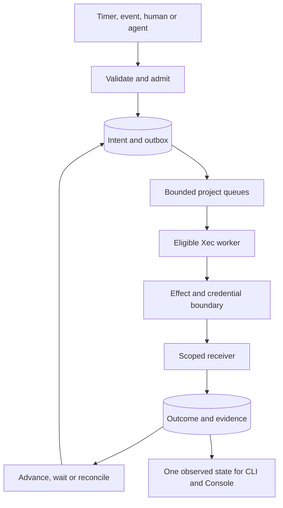

# One automation system, from intent to recovery

:::info{title="Design proposal — 16 November 2026"}
For a working automation in 0.4.15, start with [Event flows](./flows.md) or [Pipelines](./automation.md). This proposal covers durable waits, replay and other execution guarantees beyond those shipped features. [Agent Studio](./studio.md) explains how a team proposes work for a controller.
:::

A useful automation system connects events, data, code and human decisions.
A dependable one also explains what happened after a failure, which changes
can be repeated, and who may authorize the next action. Omnitron's goal is to
provide that complete path on infrastructure controlled by its operator.

The target is broader than a collection of integration nodes: create a service,
operate it, automate its business processes and let agents improve it within
one explicit authority and evidence model. Breadth must come from composition
of a small set of reliable primitives, not a separate engine for each interface.

## What we must match, and what we must prove {#comparison}

Reference documentation was reviewed on 16 November 2026. The following is a
requirements comparison, not a benchmark result or a claim that Omnitron
already outperforms these products. Editions and deployment configurations
matter. Several references support self-hosting; privacy is not established
merely by using that label.

| Reference capability | Baseline Omnitron must meet | Proposed additional acceptance condition |
| --- | --- | --- |
| [Node-RED message flows and reusable subflows](https://nodered.org/docs/user-guide/editor/workspace/subflows) | Events, composition, understandable wiring and reusable definitions | Typed ports, versioned subflow contracts and bounded overload behavior visible before deployment |
| [Node-RED scoped context](https://nodered.org/docs/user-guide/context) | State appropriate to node, flow and shared use | Explicit durability and isolation for every state store; restoring state must preserve the advertised recovery point |
| [n8n flow logic](https://docs.n8n.io/build/flow-logic.md) | Branches, joins, loops, waits, sub-workflows and error paths | Identical semantics through visual, CLI and agent entry points, including uncertain external outcomes |
| [n8n queue execution](https://docs.n8n.io/hosting/scaling/queue-mode/) | Separate ingress and scalable workers | Fair scheduling per project, fenced ownership and no global lock between independent projects |
| [Windmill code and flow authoring](https://www.windmill.dev/docs/flows/flow_editor) | Typed code steps, visual composition and inspectable dependencies | A canonical portable definition with semantic diffs and verified round trips for its supported subset |
| [Windmill suspended decisions](https://www.windmill.dev/docs/flows/flow_approval) | Durable human input without occupying a worker | Decisions bind the exact plan, actor, target revision and expiry; changed effects invalidate approval |
| [Flowise Agentflow](https://docs.flowiseai.com/using-flowise/agentflowv2) | Agent tasks, branches, shared state and human decisions | Models operate within the same grants, budgets and independent verification as every other actor |
| [Temporal workflow execution](https://docs.temporal.io/workflow-execution) and [Restate actions](https://docs.restate.dev/foundations/actions) | Recoverable execution with explicit treatment of external actions | Reuse Xec and Omnitron contracts; prove behavior at real effect boundaries, not just graph progression |

Connector coverage, reliability and usability are separate measurements. A
small set of correct adapters does not equal a mature integration catalog.
Conversely, a large palette does not establish safe recovery. Publish both
coverage and limitations rather than hiding them in a single comparison score.

## Execution contract {#execution-contract}

The [studio architecture](./studio.md#one-execution-path) owns the layer boundaries:
Xec provides portable execution primitives; Omnitron provides placement,
authority and durable orchestration; Netron carries typed calls and streams;
Prism presents the same contracts. Extend those owners rather than adding a
canvas scheduler or a separate agent execution engine.

Three workload shapes share admission, effects, quotas and observation while
retaining distinct lifecycle semantics:

| Shape | Unit of work | Completion and recovery |
| --- | --- | --- |
| Finite workflow | One input and a pinned definition | Terminal result or an explicit waiting, blocked or unconfirmed state |
| Event processor | A partitioned event stream with bounded state | Checkpoints and per-event outcomes; no invented global completion |
| Managed service | A long-running process or subscription | Readiness, desired state and lifecycle operations through Omnitron supervision |

An event processor may start a finite workflow. A workflow may request a
service operation. Neither turns into an unbounded in-memory graph. Do not
claim hard real-time control from a general-purpose JavaScript scheduler.

The scheduler must not infer authority from a graph edge, a trusted-looking
node label or a model's explanation. Admission and the receiver validate the
actual operation. Durable intent precedes dispatch; a transport acknowledgement
does not establish completion.

## A small language with precise meaning {#definition-and-types}

The portable definition is data with versioned runtime schemas. It includes
stable step IDs, operation versions, dependencies, typed ports, resource keys,
effect class and bounded execution policies. Unknown schema versions or node
kinds fail validation. Canvas layout and notes are separately versioned
presentation metadata; moving a node must not change execution identity.

| Primitive | Required semantics |
| --- | --- |
| Input and output | Schema, cardinality, classification and maximum size |
| Pure transform | Pinned implementation and explicit inputs; no clock, randomness, network or hidden mutable state |
| Branch | One recorded predicate result; skipped is distinct from empty, null and failed |
| Map | Stable item identities, bounded concurrency and declared ordering |
| Join | All, first successful or quorum; define empty and failed branches, ties, outstanding work and deadlines |
| Subflow | Pinned definition, input/output contract and inherited limits; recursion must be bounded |
| Activity | Declared external effect, deadline, retry class and reconciliation contract |
| Wait | Durable event, decision or timer; no occupied process or worker slot |
| Verify | Independent check bound to the candidate artifact and protected criteria |
| Finish | Explicit result, completeness and outstanding-effect accounting |

A join cannot silently discard an already dispatched mutation in a losing
branch. Cancellation must settle or reconcile it before the run claims a
fully confirmed result. Pure reductions declare their ordering; parallel
completion order must not change a supposedly deterministic answer.

Runtime schemas validate external data as well as TypeScript declarations.
Distinguish absent, null, empty collection and unavailable value. Specify time
units, integer range, byte encoding and schema evolution. Implicit string to
number conversions and implicit item iteration are not portable semantics.
Data references select typed fields; arbitrary expressions run as explicit
isolated code activities, not as hidden `eval` in the editor or controller.

Visual editing and the supported TypeScript declaration format round-trip to
one canonical definition. Arbitrary TypeScript remains an opaque, pinned Xec
activity with inspectable source. This boundary preserves expressiveness
without pretending every program can be losslessly edited as boxes and wires.

## Connector contracts, not privileged plugins {#connectors}

Each connector operation declares its input/output schemas, effect class,
resource scope, credential references, egress destinations, pagination,
rate limits, timeouts and version compatibility. Tests exercise its real
protocol against a controlled receiver. Generated OpenAPI clients can supply
transport types; they cannot infer business idempotency or compensation.

Start with reusable Netron operations and Xec tasks, then HTTP/webhooks, SQL,
object storage, files and message subscriptions. Add domain adapters where
they remove repeated integration work. Record operation-level support,
authentication modes and known limits; a product logo is not a capability.

Resolve credentials just before an authorized effect, on the node that owns
them. Prefer brokered requests when the connector need not read the secret.
Isolate a connector that must hold credentials with bounded filesystem and
network access. Redirects, DNS changes and user-supplied destinations must
not bypass egress policy or reach controller metadata endpoints. Installing a
connector never implies permission to execute its lifecycle code as the owner.

Connector revisions and their dependency closures are pinned. Revocation can
block new work without deleting retained receipts. Offline bundles include
schemas, artifacts and documentation; they do not silently fetch missing code
from a public registry. Importing another product's flow produces a supported-
operation report and explicit unresolved nodes. Never approximate a security
or retry policy to make an import appear successful.

## Data, state and streams {#data-and-state}

Values carry schema and provenance; protected data also carries a destination
policy. Transforming or summarizing a value preserves its restrictions until
an authorized declassification operation says otherwise. The same rule covers
model prompts, logs, previews, search indexes and notifications.

Large files and media use scoped artifact references with digest, length,
content type, ownership and retention. Downstream grants control reads;
knowledge of a digest does not grant access. Keep large payloads out of hot
state rows and graph messages. Garbage collection respects active references,
legal retention policy and pending reconciliation; it cannot remove evidence
needed to recover an outstanding effect.

Stream ports declare partition keys, ordering, acknowledgement and maximum
buffer size. Backpressure crosses transport and worker boundaries. Dropping,
coalescing or sampling is an explicit lossy operator with counters, never an
unannounced overload fallback. Windowed processing declares event time versus
processing time, watermark, late-arrival policy and bounded retained state.

A checkpoint atomically binds state and consumed offsets where the source and
sink support that transaction. Otherwise record the gap and use deduplication
or reconciliation; do not claim exactly-once behavior across unrelated systems.
Resource admission reserves disk as well as CPU and memory. Exhaustion pauses
or rejects work predictably, leaving capacity for diagnostics and recovery.

## Triggers, time and overload {#triggers-and-time}

Authenticated webhook ingress validates payload size and signature before
admission. A success acknowledgement for accepted work follows its durable
commit. A duplicate event key with a different payload is a conflict, not a
second implicit run. If capacity is unavailable, return the declared retryable
response; do not acknowledge work that will be discarded.

Timers persist deadlines. Schedules pin time zone and daylight-saving rules,
including skipped and repeated local times. Misfire policy chooses skip,
coalesce or bounded catch-up explicitly. After a clock correction or restart,
the same scheduled occurrence keeps its identity. Use monotonic clocks for
in-process durations and authoritative persisted time for restart semantics.

Polling and subscription connectors persist cursors and reconnect under bounded
backoff. Poison events enter a reviewable quarantine with their access policy.
Reprocessing creates a traceable attempt against a chosen definition; it does
not silently erase the earlier failure. Pause, drain and stop have different
contracts and remain responsive when ordinary queues are full.

## Effects, retries and recovery {#effects-and-recovery}

| Effect class | Safe automatic behavior |
| --- | --- |
| Pure computation | Recompute against pinned inputs and implementation |
| Read with freshness requirements | Repeat only within its deadline and read policy; a new observation may change downstream evidence |
| Idempotent write | Retry the same effect ID while the receiver's deduplication guarantee remains valid |
| Reconcilable write | Query the receiver before deciding whether another dispatch is safe |
| Non-repeatable write without reconciliation | Preserve unconfirmed outcome and require an explicit recovery decision |

A retry changes an attempt ID, not the intended effect ID. Credentials and
current authority are rechecked on dispatch. Keep the last valid result and
its provenance; never relabel stale data as a fresh successful observation.
Compensation is a separately authorized effect and can itself fail. It is not
a database rollback across email, external services and physical devices.

Test the crash boundaries: before intent commit, after commit, before dispatch,
after receiver mutation, before receipt commit and during recovery. Repeat
with delayed replies, network partitions, expired credentials and a revoked
worker. A lease timeout alone cannot fence an external recipient that does
not understand fencing tokens. Such a recipient requires deduplication,
reconciliation or an explicit stop, not a second concurrent writer.

## Placement and isolation {#placement-and-isolation}

One authoritative domain owns a run. For a single node, use the existing
transactional persistence boundary and bounded workers. For a shared fleet,
use a qualified shared authority store with fenced claims or partition runs
among explicit owners. Netron transports messages; it is not a substitute for
consensus or a database transaction. Do not synchronize independent SQLite
files into an implicit multi-writer authority.

Placement considers declared runtime, isolation support, artifact availability,
resource capacity and data residency. Warm workers and local artifact reuse
reduce latency without sharing mutable state or credentials between projects.
A remote trust domain admits delegated work under its own policy and returns
receipts. Federation is not unrestricted access to every node's filesystem.

Scheduling combines per-project limits, fair queues and resource-specific
serialization. A slow integration cannot exhaust every worker. Conflicting
changes to one resource use revisions or a scoped lock; unrelated projects
continue. Reserve separate capacity for cancellation, reconciliation and
control traffic. Define key rotation, backup restoration and authority-store
recovery before claiming high availability.

## An interface that explains consequences {#authoring-and-debugging}

One workbench provides **Define**, **Review**, **Run** and **Inspect** views.
These are perspectives on one revision and its receipts, not separate products.
Prism owns the shared editor controls, forms, state displays and accessibility.

- **Define:** start from a goal or a small template; discover operations by
  capability; inspect typed ports and required permissions. Provide equivalent
  keyboard-accessible step editing, code and canvas views.
- **Review:** show the semantic diff, target resources, data destinations,
  credentials, expected downtime and uncertain or irreversible effects. A
  layout-only edit does not demand re-running unchanged execution checks.
- **Run:** distinguish validation, simulation and real execution. Show queue
  reason, active work, durable waits, budgets and the next required decision.
- **Inspect:** connect inputs, transformations, effect receipts and acceptance
  evidence. Separate known failure, stale observation and unconfirmed effect.
  Offer only recovery actions valid for that state and the caller's authority.

Debug with recorded inputs and isolated fixtures. A replay view replays
observations; it does not repeat production writes. Forking from a checkpoint
creates a new run with fresh admission. Reusing earlier evidence requires the
same artifact, relevant environment and verifier identities. Production data
used for a test keeps its access restrictions.

Collaborative drafts use revisions, conflict detection and semantic merge.
An agent and a person cannot silently overwrite each other's changes. Editing
a running definition creates a new revision; migration of a suspended run is
a separate compatibility-reviewed operation. Mobile shows the same state and
can answer authorized decisions without exposing a miniature desktop canvas.

## Agents use the same constrained path {#agents}

The [agent harness](./agent-harness.md) supplies protected task criteria,
independent verification, scoped tools and bounded repair. A model proposes a
typed patch or plan. It cannot mark its own run accepted, widen a grant, change
the oracle or transform untrusted connector output into a new instruction.

Generate context from current schemas, relevant project facts and observed
failures. Every operation returns structured status and actionable reasons.
A smaller model can solve narrower verified steps and reuse accepted subflows;
complexity is handled by explicit decomposition and verification. Capability
limits remain visible: unsuccessful attempts stop or escalate within an
approved budget, never manufacture success. Evaluate this on held-out tasks
with both weak and strong models, including false acceptance and total cost.

## Acceptance before comparative claims {#acceptance}

Each scenario must run through the ordinary CLI and Console contracts. Add an
agent entry point where applicable, then compare resulting canonical plans,
effects and receipts. Run failure injection against real test receivers.

| Scenario | Required result |
| --- | --- |
| Duplicate webhook starts an invoice process | One admitted business effect; retries preserve identity; a lost acknowledgement is reconciled |
| A human decision waits across a restart | No worker held; the same decision resumes once; stale approval is rejected |
| A worker dies after an external mutation | No blind duplicate; a receiver receipt establishes success or the run stays unconfirmed |
| A fast sensor source meets a slow sink | Bounded memory, declared ordering and visible overload behavior; no hidden loss |
| Ten projects release concurrently | Per-resource correctness; one blocked project does not serialize the others |
| Visual edit and TypeScript edit describe the same flow | Equal canonical execution identity and results, with stable semantic diffs |
| A connector or document contains hostile instructions | No escalation, secret export or oracle mutation through the agent path |
| A small model repairs an unfamiliar application | Independent functional and recovery criteria pass within budget, or the task reports failure honestly |
| A private fleet is disconnected from public services | Installed offline-capable operations continue; no hidden analytics, registry or model fallback request |
| A backup is restored after a partial operation | Outstanding effects and deduplication remain meaningful; recovery does not replay already committed external work |

Benchmark declared hardware, versions, editions, payloads, concurrency,
durability settings and cold/warm state. Report end-to-end latency, p95/p99,
throughput, resource use, recovery time, failure rate and operator actions.
User studies must include discovering an error and recovering, not only wiring
a successful flow. Measure keyboard-only completion and mobile decisions.
Publish limitations and reproducible fixtures alongside any comparison.

## Delivery without a second platform {#delivery}

1. Specify and test the canonical graph, value and effect contracts in Xec;
   keep current trusted pipeline behavior explicit until its replacement passes.
2. Add durable admission, receipts, waits and reconciliation to Omnitron's
   existing operation services. Prove one real external effect through restart.
3. Build Prism authoring and inspection over those contracts. Ship the same
   vertical path through CLI, Console and a restricted agent adapter.
4. Add connectors and event-processing capabilities through contract tests,
   then qualify placement, federation and device-specific operations.

The first reference flow should exercise our own delivery path: a source
change produces one qualified artifact, a scoped decision authorizes promotion,
the normal Omnitron operation deploys it, receipts verify the target, and a
failed transition uses the declared recovery. A second independent project
must progress while the first waits. This tests the platform against the
problem it is meant to solve, rather than another demonstration-only engine.

A stable core should make new capabilities cheap to express and hard to misuse.
New protocols, threats and workloads will still require development. The design
therefore protects clear invariants and versioned extension boundaries; it does
not claim that a finite feature list can be complete forever.
