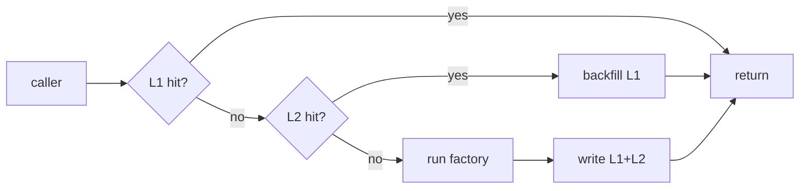

# titan-cache

<span class="module-badge">official · @omnitron-dev/titan-cache</span>

LRU/LFU in-memory caches and a multi-tier cache with a caller-supplied L2
adapter, TTL, tags, optional compression and partition views. Single-flight
helpers combine concurrent work within one process; they are not distributed
idempotency or a transaction boundary.

```bash
pnpm add @omnitron-dev/titan-cache
```

## When you need it {#when-you-need-it}

- Cache expensive reads with a bounded per-process LRU or LFU.
- Share stored values through an explicitly configured L2 adapter.
- Reduce repeated concurrent reads with `createCacheGetOrSet` or a multi-tier
  cache's `getOrSet`. This coordination is local to the instance, not across pods.

Measure hit ratio and database load for your workload; the module promises no
fixed speedup. Cache misses, evictions and backend outages are ordinary cases.

## Quickstart {#quickstart}

### Single-tier in-memory {#single-tier-in-memory}

```typescript
import { TitanCacheModule } from '@omnitron-dev/titan-cache';

@Module({
  imports: [
    TitanCacheModule.forRoot({
      maxSize:        5_000,
      defaultTtl:     600,                    // seconds
      evictionPolicy: 'lru',
      enableStats:    true,
    }),
  ],
})
class AppModule {}
```

### Multi-tier cache with an L2 adapter {#multi-tier-l1-in-memory--l2-redis}

```typescript
import { TitanCacheModule, type IL2CacheAdapter } from '@omnitron-dev/titan-cache';

export function sharedCache(adapter: IL2CacheAdapter) {
  return TitanCacheModule.forRoot({
    multiTier: true,
    l1: { maxSize: 1_000, ttl: 60 },
    l2: { client: adapter, ttl: 3600, prefix: 'cache:' },
    trackL2Tags: true,
    broadcastInvalidations: true,
  });
}
```

Implement the L2 contract (`get`, `set`, `mget`, `mset`, `delete`, `exists`,
`keys`, `ttl`, `flush`, etc.) around the chosen backend. A raw Redis connection
is not that contract. Without an L2 client the multi-tier constructor uses an
in-memory L2. Broadcast invalidation additionally needs the adapter's optional
`publishInvalidation` and `subscribeInvalidation` methods.

Reads fall through L1 to L2 and may backfill L1; module-created caches write
through both tiers. This is not transactional cross-pod coherence: L2 failures
can be treated as misses or ignored by mutation operations.

### Async configuration {#async-configuration}

```typescript
TitanCacheModule.forRootAsync({
  useFactory: (config: ConfigService) => ({
    multiTier: config.get('cache.multiTier'),
    l1: { maxSize: config.get('cache.l1.size'), ttl: config.get('cache.l1.ttl') },
    l2: { client: redisAdapter, ttl: config.get('cache.l2.ttl') },
  }),
  inject: [ConfigService],
})
```

## `ICacheModuleOptions` {#icachemoduleoptions}

| Option                  | Type                                                                        | Default       |
| ----------------------- | --------------------------------------------------------------------------- | ------------- |
| `multiTier`             | `boolean`                                                                   | `false`       |
| `l1`                    | `{ maxSize, ttl }`                                                          | —             |
| `l2`                    | `{ client, ttl, prefix }`                                                   | —             |
| `defaultTtl`            | `number` (seconds)                                                          | `300`         |
| `maxSize`               | `number`                                                                    | `1_000`       |
| `evictionPolicy`        | `'lru' \| 'lfu'` implemented; other declared values select LRU                             | `'lru'`       |
| `enableStats`           | `boolean`                                                                   | `true`        |
| `statsInterval`         | `number` (ms)                                                               | —             |
| `partitions`            | `ICachePartition[]`                                                         | —             |
| `warmingStrategies`     | `ICacheWarmingStrategy[]` — declared option; not automatically run                                                   | —             |
| `useWeakRef`            | `boolean`                                                                   | `false`       |
| `compressionThreshold`  | `number` (bytes)                                                            | `1_024`       |
| `compressionAlgorithm`  | `'none' \| 'gzip' \| 'deflate' \| 'brotli'`; declared `lz4` currently uses deflate                        | `'none'`      |
| `ttlCleanupInterval`    | `number` (ms — wheel-timer bucket size)                                     | —             |
| `wheelTimerBuckets`     | `number`                                                                    | —             |
| `staleWhileRevalidate`  | `number` — declared but not consumed                                             | —             |
| `backgroundRefresh`     | `boolean` — declared but not consumed                                                                   | —             |
| `isGlobal`              | `boolean`                                                                   | `false`       |

## `CacheService` {#cacheservice}

The top-level service exposed via DI. Resolves named caches; creates
ad-hoc ones at runtime; emits / observes lifecycle events.

```typescript
import { CACHE_SERVICE_TOKEN, type ICacheService } from '@omnitron-dev/titan-cache';

@Service({ name: 'users' })
class UsersService {
  constructor(@Inject(CACHE_SERVICE_TOKEN) private readonly cache: ICacheService) {}
}
```

| Method                                                  | Purpose                                          |
| ------------------------------------------------------- | ------------------------------------------------ |
| `getCache<T>(name?)`                                    | Get cache by name (default: `'default'`)         |
| `createCache<T>(name, options?)`                        | Create a new named cache                         |
| `getOrCreateCache<T>(name, options?)`                   | Atomic get-or-create                             |
| `listCaches()`                                          | All cache names                                  |
| `deleteCache(name)`                                     | Remove a cache                                   |
| `getGlobalStats()`                                      | Aggregated stats across every cache              |
| `on(event, listener)` / `off(event, listener)`          | Subscribe / unsubscribe                          |
| `dispose()`                                             | Async cleanup of all caches                      |

## `ICache<T>` — the per-cache surface {#icachet--the-per-cache-surface}

```typescript
import { createCacheGetOrSet } from '@omnitron-dev/titan-cache';

const users = cacheService.getCache<User>('users');
const getUser = createCacheGetOrSet(users); // create once; reuse its single-flight map
const user = await getUser(`u:${id}`, () => repository.findById(id), { ttl: 60 });
```

| Method                                              | Purpose                                                       |
| --------------------------------------------------- | ------------------------------------------------------------- |
| `get(key, options?)`                                | Read; returns `undefined` on miss                             |
| `set(key, value, options?)`                         | Write with optional TTL / tags / compression                  |
| `has(key)`                                          | Existence check — **see TOCTOU note below**                   |
| `getOrSet(key, factory, options?)`                  | Optional on `ICache`; implemented by `MultiTierCache`, not LRU/LFU         |
| `delete(key)`                                       | Remove a key                                                  |
| `clear(pattern?)`                                   | Drop all or by string / RegExp pattern                        |
| `invalidateByTags(tags[])`                          | Drop every entry tagged with any of these                     |
| `getMany(keys[])` / `setMany(map, options?)`        | Batch read / write                                            |
| `getStats()` / `resetStats()`                       | Per-cache stats                                               |
| `getEntry(key)`                                     | Read value + metadata (created, hits, tags)                   |
| `keys(pattern?)` / `size()`                         | Enumerate / count                                             |
| `warm(strategies?)`                                 | Preload from configured warming strategies                    |
| `partition(name)`                                   | Get a partition view (isolated key namespace)                 |
| `dispose()`                                         | Async per-cache cleanup                                       |

### TOCTOU note on `has()` {#toctou-note-on-has}

A key may expire or be evicted between `has` and `get`. Read with `get` and handle
`undefined`, or reuse a `createCacheGetOrSet(cache)` wrapper for local
single-flight. `ICache.getOrSet` is optional: the LRU/LFU instances returned by a
single-tier `CacheService` do not implement it. No cache method guarantees that a
side effect runs exactly once across processes.

## Multi-tier API — `IMultiTierCache<T>` extends `ICache<T>` {#multi-tier-api--imultitiercachet-extends-icachet}



Additional methods on a multi-tier cache:

| Method                       | Effect                                       |
| ---------------------------- | -------------------------------------------- |
| `getL1()` / `getL2()`        | Access per-tier cache for advanced ops       |
| `promote(key)`               | Force entry into L1 (preload after eviction) |
| `demote(key)`                | Force entry out of L1 (keep in L2 only)      |
| `sync()`                     | Flush the write-back buffer to L2     |
| `getTierStats(tier)`         | Stats per tier — useful for hit-ratio tuning |

## Decorators {#decorators}

### `@Cacheable(options)` — read-through cache {#cacheableoptions--read-through-cache}

```typescript
import { Cacheable, CacheKey } from '@omnitron-dev/titan-cache';

@Public()
@Cacheable({ cacheName: 'users', keyPrefix: 'u', ttl: 300, tags: ['users'] })
async findById(@CacheKey() id: string): Promise<User> {
  return this.repo.findById(id);
}
```

| Field          | Type                                                  |
| -------------- | ----------------------------------------------------- |
| `cacheName?`   | `string` — which cache to use                         |
| `keyPrefix?`   | `string`                                              |
| `keyGenerator?`| `(...args) => string`                                 |
| `ttl?`         | `number` (seconds)                                    |
| `tags?`        | `string[] \| ((...args) => string[])`                 |
| `condition?`   | `(...args) => boolean` — skip caching if `false`      |
| `unless?`      | `(result) => boolean` — don't cache certain results   |
| `compress?`    | `boolean` — force compression regardless of size      |

### `@CacheInvalidate(options)` — bust on mutation {#cacheinvalidateoptions--bust-on-mutation}

```typescript
@CacheInvalidate({ cacheName: 'users', tags: ['users'] })
async update(id: string, patch: Partial<User>): Promise<User> { /* … */ }
```

| Field             | Type                                                       |
| ----------------- | ---------------------------------------------------------- |
| `cacheName?`      | `string`                                                   |
| `keyPattern?`     | `string` — supports `{0}`, `{1}` placeholder substitution  |
| `tags?`           | `string[] \| ((...args) => string[])`                      |
| `allEntries?`     | `boolean` — clear the whole cache                          |
| `beforeInvocation?` | `boolean` — invalidate before the method (default: after) |
| `keyGenerator?`   | `(...args) => string[]`                                    |

### `@CachePut(options)` — write-through cache {#cacheputoptions--write-through-cache}

Extends `@Cacheable` options; runs the method first and writes the
returned value into the cache. Used when the method itself is the
canonical source.

### `@CacheKey()` — parameter marker {#cachekey--parameter-marker}

When **any** parameter is marked `@CacheKey()`, only marked parameters
contribute to the auto-generated key. Useful when the method has
auxiliary args (logger, span) you don't want in the key.

### Property injection helpers {#property-injection-helpers}

| Decorator                  | Effect                                                    |
| -------------------------- | --------------------------------------------------------- |
| `@InjectCacheService()`    | Property decorator — marks the property as the cache service for decorator discovery |
| `@InjectCacheLogger()`     | Property decorator — marks the property as logger for error reporting |

## Tags-based invalidation {#tags-based-invalidation}

Tags are the right primitive for "drop everything related to user `u_42`":

```typescript
@Cacheable({ cacheName: 'users', tags: (id) => [`user:${id}`] })
async findById(id: string) { /* … */ }

@CacheInvalidate({ cacheName: 'users', tags: (id) => [`user:${id}`] })
async updateProfile(id: string, patch: ProfilePatch) { /* … */ }
```

`invalidateByTags(['user:u_42'])` removes matching local entries. For L2 deletion,
enable `trackL2Tags`; the tag index only knows keys written by that cache instance.
For other processes' L1 invalidation, also enable `broadcastInvalidations` and
provide the adapter's pub/sub methods. Tags are not persisted as a global L2
index, and errors/disconnections can leave stale copies until their TTL expires.

## Compression {#compression}

Compression is selected per cache with `compressionAlgorithm` and
`compressionThreshold`. LRU/LFU serialize as JSON and only retain compressed bytes
when sufficiently smaller. Use `gzip`, `deflate` or `brotli` when appropriate.

```typescript
import { TitanCacheModule } from '@omnitron-dev/titan-cache';

TitanCacheModule.forRoot({ compressionAlgorithm: 'gzip', compressionThreshold: 4_096 });
```

The type accepts `lz4`, but the current implementation encodes with deflate and
decodes with inflate. It does not produce LZ4 data. The decorator's `compress`
option is forwarded but is not honored as a per-write override by LRU/LFU.

## Warming {#warming}

Call `warm(strategies)` explicitly:

```typescript
import { LRUCache } from '@omnitron-dev/titan-cache';

const cache = new LRUCache<string>({ maxSize: 1_000 });
await cache.warm([{ name: 'startup', loader: async () => new Map([['status', 'ready']]) }]);
await cache.dispose();
```

The module's `warmingStrategies` option is not wired to boot or cron execution.
`warm()` with no argument does nothing. Use the scheduler or an application hook
for timing. Multi-tier `warm` populates L1 only.

## Partitions {#partitions}

Partition views prefix ordinary key operations. They are not an authorization
or complete tenant-isolation boundary: tag invalidation, stats and warming are
shared with the parent. Multi-tier `partition()` returns an L1 view only:

```typescript
const users = this.cache.getCache('users');
const tenantUsers = users.partition(tenantId);
await tenantUsers.get('u_42');     // isolated from other tenants
```

## Stats {#stats}

```typescript
const stats = users.getStats();
// { hits, misses, hitRate, size, bytes, evictions, ... }
```

Per-cache and global. Reset with `resetStats()` after a warmup or
deployment.

## Anti-patterns {#anti-patterns}

- **Caching everything.** Adds invalidation surface for no benefit on
  cold paths. Cache only what you've measured to be hot.
- **`has + get` pattern.** Handle a miss from `get`, or use the shared
  `createCacheGetOrSet` wrapper rather than assuming every cache has that method.
- **Skipping `tags` and relying on `clear()`.** `clear()` is a
  carpet bomb — tags target only what you actually want to drop.
- **Putting `Request`-scoped keys in a `Singleton` cache.** Per-user
  data needs per-user keys (`user:${id}`), not per-process keys.
- **Forgetting `defaultTtl`.** Unbounded entries grow until the
  eviction policy kicks in. Always set a TTL appropriate to your
  data's volatility.

## Tokens {#tokens}

| Token                          | Purpose                                          |
| ------------------------------ | ------------------------------------------------ |
| `CACHE_SERVICE_TOKEN`          | Resolve `ICacheService`                          |
| `CACHE_DEFAULT_TOKEN`          | Resolve the default `ICache` instance directly   |
| `CACHE_OPTIONS_TOKEN`          | Resolved options bundle                          |
| `getCacheToken(name)`          | Token for a named cache (advanced injection)     |

## Lifecycle {#lifecycle}

`CacheService` does not implement explicit `OnInit` / `OnDestroy` —
cleanup runs through its async `dispose()`, which the framework calls
during container teardown. If you create caches dynamically, call
`deleteCache(name)` when done.

## Inter-module dependencies {#inter-module-dependencies}

- Uses `@omnitron-dev/eventemitter` for cache lifecycle events.
- Optional L2 typically uses an adapter built on
  [`titan-redis`](./redis.mdx); the cache module itself does not
  hard-depend on Redis.
- Compresses with Node's `zlib` (built-in) or a pluggable adapter.

## See also {#see-also}

- [`titan-redis`](./redis.mdx) — typical L2 backing
- [`titan-lock`](./lock.mdx) — prevent thundering-herd writes outside `getOrSet`
- [Best Practices / Performance](../best-practices/performance.md)
