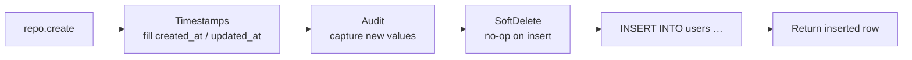

# titan-database

<span class="module-badge">official · @omnitron-dev/titan-database · stable</span>

Kysely-based typed query builder with decorator-driven repository
configuration, declarative migrations, row-level security, plugin
system (soft-delete / timestamps / audit), multi-dialect (Postgres /
MySQL / SQLite), and `AsyncLocalStorage`-based transaction context so
nested calls participate in the active transaction without parameter
threading.

```bash
pnpm add @omnitron-dev/titan-database
```

## Quickstart {#quickstart}

### Single connection {#single-connection}

```typescript
import { TitanDatabaseModule } from '@omnitron-dev/titan-database';

@Module({
  imports: [
    TitanDatabaseModule.forRoot({
      connection: {
        dialect:      'postgres',
        connection:   env.DATABASE_URL,
        pool:         { min: 2, max: 20 },
        migrationsPath: './migrations',
        coerceBigint: true,
      },
    }),
  ],
})
class AppModule {}
```

### SQLite {#sqlite}

Install the optional `better-sqlite3` peer when using the SQLite dialect.
`DatabaseModule` opens SQLite on the first connection. For a dedicated local
journal, the `@omnitron-dev/titan-database/sqlite` entry point exposes the same
checked driver directly.

```ts
import { openSqliteDatabase } from '@omnitron-dev/titan-database/sqlite';

const database = openSqliteDatabase(':memory:');
try {
  const rows = database.prepare('select 1 as ready').all();
  console.log(rows);
} finally {
  database.close();
}
```

The native binding requires Node-API 10. Omnitron needs this capability for its
durable state and logs. On an incompatible Node runtime, opening SQLite raises
a JavaScript error before loading the binding. PostgreSQL and MySQL users can
use their own drivers independently.

### Multiple named connections {#multiple-named-connections}

```typescript
TitanDatabaseModule.forRoot({
  connections: {
    primary: { dialect: 'postgres', connection: env.PRIMARY_URL },
    analytics: { dialect: 'postgres', connection: env.ANALYTICS_URL },
  },
})
```

### `forFeature` — repository registration {#forfeature--repository-registration}

```typescript
@Module({
  imports: [
    TitanDatabaseModule.forRoot({ connection: { dialect: 'postgres', connection: env.DATABASE_URL } }),
    TitanDatabaseModule.forFeature([UsersRepository, OrdersRepository]),
  ],
  providers: [UsersService],
})
class UsersModule {}
```

`forFeature` registers repository classes, wires them into the
container under per-repo tokens, and ensures decorator-driven plugins
(soft-delete, timestamps, audit) bind correctly at boot.

### Async configuration {#async-configuration}

```typescript
TitanDatabaseModule.forRootAsync({
  imports:    [ConfigModule],
  useFactory: (config: ConfigService) => ({
    connection: {
      dialect:    'postgres',
      connection: config.get('database.url'),
      pool:       config.get('database.pool'),
    },
  }),
  inject: [ConfigService],
})
```

## Read-only component schema readiness {#read-only-component-schema-readiness}

Use `@omnitron-dev/titan-database/readiness` when a component must verify the
PostgreSQL schema it consumes before accepting traffic. This optional entry
exports `requirePostgresSchema`, `SchemaReadinessError`, `requiredColumn`,
`nullableColumn` and their contract types. It borrows an existing pool, performs
catalog checks in a **read-only, repeatable-read transaction**, then releases its
connection. Importing it does not create a pool, load a PostgreSQL driver, build a
DI container or run migrations.

Omnitron applications can import the identical API through
`@omnitron-dev/omnitron/readiness`; they do not need to depend on Kysera or reach
into Titan internals. Choose the public entry for the layer your application uses.

### Declare what this component requires {#declare-what-this-component-requires}

The application owns its driver and pool. This example uses `pg`; install that
driver when it is not already an application dependency.

```typescript
import { Pool } from 'pg';
import {
  requirePostgresSchema,
  requiredColumn,
  nullableColumn,
  type PostgresSchemaRequirement,
} from '@omnitron-dev/omnitron/readiness';

const notificationSchema = {
  name: 'notification-worker',
  schema: 'public',
  tables: {
    notification_jobs: {
      insert: true,
      columns: {
        id: requiredColumn('uuid'),
        payload: requiredColumn('jsonb'),
        state: {
          ...requiredColumn('text'),
          default: true,
          defaultExpression: "'pending'::text",
        },
        processed_at: nullableColumn('timestamptz'),
      },
      unique: [['id']],
    },
  },
} satisfies PostgresSchemaRequirement;

export async function openWorkerPool(connectionString: string): Promise<Pool> {
  const pool = new Pool({ connectionString, connectionTimeoutMillis: 2_000 });
  try {
    await requirePostgresSchema(pool, notificationSchema, {
      statementTimeoutMs: 10_000,
      lockTimeoutMs: 1_000,
    });
    return pool;
  } catch (error) {
    await pool.end();
    throw error;
  }
}
```

Call this during the component's normal startup, after the
[stack-owned migration phase](../../omnitron/migrations.md#stack-owned-migrations)
and before serving requests or consuming work. Continue using the returned pool;
the application closes it on shutdown. The checker itself leaves a borrowed pool
open. Avoid starting the component's own copy of a shared migration registry:
a later, unrelated migration must not force an older compatible worker to become
a schema writer.

### Compatibility contract {#compatibility-contract}

`PostgresSchemaRequirement` names a component, an optional schema and the tables
and routines it needs. Without `schema`, PostgreSQL's `current_schema()` on the
borrowed connection selects the namespace. Declare the required subset rather
than an entire historical database snapshot.

| Contract | What is checked |
| --- | --- |
| `PostgresTableRequirement.columns` | Required physical table and exact declared column shapes; views and foreign tables do not satisfy it |
| `PostgresColumnRequirement.type` / `nullable` | PostgreSQL catalog type name and exact nullability; helpers set the nullability flag |
| `typeSchema` | Type namespace; defaults to `pg_catalog`, and can name a schema containing an enum or domain |
| `formattedType` | Optional exact `format_type` spelling, such as `numeric(12,2)` or `character varying(80)` |
| `default` / `defaultExpression` | Presence of a default, or its exact `pg_get_expr` representation when its meaning matters |
| `generated` | `false` requires a writable column; a string requires the exact generated expression |
| `insert: true` | Declared columns must be writable unless an expression is explicitly required; extra non-null columns must provide a default, identity or generated value |
| `unique` | Ordered whole-table unique key columns, enforced immediately by a valid unique index; primary/unique constraints and standalone indexes share this check |
| `foreignKeys` | Ordered local/referenced columns, referenced table in the checked schema, and exact delete/update actions; defaults are `no action` |

Compatible extra tables and nullable/defaulted columns are allowed. A read-only
projection can omit the `generated` distinction; insert contracts default to
non-generated declared columns.

A standalone `CREATE UNIQUE INDEX` can enforce the same key as a primary/unique
constraint and can support a foreign key. Readiness inspects that enforcing index
in PostgreSQL's catalog: it must be unique, valid, ready, live and immediate, with
no predicate or expression. `INCLUDE` columns carry payload and are excluded from
the ordered key. Partial, invalid, unfinished, dropping or deferrable indexes do
not satisfy `unique`. Foreign keys are checked independently. This does not
require changing migrations to turn an existing valid index into a constraint.
See [PostgreSQL index metadata](https://www.postgresql.org/docs/current/catalog-pg-index.html).

These checks do not prove arbitrary check constraints, index performance, query
permissions, row-level policies or every possible PostgreSQL invariant.

### Routines and triggers {#routines-and-triggers}

`routines` binds each ordinary scalar function to its exact ordered
`argumentTypes` (no arguments by default), SHA-256 of `pg_proc.prosrc`, language
(`sql` or `plpgsql`), volatility (`i`, `s` or `v`) and invoker security. Variadic,
default-argument and set-returning functions cannot satisfy this contract. An
unrelated overload does not count. Optional `returnType` uses `format_type`:
for example, `bigint`, whereas a column's catalog `type` is `int8`.

Table `triggers` bind the function name, reviewed body hash and PostgreSQL
`tgtype` bitmask. The trigger must be enabled for ordinary execution, apply
without a `WHEN` or column filter, have no trigger arguments and invoke an
invoker-security PL/pgSQL function in the checked schema returning `trigger`.
The `immutable` shorthand declares the row-level `BEFORE UPDATE OR DELETE`
trigger shape (`type: 27`); its reviewed function body determines the actual
rejection behavior.

Derive `bodySha256` from the exact function body supplied by reviewed migration
source. Do not derive an expected hash from the live function being checked:
that would accept the drift this contract is intended to detect. The checker
compares properties and bytes; it does not analyze arbitrary SQL semantics.

For routines and trigger functions, `configuration` is the exact set of
`pg_proc.proconfig` settings, empty by default. `schemaSearchPath: true` additionally
requires `pg_catalog, <checked schema>, pg_temp` using PostgreSQL identifier
quoting. Other intentional settings must still be declared. This binds name
resolution to the component's namespace without trusting a caller's mutable
search path; it is not a general SQL-security proof.

### Deadlines and failure reporting {#deadlines-and-failure-reporting}

The optional third argument is `PostgresReadinessOptions`:

| Option | Default | Boundary |
| --- | --- | --- |
| `statementTimeoutMs` | 10,000 ms | Each PostgreSQL statement |
| `lockTimeoutMs` | 1,000 ms | Each PostgreSQL lock wait |

Both accept positive integer milliseconds within PostgreSQL's supported range.
The settings are transaction-local and are restored afterward. They are **not**
a total-operation deadline. Set a finite pool acquisition timeout separately,
such as `pg`'s `connectionTimeoutMillis`; the pool owner controls acquisition.

A schema mismatch throws `SchemaReadinessError` with stable
`code: 'database_schema_incompatible'`, the component name and individual
`violations`. Authentication, connection and PostgreSQL timeout failures retain
their own errors. Report that actual failure through the application's normal
health/diagnostic path; do not translate an unavailable database into “schema is
compatible.” The check applies no DDL, writes no migration journal and never
repairs the schema automatically.

## `DatabaseModuleOptions` {#databasemoduleoptions}

| Option         | Type                                                                 |
| -------------- | -------------------------------------------------------------------- |
| `connection`   | `DatabaseConnection` — single connection                             |
| `connections`  | `Record<string, DatabaseConnection>` — multiple named                |
| `kysera`       | `{ core?, repository?, plugins? }` — Kysera integration config       |
| `plugins`      | `PluginsConfiguration` — global soft-delete / timestamps / audit     |

## `DatabaseConnection` {#databaseconnection}

| Field             | Type                                                              |
| ----------------- | ----------------------------------------------------------------- |
| `name?`           | `string`                                                          |
| `dialect`         | `'postgres' \| 'mysql' \| 'sqlite'`                               |
| `connection`      | `string \| ConnectionConfig` — URL or config object               |
| `pool?`           | `{ min, max, acquireTimeoutMillis, idleTimeoutMillis }`           |
| `debug?`          | `boolean`                                                         |
| `plugins?`        | `string[]` — plugin names                                         |
| `migrationsPath?` | `string`                                                          |
| `seedsPath?`      | `string`                                                          |
| `coerceBigint?`   | `boolean` — parse PG `BIGINT` as JS `number` if safe (default `true` for PG) |

## Repository pattern — `TransactionAwareRepository<DB, Table>` {#repository-pattern--transactionawarerepositorydb-table}

```typescript
import { Repository, SoftDelete, Timestamps, Audit } from '@omnitron-dev/titan-database';
import { TransactionAwareRepository } from '@omnitron-dev/titan-database';

interface Database {
  users: UsersTable;
}

@Repository('users')
@SoftDelete({ column: 'deleted_at' })
@Timestamps({ createdAt: 'created_at', updatedAt: 'updated_at' })
@Audit({ table: 'audit_logs', captureOldValues: true })
export class UsersRepository extends TransactionAwareRepository<Database, 'users'> {
  async findByEmail(email: string) {
    return this.executor.selectFrom('users')
      .where('email', '=', email)
      .selectAll()
      .executeTakeFirst();
  }
}
```

### Inherited methods {#inherited-methods}

| Method                                          | Purpose                                       |
| ----------------------------------------------- | --------------------------------------------- |
| `findById(id)`                                  | Fetch by primary key (`null` if missing)      |
| `findByIds(ids[])`                              | Fetch many by primary key                     |
| `create(data)` / `createMany(data[])`          | Insert one / many (returns inserted rows)     |
| `update(id, data)`                              | Update by id (returns row or `null`)          |
| `delete(id)`                                    | Hard delete by id (returns `boolean`)         |
| `softDelete(id)` / `restore(id)`               | Soft-delete / restore (requires `@SoftDelete`)|
| `list(options?)`                                | Offset-paginated list → `OffsetPaginatedResult` |
| `findWhere(where, options?)`                    | Dynamic `WHERE` (via `@kysera/repository` operators) |
| `findOneWhere(where)` / `countWhere(where)`     | Single match / count by `WHERE`               |
| `updateWhere(where, data)` / `deleteWhere(where)` | Bulk update / delete by `WHERE` (returns count) |
| `exists(id)` / `count()`                        | Existence check / row count                   |
| `upsert(data, options)` / `upsertMany(data[], options)` | Insert-or-update                      |

### Protected accessors {#protected-accessors}

| Member                         | Purpose                                                |
| ------------------------------ | ------------------------------------------------------ |
| `executor`                     | Current executor — transaction-aware                   |
| `inTransaction`                | `true` if running inside a transaction context         |
| `transaction`                  | Current `Transaction<DB>` if any                       |
| `hasSoftDelete`                | Plugin flag (set by `@SoftDelete`)                     |
| `softDeleteColumn`             | Column name (default `'deletedAt'`)                    |

## `DatabaseManager` {#databasemanager}

```typescript
import { DATABASE_MANAGER, type IDatabaseManager, runInTransaction } from '@omnitron-dev/titan-database';

interface AppDB {
  users: { id: number; email: string };
}

@Service({ name: 'reports' })
class ReportsService {
  constructor(@Inject(DATABASE_MANAGER) private readonly db: IDatabaseManager) {}

  @Public()
  async summary() {
    // getConnection() is async, and takes your schema as its type argument.
    // Without one it is Kysely<unknown>, which accepts no table name.
    const conn = await this.db.getConnection<AppDB>();
    return runInTransaction(conn, async () => {
      const users = await conn.selectFrom('users').selectAll().execute();
      return users;
    });
  }
}
```

| Method                                          | Purpose                                              |
| ----------------------------------------------- | ---------------------------------------------------- |
| `getConnection(name?)`                          | `async` — named or default plugin-aware `Kysely<unknown>` |
| `getExecutor(name?, plugins?)`                  | `async` — plugin-aware Kysera executor               |
| `getPool(name?)` / `getPoolMetrics(name?)`      | Raw driver pool / pool stats                         |
| `isConnected(name?)` / `getConnectionNames()`   | Connection state / registered names                  |
| `close(name?)` / `closeAll()`                   | Async cleanup of one / every connection (on shutdown) |

Transactions are run through the standalone `runInTransaction(conn, fn, options?)`
helper (below), **not** a method on the manager — pass it a connection from
`getConnection()`.

## Transaction context {#transaction-context}

The module uses `AsyncLocalStorage` to track the active transaction
per request. Repository calls inside `runInTransaction` automatically
use the transaction; no plumbing required.

```typescript
import {
  runInTransaction,
  getExecutor,
  getCurrentTransaction,
  isInTransactionContext,
} from '@omnitron-dev/titan-database';

await runInTransaction(db, async () => {
  await this.usersRepo.create({ email: 'ada@example.com' });   // uses the transaction
  await this.auditRepo.create({ kind: 'user.created' });        // same transaction
}, { name: 'signup' });
```

### Helpers {#helpers}

| Function                                  | Purpose                                                 |
| ----------------------------------------- | ------------------------------------------------------- |
| `runInTransaction(db, fn, options?)`      | Open a new transaction and run `fn` inside it           |
| `getExecutor(db)`                         | Return either current transaction or the base connection |
| `getCurrentTransaction()`                 | Current transaction or `undefined`                      |
| `isInTransactionContext()`                | Boolean check                                           |
| `getTransactionContext()`                 | Full context: depth, started-at, name, connection name  |

## Decorators {#decorators}

### Repository / plugins {#repository--plugins}

```typescript
import { Repository, SoftDelete, Timestamps, Audit, Migration }
  from '@omnitron-dev/titan-database';
```

| Decorator                              | Effect                                                     |
| -------------------------------------- | ---------------------------------------------------------- |
| `@Repository(table \| config)`         | Mark a class as a repository; config: `{ table, connection?, softDelete?, timestamps?, audit?, schema?, validate?, plugins? }` (RLS is configured separately via `@Policy`) |
| `@SoftDelete({ column?, includeDeleted?, tables? })` | Soft-delete behaviour — column defaults to `'deletedAt'` |
| `@Timestamps({ createdAt?, updatedAt? })` | Auto-managed timestamp columns                          |
| `@Audit({ table?, captureOldValues?, captureNewValues? })` | Row-level audit logging                  |
| `@Migration({ version, description?, dependencies?, connection?, transactional?, timeout? })` | Mark a class as a migration |

### Row-level security {#row-level-security}

```typescript
import { Policy, Allow, Deny, Filter, BypassRLS } from '@omnitron-dev/titan-database';
```

| Decorator                                                            | Effect                                          |
| -------------------------------------------------------------------- | ----------------------------------------------- |
| `@Policy({ table?, skipFor?, defaultPolicy? })`                      | Class-level RLS configuration                   |
| `@Allow({ operations: [...], priority?, name? })`                    | Allow rule for the listed operations            |
| `@Deny({ operations: [...], priority?, name? })`                     | Deny rule (evaluated before allow)              |
| `@Filter({ operations?, name? })`                                    | Method returns a WHERE-clause predicate         |
| `@BypassRLS()`                                                       | Skip RLS (requires admin / system context)      |

Example:

```typescript
@Repository('orders')
@Policy({ skipFor: ['admin'] })
class OrdersRepository extends TransactionAwareRepository<Database, 'orders'> {
  @Filter({ operations: ['select'] })
  tenantFilter(ctx: ExecutionContext) {
    return { tenant_id: ctx.tenantId };
  }

  @Allow({ operations: ['insert', 'update'] })
  ownerWrite(ctx: ExecutionContext, row: Row) {
    return row.user_id === ctx.auth.userId;
  }
}
```

### Injection {#injection}

| Decorator                                | Effect                                  |
| ---------------------------------------- | --------------------------------------- |
| `@InjectConnection(name?)`               | Inject a named connection               |
| `@InjectDatabaseManager()`               | Inject the `DatabaseManager`            |
| `@InjectRepository(RepoClass)`           | Inject a repository instance            |

## Migrations {#migrations}

```typescript
import { Migration } from '@omnitron-dev/titan-database';

@Migration({ version: '20260101_001', description: 'create users table' })
export class CreateUsersTable {
  async up(db: Kysely<any>) {
    await db.schema.createTable('users')
      .addColumn('id', 'uuid', (c) => c.primaryKey())
      .addColumn('email', 'text', (c) => c.notNull().unique())
      .addColumn('created_at', 'timestamptz', (c) => c.defaultTo('now()'))
      .execute();
  }

  async down(db: Kysely<any>) {
    await db.schema.dropTable('users').execute();
  }
}
```

`@Migration` records class metadata. The module does not discover or execute
migrations automatically at DI startup; `migrationsPath` does not schedule them.
Choose an explicit registry and deployment command. Omnitron applications use
[`@omnitron-dev/omnitron/migration`](../../omnitron/migrations.md); standalone
Titan applications use `@omnitron-dev/titan-database/migration`.

### One execution engine {#one-execution-engine}

Kysera owns execution, connection pinning, locking, history and checksums.
Titan's narrow migration entry point re-exports that engine and adds driver
adapters. There is no second transaction or journal implementation.

`createHardenedRunner` preserves the original Titan journal (`migrations` plus
`migration_checksums`), advisory lock and function-source checksum format.
It defaults to per-migration transactions and fails promptly on lock contention;
set `lockTimeoutMs` to wait. Body, journal and checksum commit together. Legacy
checksums are backfilled on writes under its compatibility policy; read-only
inspection reports missing checksums as unverified. An explicit `checksum`
overrides function-source hashing.

For new applications, Omnitron's `createMigrationRunner` uses explicit defaults
and an inline checksum journal with execution order. `defineSqlMigration` hashes
SQL contents; `transactionMode: 'batch'` makes an entire operation atomic where
the dialect supports it. Preserve existing history and lock identities when
adopting the engine. See [guarantees and migration examples](../../omnitron/migrations.md).

### Transaction context {#transaction-context-1}

`runInTransaction` and `getExecutor` propagate only the transaction belonging to
the requested database. Nested work uses Kysera DAL savepoints; a second database
gets an independent transaction. Whole-transaction retries use Kysera Infra and
are opt-in. A failed rollback preserves both causes. Cross-database work is not
a distributed transaction: callers must design compensation explicitly.

## What comes through from `@kysera/*` {#what-comes-through-from-kysera}

This package re-exports about sixty symbols from the `@kysera` family, so they
are importable from `@omnitron-dev/titan-database` and a reader has no reason
to guess that a second package is involved. They are listed here by origin
rather than described — their own documentation is authoritative, and copying
it here would rot.

| From                  | What                                                                 |
| --------------------- | -------------------------------------------------------------------- |
| `@kysera/core`        | error mapping (`parseDatabaseError`, `ErrorCodes`, `UniqueConstraintError`, `ForeignKeyError`, `NotNullError`), pagination (`paginate`, `paginateCursor`, `applyOffset`, `applyDateRange`, `executeCount`) |
| `@kysera/repository`  | `upsert`, `upsertMany`, `atomicStatusTransition`, `ContextAwareRepository` (also exported as `BaseRepository`), and the `WHERE`-operator helpers |
| `@kysera/infra`       | `withRetry`, `withTransactionRetry`, `CircuitBreaker`, `isTransientError`, `isSerializationError`, `HealthMonitor`, `checkDatabaseHealth` |
| `@kysera/rls`         | `defineRLSSchema`, `allow`, `deny`, `filter`, `rlsPlugin`             |
| `@kysera/dialects`    | `getAdapter`, `createDialectAdapter`, and the per-dialect adapters    |
| plugins               | `softDeletePlugin`, `timestampsPlugin`, `auditPlugin`                 |
| `kysely`              | `Kysely`, `Transaction`, `Selectable`, `Insertable`, `Updateable` (types) |

Three of kysera's error classes are renamed on the way through:
`DatabaseError`, `NotFoundError` and `BadRequestError` are exported as
`KyseraDatabaseError`, `KyseraNotFoundError` and `KyseraBadRequestError`. The
unprefixed names are NOT exported from this package at all — reach for
`NotFoundError` here and the import fails rather than resolving to something
that merely looks right, which is the intended outcome: those names belong to
your application's own error hierarchy or to Titan's, and a database driver's
version of them is a different type.

## Plugin lifecycle ordering {#plugin-lifecycle-ordering}



For deletes, soft-delete intercepts first: it issues an UPDATE that
sets `deleted_at` instead of a DELETE; the audit plugin captures the
before/after.

## Tokens {#tokens}

| Token                                  | Purpose                                                |
| -------------------------------------- | ------------------------------------------------------ |
| `DATABASE_MANAGER`                     | `DatabaseManager`                                      |
| `DATABASE_MODULE_OPTIONS`              | Resolved options bundle                                |
| `DATABASE_CONNECTION`                  | Default `Kysely<unknown>`                              |
| `DATABASE_HEALTH_INDICATOR`            | Health indicator for `titan-health`                    |
| `getDatabaseConnectionToken(name?)`    | Token for a named connection                           |
| `getRepositoryToken(RepoClass)`        | Token for a specific repository instance               |

## Lifecycle {#lifecycle}

`TitanDatabaseModule` implements:

- `async onStop(app)` — `manager.closeAll()` to release every
  connection. Crucial during dev with file watchers — without this,
  rapid restarts exhaust PG connection slots.

## Adding your own kysera plugins {#adding-your-own-kysera-plugins}

Plugins go on the CONNECTION, through `kysera.plugins`. They are
applied when the executor is built, so every query on that
connection passes through them — including hand-written Kysely,
which is how applications that do not use the base repository
class get covered:

```typescript
TitanDatabaseModule.forRootAsync({
  useFactory: () => ({
    connection: { /* … */ },
    kysera: {
      plugins: [rlsPlugin({ schema, bypassRoles }), myPlugin()],
    },
  }),
});
```

`kysera.plugins` and the built-in `plugins` block are MERGED, not
alternatives — configuring one of them does not silently drop the
other.

:::warning Removed: `registerTablePlugins`
There used to be a per-table registry documented here, recommended
for exactly the case above. Plugins registered through it were
always skipped: `DATABASE_CONNECTION` already resolves to a kysera
executor, and the reader correctly declines to wrap a connection
that is already plugin-aware — so the registry's own reader was
unreachable by construction. It was deleted rather than fixed,
because `kysera.plugins` is the path that works. If you are
following an older copy of this page, move the plugin list into
the module options as above.
:::

## Anti-patterns {#anti-patterns}

- **Manual transaction threading.** Don't pass `tx` as a parameter
  through every layer. Use `runInTransaction`; repository calls
  pick up the transaction from the async context.
- **Naked DELETE on soft-delete tables.** Use the repo's `delete()`
  — the plugin transforms it into an UPDATE setting `deleted_at`.
- **Forgetting `migrationsPath`.** Without it, the migration runner
  has nothing to discover.
- **Using `@BypassRLS` casually.** It exists for system flows
  (cron-driven cleanups, admin scripts) — every use case needs a
  written justification.
- **Sharing one connection across very different workloads.** OLTP
  and analytics traffic on one pool starves each other. Use
  multiple named connections.

## Inter-module dependencies {#inter-module-dependencies}

- Uses [`@kysera/*`](https://github.com/kysera) — core / repository
  / rls / soft-delete / timestamps / audit / executor / infra /
  migrations.
- Peer deps on the drivers you use: `pg`, `mysql2`, `better-sqlite3`.
- Optional health indicator integrates with [`titan-health`](./health.mdx).

## See also {#see-also}

- [`titan-health`](./health.mdx) — `DatabaseHealthIndicator` exported by this module
- [Best Practices / Performance](../best-practices/performance.md) — N+1, projection, indexing


## PostgreSQL coordination leases {#postgresql-coordination-leases}

The optional `@omnitron-dev/titan-database/coordination` entry point exports
`PostgresLeaseStore`, `LeaseLostError`, `POSTGRES_LEASE_SCHEMA_V1`, `LeaseIdentity`,
`LeaseGrant` and `LeaseStore`. It imports Kysely without starting Titan DI, Redis or
an election service. Apply its schema through the migration facade owned by your
application; constructing a store never mutates schema.

```typescript
import { randomUUID } from 'node:crypto';
import type { Kysely } from '@omnitron-dev/titan-database';
import { PostgresLeaseStore } from '@omnitron-dev/titan-database/coordination';

interface BillingDatabase {
  jobs: { id: string; status: 'pending' | 'claimed' };
}

// Retain one incarnation for this controller's lifetime.
const incarnation = randomUUID();

async function claimJob(db: Kysely<BillingDatabase>, instanceId: string, jobId: string) {
  const leases = new PostgresLeaseStore(db);
  const grant = await leases.acquire({ key: 'billing/reconcile', owner: instanceId, incarnation }, 15_000);
  if (!grant) return false;
  try {
    return await leases.withLease(grant, async trx => {
      // All protected database effects must use this transaction.
      const result = await trx.updateTable('jobs')
        .set({ status: 'claimed' })
        .where('id', '=', jobId)
        .where('status', '=', 'pending')
        .executeTakeFirst();
      return result.numUpdatedRows === 1n;
    });
  } finally {
    await leases.release(grant);
  }
}
```

Use one incarnation for a controller lifetime. Repeating an acquisition with the
same identity reconciles a lost reply while the epoch is valid. `renew` returns
`null` after expiry or replacement; it never grants a new epoch. `read` reports only
an unexpired database observation. Release retains the row and epoch.

All contenders need the same writable PostgreSQL authority; its failover must
preserve committed epochs. Mutations request synchronous commit. Lock waits are
bounded to two seconds and SQL statements to five seconds; configure a finite
connection-acquisition timeout on the pool too. Fenced callbacks must be bounded
and perform database work through the supplied transaction. External I/O is not
rolled back or fenced by a SQL transaction: its recipient needs an epoch-aware
admission contract. Never delete lease rows to reset ownership.
