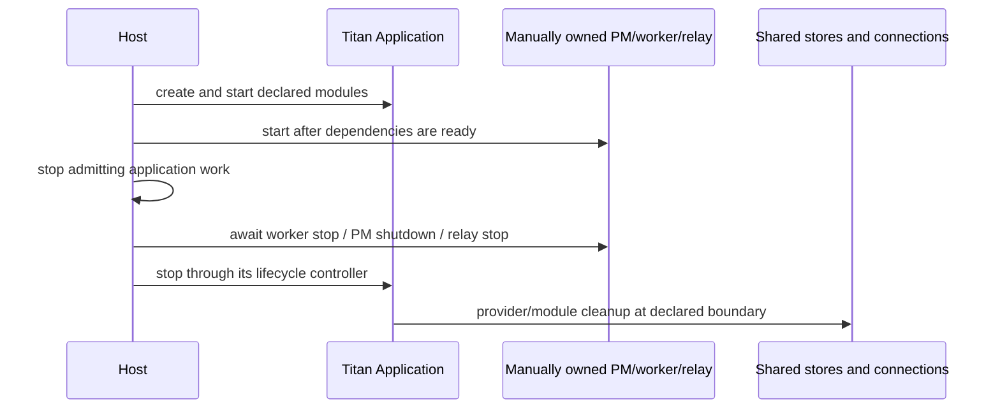

# Lifecycle reference

Module hooks, provider disposal and explicit service methods are different
mechanisms. This page names the implemented entry point and its owner. A method
named `start`, `shutdown` or `onModuleDestroy` is not automatically a Titan hook.

## The four phases {#the-four-phases}

Recap of [Application lifecycle](../application/lifecycle.md):

| Phase           | Fires when                                                            |
| --------------- | --------------------------------------------------------------------- |
| `onInit`        | After construction, before any `onStart` fires                       |
| `onStart`       | Once every `onInit` finished; in dependency order                    |
| `onStop`        | On `app.stop()`; in **reverse** dependency order                     |
| `onDestroy`     | Final cleanup phase after `onStop`                                    |

Modules are not obliged to implement all four — most use just one
or two. The table below shows what each official module actually
does.

## Lifecycle behaviour by module {#lifecycle-behaviour-by-module}

official · @omnitron-dev/titan-*

### `titan-auth` {#titan-auth}

| Hook         | What it does                                                |
| ------------ | ----------------------------------------------------------- |
| `onInit`     | —                                                           |
| `onStart`    | —                                                           |
| `onStop`     | —                                                           |
| `onDestroy`  | —                                                           |

`titan-auth` is **lifecycle-passive**. The JWT service has no
long-lived resources to set up or tear down beyond the JWKS HTTP
client it opens lazily on first use.

### `titan-cache` {#titan-cache}

`CacheService` creates its default cache in the constructor. It has no `onStop`
hook; Titan tracks its async `dispose()` for container teardown. Disposal awaits
cache cleanup, pending write-back, invalidation unsubscription and an optional
L2 adapter `dispose()`. The adapter decides whether it owns or borrows a Redis
connection. A caller creating the service directly must await `dispose()`.

### `titan-database` {#titan-database}

Factories configure `DatabaseManager`; connection initialization is handled by
its providers. `TitanDatabaseModule.onStop(app)` resolves the manager and calls
`closeAll()`. The module catches close errors during shutdown, so this hook alone
is not proof that every write committed. Directly constructed connections remain
the caller's responsibility.

### `titan-discovery` {#titan-discovery}

The module's `onStart(app)` starts `DiscoveryService` and attempts optional Netron
integration. Integration initialization failure is logged at debug level and does
not abort startup. The service opens pub/sub only when `pubSubEnabled` is true and
starts heartbeats only outside `clientMode`.

`onStop` stops heartbeats, attempts deregistration and unsubscribes; `onDestroy`
also awaits the same stop path. `clientMode` does not enable pub/sub by itself.
The service is terminal after stop.

### `titan-events` {#titan-events}

Event services initialize their in-memory state and discovery during startup.
`EventsService.onStart()` and `onStop()` currently log only; `onStop` does not
block new emits or await all application handler work. `onDestroy()` removes
subscriptions, listener references and statistics. Scheduler/history sub-services
have their own teardown. Stop and await your event producers before disposing the
container; there is no durable replay or shutdown-drain guarantee.

### `titan-health` {#titan-health}

Factories register indicators. `HealthService` has no polling loop or lifecycle
hooks; callers invoke checks. A cached result is reused only after a completed
check. Concurrent cold calls are not coalesced. HTTP probe routes are owned by
the host; the optional Netron RPC service is a separate surface.

### `titan-lock` {#titan-lock}

The lock service has no `onStop`, release-all hook or registry of all acquired
leases. `withLock` releases its own lease in `finally`; low-level callers must
pair `acquireLock` with `releaseLock`. TTL expiration is the recovery path after
process death. Renewal failure cannot forcibly cancel arbitrary application code.

### `titan-metrics` {#titan-metrics}

The module factory calls `MetricsService.start()` on provider creation. It starts
process collection, periodic flush and retention timers. An orchestrator must be
passed explicitly for child collection; the RPC/custom flags do not add hooks.

Provider `onDestroy()` awaits `stop()`: timers stop, the collector is drained,
queued writes flush and active durable writes settle. `stop()` does not run a
retention cleanup. A directly constructed service needs an explicit awaited stop
before its storage connection closes.

### `titan-notifications` {#titan-notifications}

Provider factories build the transport and channel registry. `NotificationsService.onStart()`
awaits transport readiness. Its `onStop()` is empty; do not assume that it fences
new sends or drains callers. `onDestroy()` shuts down channels, then destroys the
transport.

`forWorker()` only registers `NotificationWorkerService` and its application ports.
The host must call `start(rawRedis, options?)` and await `stop()` before closing
that caller-owned Redis client. The worker has no Titan lifecycle hook.

### `titan-pm` {#titan-pm}

The `ProcessManager` constructor initializes components and starts its liveness
sweep. Work starts through `spawn`, `pool` and supervisor operations; the module
has no automatic process list or `onStart` hook.

The host must await `ProcessManager.shutdown()` during shutdown. Neither the
module nor manager currently implements a Titan `onStop`/`onDestroy` bridge.
Process signal handling is opt-in via `handleSignals: true`; it defaults off so
the application can own signals. Shutdown fences new work and drains/terminates
tracked resources. Supervision and spawn admission are described in [PM](./pm.mdx).

### `titan-ratelimit` {#titan-ratelimit}

`MemoryRateLimitStorage` owns an expiry-cleanup timer. `RateLimitService.destroy()`
calls storage `destroy()` when available; call it explicitly for cleanup. The
service's Titan `onDestroy()` currently only withdraws the ambient decorator
reference and does not call `destroy()`.

Redis storage borrows its client and does not close it. The client's owner handles
connection shutdown. Do not infer Redis cleanup from the memory-storage method.

### `titan-redis` {#titan-redis}

The module's provider factory awaits `RedisManager.init()` to create clients and
load scripts. `TitanRedisModule.onStop(app)` calls `manager.destroy()` and closes
registered clients through the manager's bounded close path.

`RedisManager.onModuleInit` / `onModuleDestroy` exist for hosts that call those
names explicitly. Titan does not treat them as aliases for its own lifecycle;
the module factory and `onStop` are the ordinary Titan path.

### `titan-scheduler` {#titan-scheduler}

`SchedulerService.onInit()` loads recoverable persisted records, discovers
decorated handlers and calls `onStart()` unless `enabled: false`. Timers can
therefore be armed during initialization. A serialized record without a callable
handler is skipped; persistence does not reconstruct JavaScript closures.

`onStop()` clears timers, requests cancellation, waits up to `shutdownTimeout`
and flushes persistence. `onDestroy()` awaits stop and destroys persistence/metrics
services. Cancellation is cooperative: a job ignoring it can outlive the wait.

### `titan-telemetry-relay` {#titan-telemetry-relay}

The relay is constructed directly. The host calls `start()` to enable buffered
flushes and WAL replay, and awaits `stop()` after stopping telemetry producers.
Stop disposes the buffer, awaits delivery, disconnects the transport and disposes
the WAL. It does not close a caller-provided aggregator or install subscriptions.
After stop the relay is terminal; create a new instance to restart.

### `titan-mailer` {#titan-mailer}

Mailer factories construct the SMTP service and optionally verify it.
`MailerService.onDestroy()` stops admission, drains accepted operations and closes
its pool. An explicit mail worker must stop before its outbox, mailer and transport.

### `titan-storage` {#titan-storage}

Titan calls the selected adapter's initialization. Local root creation is deferred
to the first operation. S3 initialization creates a client; `onDestroy()` destroys
it. Direct constructors require caller-owned lifecycle.

### `titan-lumen` {#titan-lumen}

The module registers `LumenService`, access filtering and live editing providers.
The service reads the configured corpus on demand; it has no module-managed
background watcher or lifecycle hooks. Optional authoring persistence uses the
injected database manager. See [Lumen](../../lumen/overview.md).

## Built-in modules {#built-in-modules}

built-in · @omnitron-dev/titan · config + logger

### `config` {#config}

`ConfigService.onInit()` loads sources, validates when `validateOnStartup` is
set, and installs file watchers when `watchForChanges` is set. `onStart()` logs
only. `onStop()` removes watchers; `onDestroy()` removes them again and clears
cache/change listeners. Validation failure is a Titan bad-request error with
validation details, not a raw Zod exception contract.

### `logger` {#logger}

`LoggerService` initializes Pino, processors and configured transports in its
constructor. It has no `onInit`/`onStop`/`onDestroy` hooks. `Application`'s default
shutdown task calls its async `flush()`; directly owned loggers require an explicit
flush. A sink can still fail or contain unconfirmed writes, which flush reports.
Async stdout has a separate process-exit flush mechanism. Forced termination
cannot guarantee buffered delivery or close application-owned transport handles.

## Putting it together — full boot/shutdown timeline {#putting-it-together--full-bootshutdown-timeline}

The diagram is an ownership sequence, not a fixed package order. Application
shutdown hooks must explicitly await manually owned resources while their
connections are still usable.

## Practical rules {#practical-rules}

- Register dependency edges explicitly; ordering cannot be inferred from prose.
- Stop producers before their stores and transports.
- Await explicit `stop`, `shutdown`, `dispose` or `flush` operations where the
  package has no lifecycle bridge.
- Treat cancellation, a method returning and durable commit as different events.
- Test shutdown through `Application`, including failed writes and outstanding work;
  calling a service hook in isolation does not verify the owning application's path.

## See also {#see-also}

- [Application / Lifecycle](../application/lifecycle.md) — framework-level explanation
- [Application / Shutdown](../application/shutdown.md) — signals, timeouts, graceful drain
- [Module map](./module-map.mdx) — dependency order determines lifecycle order
- [Options patterns](./options-patterns.mdx) — when `onInit` factories run
