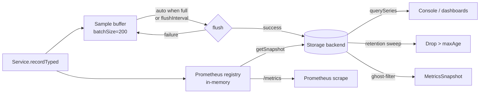

import ModuleBadge from '@site/src/components/ModuleBadge';

# titan-metrics

<ModuleBadge origin="official" pkg="@omnitron-dev/titan-metrics" status="stable" />

Pure Titan-native counters, gauges, and histograms with a Prometheus
exposition registry, pluggable storage backends (memory / PostgreSQL
/ SQLite), automatic process / system / RPC collection, retention,
re-enqueue-on-failure semantics, ghost-app filtering, and optional
sync hooks for external systems.

```bash
pnpm add @omnitron-dev/titan-metrics
```

> **No `prom-client` dependency.** This module ships its own
> Prometheus exposition format generator and time-series storage.
> Scrape with any Prometheus-compatible tool; persist locally with
> SQLite; aggregate across pods with PostgreSQL.

## When you need it

- **Dashboards.** Counters for throughput, histograms for latency,
  gauges for resource use.
- **Time-series queries inside your app.** Persist to SQLite or
  Postgres and query directly without setting up Prometheus.
- **Prometheus exposition.** Generate the standard `/metrics`
  text format from the registry.
- **Operator console without external observability stack.** The
  in-memory ring buffer + the `OmnitronMetrics` RPC service let the
  CLI and webapp read the metrics directly.

## Quickstart

```typescript
import { TitanMetricsModule } from '@omnitron-dev/titan-metrics';

@Module({
  imports: [
    TitanMetricsModule.forRoot({
      appName:    'my-api',
      collection: {
        enabled:  true,
        interval: 5_000,                 // sample every 5s
        process:  true,                  // CPU, RSS, heap
        system:   true,                  // load, free mem
        rpc:      true,                  // Netron call metrics
        custom:   true,
      },
      storage:   { type: 'memory', batchSize: 200, flushInterval: 5_000 },
      retention: { maxAge: '7d', cleanupInterval: 3_600_000 },
    }),
  ],
})
class AppModule {}
```

Async config via `forRootAsync({ useFactory, inject? })`.

## `IMetricsModuleOptions`

| Option              | Type                                                                          | Default                  |
| ------------------- | ----------------------------------------------------------------------------- | ------------------------ |
| `appName`           | `string` — required; tags every metric                                       | —                        |
| `collection`        | `{ enabled?, interval?, process?, system?, rpc?, custom? }`                  | enabled, 5s, all on      |
| `storage`           | `{ type: 'memory' \| 'postgres' \| 'sqlite', batchSize?, flushInterval? }`   | `'memory'`, `200`, `5_000` |
| `retention`         | `{ maxAge?, cleanupInterval? }`                                              | `'7d'`, `1h`             |
| `sync`              | `{ enabled?, onFlush?: (batch) => Promise<void> }`                           | —                        |
| `isGlobal`          | `boolean`                                                                     | `false`                  |

## `MetricsService` — the API

```typescript
import { MetricsService, METRICS_SERVICE_TOKEN }
  from '@omnitron-dev/titan-metrics';

@Service('users@1.0.0')
class UsersService {
  constructor(@Inject(METRICS_SERVICE_TOKEN) private readonly metrics: MetricsService) {}

  @Public()
  async create(input: CreateInput) {
    this.metrics.recordTyped('counter', 'users.created.total',
      { source: input.source }, 1);

    const t0 = performance.now();
    try {
      return await this.repo.create(input);
    } finally {
      this.metrics.recordTyped('histogram', 'users.create.ms',
        { source: input.source }, performance.now() - t0);
    }
  }
}
```

### Recording API

| Method                                                            | Purpose                                          |
| ----------------------------------------------------------------- | ------------------------------------------------ |
| `record(sample)`                                                  | Record a fully-formed sample                     |
| `recordBatch(samples[])`                                          | Record many at once                              |
| `recordTyped(type, name, labels, value)`                          | **Preferred** — keeps registry + storage in sync |
| `getRegistry()`                                                   | Direct access to the in-memory Prometheus registry |

The `recordTyped()` method is the canonical entry point — it
guarantees the Prometheus registry and long-term storage stay
synchronised. Lower-level `record` is for cases where you've
already built a sample object.

### Query API

| Method                                                            | Purpose                                          |
| ----------------------------------------------------------------- | ------------------------------------------------ |
| `getSnapshot()`                                                   | Point-in-time per-app snapshot (ghost-filtered)  |
| `querySeries(filter)`                                             | Query time-series with bucketing                 |
| `getPrometheusText()`                                             | Standard Prometheus exposition format            |
| `evictApp(app)`                                                   | Drop all metrics for a given app tag             |

### Lifecycle

| Method                                                            | Purpose                                          |
| ----------------------------------------------------------------- | ------------------------------------------------ |
| `start()`                                                         | Start periodic collection + flushing + cleanup   |
| `stop()`                                                          | Drain buffers, stop collection                   |
| `flush()`                                                         | Force-flush pending samples; re-enqueues on failure |
| `getStorageStatus()`          | `MetricsStorageStatus`        | requires auth       |
| `cleanup()`                                                       | Apply retention policy                           |

## Why `recordTyped` matters (T#74)

The unified entry point exists because pre-T#74, callers had two
incompatible ways to write metrics:

1. **`record(sample)`** — wrote to BOTH registry and storage, but
   the registry routed by previously-registered type, defaulting
   to **gauge**. Wrong for counters and histograms unless someone
   else pre-registered the metric name.
2. **`getRegistry().counter(...)` etc** — wrote to ONLY the
   registry. These metrics appeared in `/metrics` (Prometheus) but
   were **invisible** to `querySeries()` — every dashboard query
   for them returned empty.

`recordTyped` takes an explicit type, writes to the registry via
the correct type-specific method, and pushes the sample to the
storage buffer in the same call. Use it unless you have a specific
reason not to.

## `MetricsQueryFilter` — the shape of time-series queries

```typescript
interface MetricsQueryFilter {
  names?:    string[];                          // ['orders.process.ms']
  apps?:     string[];                          // ['orders-api']
  from?:     string | number;                   // ISO string or ms
  to?:       string | number;
  labels?:   Record<string, string>;            // { region: 'eu-west' }
  interval?: string;                            // '1m' | '5m' | '1h' for bucketing
  limit?:    number;
}
```

Returns `MetricsTimeSeries[]`:

```typescript
interface MetricsTimeSeries {
  name:   string;
  app:    string;
  labels: Record<string, string>;
  points: Array<{ timestamp: number; value: number }>;
}
```

A typical dashboard query:

```typescript
const series = await metrics.querySeries({
  names:    ['orders.process.ms'],
  apps:     ['orders-api'],
  from:     Date.now() - 3_600_000,           // last hour
  to:       Date.now(),
  interval: '1m',                              // 60 points
});
```

Pagination uses `limit` + repeated calls with adjusted `from` —
there's no opaque cursor.

## `MetricsSnapshot` — what `getSnapshot()` returns

```typescript
interface MetricsSnapshot {
  timestamp: number;
  apps: Record<string, {
    cpu:        number;
    memory:     number;
    requests:   number;
    errors:     number;
    instances:  number;
    status:     string;
    latency?:   { p50: number; p95: number; p99: number; mean: number };
  }>;
  totals: {
    cpu:        number;
    memory:     number;
    apps:       number;
    onlineApps: number;
  };
}
```

The snapshot powers the omnitron-console dashboard. It includes
**per-app aggregates** plus cluster-wide totals.

### Ghost-app filtering

A subtle but important property: `getSnapshot()` filters out apps
whose freshest `app_status` sample is older than
`max(3 × collection.interval, 30_000)` ms. Without this filter,
the ring buffer would keep showing apps the orchestrator no longer
reports (renamed, removed, dev-mode reload, etc.) as "offline" —
inflating `totals.apps` with ghosts.

The staleness multiplier is fixed at 3× (the smallest value that
survives normal flush jitter). Override the floor by configuring
a longer `collection.interval`.

## Storage and commit boundaries

| Backend | Setup | What survives restart |
| --- | --- | --- |
| `memory` | Default; no SQL runtime dependency | Nothing; a bounded ring serves recent readings |
| `sqlite` | A caller-owned Kysely connection; SQLite `synchronous=FULL` or `EXTRA` | Committed rows in the database file |
| `postgres` | A caller-owned Kysely connection and a registered schema migration | Committed rows in the logged table |

Omnitron selects PostgreSQL on masters and SQLite on updated slave daemons.
Standalone Titan applications opt in by registering `METRICS_STORAGE_TOKEN`
with the appropriate adapter. Selecting a storage type does not create a database
connection. `forRootAsync` accepts a `storage: { useFactory, inject }` provider;
it refuses a persistent configuration without one instead of silently using memory.
Kysely is an optional peer dependency; install the driver for your chosen database.

`PostgresMetricsStorage.write(samples)` and `SQLiteMetricsStorage.write(samples)`
resolve after the transaction commits. They have no internal queue or flush timer.
Errors reject the call. All INSERT chunks and an optional `afterWrite(trx, samples)`
outbox callback share that transaction. The callback receives newly inserted samples,
so a retry with the same IDs cannot append the outbox twice. `writeInTransaction`
joins a caller-owned transaction; only the outer commit confirms persistence.
Initialize the SQLite adapter before joining another transaction.

### Apply the schema once

Titan owns the immutable `METRICS_POSTGRES_SCHEMA_V1` and `METRICS_SQLITE_SCHEMA_V1`
DDL. PostgreSQL schema changes run through the application's migration framework,
not opportunistically from a write:

```typescript
import { METRICS_POSTGRES_SCHEMA_V1 } from '@omnitron-dev/titan-metrics';
import { defineSqlMigration } from '@omnitron-dev/titan-database/migration';

export const migration = defineSqlMigration(
  '001_metrics',
  METRICS_POSTGRES_SCHEMA_V1.join(';\n'),
  'DROP TABLE metrics_samples',
);
```

Omnitron registers this as `015_persistent_metrics` through its public migration
API. Application developers using Omnitron do not need to import Kysera directly.
Existing `metrics_raw` tables are not adopted or erased: the new contract uses
`metrics_samples`, epoch milliseconds, stable sample IDs and indexed series identity.
SQLite initialization creates that table idempotently; use `initializeSchema: false`
when your migrations own its creation. Setup errors propagate and remain retryable.

### Await a durable write

```typescript
import { MetricsService, PostgresMetricsStorage } from '@omnitron-dev/titan-metrics';

// db is your existing, migrated Kysely connection.
const metrics = new MetricsService(
  { appName: 'api', collection: { enabled: false }, storage: { type: 'postgres' } },
  new PostgresMetricsStorage(db),
);
const receipt = await metrics.recordDurable([{
  id: 'measurement-42', // preserve across caller retries after an uncertain response
  name: 'queue_depth', value: 12, timestamp: Date.now(), labels: { app: 'api' },
}]);
// receipt: { durability: 'persistent', samples: 1, committedAt: ISO timestamp }
```

An ID identifies one immutable sample. Reusing it with different data rejects the
write. `recordDurable` rejects memory or undeclared durability. PostgreSQL requires
`fsync=on`, `full_page_writes=on` and a logged table; writes set transaction-local
`synchronous_commit=on`. SQLite verifies disk durability and reports `:memory:` as
volatile. Database commit does not certify a backup or availability of replicas.

### Buffered collection and diagnostics

`record`, `recordBatch` and `recordTyped` are synchronous collection calls, **not
commit acknowledgements**. The service assigns IDs before queuing. `flush()` awaits
all samples accepted before the call, including an in-flight writer; `stop()` stops
collection and awaits the final flush. A failed write keeps its batch for retry.
Until commit, this queue is volatile. Use the awaited API when the caller needs a
persistence result.

The queue defaults to 50,000 samples and 16 MiB of serialized UTF-8 data, including
writes in flight (`storage.maxBufferSize`, `storage.maxBufferBytes`). Overflow
rejects new samples from persistence and increments `droppedSamples`; it cannot be
mistaken for a committed write. Background errors are caught, exposed by
`getStorageStatus()` and sent to the optional `onError(error, operation)` callback.
Explicit writes, flush and cleanup still reject. Counters describe this process;
the database history survives its replacement.

Status includes pending sample/byte counts, capacity, oldest enqueue time, last
completed write, failed writes, known losses, write/retention/callback errors and
storage durability. Omnitron exposes the same interpretation in `omnitron metrics
--json`, daemon health and the Console Metrics page. A disconnected status poll
must not leave a green persistence claim on screen.

`sync.onFlush` is a post-write notification, not a transactional outbox. Its failure
is reported separately and never retries an already committed storage write. Use
`afterWrite` with the supplied transaction for reliable enqueueing.

### Bounded history queries

Names, apps and labels filter in SQL before per-series limits. Node labels remain
separate series. `limit` is 1–2000 points per series (default 120); SQL adapters
default to the last 24 hours when `from` is omitted. Time buckets average gauges
and keep the last `*_total`/`*_count` value. Bounds cover the whole requested window,
not just its first rows. Limits apply to the newest points.

Results are capped at 100,000 points and 1,024 series by default. Adapter options
`maxQueryPoints` and `maxQuerySeries` can lower these budgets; the series cap can be
raised to 4,096. PostgreSQL queries have a 10-second statement timeout by default.
An exceeded budget rejects with an instruction to narrow the query; it does not
silently truncate history. Labels are returned once per series. Samples allow up
to 64 string labels and 8 KiB of serialized labels. Keep cardinality low.

## `@Metrics` decorator

```typescript
import { Metrics } from '@omnitron-dev/titan-metrics';

@Public()
@Metrics()                      // metric label defaults to `ClassName.process`
async process(order: Order) { /* … */ }

@Public()
@Metrics('orders.process')      // optional explicit method label
async processNamed(order: Order) { /* … */ }
```

The decorator takes a single optional `metricName` string — the value
used as the `method` label (defaults to `ClassName.methodName`). It
auto-instruments the wrapped method, recording three registry metrics
on every call:

| Registry metric                  | Type      | Labels             |
| -------------------------------- | --------- | ------------------ |
| `rpc_requests_total`             | counter   | `method`, `status` |
| `rpc_request_duration_seconds`   | histogram | `method`           |
| `rpc_errors_total`               | counter   | `method`, `error`  |

> **Wiring required.** The decorator reads its `MetricsService` from a
> `WeakMap` keyed by the instance — call `attachMetricsService(instance,
> service)` during DI wiring, or the decorator silently records nothing.
> It writes to the registry only (Prometheus exposition); these metrics
> are not pushed to the storage buffer.

## Prometheus exposition

```typescript
const text = await this.metrics.getPrometheusText();
// # HELP users_created_total Number of users created
// # TYPE users_created_total counter
// users_created_total{source="web"} 42
// ...
```

Serve this on a `/metrics` route from a tiny HTTP handler and point
Prometheus at it. No `prom-client` needed.

## RPC surface — `OmnitronMetrics`

Expose `MetricsRpcService` explicitly on Netron when needed. The standalone service is defined in
[`packages/titan-metrics/src/rpc-service.ts`](https://github.com/omnitron-dev/omni/tree/main/packages/titan-metrics/src/rpc-service.ts).

| Method                         | Returns                       | Auth                |
| ------------------------------ | ----------------------------- | ------------------- |
| `getSnapshot()`                | `MetricsSnapshot`             | `allowAnonymous`    |
| `querySeries(filter)`          | `MetricsTimeSeries[]`         | `allowAnonymous`    |
| `getPrometheusText()`          | `string`                      | `allowAnonymous`    |
| `cleanup()`                    | `{ cleaned: true }`           | requires auth       |
| `flush()`                      | `{ flushed: true }`           | requires auth       |
| `evictApp({ app })`            | `{ evicted: true }`           | requires auth       |

The standalone Titan RPC service retains its anonymous snapshot/history/scrape
methods for existing integrations. The Omnitron facade requires viewer, operator,
admin or control-plane roles for reads, operator/control-plane authority for flush,
and administrator authority for cleanup and eviction. The dedicated Prometheus
HTTP endpoint follows its own configured authentication policy.

```typescript
const metricsClient = await peer.queryInterface<MetricsRpcService>('OmnitronMetrics');
const snap = await metricsClient.getSnapshot();
```

## Pipeline at runtime



Key invariants:

- **One bounded queue.** Failed batches retain their identities until retry;
  overflow is reported as loss.
- **One awaited flush.** Concurrent callers wait for writes they depend on;
  a busy writer is never treated as a completed flush.
- **Cleanup runs hourly.** `cleanupInterval` default 3 600 000 ms;
  applies `maxAgeMs` to the storage backend.

## Retention tuning

The default retention is 7 days with an hourly sweep. Duration values must be
positive and use `s`, `m`, `h` or `d`. SQL cleanup deletes at most 10,000 rows per
transaction, yielding between chunks and stopping a pass after its time budget;
the next sweep resumes. Errors remain visible in storage diagnostics.

Estimate capacity from measured row/index/WAL growth. At 1,000 samples/s, one day
is 86.4 million samples and seven days is 604.8 million; this is substantial storage.
Reduce collection frequency, label cardinality or retention to fit the workload.
An hourly deletion policy is not partitioning or downsampling. Replication outbox
retention is independent: pruning chart history cannot delete pending deliveries.

## Sizing & cardinality control

The single biggest operational risk is **label cardinality**.
Every unique combination of label values creates a separate
time-series in storage. At 1 metric × 10 labels × 100 values
each, that's 10^10 series — far past anything healthy.

Recipes:

- **Bucket continuous values.** Don't label by exact `amount`;
  label by `tier` derived from amount (`free|pro|enterprise`).
- **Drop request IDs.** They're unique per request — never use as
  labels.
- **Quantise time.** If you must label by a timestamp, round to
  the hour or day, not the second.
- **One metric, many labels** beats **many metrics, few labels**
  for cardinality budget — but be sane about it.

Healthy cardinality targets:

| Setup                       | Total series target           |
| --------------------------- | ----------------------------- |
| Single small app            | < 10 000                      |
| Multi-pod cluster           | < 100 000                     |
| Aggregator backbone         | < 1 000 000                   |

Monitor `metrics.getRegistry()` size as a meta-metric; alert when
it grows faster than your service count.

## Tokens

| Token                       | Type                          |
| --------------------------- | ----------------------------- |
| `METRICS_SERVICE_TOKEN`     | `IMetricsService`             |
| `METRICS_OPTIONS_TOKEN`     | `IMetricsModuleOptions`       |
| `METRICS_STORAGE_TOKEN`     | `IMetricsStorage`             |

## Lifecycle

`MetricsService.start()` is invoked at module init and:
- Starts the collector (process / system / RPC samples on
  `collection.interval`, default 5 s).
- Schedules flush on `storage.flushInterval` (default 5 s).
- Schedules cleanup on `retention.cleanupInterval` (default 1 h).

`stop()` does the reverse in order:
- Stops the collector.
- Clears flush + cleanup timers.
- Drains the collector buffer.
- Calls `flush()` one last time to push everything to storage.

Both timers `unref()` so they don't pin the event loop alive.

## Anti-patterns

- **Per-user labels.** A label per `userId` creates a new time
  series per user, blowing up cardinality. Keep labels low-
  cardinality (`tier`, `region`, `status`).
- **Counters that decrement.** Counters are monotonically
  increasing. Use a gauge for values that go up *and* down.
- **Histograms with too many buckets.** Each bucket is a separate
  time series. Five to ten buckets per histogram is usually right.
- **Forgetting `appName`.** Without it, metrics from different
  services pile together. Always set it per application.
- **Confusing collection with commit.** `record` and `recordTyped` both queue
  history. Use `recordDurable` when the caller needs database confirmation.
- **Disabling retention.** Leaving samples to accumulate
  indefinitely fills disk on Postgres / SQLite. Default `'7d'`
  is sensible.
- **Anonymous RPC `cleanup` / `flush` / `evictApp`.** These
  mutate state. The defaults require auth — don't relax this in
  production.

## See also

- [Best Practices / Observability](../best-practices/observability.md)
  — logs, metrics, traces working together
- [`titan-telemetry-relay`](./telemetry-relay.mdx) — ship metrics
  off-host via store-and-forward
- [`titan-health`](./health.mdx) — register a health indicator that
  surfaces `MetricsService` connectivity
- [Tokens & RPC reference](./tokens-reference.mdx) — full token
  inventory
- [Migrations / From prom-client](../migrations/from-prom-client.md) —
  surgical migration path
