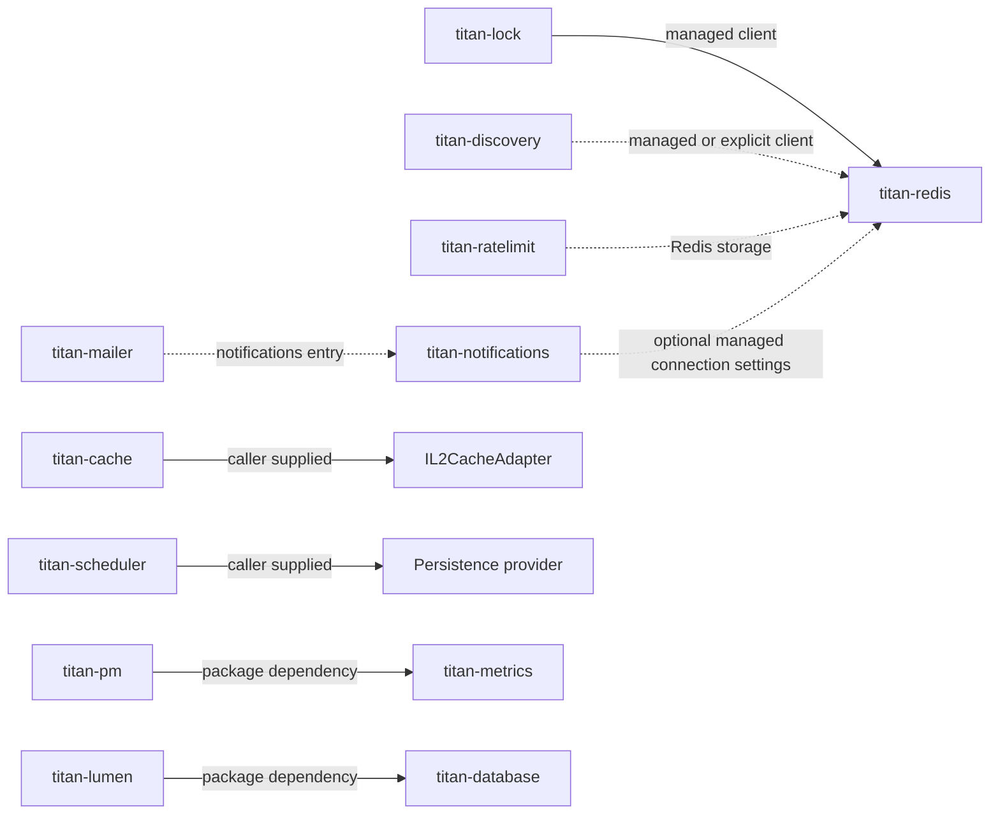

# Module map

A bird's-eye view of every module in the Titan ecosystem — who
depends on whom, who can substitute for whom, and which
combinations show up in real backends.

## Dependency graph {#dependency-graph}

This diagram names the connection or package edge. It does not imply that a
feature starts automatically. JWT's token cache is internal to `titan-auth`;
it does not use `titan-cache`. Notification preferences use a Redis store or an
application `IPreferenceStore`, not an implicit database module. Health accepts
connections through its options. The relay accepts application transports/sinks.

## Install footprint {#install-footprint}

The table lists third-party **runtime dependencies declared by each package**,
excluding internal Omnitron packages and TypeScript declaration packages. It does
not claim a connector for every library listed. Versions come from the selected
workspace release and lockfile.

| Package | Runtime libraries |
| --- | --- |
| `titan-auth` | `jose`, `reflect-metadata` |
| `titan-cache` | `msgpackr`, `reflect-metadata` |
| `titan-database` | `@kysera/audit`, `@kysera/core`, `@kysera/dal`, `@kysera/dialects`, `@kysera/executor`, `@kysera/infra`, `@kysera/migrations`, `@kysera/repository`, `@kysera/rls`, `@kysera/soft-delete`, `@kysera/timestamps`, `kysely`, `zod` |
| `titan-discovery` | `ioredis` |
| `titan-events` | `node-cron`, `zod` |
| `titan-health` | — |
| `titan-lock` | — |
| `titan-lumen` | `@modelcontextprotocol/server`, `typescript`, `zod` |
| `titan-mailer` | `nodemailer`, `reflect-metadata` |
| `titan-metrics` | — |
| `titan-notifications` | `ioredis`, `minimatch`, `msgpackr`, `reflect-metadata` |
| `titan-pm` | `pino`, `reflect-metadata` |
| `titan-ratelimit` | `reflect-metadata` |
| `titan-redis` | `ioredis` |
| `titan-scheduler` | `cron-parser`, `node-cron`, `reflect-metadata` |
| `titan-storage` | `@aws-sdk/client-s3`, `@aws-sdk/s3-request-presigner`, `@smithy/node-http-handler` |
| `titan-telemetry-relay` | — |

Titan core uses Pino for logging, Zod for validation, `ws` for WebSocket transport,
`yaml` for YAML configuration and the internal Netron/codec packages. The built-in
RLS decorators use Kysera RLS. `titan-auth` uses `jose` and its own token cache;
`titan-metrics` has no external runtime metrics library.

Peers are separate: most packages require Titan. Database drivers (`pg`, `mysql2`,
`better-sqlite3`) and Kysely for metrics SQL storage depend on the selected backend.
The notifications package declares optional email/SMS/push library peers, but its
root entry supplies abstract bases, not ready-made Twilio/FCM/SMTP integrations.
Use `titan-mailer/notifications` for the concrete Nodemailer channel.

## Common stacks {#common-stacks}

### Web API service {#web-api-service}

Start with Config and Logger, then select auth, database, cache, health or metrics
for the application's needs. A memory cache and JWT verification need no Redis.
Add a configured L2 adapter only when shared caching is required.

### Worker fleet {#worker-fleet}

Use `titan-pm` for workers, `titan-scheduler` for timed dispatch, and an explicitly
wired lock provider for coordinated scheduler firing. Locks do not make external
effects exactly once. Persist idempotency and business results at the operation's
transaction boundary. See [Worker fleet](../recipes/worker-fleet.md).

### Notification gateway {#notification-gateway}

Use `titan-notifications` for transport/channel operations and the separate
`NotificationPublisher` / `NotificationWorkerService` event path when storing
notifications and signaling clients. For durable SMTP delivery, use the mailer's
SQL outbox worker. These paths have different payloads and lifecycle requirements.

### Multi-instance app {#multi-instance-app}

Add `titan-discovery` when peers need a Redis registry. The module can bridge to a
managed Redis connection or open an explicit one. Check that Netron integration
actually initialized before relying on discovered addresses.

### Edge / offline node {#edge--offline-node}

A telemetry relay with a persistent WAL retries retained batches. The application
owns authentication, sink commits and deduplication. Memory admission and bounded
WAL retention leave loss windows; see [delivery and recovery](./telemetry-relay.mdx#delivery-and-recovery).

## Similar modules — when which? {#similar-modules--when-which}

| Need | Surface | Boundary |
| --- | --- | --- |
| In-process events | `titan-events` | Memory history, no durable cross-process broker |
| Notification transport | `titan-notifications` | Redis Streams/Rotif by default; configure channels and consumers |
| Transactional email | `titan-mailer` | SMTP acceptance; durable SQL outbox is a separate path |
| Timed execution | `titan-scheduler` | Register handlers each boot; serialized closures cannot be restored |
| Process supervision | `titan-pm` | Explicit spawn/pool/shutdown ownership |
| Metric history | `titan-metrics` | Registry plus separate queued/persistent history |
| Generic telemetry delivery | `titan-telemetry-relay` | Caller-provided transport and sink |
| Object bytes | `titan-storage` | Application owns authorization and metadata transactions |
| Document services | `titan-lumen` | Configure document access and authoring storage explicitly |

## Replacement / overlap matrix {#replacement--overlap-matrix}

| Comparison | What differs |
| --- | --- |
| Cache vs Redis | Cache adds eviction, serialization and local tiers; Redis alone does not create a cache adapter |
| Events vs notifications | Local handlers/history vs transport and channel delivery |
| Scheduler vs locks | Timers choose when to invoke; locks coordinate a lease, not durable completion |
| Metrics vs `prom-client` | Titan owns time-series storage and a separate registry; optional text output is not API equivalence |
| Health vs HTTP probes | Health returns results; an HTTP listener must route them |
| Mailer vs notification email base | Mailer implements SMTP delivery; the notification base is an extension point |

## Where Redis sits {#where-redis-sits}

| Consumer | Connection behavior |
| --- | --- |
| Lock | Selects `redisClientName` through `REDIS_MANAGER` |
| Discovery | Uses manager internal client unless `redisUrl` / `redisOptions` creates a standalone connection |
| Rate limit | Resolves the default client token when using Redis; async factory currently also injects it for memory options |
| Notifications | Explicit `redis` wins; otherwise derives Rotif connections from managed client settings; without either transport defaults to localhost |
| Cache | Requires a supplied L2 adapter; raw `ioredis` does not implement that adapter contract |
| Scheduler | `RedisPersistenceProvider` receives its client from the application |

Configure named clients in `TitanRedisModule.forRoot({ clients: [...] })`.
`forFeature(['name'])` exposes tokens for clients that the manager already knows;
it does not create separately configured servers or database selections. Use
key prefixes and server ACLs intentionally. A numbered-DB recipe is not portable
to Redis Cluster and does not isolate pub/sub channels.

## Lifecycle order — first to last {#lifecycle-order--first-to-last}

Titan orders declared module dependencies and disposes tracked providers. It
cannot infer a dependency created by a closure, a global variable or a manual
constructor call. There is no universal order such as cache-before-auth or
metrics-before-relay: those packages do not declare those edges.

Read the [lifecycle reference](./lifecycle-reference.mdx). For manually owned
workers and adapters, stop producers, await in-flight work, then flush/close their
stores and connections.

## Picking the right tier {#picking-the-right-tier}

Built-in identifies entry points shipped with Titan; official identifies packages
maintained in this workspace; community identifies third-party packages. Select
by the implemented API and backend contract. Origin badges are not stability,
performance or durability certification.

## See also {#see-also}

- [Modules index](./index.mdx) — flat list by tier
- [Authoring a module](../modules-system/authoring-modules.md) —
  conventions every official module follows
- [Recipes](../recipes/index.md) — concrete combinations that solve
  real problems
