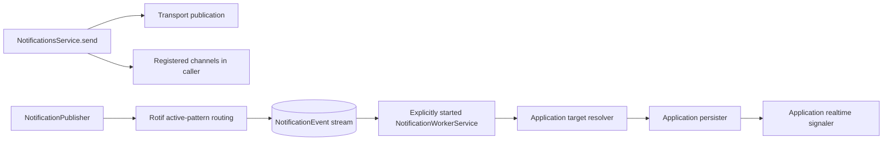

# titan-notifications

<span class="module-badge">official · @omnitron-dev/titan-notifications</span>

Multi-channel notification delivery (in-app, webhook, plus extensible
email / SMS / push abstractions) with a template engine, Redis-backed
rate limiting, per-user preferences, channel routing, scheduled and
broadcast send, and a separate **worker mode** for consuming
`NotificationEvent` records from Rotif. `NotificationsService.send` publishes and
can deliver through local channels in the caller; it is not automatically deferred
to that worker.

```bash
pnpm add @omnitron-dev/titan-notifications @omnitron-dev/titan-events @omnitron-dev/titan-redis
```

For SMTP email, use [titan-mailer](./mailer): a concrete Nodemailer channel,
strict TLS, typed templates, bounded pools and a durable outbox worker over this
module's Redis transport. Business-state changes and queued email are committed
together; only opaque delivery IDs travel through Redis. SMTP acceptance is not
an exactly-once or inbox-delivery guarantee.

## When you need it {#when-you-need-it}

- **Multi-channel delivery.** Same payload, different channels per
  user (email + push for some, in-app only for others).
- **Templated messages.** Render once, send via any channel.
- **Preference-respecting workflow.** Users opt out of certain
  channels; rate limits stop you spamming.
- **Producer/worker split.** API pod publishes, worker pod consumes
  and delivers — `forRoot` and `forWorker` cover both ends.

## Quickstart — producer (the app that emits notifications) {#quickstart--producer-the-app-that-emits-notifications}

```typescript
import { NotificationsModule } from '@omnitron-dev/titan-notifications';

@Module({
  imports: [
    TitanRedisModule.forRoot({ config: { url: env.REDIS_URL } }),
    NotificationsModule.forRoot({
      redis:           env.REDIS_URL,
      enableInApp:     true,
      enableWebhook:   true,
      // Pass channels per send; no email channel is installed by this example.
      templates:       { enabled: true, cacheEnabled: true },
      rateLimiterConfig: {
        defaultLimits: { perMinute: 10, perHour: 100, perDay: 1_000 },
        channelLimits: { sms: { perMinute: 1, perHour: 10 } },
      },
    }),
  ],
})
class AppModule {}
```

## Quickstart — worker (the pod that consumes and delivers) {#quickstart--worker-the-pod-that-consumes-and-delivers}

```typescript
import { NotificationsModule } from '@omnitron-dev/titan-notifications';

@Module({
  imports: [
    NotificationsModule.forWorker({
      targetResolver:   MyUserResolver,
      persister:        MyPersister,
      realtimeSignaler: MyRealtimeSignaler,
      // There is no `concurrency` — the worker runs one XREADGROUP loop and
      // takes a batch per read. `readCount` sizes the batch.
      workerOptions:    { readCount: 100, blockTimeoutMs: 5_000 },
    }),
  ],
  providers: [
    MyUserResolver, MyPersister, MyRealtimeSignaler, // implement the application ports
  ],
})
class WorkerModule {}
```

`forWorker` only registers providers. The host must resolve
`NotificationWorkerService`, call `await worker.start(rawRedis, options?)`, and
await `worker.stop()` before closing that caller-owned connection. Stop waits
up to ten seconds for its consume loop; a longer application operation can still
be running after that wait. Use a dedicated
client for its blocking reads. It consumes the `NotificationEvent` schema used
by `NotificationPublisher` (default stream pattern `notify.*`), resolves recipients,
persists records and calls the application realtime signaler. It does not consume
`NotificationsService.send` envelopes as a generic email/SMS/push dispatcher.

The worker creates a Redis consumer group but does not register its pattern in
Rotif's active-pattern registry. `NotificationPublisher.publish` ignores the
underlying no-matching-pattern result. On a clean Redis instance this combination
is therefore not a complete producer-to-worker delivery setup. Validate routing
and persisted output explicitly; importing both APIs is insufficient.

## `NotificationsModuleOptions` {#notificationsmoduleoptions}

| Option                    | Type                                                                                  |
| ------------------------- | ------------------------------------------------------------------------------------- |
| `transport`               | `{ useTransport?: MessagingTransport, rotif?: RotifTransportOptions }`                |
| `redis`                   | `RedisOptions \| string`                                                              |
| `rateLimiter`             | `IRateLimiter`                                                                        |
| `preferenceStore`         | `IPreferenceStore`                                                                    |
| `channelRouter`           | `IChannelRouter`                                                                      |
| `defaultChannels`         | `string[]` — declared; `send` does not read it, pass channels in send options                                                                            |
| `channels`                | `NotificationChannel[]`                                                               |
| `enableInApp`             | `boolean` (default `true`; needs Redis)                                               |
| `enableWebhook`           | `boolean` (default `true`)                                                            |
| `inAppConfig`             | `{ keyPrefix?, defaultTTL?, maxNotificationsPerUser?, enableRealtime? }`              |
| `webhookConfig`           | `{ timeout?, retries?, signatureSecret?, signatureHeader? }`                          |
| `templates`               | `{ enabled?, cacheEnabled?, cacheTTL? }`                                              |
| `rateLimiterConfig`       | `{ keyPrefix?, defaultLimits, channelLimits?, enableBurstDetection? }`                |
| `preferenceStoreConfig`   | `{ keyPrefix?, defaultPreferences? }`                                                 |
| `isGlobal`                | `boolean`                                                                             |

Also: `forRootAsync({ useFactory, inject?, useExisting?, useClass?, imports?, isGlobal? })`.

## `NotificationsService` — the producer API {#notificationsservice--the-producer-api}

```typescript
import { NotificationsService, NOTIFICATIONS_SERVICE }
  from '@omnitron-dev/titan-notifications';

@Service({ name: 'notify' })
class NotifyService {
  constructor(@Inject(NOTIFICATIONS_SERVICE) private readonly notify: NotificationsService) {}

  @Public()
  async welcome(user: User) {
    await this.notify.send(
      { id: user.id, email: user.email },
      { type: 'info', title: 'Welcome', message: `Hello, ${user.name}` },
      { channels: ['inApp'] },
    );
  }
}
```

| Method                                                                   | Returns                  |
| ------------------------------------------------------------------------ | ------------------------ |
| `send(recipient, payload, options?)`                                     | `Promise<SendResult>`    |
| `broadcast(recipients[], payload, options?)`                             | `Promise<BroadcastResult>` |
| `schedule(recipient, payload, scheduledAt)`                              | `Promise<ScheduleResult>`  |

`NotificationPayload` requires `type`, `title` and `message`. There is
no `template` field on it — see below.

The service:
1. Checks rate limits per channel per recipient.
2. Checks preferences (does the user opt in to this channel?).
3. Routes to the right channel via `IChannelRouter` — only if one is
   registered; the injection is `@Optional()`, and without it the
   `channels` you pass in the options are used as given.
4. Hands off to the registered channel implementations.
5. Records the send against the rate limiter.

### Templates are opt-in and caller-driven {#templates-are-opt-in-and-caller-driven}

`send()` does not render templates. `TemplateEngine` is a separate
service exported under `NOTIFICATIONS_TEMPLATE_ENGINE`; nothing inside
the package calls it. You apply it yourself and pass the result on:

```typescript
import {
  NOTIFICATIONS_TEMPLATE_ENGINE, NOTIFICATIONS_SERVICE,
  TemplateEngine, NotificationsService,
} from '@omnitron-dev/titan-notifications';

@Service({ name: 'notify' })
class NotifyService {
  constructor(
    @Inject(NOTIFICATIONS_SERVICE) private readonly notify: NotificationsService,
    @Inject(NOTIFICATIONS_TEMPLATE_ENGINE) private readonly templates: TemplateEngine,
  ) {}

  @Public()
  async welcome(user: User) {
    const payload = this.templates.applyToPayload(
      'welcome',
      { type: 'info', title: '', message: '' },
      { name: user.name },
    );
    await this.notify.send({ id: user.id, email: user.email }, payload);
  }
}
```

`applyToPayload` overlays the rendered `title`/`message` onto the
payload and stashes the full render under `data._rendered`. The
`templates` block in the module options configures that engine
(caching, TTL) — it does not switch on rendering inside `send()`.

### `NotificationRecipient.id` is the only required field, and it is load-bearing {#notificationrecipientid-is-the-only-required-field-and-it-is-load-bearing}

```typescript
interface NotificationRecipient {
  id: string;              // required
  email?: string; phone?: string; pushTokens?: string[];
  webhookUrl?: string; locale?: string;
}
```

Every step above keys off `id`: the rate-limit bucket
(`checkLimit(recipient.id, …)`), the preference lookup, the realtime
channel the delivery is published to
(`notifications.{type}.{recipient.id}`), and the in-app channel's own
`canDeliver` check, which is literally `!!recipient.id`.

That makes a misspelt key — `userId`, say — quiet rather than loud: the
send resolves, in-app delivery is skipped for failing `canDeliver`, and
everything else is published to `notifications.welcome.undefined`,
where no subscriber is listening. Nothing throws. TypeScript is the
only thing that catches it, so do not widen this argument to `any`.

## Channels {#channels}

Out-of-the-box implementations + extensible bases:

| Channel class                | Purpose                                            |
| ---------------------------- | -------------------------------------------------- |
| `InAppChannel`               | In-app inbox; Redis-backed list per user           |
| `WebhookChannel`             | HMAC-signed HTTP POST to a URL                     |
| `AbstractEmailChannel`       | Base — extend for SMTP / Sendgrid / SES / etc.     |
| `AbstractSMSChannel`         | Base — extend for Twilio / Vonage / etc.           |
| `AbstractPushChannel`        | Base — extend for FCM / APNS / etc.                |
| `MockEmailChannel` / `MockSMSChannel` / `MockPushChannel` | Test doubles      |

A concrete channel typically implements just `deliver(recipient,
rendered, options)` plus optional `validate()`.

## Templates {#templates}

`TemplateEngine` is a separate service. Enable it with `templates`, then register
or render a template and construct the required `{ type, title, message }` payload
before calling `send`. See the [explicit template example](#templates-are-opt-in-and-caller-driven).
There is no `template` field on `NotificationPayload` and no implicit rendering
inside `send`. Recipient objects require `id`, not `userId`.

`schedule()` delays transport publication; the current `send` path still invokes
registered local channels immediately. Do not use it as a durable delayed-email
guarantee. `cancel()` currently returns false and does not cancel queued work.

## Rate limiting and preferences {#rate-limiting-and-preferences}

`RedisRateLimiter` enforces per-minute / per-hour / per-day limits
globally or per-channel; `RedisPreferenceStore` tracks per-user
opt-in/out per channel. Wired automatically when `redis:` is set.

```typescript
rateLimiterConfig: {
  defaultLimits:        { perMinute: 10, perHour: 100, perDay: 1_000, burstLimit: 5 },
  channelLimits:        { sms: { perMinute: 1, perHour: 10 } },
  enableBurstDetection: true,
}

preferenceStoreConfig: {
  defaultPreferences: { channels: { email: { enabled: true }, sms: { enabled: false }, push: { enabled: true } } },
}
```

## Worker model {#worker-model}



These are separate message contracts. The event worker does not render templates,
run channel delivery or automatically inherit `NotificationsService` preferences
and rate limits. Its startup also leaves pattern registration to the host, as
noted above. Use a verified application consumer or the [mailer's outbox worker](./mailer.mdx)
when external delivery must run outside request handling.

## `@OnNotification` decorator {#onnotification-decorator}

```typescript
import { OnNotification, NotificationsModule, type MessagingTransport }
  from '@omnitron-dev/titan-notifications';

class AnnouncementListener {
  @OnNotification('notifications.announcement.*')
  async onMessage(notification: unknown) {
    await persistAnnouncement(notification); // application handler
  }
}

export async function attach(transport: MessagingTransport) {
  const listener = new AnnouncementListener();
  await NotificationsModule.registerHandlers(transport, listener);
  return () => NotificationsModule.unregisterHandlers(listener);
}
```

The decorator stores metadata; the host must register and unregister handlers.
Its patterns are transport channels. `NOTIFICATIONS_EVENTS` names are lifecycle
topics on `titan-events` and are not automatically republished to Rotif. Subscribe
to that event bus for lifecycle observations. Options such as `exactlyOnce` refer
to transport deduplication policy, not exactly-once external side effects.

## Health indicator {#health-indicator}

The module provides `NotificationsHealthIndicator` under `NOTIFICATIONS_HEALTH`.
Resolve that instance and register it explicitly with `HealthService.registerIndicator`.
Loading the two modules does not automatically connect their health registries.

Observer failures also appear in the health report. Async lifecycle listeners
are awaited; failures are logged and retained until the same event succeeds.
An observer failure does not resend a notification that already reached its
transport. Without an Events module, lifecycle emission is disabled and reported
as such in the health details.

## Operational diagnostics {#operational-diagnostics}

`@omnitron-dev/titan-notifications/diagnostics` provides
`DiagnosticNotificationSink` and `DiagnosticNotificationsModule`. They use the
configured transport's queue, deduplication, retry and DLQ mechanisms. A missing
consumer rejects delivery; broker acceptance is not recipient acknowledgement.
See the [contract, module wiring and outbox bridge](../../omnitron/diagnostics.md).

## Tokens (selection) {#tokens-selection}

| Token                                          |
| ---------------------------------------------- |
| `NOTIFICATIONS_SERVICE`                        |
| `NOTIFICATIONS_TRANSPORT`                      |
| `NOTIFICATIONS_MODULE_OPTIONS`                 |
| `NOTIFICATIONS_HEALTH`                         |
| `NOTIFICATIONS_RATE_LIMITER`                   |
| `NOTIFICATIONS_PREFERENCE_STORE`               |
| `NOTIFICATIONS_CHANNEL_ROUTER`                 |
| `NOTIFICATIONS_EVENT_EMITTER`                  |
| `NOTIFICATIONS_CHANNEL_REGISTRY`               |
| `NOTIFICATIONS_TEMPLATE_ENGINE`                |
| `NOTIFICATION_TARGET_RESOLVER`                 |
| `NOTIFICATION_PERSISTER`                       |
| `NOTIFICATION_REALTIME_SIGNALER`               |

## Lifecycle {#lifecycle}

Transport and channel factories initialize dependencies. `NotificationsService.onStart()`
awaits transport readiness; `onStop()` is empty. `onDestroy()` shuts down channels
and destroys the transport. The application must stop new sends and await its
in-flight operations before this point.

`NotificationWorkerService` has explicit `start(rawRedis, options?)` and `stop()`
methods; `forWorker` does not call them. Its retry policy eventually acknowledges
poison messages after `maxDeliveries`; this worker path is not the same as the
transport's configurable DLQ path.

## Anti-patterns {#anti-patterns}

- **Assuming `send` only queues.** Registered channels can run in the caller.
  Use an explicit consumer/outbox for slow delivery; for SMTP see `titan-mailer`.
- **Skipping preferences.** Sending to users who opted out is a
  compliance risk in many jurisdictions. Always wire
  `preferenceStore`.
- **Per-user templates.** Templates are content; per-user data goes
  in the `data` payload. Pre-render with the engine, not in code.
- **No rate limits.** Without limits, a runaway loop can spam every
  user in your database in minutes.

## See also {#see-also}

- [`titan-events`](./events.mdx) — in-process events; this module
  bridges them to multi-channel delivery
- [`titan-redis`](./redis.mdx) — backs rate limiter, preference
  store, and Rotif
- [`titan-ratelimit`](./ratelimit.mdx) — pluggable rate limiter
  for the producer side
