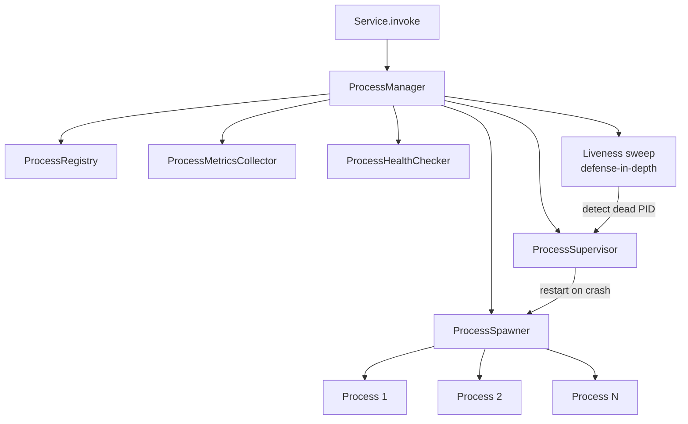

# titan-pm

<span class="module-badge">official · @omnitron-dev/titan-pm · stable</span>

Process supervision with worker pools, IPC (Unix / TCP / WebSocket),
supervisor patterns, restart policies with exponential backoff,
resource limits, metrics + health collection, a transparent service
proxy that makes every process behave like a local Netron service,
and decorators for in-process workflows and resilience.

```bash
pnpm add @omnitron-dev/titan-pm
```

## When you need it {#when-you-need-it}

- **CPU-bound work.** Image processing, ML inference, parsing —
  isolate from the main event loop.
- **Crash isolation.** A worker crash should not take the whole app
  down. Supervisors restart with backoff and policy.
- **Worker pools.** Many parallel workers across CPUs with load
  balancing.
- **Multi-step work.** Dependency-ordered stages with explicit compensation.
  Workflow state is in memory; process or host loss requires an external durable
  operation/recovery contract.

## Quickstart {#quickstart}

```typescript
import { ProcessManagerModule } from '@omnitron-dev/titan-pm';

@Module({
  imports: [
    ProcessManagerModule.forRoot({
      isolation: 'worker',                       // 'none' | 'worker' | 'child'
      transport: 'unix',                          // 'unix' | 'tcp' | 'ws'
      restartPolicy: {
        enabled:     true,
        maxRestarts: 3,
        window:      60_000,
        delay:       1_000,
        backoff:     { type: 'exponential', initial: 1_000, max: 30_000, factor: 2 },
      },
      resources: {
        maxMemory: '512MB',
        maxCpu:    1.0,
        timeout:   30_000,
      },
      monitoring: {
        healthCheck: { interval: 5_000, timeout: 2_000 },
        metrics:     true,
        tracing:     false,
      },
    }),
  ],
})
class AppModule {}
```

Async config via `forRootAsync({ useFactory, inject?, useExisting? })`.

## `IProcessManagerConfig` {#iprocessmanagerconfig}

| Option            | Type                                                                                                |
| ----------------- | --------------------------------------------------------------------------------------------------- |
| `isolation`       | `'none' \| 'worker' \| 'child'` — default `'worker'`                                                |
| `transport`       | `'unix' \| 'tcp' \| 'ws'` — default `'unix'`                                                        |
| `restartPolicy`   | `{ enabled, maxRestarts, window, delay, backoff?: { type, initial, max, factor? } }`               |
| `resources`       | `{ maxMemory, maxCpu, timeout }`                                                                    |
| `monitoring`      | `{ healthCheck: { interval, timeout }, metrics, tracing }`                                          |
| `testing`         | `{ useMockSpawner }`                                                                                |
| `advanced`        | `{ gracefulShutdownTimeout, livenessSweepIntervalMs, handleSignals }`                              |

Defaults are pulled from `DEFAULT_PM_CONFIG`.

## `ProcessManager` — the API {#processmanager--the-api}

```typescript
import { ProcessManager, PM_MANAGER_TOKEN, Process, Public }
  from '@omnitron-dev/titan-pm';

@Process({ name: 'image-worker' })
class ImageWorker {
  @Public()
  async resize(input: Buffer, width: number): Promise<Buffer> {
    return sharp(input).resize(width).toBuffer();
  }
}

@Service({ name: 'media' })
class MediaService {
  constructor(@Inject(PM_MANAGER_TOKEN) private readonly pm: ProcessManager) {}

  @Public()
  async resize(input: Buffer, width: number) {
    const worker = await this.pm.spawn(ImageWorker);
    return worker.resize(input, width);     // transparent RPC call
  }
}
```

`spawn()` accepts either a process **class** or a **module path string**
(for fork/process isolation where the worker runs in a separate module).

Process options use one contract from the manager through the native spawner to
the worker. `cwd`, environment, logging, startup and shutdown budgets, RPC
`requestTimeout`, and explicit method visibility are preserved. Without
`allMethodsPublic: true`, undecorated methods remain unavailable over RPC.

Use `cwd` with child-process isolation for an application-specific working
directory. Worker threads share the parent's directory and reject a different
`cwd`; they never change the parent's directory. Pools inherit common
`spawnOptions`; `spawnOptionsFactory(index)` supplies per-worker overrides.
Keep mutable application state outside sealed runtime directories.

Use `beforeSpawn` for asynchronous parent-side admission, such as verifying an
installed executable before it starts. The manager awaits it before registering
or spawning a process, including supervisor restarts and pool replacements. A
rejection prevents that spawn; the function is never serialized to the worker.
The pool also rechecks shutdown intent after admission, so a pending check cannot
create a worker after draining begins. This hook does not replace application
readiness or prove that the process subsequently remained healthy.

| Method                                                                  | Returns                                       |
| ----------------------------------------------------------------------- | --------------------------------------------- |
| `spawn<T>(processClassOrPath, options?)`                                | `Promise<ServiceProxy<T>>`                    |
| `pool<T>(processClassOrPath, options?)`                                 | `Promise<IProcessPool<T>>`                    |
| `createSupervisor(classOrConfig, options?)`                             | `ProcessSupervisor`                           |
| `discover<T>(serviceName)`                                              | `Promise<ServiceProxy<T> \| null>`            |
| `getProcess(id)`                                                        | `IProcessInfo \| undefined`                   |
| `listProcesses()`                                                       | `IProcessInfo[]`                              |
| `kill(id, signal?, { shutdownTimeout? })`                                                     | `Promise<boolean>`                            |
| `shutdown({ timeout?, force? })`                                        | `Promise<void>`                               |
| `getMetrics(processId)`                                                 | `Promise<IProcessMetrics \| null>`            |
| `getHealth(processId)`                                                  | `Promise<IHealthStatus \| null>`              |

The `ServiceProxy` returned by `spawn()` exposes every `@Public`
method of the process class as a typed remote call — transport
details are hidden.

### Worker pools {#worker-pools}

```typescript
const pool = await this.pm.pool(ImageWorker, {
  size: 2,
  autoScale: { enabled: true, min: 2, max: 8 },
});
const result = await pool.execute('resize', input, width);
```

The pool routes the call to a free worker, queues if all workers
are busy, and respects the pool's load-balancing policy. The proxy
returned by `pool()` also lets you call `@Public` methods directly
(`pool.resize(input, width)`).

`membershipChanging` reports whether the pool is spawning, replacing, retiring
or draining workers. `pool:membership-settled` notifies observers after a resize
or replacement attempt leaves the lifecycle queue, including a failed attempt.
Read the current flag and worker identities when handling it: a queued successor
may already be running. The event does not mean the requested size was reached
or that every worker is healthy.

Worker retirement excludes the old proxy from both direct and queued requests
before termination begins. A replacement becomes ready first; already admitted
calls finish within `requestTimeout` (30 seconds when disabled). If a planned
drain cannot finish, it rejects and keeps the worker owned for retry. Explicit
pool destruction retains its bounded shutdown policy. A failed termination never
re-enables the old proxy. Requests are not automatically replayed, because an
unknown outcome may already have changed application state.

Only healthy, idle workers accept new calls. Requests wait in the bounded queue
while every worker is busy, unhealthy or retiring, and resume when capacity or
health recovers. Normal recycling can change worker PIDs without restarting the
application or replacing its topology endpoint.

### Supervisors {#supervisors}

```typescript
const supervisor = this.pm.createSupervisor(ParentProcess);
```

Create the supervisor, attach observers, then call `await supervisor.start()`:

```typescript
const supervisor = pm.createSupervisor({
  strategy: SupervisionStrategy.ONE_FOR_ONE,
  maxRestarts: 3,
  window: 60_000,
  backoff: { type: 'exponential', initial: 1_000, max: 30_000, factor: 2 },
  children: [{ name: 'worker', process: '/absolute/worker.js', critical: false }],
});
supervisor.on('child:start-failed', (name, error) => logger.error({ name, err: error }, 'Startup failed'));
supervisor.on('child:recovery-stopped', (name, error) => logger.error({ name, err: error }, 'Recovery stopped'));
await supervisor.start();
```

Import `SupervisionStrategy` from `@omnitron-dev/titan-pm`. Both noncritical initial startup failures and failures during a crash restart consume the same configured retry budget and backoff. `maxRestarts: 0` disables automatic retries. A required critical child still fails initial supervisor startup immediately; after the supervisor is running, its recovery follows policy.

Recovery is serialized per supervisor. `ONE_FOR_ONE` preserves unaffected siblings; `ONE_FOR_ALL` and `REST_FOR_ONE` retain declaration order, including children whose previous start failed. `stop()` cancels waiting retries and joins any spawn already in progress before stopping its result. No delayed restart may resurrect a stopped supervisor.

Use `child:start-failed` for the original cause, `child:restart` for attempts, and `child:started` for readiness. `child:recovery-stopped` means policy declined further attempts or failed itself; critical exhaustion emits `escalate`. Explicit `restartChild(name)` can retry a failed declaration. Omnitron preserves the last failure until the whole application is online and reports when the policy stops recovery.

## Decorators {#decorators}

The rich decorator set is what makes processes feel like local
services. Annotated processes can declare lifecycle, observability,
resilience and workflow compensation declaratively.

### Class-level {#class-level}

| Decorator         | Purpose                                                          |
| ----------------- | ---------------------------------------------------------------- |
| `@Process(opts?)` | Mark a class as a runnable process                               |
| `@Workflow()`| Dependency-ordered in-process workflow                              |
| `@Actor()`        | Compatibility metadata only; no actor runtime or serial mailbox                         |
| `@Supervisor(opts?)`| Supervisor for child processes                                 |

### Method-level — exposure and lifecycle {#method-level--exposure-and-lifecycle}

| Decorator         | Purpose                                                          |
| ----------------- | ---------------------------------------------------------------- |
| `@Public()`       | Expose method over IPC                                           |
| `@Stage()`        | Workflow stage                                                   |
| `@Compensate(stage)` | Compensates a completed stage after a known workflow failure          |
| `@HealthCheck()`  | Mark method as the health check                                  |
| `@OnShutdown()`   | Cleanup hook before the process exits                            |
| `@Child()`        | Supervisor: declare a supervised child                           |

### Method-level — observability {#method-level--observability}

| Decorator                | Purpose                                                          |
| ------------------------ | ---------------------------------------------------------------- |
| `@Trace()`               | Distributed tracing span                                         |
| `@Metric(name?)`         | Auto-instrument metric (flags the method for metrics collection) |
| `@Validate(options)`     | Validate input (`{ schema?, validator? }`)                       |
| `@Cache(options?)`       | Cache the result (`{ ttl?, key?, condition? }`)                  |

### Method-level — resilience {#method-level--resilience}

| Decorator                | Purpose                                                      |
| ------------------------ | ------------------------------------------------------------ |
| `@CircuitBreaker(opts)`  | Circuit-break the method (`{ threshold?, timeout?, fallback? }`) |
| `@RateLimit(opts)`       | Rate-limit the method (`{ rps?, burst?, strategy?, key? }`)  |
| `@Idempotent(opts)`      | Deduplicate by key (`{ key, ttl? }` — `key` names the arg field, `ttl` a duration string like `'1h'`) |

### Combined example — a worker class {#combined-example--a-worker-class}

```typescript
import {
  Process, Public, OnShutdown, HealthCheck,
  Trace, Metric, CircuitBreaker, Idempotent,
} from '@omnitron-dev/titan-pm';

@Process({ name: 'image-worker' })
class ImageWorker {
  @Public()
  @Trace()
  @Metric('images.resized')
  @CircuitBreaker({ threshold: 5, timeout: 30_000 })
  @Idempotent({ key: 'requestId', ttl: '1h' })
  async resize(input: Buffer, width: number): Promise<Buffer> {
    return sharp(input).resize(width).toBuffer();
  }

  @HealthCheck()
  async health() {
    return { status: 'healthy', queueDepth: this.queue.size };
  }

  @OnShutdown()
  async cleanup() {
    await this.queue.drain();
  }
}
```

## Architecture {#architecture}



The **liveness sweep** is defense-in-depth: even if a process exits
without firing its exit signal, the sweep detects the dead PID
(every `livenessSweepIntervalMs`, default 30 s) and tells the
supervisor to restart per policy.

## Tokens {#tokens}

| Token                   |
| ----------------------- |
| `PM_CONFIG_TOKEN`       |
| `PM_MANAGER_TOKEN`      |
| `PM_REGISTRY_TOKEN`     |
| `PM_SPAWNER_TOKEN`      |
| `PM_METRICS_TOKEN`      |
| `PM_HEALTH_TOKEN`       |

## Lifecycle {#lifecycle}

`ProcessManager` is registered as a singleton service. On
application shutdown, `shutdown({ timeout?, force? })` runs to
gracefully terminate every spawned process and pool (respects
`gracefulShutdownTimeout`).

Manager shutdown is terminal: it closes new process/pool admission immediately and
owns initialization already in progress. Concurrent and repeated calls share the
same promise and outcome; a later `force` argument does not replace the first
call's policy. Every pool and worker cleanup is attempted within the timeout, with
errors collected rather than hidden. A deadline or failed drain/termination rejects
and remains rejected even if a worker exits later. Inspect retained ownership and
native process evidence before recovery; another `shutdown()` call is not proof
of a clean exit.

Omnitron's application `stopAll` is a separate, reversible operation: it stops
application handles and reports aggregate failures while keeping the manager
available for a later explicit start. Terminal manager shutdown belongs to the
resident execution owner or Titan's application lifecycle.

## Isolation modes {#isolation-modes}

| Isolation | Backed by            | Best for                                                     |
| --------- | -------------------- | ------------------------------------------------------------ |
| `worker`  | `worker_threads`     | CPU-bound work, low IPC latency; shared memory option (default) |
| `child`   | `child_process.fork` | Strong isolation, ability to crash without taking down peers   |
| `none`    | The calling process  | Tests. No Netron management client is created for the worker.  |

`execArgv` forces `child` even when `isolation` is `'worker'`: worker threads
do not accept Node CLI flags.

Sandboxing is a separate option, `security.isolation` on a spawn
(`'none' | 'vm' | 'container'`). It does not select a spawn strategy. Neither
`'vm'` nor `'container'` is implemented — both spawn an ordinary child process
that shares the parent's filesystem and network, and say so in a warning at
spawn time. Do not rely on either as a security boundary.

## Transport choice {#transport-choice}

| Transport   | Best for                                            |
| ----------- | --------------------------------------------------- |
| `unix`      | Local IPC; lowest latency on the same host          |
| `tcp`       | Cross-host workers; encrypt with TLS if needed     |
| `ws`        | Long-lived workers behind a proxy                   |

## Anti-patterns {#anti-patterns}

- **Tiny tasks in `child` isolation.** Process fork has ~50 ms
  startup cost. Reserve for long-lived work or pre-warmed pools.
- **No restart policy.** A crashing worker keeps respawning at
  full speed without `restartPolicy: { backoff }`. Always set
  exponential backoff with a cap.
- **No `@OnShutdown`.** Workers killed mid-task lose work in flight.
  Drain queues in the shutdown hook.
- **Sharing mutable state via IPC.** IPC is for messages, not
  shared mutable state. If you need shared state, put it in Redis
  or a database.

## See also {#see-also}

- [Resilience / Retry](../resilience/retry.md), [Circuit Breaker](../resilience/circuit-breaker.md)
- [`titan-metrics`](./metrics.mdx) — collects process metrics
  when `monitoring.metrics: true`
- [`titan-events`](./events.mdx) — inter-process event delivery


## Workflow failure and recovery {#workflow-failure-and-recovery}

`@Workflow()`, `@Stage({ dependsOn, timeout, retries })` and `@Compensate(stageName)`
are executed by Titan PM. Dependency validation uses Titan's shared
`dependencyBatches` utility, also used by Omnitron application startup. Missing
prerequisites, duplicate stage names and cycles are refused before effects begin.
Compensation declaration order does not matter; subclass metadata does not mutate
its parent workflow.

One instance runs once at a time. Use separate instances for independent concurrent
runs. Each later run receives a new run ID and fresh stage results. A failed
parallel stage waits for its active siblings to settle before compensating completed
stages in reverse dependency order. Compensation outcomes are visible in
`getContext().stages`; failed compensation returns an `AggregateError` containing
both the original failure and recovery failures, and blocks reuse of that instance.

A timeout does not cancel an arbitrary JavaScript handler. Titan reports
`WorkflowStageUncertainError` (exported by `@omnitron-dev/titan-pm`) and stage status
`unknown`, then blocks automatic retry, compensation and instance reuse. The handler
may still complete externally. Reconcile its actual effects before starting a new
workflow. Explicit retries after ordinary failures require idempotent or otherwise
retry-safe handlers. Invalid timeout/retry settings are rejected before execution.

This is not persistent workflow execution or exactly-once external effects. For
infrastructure operations, use the journal, effect receipts and reconciliation
contracts in the [resilient control-plane design](../../omnitron/resilient-control-plane.md).
The `@Actor()` compatibility decorator records metadata only; it does not create an
actor mailbox, serialize messages or provide distributed actor supervision.

## Confirmed process termination {#confirmed-process-termination}

`kill()` resolves `true` after termination and cleanup, and `false` only when the
process is not registered. An unconfirmed exit rejects and retains the worker
handle for a retry. Sending a signal, a closed IPC channel, or an elapsed deadline
is not proof of exit. `SIGKILL` selects an immediate forced shutdown; an optional
`shutdownTimeout` reaches the same manager cleanup path for supervisor children.

Supervisor stop and pool destruction attempt every owned child and report aggregate
failures. Successfully stopped children are removed from ownership; survivors stay
registered, with automatic recovery disabled during teardown. Pool destruction
also joins already admitted spawns, preventing late workers from escaping a stop.
Retry the operation after resolving the reported cause; do not interpret a timeout
as permission to launch a replacement over an unconfirmed process.
