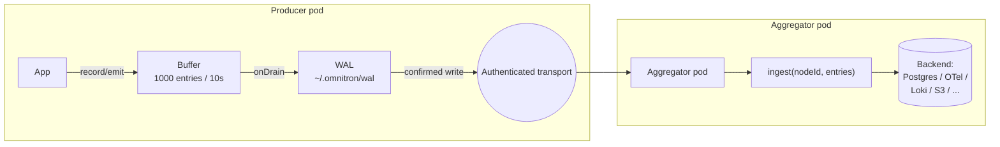

# titan-telemetry-relay

<span class="module-badge">official · @omnitron-dev/titan-telemetry-relay · stable</span>

Store-and-forward telemetry pipeline for distributed Titan
applications. Producers buffer telemetry locally, persist to an
on-disk **WAL** (write-ahead log) for crash safety, and ship to a
remote aggregator over an application-supplied transport. Unconfirmed batches in the WAL replay on recovery. Omnitron uses its own SQLite outbox and database receipts for fleet replication. [Follow a measurement from node to controller.](../../omnitron/observability.md)

```bash
pnpm add @omnitron-dev/titan-telemetry-relay
```

> **Not a Titan module.** Unlike most ecosystem packages, this one
> doesn't expose `forRoot` / `forRootAsync`. You instantiate
> `TelemetryRelayService` directly because the relay's role
> (producer / aggregator / both) is a deployment concern, not an
> application-level configuration toggle.

## When you need it {#when-you-need-it}

- **Services that emit telemetry but shouldn't ship it directly.**
  Producer pods buffer locally; an aggregator pod takes the hit of
  shipping to long-term storage.
- **Collector outages.** A producer with persistent WAL storage can retry retained batches after restart.
- **Sidecar pattern.** Producer in your app pod; aggregator in a
  sidecar; both forward to a canonical sink.
- **Edge / offline-tolerant deployments.** Branch / IoT nodes that
  may be disconnected for hours buffer to disk and drain when
  connectivity returns.

## Three roles {#three-roles}



| Role         | Receives                                              | Forwards to                          |
| ------------ | ----------------------------------------------------- | ------------------------------------ |
| `producer`   | Local app via `record` / `emitLog` / `emitMetric` / `emitHealth` | Aggregator (via transport) |
| `aggregator` | Authenticated transport handler calling `receive(nodeId, entries)`   | Persistent sink (via `TelemetryAggregator`) |
| `both`       | Local app + remote producers                          | Persistent sink directly             |

## Quickstart — producer {#quickstart--producer}

```typescript
import { TelemetryRelayService } from '@omnitron-dev/titan-telemetry-relay';

const relay = new TelemetryRelayService({
  role:   'producer',
  nodeId: process.env.HOSTNAME,
  buffer: { maxBufferSize: 1_000, flushIntervalMs: 10_000, maxBatchSize: 500 },
  wal:    { directory: '/var/lib/omnitron/wal', maxSizeBytes: 50 * 1024 * 1024, maxSegments: 10 },
});

relay.setTransport(myAuthenticatedTransport);
await relay.start();

// In your services:
relay.emitLog('users', 'info', 'user created', { userId: 'u_42' });
relay.emitMetric('users.created.total', 1, { source: 'web' });
relay.emitHealth('users', 'ok');
```

## Quickstart — aggregator {#quickstart--aggregator}

```typescript
const relay = new TelemetryRelayService({
  role: 'aggregator',
});

relay.setAggregator(myPersistenceAggregator);   // writes to long-term sink
await relay.start();

// Your transport handler authenticates the peer, then calls:
//   relay.receive(nodeId, entries)
// which delegates to aggregator.ingest(nodeId, entries).
```

## Quickstart — both (single-node / sidecar) {#quickstart--both-single-node--sidecar}

```typescript
const relay = new TelemetryRelayService({
  role: 'both',
});

// Skip transport — the relay calls the local aggregator directly.
relay.setAggregator(myAggregator);
await relay.start();

relay.emitLog('myApp', 'info', 'starting');     // → aggregator.ingest()
```

When `role: 'both'` and no `transport`, `forwardEntries` calls the
local aggregator's `ingest` directly without going through the
network — useful for single-node leader daemons.

## Constructor options — `TelemetryRelayModuleOptions` {#constructor-options--telemetryrelaymoduleoptions}

| Option       | Type                                                  | Default                                |
| ------------ | ----------------------------------------------------- | -------------------------------------- |
| `nodeId`     | `string`                                              | `node-{pid}-{base36 timestamp}`        |
| `role`       | `'producer' \| 'aggregator' \| 'both'`                | `'both'`                               |
| `buffer`     | `TelemetryBufferConfig` (see below)                   | defaults below                         |
| `wal`        | `TelemetryWalConfig \| false`                         | defaults below; `false` to disable     |
| `transport`  | `TelemetryTransport`                                  | none (set via `setTransport`)          |

> **`wal: false`** disables WAL persistence entirely. Also auto-
> disabled when `role: 'aggregator'` (the aggregator has no
> outbound transport, so there's nothing to retry).

### `TelemetryBufferConfig` {#telemetrybufferconfig}

| Field             | Type    | Default  |
| ----------------- | ------- | -------- |
| `maxBufferSize`   | `number`| `1_000`  |
| `flushIntervalMs` | `number` (ms) | `10_000` |
| `maxBatchSize`    | `number`| `500`    |

### `TelemetryWalConfig` {#telemetrywalconfig}

| Field           | Type    | Default                                        |
| --------------- | ------- | ---------------------------------------------- |
| `directory`     | `string`| `~/.omnitron/wal/`                             |
| `maxSizeBytes`  | `number`| `50 * 1024 * 1024` (50 MB per segment)         |
| `maxSegments`   | `number`| `10` (max ~500 MB total)                       |

Use a separate persistent directory for each producer. Rotation limits the number of segments. A single encoded batch can exceed the target segment size.

## `TelemetryEntry` — the universal unit {#telemetryentry--the-universal-unit}

```typescript
interface TelemetryEntry {
  id?:        string;          // stable on retry, optional on older WAL entries
  type:       'log' | 'metric' | 'event' | 'health' | 'alert';
  timestamp:  string;          // ISO 8601
  nodeId:     string;          // injected from relay.nodeId
  app?:       string;
  data:       Record<string, unknown>;
  labels?:    Record<string, string>;
}
```

Five entry types route at the aggregator. The relay itself doesn't
care — it just buffers, persists, and ships.

## Convenience emitters {#convenience-emitters}

| Method                                                     | Resulting `type` / `data`                                       |
| ---------------------------------------------------------- | --------------------------------------------------------------- |
| `emitLog(app, level, message, labels?)`                    | `type: 'log'`, `data: { level, message }`                       |
| `emitMetric(name, value, labels?, app?)`                   | `type: 'metric'`, `data: { name, value }`                       |
| `emitHealth(app, status, details?)`                        | `type: 'health'`, `data: { status, ...details }`                |

For `event` / `alert` types or custom payloads, call `record({...})`
directly:

```typescript
relay.record({
  type:   'event',
  app:    'payments',
  data:   { action: 'invoice.paid', invoiceId: 'inv_123', amount: 9900 },
  labels: { region: 'eu-west', tier: 'pro' },
});
```

## Transport contract {#transport-contract}

```typescript
interface TelemetryTransport {
  send(entries: TelemetryEntry[]): Promise<number>;   // returns ack'd count
  isConnected(): boolean;
  connect():    Promise<void>;
  disconnect(): Promise<void>;
}
```

Implement `connect` and `disconnect` for your transport. Bind the source identity to an authenticated connection before passing a batch to `receive`. Return the committed count from the sink. An empty response, a fraction or a count outside the range of the batch is an invalid acknowledgement. A partial count leaves the entire retained snapshot eligible for replay. If a response is lost after commit, earlier records can arrive again.

Use `entry.id` scoped to the authenticated producer for idempotency. New records receive an ID at admission. Records from a WAL created by older releases can lack one. The receiver decides how to handle their duplicate risk. Where you need durable per-entry evidence or historical reconciliation across Omnitron nodes, use the fleet replication service.

## Aggregator contract {#aggregator-contract}

```typescript
interface TelemetryAggregator {
  ingest(nodeId: string, entries: TelemetryEntry[]): Promise<number>;
  query(filter: TelemetryQueryFilter): Promise<TelemetryEntry[]>;
}

interface TelemetryQueryFilter {
  type?:    TelemetryEntry['type'] | TelemetryEntry['type'][];
  nodeId?:  string;
  app?:     string;
  from?:    string;   // ISO 8601
  to?:      string;
  labels?:  Record<string, string>;
  limit?:   number;
  offset?:  number;
}
```

The aggregator owns persistence — write to Postgres, ClickHouse,
S3, OTLP collector, or whatever backend fits. `ingest` returns the
count of entries successfully persisted (used for ack accounting).

## Delivery and recovery {#delivery-and-recovery}

1. `record` places an entry in memory. A process crash before the next flush can lose it. Watch `buffer.totalDropped` for memory pressure.
2. With a WAL, the producer appends the batch and syncs it to disk before sending. Replay and normal sends run in sequence. New arrivals cannot be cleared by a previous send.
3. The sender reads retained entries in batches of at most `maxBatchSize`. It clears the snapshot after the sink confirms every batch in full. Use a transaction and durable IDs at the sink so replay after a lost acknowledgement is safe.
4. Incomplete responses or transport failures leave the snapshot available for retry. Use `stats().lastError` for the reason. `start()` can replay a persisted backlog before any new events arrive. `setTransport` can trigger recovery when the relay is running.
5. WAL retention rotates by segment. Long outages can exceed capacity. Provision persistent space for the expected offline interval and alert on disk usage, `stats().wal?.evictedSegments`, `evictedBytes`, memory drops and delivery failures. Eviction counters cover the current process lifetime.

With `wal: false`, pending entries exist in memory only. A failed sink call can return them to that bounded buffer. An application requiring durable replication should use a persistent WAL directory or the Omnitron outbox.

## WAL on-disk format {#wal-on-disk-format}

NDJSON — one telemetry entry per line:

```jsonl
{"type":"log","timestamp":"2026-05-16T12:34:56.789Z","nodeId":"node-1234-l7x","app":"users","data":{"level":"info","message":"created"},"labels":{"region":"eu"}}
{"type":"metric","timestamp":"2026-05-16T12:34:56.793Z","nodeId":"node-1234-l7x","app":"users","data":{"name":"users.created.total","value":1}}
```

Segment files are named `000001.wal`, `000002.wal`, …, with the
highest-numbered one being the current write target. When it
exceeds `maxSizeBytes`, a new segment opens; segments past
`maxSegments` are deleted (oldest first).

An invalid NDJSON record or unreadable segment is a recovery error. Inspect the journal and the sink's committed IDs before repairing it. Keep a copy of the original segments.

## Statistics {#statistics}

`relay.stats()` returns a snapshot:

```typescript
{
  nodeId:               string;
  role:                 'producer' | 'aggregator' | 'both';
  buffer:               { size, totalPushed, totalDropped, totalFlushed };
  wal:                  { segments, totalSize, totalWritten, currentSegment, evictedSegments, evictedBytes, listError? } | null;
  totalEmitted:         number;
  totalSent:            number;
  totalFailed:          number;
  lastError:            string | null;
  totalReceived:        number;   // aggregator-side
  transportConnected:   boolean;
}
```

Surface these via your existing metrics module — they're the
primary signal for "is the pipeline healthy?".

## Sizing guidance {#sizing-guidance}

Each timer tick drains up to `maxBatchSize` entries from the memory buffer. With a ten-second interval and a batch of 500, the upper bound is 50 entries per second before disk and sink latency. At 100 entries per second the backlog will grow with those defaults. Measure under load, then select a batch size and interval that leave room for bursts and slow writes. Size the memory buffer for arrivals between completed flushes.

For a four-hour outage at 100 entries per second and 1,000 encoded bytes per entry, plan for at least 1.44 GB of journal data plus operational headroom. Monitor actual encoded bytes and segment evictions to validate that estimate.

## Lifecycle {#lifecycle}

`TelemetryRelayService` is a plain `EventEmitter` subclass — no
DI lifecycle hooks. Wire it manually if you want DI integration:

```typescript
import { Injectable } from '@omnitron-dev/titan';
import type { OnStart, OnStop } from '@omnitron-dev/titan/application';
import { TelemetryRelayService } from '@omnitron-dev/titan-telemetry-relay';

@Injectable()
class TelemetryRelayAdapter implements OnStart, OnStop {
  constructor(private readonly relay: TelemetryRelayService) {}
  async onStart() { await this.relay.start(); }
  async onStop()  { await this.relay.stop();  }
}
```

`start()` attempts to deliver a retained WAL through the configured destination; `stop()`
flushes the buffer to WAL, disconnects the transport, and disposes
the WAL (awaits pending writes, closes fds).

## Choosing a destination {#choosing-a-destination}

The application supplies a destination or changes it with `setTransport`. If several collectors share a store, deduplicate against the same durable identity on every collector. Confirm a record only when the configured durability requirement has been met.

## When to use this vs the built-in logger {#when-to-use-this-vs-the-built-in-logger}

| Need                                              | Use                                              |
| ------------------------------------------------- | ------------------------------------------------ |
| Local console output during development           | `@omnitron-dev/titan/module/logger` (built-in)   |
| Single-pod, ship logs via host log shipper        | Built-in logger + stdout                         |
| Multi-pod, one pipeline for logs/metrics/health with at-least-once delivery | This module |
| Sidecar pattern (one collector per host)          | This module with `role: 'both'`                  |
| OTel-compatible sink                              | Build a `TelemetryAggregator` wrapping the OTLP exporter |
| Edge node that may be offline for hours           | This module with large `maxSegments`             |

## Operational checks {#operational-checks}

- If `buffer.totalDropped` grows, the producer has exceeded the memory buffer. Oldest in-memory entries are evicted before they reach disk.
- If WAL eviction counters grow, the outage or input rate has exceeded configured retention. Restore the destination and check for gaps.
- Before accepting remote traffic, configure the receiving aggregator. A receiver with no sink returns zero acknowledgements.
- Place each WAL on persistent storage and recover it under its original producer identity.

## See also {#see-also}

- [`titan-metrics`](./metrics.mdx) — emit metrics that this relay
  can ship
- [Best Practices / Observability](../best-practices/observability.md)
- [Module map](./module-map.mdx) — where the relay sits in the
  observability stack
