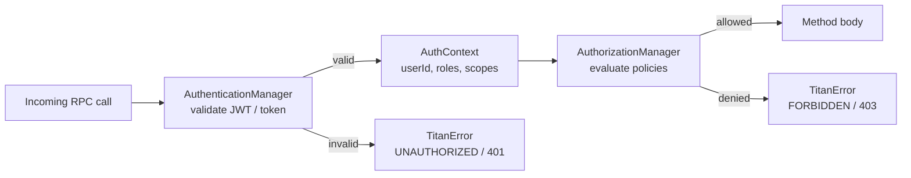

# Authentication

:::info
This page is the Netron-layer reference for `AuthConfig`,
PolicyEngine, and the `BuiltInPolicies` library. For the
end-to-end authorisation surface (permission grammar,
per-user overrides, RLS bridge, audit), start at
[Authentication & Authorisation](../../auth/index.md). For
the higher-level façade decorators that compile to the
`@Auth({policies})` form below, see [Permissions →
Scopes](../../auth/permissions.md#scopes).
:::

Netron separates **authentication** (who is the caller?) from
**authorisation** (is this caller allowed to do this?). Two
managers, one shared policy engine, composable policies.

Import path:

```typescript
import {
  AuthenticationManager,
  AuthorizationManager,
  PolicyEngine,
  BuiltInPolicies,
} from '@omnitron-dev/titan/netron/auth';
```

## The two managers

| Manager                  | Job                                                         |
| ------------------------ | ----------------------------------------------------------- |
| `AuthenticationManager`  | Validate credentials, produce an auth context               |
| `AuthorizationManager`   | Evaluate policies against the auth context                  |



These are wired by the `titan-auth` ecosystem module (or by your own
integration). You rarely construct them directly.

## Auth context

Every authenticated call carries an auth context with:

```typescript
{
  userId:       string;
  roles:        string[];
  permissions:  string[];
  scopes?:      string[];                // optional
  token?:       { /* … */ };             // optional, integration extras
  metadata?:    Record<string, any>;     // optional
}
```

This is what `AuthConfig` policies match against. (`userId`, `roles`,
and `permissions` are required; `scopes` is optional.)

## `@Auth(config)` — configuring a method

`AuthConfig` (from `@omnitron-dev/titan/decorators`):

```typescript
interface AuthConfig {
  roles?:        string[];     // ANY role grants access
  permissions?:  string[];     // ALL required
  scopes?:       string[];     // ALL OAuth2 scopes required
  policies?:     string[] | { all: string[] } | { any: string[] } | PolicyExpression;
  allowAnonymous?: boolean;
  inherit?:      boolean;      // inherit class-level policies
  override?:     boolean;      // override class-level policies
}
```

Usage:

```typescript
import { Public, Auth } from '@omnitron-dev/titan/decorators';

@Service('orders@1.0.0')
class OrdersService {
  @Public()
  @Auth({ scopes: ['orders:read'] })
  async list() { /* … */ }

  @Public()
  @Auth({ roles: ['admin'] })
  async deleteAll() { /* … */ }

  @Public()
  @Auth({ allowAnonymous: true })          // explicit anonymous
  async ping() { /* … */ }

  @Public()
  @Auth({ policies: { any: ['policy:admin', 'policy:resource-owner'] } })
  async modifyResource(id: string) { /* … */ }
}
```

The same configuration is also accepted inline through `@Public`:

```typescript
@Public({ auth: { scopes: ['orders:read'] } })
async list() { /* … */ }
```

Pick one style per project.

## `BuiltInPolicies` — reusable policy definitions

The `BuiltInPolicies` namespace produces policy definitions you can
register with the policy engine:

```typescript
import { BuiltInPolicies } from '@omnitron-dev/titan/netron/auth';

const policies = [
  BuiltInPolicies.requireRole('admin'),
  BuiltInPolicies.requireAnyRole(['admin', 'support']),
  BuiltInPolicies.requireAllRoles(['user', 'verified']),
  BuiltInPolicies.requirePermission('users:read'),
  // …~18 helpers in the source: requireAnyPermission, requireScope,
  // requireResourceOwner, requireIP, requireRateLimit, …
];

// Register them with the engine:
policyEngine.registerPolicies(policies);   // array form; single: registerPolicy(p)
```

Reference by name in `AuthConfig`:

```typescript
@Auth({ policies: ['role:admin'] })
async deleteAll() { /* … */ }
```

The policy name follows the convention shown in the helper
(`role:admin`, `role:any:admin,support`, etc.) — the registration
sets the name based on the helper's logic.

## Custom policies

A policy is a `PolicyDefinition`:

```typescript
import type { PolicyDefinition } from '@omnitron-dev/titan/netron/auth';

const IsResourceOwner: PolicyDefinition = {
  name:        'resource:owner',
  description: 'Caller must own the resource referenced by the first argument',
  evaluate: async (context) => {
    const resourceId = context.method?.args?.[0];      // method args live here
    const resource   = await ordersRepo.findById(resourceId);  // close over your deps
    const allowed    = resource?.userId === context.auth?.userId;
    return {
      allowed,
      reason: allowed ? 'Owner' : 'Not owner',
    };
  },
};

policyEngine.registerPolicies([IsResourceOwner]);

// Then in your service:
@Public()
@Auth({ policies: ['resource:owner'] })
async getOrder(orderId: string) { /* … */ }
```

The context passed to `evaluate` is an `ExecutionContext`
(`{ auth?, service?, method?: { name, args }, resource?, environment?, request? }`).
Note there is **no** `context.args` (use `context.method?.args`) and
**no** DI hook on the context — close over the dependencies your
policy needs. The exact shapes live in `netron/auth/policy-engine.ts`
and `netron/auth/types.ts`.

## Class-level vs method-level

Both work; method-level overrides class-level for that method:

```typescript
@Service('orders@1.0.0')
@Auth({ scopes: ['orders:*'] })                     // class-level default
class OrdersService {
  @Public()                                          // inherits class-level
  async list() { /* … */ }

  @Public()
  @Auth({ allowAnonymous: true })                    // override
  async listPublic() { /* … */ }

  @Public()
  @Auth({ roles: ['admin'] })                        // override
  async deleteAll() { /* … */ }
}
```

Use `inherit` / `override` flags in `AuthConfig` to control
combination semantics for fine-grained cases.

## Install HTTP authority before listening

Configure native authentication and cookie security before starting the HTTP
transport. Do not reach into a transport's private middleware pipeline from an
`afterStart` hook: the socket can already accept requests at that point.

```typescript
import { CookieTokenTransport, CsrfManager } from '@omnitron-dev/titan/netron/auth';

const csrf = new CsrfManager({
  headerName: 'X-CSRF-Token',
  cookie: { name: 'app_csrf', path: '/', secure: true, sameSite: 'Lax' },
});
netron.configureAuth(authenticationManager, authorizationManager, {
  tokenTransport: new CookieTokenTransport({
    accessCookie: { name: 'app_session', path: '/', httpOnly: true, secure: true, sameSite: 'Lax' },
    csrf,
  }),
  httpSecurity: {
    authenticateEndpoint: 'disabled', // Auth.login owns the application's sign-in flow
    origin: { allowedOrigins: ['https://app.example'], alwaysEnforce: true },
    csrf: { csrf, accessCookieName: 'app_session', exempt: ['Auth.login'] },
  },
});
```

The HTTP server installs these gates during peer binding, before `listen`, for
both single and batch invocations. Configuring HTTP security after transport
startup is rejected. Exempting an initial login from double-submit CSRF does not
exempt it from the Origin gate.

`httpSecurity.authenticateEndpoint` controls the built-in `/netron/authenticate`
endpoint. It defaults to `'enabled'` for existing clients. Applications with their
own native sign-in service should set it to `'disabled'`: the built-in route then
returns 404 without executing the credential provider or returning an auth context.
When enabled, it enforces the configured Origin policy even when no cookie is sent.
The RPC CSRF exemption list does not exempt this endpoint from Origin validation.

The Node HTTP transport rejects declared or streamed request bodies above
`maxRequestSize` with HTTP 413 before invoking a service. Rejection must not escape
the Node request callback or terminate the server. A client disconnect also cancels
a pending response stream, including when the response becomes ready after the
connection has already closed.

The credential verifier can resolve an opaque session against a database; a JWT
is not required. Disable the authentication token cache if role/session revocation
must affect the very next request and there is no explicit cache-invalidation
protocol. Sensitive state transitions should recheck session ownership inside
the same transaction that changes the credential.

`issueTokens` and `clearTokens` publish cookies through the native request scope.
Never accept token-issuance metadata or `authContext` from a client. The HTTP
transport reconstructs authority from the verified credential. A service using
`withAuthRLSContext` can read the current server scope through
`getCurrentRLSAuthContext()`; anonymous invocations must receive their own empty
scope rather than inherit an enclosing actor.

## Verification failure versus service failure

A rejected credential and an unavailable credential verifier have different
meanings. Return the ordinary invalid-credential outcome for a token that the
verifier successfully checked and refused. Throw `AuthenticationUnavailableError`
for a database, identity-provider or equivalent verification infrastructure failure.
The native authentication timeout uses the same unavailable result.

```typescript
import { AuthenticationUnavailableError } from '@omnitron-dev/titan/netron/auth';

async function validateToken(token: string) {
  let session;
  try { session = await sessions.resolve(token); }
  catch (cause) {
    throw new AuthenticationUnavailableError(cause instanceof Error ? cause : undefined);
  }
  if (!session) throw new Error('invalid_session');
  return session.authContext;
}
```

An unavailable verifier returns HTTP 503 with stable error code
`authentication_unavailable`; it does not execute an anonymous handler or clear
cookies. This distinction is preserved in single requests and both sequential
and parallel batches. It lets an editor retain its draft during an outage without
granting authority from a cached browser identity. The public response omits the
underlying database/provider error.

## Failure semantics

The Netron enforcement path throws a plain `TitanError` carrying an
error **code** (not the `AuthError`/`PermissionError` subclasses):

| Failure                            | Thrown                                       | Code / Status                |
| ---------------------------------- | -------------------------------------------- | ---------------------------- |
| No credentials                     | `TitanError`                                 | `UNAUTHORIZED` / 401         |
| Invalid token                      | `TitanError`                                 | `UNAUTHORIZED` / 401         |
| Authenticated but policy denied    | `TitanError`                                 | `FORBIDDEN` / 403            |

Discriminate on the **code**, not the class — e.g.
`err.code === ErrorCode.UNAUTHORIZED` vs `ErrorCode.FORBIDDEN` (or the
401/403 HTTP status). The `AuthError` / `PermissionError` classes do
exist in the errors module (both extend `HttpError` extends
`TitanError`), but the auth layer does not instantiate them, so
`instanceof AuthError` will not match a thrown auth error.

## Anti-patterns

- **Auth checks in method bodies.** Defeats the policy framework.
  Use `@Auth(...)`. Inline checks duplicate the policy and drift
  from the rest of the codebase.
- **Single super-scope (`'admin'`).** A flat scope model collapses
  under growth. Prefer hierarchical scopes (`orders:*`,
  `orders:read`, `orders:write`) so you can grant least privilege.
- **Auth as the only check.** Auth says *who* can call. It does
  not say *whether the input is valid* or *whether the resource is
  in the right state*. Combine with `@Validate` and domain checks.

→ Next: [Streaming](./streaming.md).
