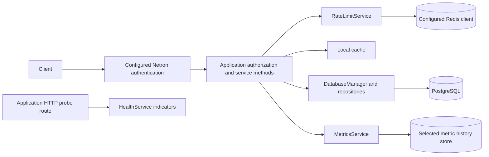

# API service stack

This recipe composes providers for an API application. Importing the modules
does not expose an HTTP server, authorize requests or instrument every method.
The application must connect those providers to its service and transport paths.

## Shape {#shape}

| Requirement | Implementation boundary |
| --- | --- |
| Authentication | Configure Netron authentication and application authorization; `titan-auth` supplies verification primitives |
| Database | Supply a connection, schema and repository policy |
| Cache | Start with a local cache; shared L2 requires an `IL2CacheAdapter` |
| Rate limits | Check a key derived from verified caller identity; shared storage must actually be connected |
| Health | Register dependency indicators and expose any HTTP probe routes explicitly |
| Metrics | Record application observations and choose history storage; optional text output is separate |

## Architecture {#architecture}



The application implements the arrows from request handling to rate limiting,
cache and metrics. Configure health indicators for the dependencies the readiness
policy needs; module imports do not register every dependency automatically.

## `AppModule` {#appmodule}

This provider configuration assumes PostgreSQL and Redis are available. It uses
an in-memory cache and metric history so their lifetime is explicit.

```typescript
import { Module } from '@omnitron-dev/titan';
import { LoggerModule } from '@omnitron-dev/titan/module/logger';
import { TitanRedisModule } from '@omnitron-dev/titan-redis';
import { TitanDatabaseModule } from '@omnitron-dev/titan-database';
import { TitanCacheModule } from '@omnitron-dev/titan-cache';
import { TitanRateLimitModule } from '@omnitron-dev/titan-ratelimit';
import { TitanHealthModule } from '@omnitron-dev/titan-health';
import { TitanMetricsModule } from '@omnitron-dev/titan-metrics';

@Module({
  imports: [
    LoggerModule.forRoot({ level: 'info', redact: ['password', 'token'] }),
    TitanRedisModule.forRoot({
      config: { host: 'localhost', port: 6379, db: 0 },
    }),
    TitanDatabaseModule.forRoot({
      connection: {
        dialect: 'postgres',
        connection: process.env.DATABASE_URL!,
      },
    }),
    TitanCacheModule.forRoot({ maxSize: 5_000, defaultTtl: 60, evictionPolicy: 'lru' }),
    TitanRateLimitModule.forRoot({
      storageType: 'redis',
      strategy: 'sliding-window',
      defaultLimit: 100,
      defaultWindowMs: 60_000,
    }),
    TitanHealthModule.forRoot({
      enableMemoryIndicator: true,
      enableEventLoopIndicator: true,
      timeout: 3_000,
    }),
    TitanMetricsModule.forRoot({
      appName: 'my-api',
      collection: { process: true, system: false, interval: 10_000 },
      storage: { type: 'memory', batchSize: 500, flushInterval: 10_000 },
    }),
  ],
})
export class AppModule {}
```

Validate required configuration before boot. Register the application's service
providers and configure its [Netron authentication](../netron/authentication.md)
before exposing a listener. See [auth](../modules/auth.mdx) for verification
configuration; importing that module alone does not authenticate Netron calls.

The rate-limit factory uses the default Redis service. If it cannot obtain a
client, its factory can fall back to memory, so verify the selected storage in the
running application. Redis names do not implicitly assign clients to other
modules. Add SQL metric persistence using the [storage adapter contract](../modules/metrics.mdx#storage-and-commit-boundaries).

## A typical `@Service` {#a-typical-service}

A service can create this reader once and call it after authorization and rate
limiting. The caller supplies the cache, metrics provider and repository lookup;
this helper is application code, not a Titan export.

```typescript
import { createCacheGetOrSet, type ICache } from '@omnitron-dev/titan-cache';
import type { IMetricsService } from '@omnitron-dev/titan-metrics';

export function createCachedReader<T>(
  cache: ICache<T>,
  metrics: IMetricsService,
  load: (id: string) => Promise<T>,
) {
  const getOrSet = createCacheGetOrSet(cache);
  return async (id: string): Promise<T> => {
    const started = performance.now();
    const labels = { app: 'my-api', operation: 'read' };
    try {
      return await getOrSet(`record:${id}`, () => load(id), { ttl: 60 });
    } finally {
      metrics.recordTyped('histogram', 'api_read_duration_seconds', labels,
        (performance.now() - started) / 1000);
    }
  };
}
```

For tenant-dependent results, include the verified tenant in the key and enforce
the repository's access policy before returning data. Do not cache a result under
a key shared by callers with different visibility. Invalidate affected keys after
a successful write. The helper coalesces concurrent loads only within that helper
instance; it is not a distributed transaction or an idempotency ledger.

`recordTyped` updates the registry and queues a history sample. `@Metrics` instead
requires `attachMetricsService(instance, service)` and updates only the registry.
Neither path is installed automatically by `collection.rpc`.

## Cross-module wiring notes {#cross-module-wiring-notes}

| Concern | Required wiring |
| --- | --- |
| Shared cache | Implement/supply `IL2CacheAdapter`; a raw `ioredis` client does not satisfy the cache adapter contract |
| Database health | Supply `execute`, `raw` or `query` through an adapter; a Kysely object cannot be passed directly |
| Redis health | Pass the selected client explicitly to the indicator |
| JWT revocation | Verification cache expiry is not token revocation; implement the required revocation/session policy separately |
| Method auth decorator | `@RequireAuth` needs `__authMiddleware__` and a request-like argument with headers; arbitrary RPC arguments do not supply that context |
| Rate-limit decorator | Resolves `__rateLimitService__` or the ambient configured service; an absent service allows the call. Use verified identity for the key |
| Health endpoints | `HealthService` supplies results; application routes choose HTTP status, access and liveness/readiness policy |
| Cleanup | Stop producers and await persistence; explicitly invoke cleanup required by the [lifecycle contract](../modules/lifecycle-reference.mdx) |

## Production checklist {#production-checklist}

- Verify the authenticated client path and rejection of unauthorized operations.
- Exercise cache misses, writes, invalidation and tenant separation through the service.
- Verify rate limits across application instances using the actual shared backend.
- Register and test dependency health indicators; do not mark readiness from memory checks alone.
- Record, flush and query a known metric; memory history disappears on restart.
- Test shutdown and recovery using the selected storage and connection owners.

There is no built-in `/metrics`, `/healthz` or `/readyz` HTTP listener in these
modules. Expose and secure the routes the deployment actually needs.

## See also {#see-also}

- [Worker fleet](./worker-fleet.md) — when the workload is async
  jobs, not request handlers
- [Observability stack](./observability-stack.md) — beyond metrics:
  traces + telemetry-relay for cross-pod shipping
- [Multi-tenant SaaS](./multi-tenant-saas.md) — extends this stack
  with RLS-driven tenant isolation
