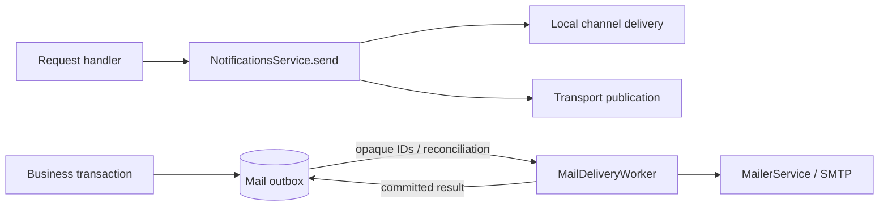

# Notifications pipeline

The package exposes several notification paths with different contracts. Choose
one explicitly: `NotificationsService.send` can deliver in the caller, the event
worker persists and signals application records, and `titan-mailer` provides a
separate durable SMTP outbox worker. They are not interchangeable stages of an
automatically assembled pipeline.

## Shape {#shape}

| Path | Input | Work performed |
| --- | --- | --- |
| `NotificationsService.send` | Recipient `{ id }`, payload `{ type, title, message }`, send options | Optional rate/preferences/router checks, transport publication and local channel calls |
| `NotificationPublisher` / event worker | `NotificationEvent` with targeting, `category`, `body`, `sourceApp` | Stream publication; explicit worker resolves users, persists and signals |
| Mail outbox worker | Opaque durable delivery ID | Claims SQL record, sends via MailerService, records outcome and retries |

Templates require an explicit `TemplateEngine.render` call. The event worker does
not install SMTP, SMS or push providers.

## Architecture {#architecture}



The SMTP outbox path separates delivery from requests and preserves business-state
atomicity. SMTP acceptance and SQL commit still cannot form one distributed
transaction; the documented delivery guarantee is at least once under recovery.

## `AppModule` — producer (API pod) {#appmodule--producer-api-pod}

A module for direct in-app delivery:

```typescript
import { Module } from '@omnitron-dev/titan';
import { NotificationsModule } from '@omnitron-dev/titan-notifications';

@Module({
  imports: [NotificationsModule.forRoot({
    redis: process.env.REDIS_URL,
    enableInApp: true,
    enableWebhook: false,
    rateLimiterConfig: {
      defaultLimits: { perMinute: 10, perHour: 100 },
    },
    preferenceStoreConfig: {
      defaultPreferences: { channels: { inApp: { enabled: true } } },
    },
  })],
})
export class AppModule {}
```

Use the exact registered channel ID `inApp`. `defaultChannels` is declared in the
options but is not consumed by `send`; pass channels on the call or supply a
router. If transport consumers are required, register them explicitly and verify
publication acknowledgements.

## Producer side — emitting a notification {#producer-side--emitting-a-notification}

```typescript
import { Inject, Service } from '@omnitron-dev/titan';
import { NOTIFICATIONS_SERVICE, type NotificationsService }
  from '@omnitron-dev/titan-notifications';

@Service({ name: 'welcome-notifications' })
class WelcomeNotifications {
  constructor(@Inject(NOTIFICATIONS_SERVICE) private readonly notify: NotificationsService) {}

  async sendWelcome(id: string, name: string) {
    return this.notify.send(
      { id },
      { type: 'announcement', title: 'Welcome', message: `Welcome, ${name}!` },
      { channels: ['inApp'] },
    );
  }
}
```

This awaits the send path, including any local channel calls. Inspect returned
status and per-channel outcomes; a resolved promise is not recipient delivery.
Register email/SMS/push implementations before selecting those channel IDs.

## Worker pod — consuming and delivering {#worker-pod--consuming-and-delivering}

`NotificationsModule.forWorker({ targetResolver, persister, realtimeSignaler,
workerOptions })` aliases application provider tokens and registers the worker.
It neither starts the worker nor configures a messaging transport. The host calls
`start(rawRedis, options?)`; `stop()` waits at most ten seconds for the consume
loop, and does not cancel arbitrary application work still running.

The worker expects `NotificationEvent` records and writes through the supplied
persister before signaling clients. It does not render templates, call email/SMS/
push channels, or invoke the producer service's preference/rate-limit policies.

There is also a startup gap: the worker creates its stream/group but does not
register its stream pattern in Rotif's active-pattern registry. The publisher
skips unmatched patterns and its wrapper ignores that result. Do not treat
`forWorker` plus `NotificationPublisher` as a complete delivery setup on an empty
Redis server. Verify routing, consumer group, stored record and retry behavior
through the application's ordinary path. The package currently provides no
single module factory that establishes this whole contract.

## A custom channel — e.g. SMTP email {#a-custom-channel--eg-smtp-email}

For SMTP use the existing [titan-mailer](../modules/mailer.mdx) package.
`MailerEmailChannel` from `@omnitron-dev/titan-mailer/notifications` adapts a
`MailerService` to the channel registry. For deferred durable delivery, use its
`MailDeliveryWorker` with an application outbox or `PostgresMailOutbox`.

The notification package's `AbstractEmailChannel`, `AbstractSMSChannel` and
`AbstractPushChannel` are extension points. Optional library peers do not install
providers for SendGrid, SES, Twilio, FCM or APNS. A custom channel must own its
transport initialization, errors and shutdown; registration alone does not
provide a durable retry transaction.

## Cross-module wiring notes {#cross-module-wiring-notes}

| Concern | Actual owner |
| --- | --- |
| Preferences and rate checks | `NotificationsService.send` path; event-worker application ports need their own policy |
| Rendering | Caller invokes `TemplateEngine`; `send` takes the rendered payload |
| Channel delivery | Registered channel called in `send`; separate consumer/outbox required for deferred work |
| Worker start/stop | Host calls explicit methods with a caller-owned Redis client |
| Health | Resolve `NOTIFICATIONS_HEALTH` and register it with HealthService explicitly |
| Lifecycle topics | Optional `titan-events`; distinct from Rotif transport topics |
| Retry and DLQ | Transport-specific; event worker acknowledges poison messages after `maxDeliveries` rather than sharing the Rotif DLQ policy |
| Scheduling | Delays transport publication; local channels in `send` still run immediately |

## Production checklist {#production-checklist}

- Select one message contract and trace producer, routing, consumer and final result.
- Test with an empty Redis instance so pre-existing pattern registrations cannot hide missing setup.
- Register the exact channel IDs and required concrete implementations.
- Keep preference policy and durable retries at the layer that actually performs delivery.
- Set retention for the chosen path: event worker defaults differ from general Rotif/DLQ settings.
- Observe pending, failed and accepted outcomes separately; do not call broker acceptance inbox delivery.
- Stop admission and account for outstanding work before closing dependencies.

## See also {#see-also}

- [`titan-notifications`](../modules/notifications.mdx) — full reference
- [`titan-events`](../modules/events.mdx) — in-process events the producer emits
- [`titan-ratelimit`](../modules/ratelimit.mdx) — alternative rate-limit backing
- [`titan-redis`](../modules/redis.mdx) — Rotif transport runs on this
