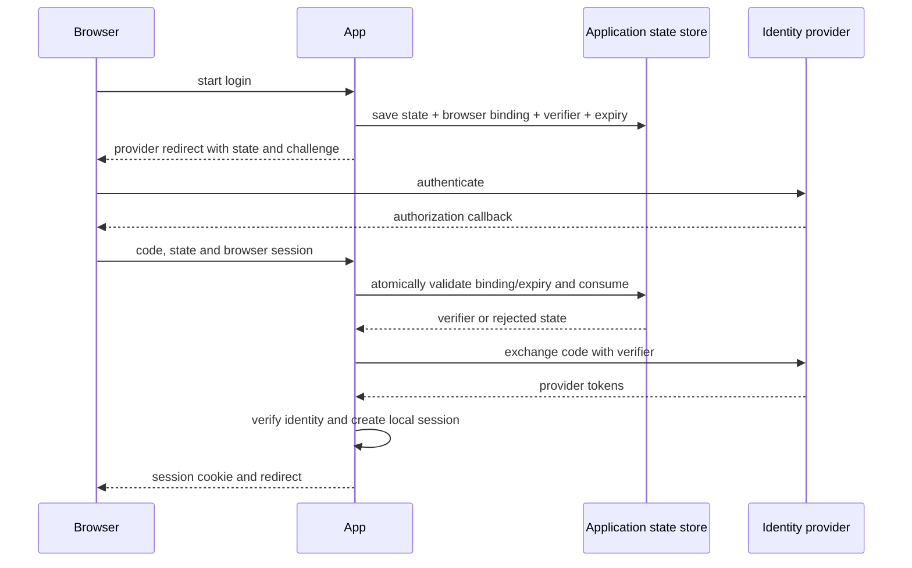

# OAuth callback

Titan supplies JWT verification, signed resource tokens, rate limiting and
storage building blocks. It does not implement a complete OAuth client or a
single-use OAuth state store. This page describes the application boundaries
needed around those primitives; importing the modules alone does not establish
a working or replay-safe login flow.

## Shape {#shape}

- Generate random state and a PKCE verifier; send only the challenge in the authorization request.
- Bind the state to the initiating browser/session and consume it atomically with an expiry check.
- Exchange the code at the configured provider; validate the identity token against that provider's keys and claims.
- Create the local session through the application's session authority and chosen cookie policy.

`titan-cache` has no atomic compare-and-consume API. Separate `get` and `delete`
calls can race and do not bind the request to a browser. A signed resource token
has an expiry and unique ID, but no built-in single-use consumption store.

## Architecture {#architecture}



## Setup {#setup}

Configure a JWT verifier for the provider's actual algorithm, JWKS URL, issuer
and audience. A symmetric local-session secret is not the external provider's
verification key. Do not reuse a single verifier configuration for unrelated
issuers or audiences.

The application also supplies an authoritative state store with atomic
consumption, HTTP routes/cookies, provider configuration, token exchange and local
session creation. Persist state in shared storage when callbacks may reach another
replica. An LRU cache can evict state and has no cross-replica consume guarantee.

Apply rate limits to the actual HTTP/RPC handlers. Registering
`TitanRateLimitModule` alone does not protect an uninstrumented endpoint.

## Implementation {#implementation}

PKCE generation is application code using Node's crypto primitives:

```typescript
import { createHash, randomBytes } from 'node:crypto';

export function createAuthorizationAttempt() {
  const state = randomBytes(32).toString('base64url');
  const verifier = randomBytes(32).toString('base64url');
  const challenge = createHash('sha256').update(verifier).digest('base64url');
  return { state, verifier, challenge };
}
```

The following is an **application-owned contract**, not an export from Titan:

```typescript
interface OAuthStateStore {
  save(attempt: {
    state: string;
    browserBinding: string;
    verifier: string;
    expiresAt: number;
  }): Promise<void>;
  // One storage operation: verify browser binding and expiry, then consume.
  // Exactly one competing caller may receive a verifier.
  consume(state: string, browserBinding: string): Promise<string | null>;
}
```

Implement and test that atomic operation in the chosen database or Redis script.
The callback rejects a missing result before token exchange. Neither `get` followed
by `delete` nor `createSignedToken` implements this contract.

After exchange, verify the provider identity token and application-specific claims
before issuing a local session. `JWTService.createSignedToken` signs a resource
payload (`resourceId`, `resourcePath`, `operation`, optional `transform`); it is
not a general login/session issuance API. If an application chooses a bootstrap
link, it must additionally store and atomically consume its one-time grant. A short
expiry alone does not prevent reuse.

## Cross-module wiring notes {#cross-module-wiring-notes}

| Concern | Boundary |
| --- | --- |
| State and PKCE | Application generation, browser binding, shared expiry and atomic consume |
| Provider JWT | `JWTService.verify` with provider-specific keys/issuer/audience; full OAuth client behavior remains application code |
| State caching | Cache TTL and `get`/`delete` do not establish single use |
| Signed resource token | Signature and expiry, not session creation or replay prevention |
| Rate limiting | Apply to the actual start and callback handlers |
| Session | Application authority validates identity and creates/revokes its session |
| Refresh tokens | Keep in the application's protected server-side store |

## Production checklist {#production-checklist}

- Test concurrent callbacks: only one can consume the same browser-bound state.
- Reject expired state and a callback from a different initiating browser/session.
- Verify the chosen provider's identity token before creating the local session.
- Keep the redirect URI and provider endpoints in trusted application configuration.
- Verify callback routing and state storage across replicas and restarts.
- If using bootstrap grants, test atomic consumption and replay rejection separately from signature verification.

## See also {#see-also}

- [`titan-auth`](../modules/auth.mdx) — JWT + signed URLs
- [`titan-cache`](../modules/cache.mdx) — state storage
- [`titan-ratelimit`](../modules/ratelimit.mdx) — protect both endpoints
- [API service stack](./api-service.md) — what runs after the user is authenticated
