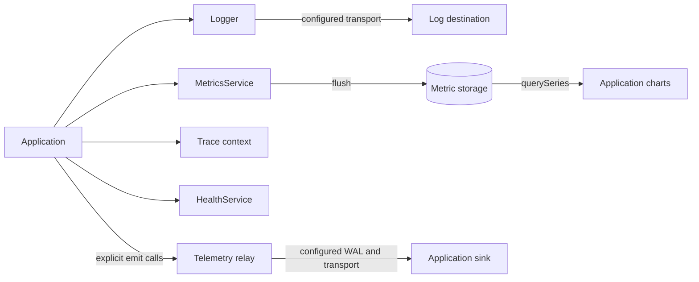

# Observability stack

Compose the signals the application needs: structured logs, explicit metrics,
trace context and pull-based health checks. The optional telemetry relay moves
application-supplied records to an application-supplied sink. None of these
modules automatically installs an external observability backend.

## Shape {#shape}

| Component | What the application gets | What the application supplies |
| --- | --- | --- |
| Logger | Structured Pino logs, processors and transports | Destinations and any trace-context processor |
| Metrics | Registry, process samples, history queue and storage adapters | Business/RPC instrumentation, custom `app` labels and SQL connection/schema |
| Tracing | Trace context and async-scope propagation | Span recording/export if needed |
| Health | Indicator results and optional Netron RPC service | HTTP probe routes and any custom dependency checks |
| Relay | Bounded buffer, optional WAL, retry/ack handling | Bridges from signals, authenticated transport and durable sink |

## Architecture {#architecture}



The arrows labelled as configured or explicit require application code. Trace
context alone is not an exported duration span; metric history is not populated
by reading the registry.

## `AppModule` — producer side {#appmodule--producer-side}

```typescript
import { Module } from '@omnitron-dev/titan';
import { LoggerModule } from '@omnitron-dev/titan/module/logger';
import { TitanMetricsModule } from '@omnitron-dev/titan-metrics';
import { TitanHealthModule } from '@omnitron-dev/titan-health';

@Module({
  imports: [
    LoggerModule.forRoot({ level: 'info', redact: ['password', 'token'] }),
    TitanMetricsModule.forRoot({
      appName: 'my-service',
      collection: { enabled: true, process: true, system: false, interval: 10_000 },
      storage: { type: 'memory', batchSize: 500, flushInterval: 10_000 },
      retention: { maxAge: '24h' },
    }),
    TitanHealthModule.forRoot({
      enableMemoryIndicator: true,
      enableEventLoopIndicator: true,
      timeout: 3_000,
      enableCaching: true,
      cacheTtl: 1_000,
    }),
  ],
})
export class AppModule {}
```

This starts local process collection when the metrics provider is created. The
memory history disappears on restart. For persistence, supply the SQL adapter,
connection and schema described in [metrics storage](../modules/metrics.mdx#storage-and-commit-boundaries).
`collection.rpc` and `collection.custom` do not control runtime instrumentation.

## Wiring the telemetry relay {#wiring-the-telemetry-relay}

```typescript
import { TelemetryRelayService } from '@omnitron-dev/titan-telemetry-relay';

const relay = new TelemetryRelayService({
  role: 'producer',
  nodeId: 'service-node-1',
  buffer: { maxBufferSize: 10_000, flushIntervalMs: 5_000, maxBatchSize: 500 },
  wal: { directory: './data/telemetry-wal', maxSizeBytes: 10 * 1024 * 1024, maxSegments: 7 },
});
relay.setTransport(myAuthenticatedTransport); // application implementation
await relay.start();
relay.emitMetric('jobs_completed_total', 1, { queue: 'default' }, 'my-service');
// After stopping all producers:
await relay.stop();
```

Use a stable node ID and a persistent directory. `record` initially admits data
to memory; WAL writes occur on flush. Crashes before that boundary, bounded-buffer
drops and WAL segment eviction can lose records. Inspect `stats()` for these
conditions. A WAL is enabled by default for producer/both roles; `wal: false`
disables it. The relay has no built-in Netron transport or logger/metrics bridge.

## Aggregator pod {#aggregator-pod}

Implement `TelemetryAggregator.ingest(nodeId, entries)` and `query(filter)`, then
pass the object to `relay.setAggregator(...)`. An authenticated receiving handler
calls `relay.receive(nodeId, entries)`; the relay does not open a port.

Return the acknowledged count only after the required durable write. Retried
batches may repeat records, so deduplicate stable entry IDs per authenticated
producer. A partial acknowledgement retains the whole snapshot for retry. There
are no packaged OTLP, Loki, Tempo or Prometheus remote-write exporters; using
those protocols requires a separate sink implementation.

## Trace propagation in your code {#trace-propagation-in-your-code}

```typescript
import { currentTrace, startSpan, withTrace } from '@omnitron-dev/titan/tracing';

await withTrace(startSpan(), async () => {
  const trace = currentTrace();
  logger.info({ traceId: trace?.traceId, spanId: trace?.spanId }, 'work started');
  await performWork();
});
```

`startSpan` creates context; `withTrace` scopes it to asynchronous work. Netron
carries that context across supported RPC calls. Reading `currentTrace()` in a
logger processor can attach IDs consistently. This does not measure span duration
or send a trace to an external collector.

## A typical instrumented service {#a-typical-instrumented-service}

This wrapper can be called by a service around the operation it wants to measure:

```typescript
import type { IMetricsService } from '@omnitron-dev/titan-metrics';

export async function measure<T>(
  metrics: IMetricsService,
  method: string,
  operation: () => Promise<T>,
): Promise<T> {
  const started = performance.now();
  const labels = { app: 'my-service', method };
  try {
    const result = await operation();
    metrics.recordTyped('counter', 'work_completed_total', labels, 1);
    return result;
  } catch (error) {
    metrics.recordTyped('counter', 'work_errors_total', labels, 1);
    throw error;
  } finally {
    metrics.recordTyped('histogram', 'work_duration_seconds', labels,
      (performance.now() - started) / 1000);
  }
}
```

Keep `method` values bounded. `recordTyped` writes both the registry and the
history queue; `await metrics.flush()` makes accepted observations available to
history queries. The stored counter observations here are increments, while the
registry exposes their cumulative sum. `@Metrics` is a different path: attach the
service explicitly, and expect registry-only output.

## Cross-module wiring notes {#cross-module-wiring-notes}

| Concern | Boundary |
| --- | --- |
| RPC measurement | Explicit instrumentation; no automatic handler installed by `collection.rpc` |
| Health probes | `isAlive()` returns true when callable; `isReady()` rejects `unhealthy`, accepts `degraded`; HTTP routing is application code |
| Metric text | `getPrometheusText()` is an optional registry export, separate from SQL history |
| Relay | Application calls emitters or supplies a bridge; no automatic metric/log/span subscription |
| SQL vs relay delivery | Metric commit and relay acknowledgement are separate operations; use a transactional outbox where their atomicity matters |

## Production checklist {#production-checklist}

- Verify a custom observation through the ordinary recording, flush and query path.
- Check queue loss/error readings and prove restart recovery for the selected store.
- Verify probe routes and access policy from an actual client.
- Stop producers before draining the relay; allow time for pending writes.
- Test sink acknowledgement, retries and duplicate handling during a simulated outage.
- Configure a scraper or an external exporter only when the deployment needs one.

## See also {#see-also}

- [Logging / Overview](../logging/overview.md) and per-page references
- [Tracing](../tracing.md) — full tracing primitive reference
- [`titan-metrics`](../modules/metrics.mdx) — full metrics reference
- [`titan-health`](../modules/health.mdx) — full health reference
- [`titan-telemetry-relay`](../modules/telemetry-relay.mdx) — relay reference
- [Best Practices / Observability](../best-practices/observability.md)
