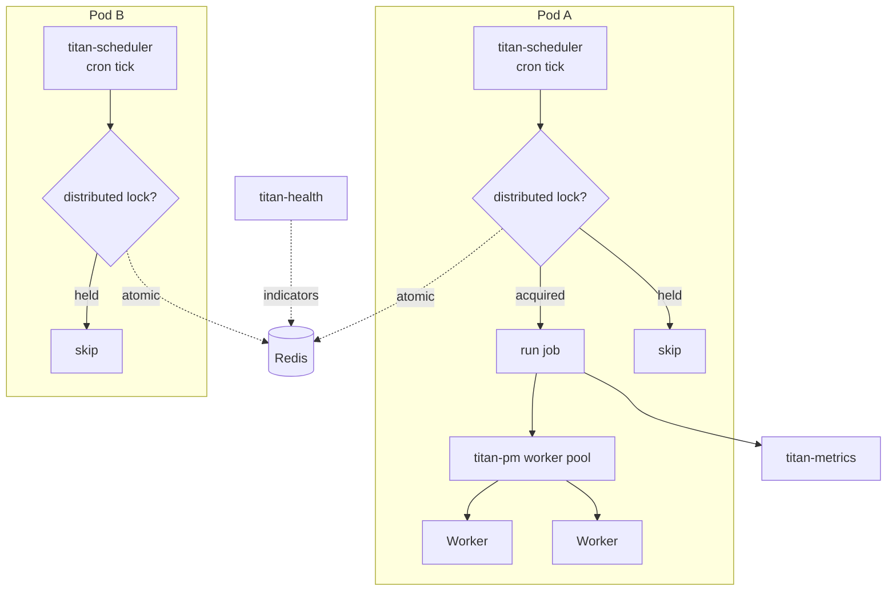

# Worker fleet

Use scheduler dispatch, Redis leases and supervised workers for background work.
A lease coordinates a time window; it does not make a business effect exactly
once. Persist idempotency and completion in the store that owns the operation.

## Shape {#shape}

- `titan-scheduler` registers and invokes cron, interval and timeout handlers.
- `titan-lock` can supply the scheduler's per-fire coordination lease.
- `titan-pm` creates supervised workers or pools through explicit API calls.
- `titan-metrics` records explicitly instrumented work and queries committed history.

Register handlers on every boot. Serialized scheduler state cannot reconstruct
arbitrary function closures. A process restart can interrupt an admitted job.

## Architecture {#architecture}



## `AppModule` {#appmodule}

```typescript
import { Module } from '@omnitron-dev/titan';
import { TitanRedisModule } from '@omnitron-dev/titan-redis';
import { TitanLockModule, LOCK_SERVICE_TOKEN, type IDistributedLockService }
  from '@omnitron-dev/titan-lock';
import { SchedulerModule } from '@omnitron-dev/titan-scheduler';
import { ProcessManagerModule } from '@omnitron-dev/titan-pm';
import { TitanMetricsModule } from '@omnitron-dev/titan-metrics';

@Module({
  imports: [
    TitanRedisModule.forRoot({ config: { url: process.env.REDIS_URL } }),
    TitanLockModule.forRoot({ keyPrefix: 'worker-locks', defaultTtl: 60_000 }),
    SchedulerModule.forRootAsync({
      inject: [LOCK_SERVICE_TOKEN],
      useFactory: (lockProvider: IDistributedLockService) => ({
        enabled: true,
        timezone: 'UTC',
        distributed: { enabled: true, lockTTL: 60_000 },
        lockProvider,
        shutdownTimeout: 30_000,
      }),
    }),
    ProcessManagerModule.forRoot({ isolation: 'worker', handleSignals: false }),
    TitanMetricsModule.forRoot({ appName: 'worker-fleet', storage: { type: 'memory' } }),
  ],
})
export class AppModule {}
```

Add your job providers to a feature module, or `SchedulerModule.forFeature([...])`.
The example uses volatile metric history deliberately: SQL needs an explicit
adapter/connection/schema. Redis scheduler persistence also needs an explicitly
constructed provider and does not turn handlers into durable workflows.

## A coordinated scheduled task {#a-scheduled-task-exactly-once}

```typescript
import { Injectable } from '@omnitron-dev/titan';
import { Schedulable, Cron, CronExpression } from '@omnitron-dev/titan-scheduler';

@Injectable()
@Schedulable()
class CleanupTasks {
  @Cron(CronExpression.EVERY_HOUR, { name: 'cleanup:hourly', timezone: 'UTC' })
  async hourlyCleanup() {
    await deleteExpiredRecords(); // application operation with idempotent effects
  }
}
```

With `distributed.enabled` and `lockProvider` configured above, scheduled fires
compete for a key derived from the job and time window. The scheduler holds that
lease until TTL rather than releasing it after a quick handler. A plain
`@WithDistributedLock` releases on return, so a later pod can acquire it and run
again in the same hour. Neither approach is an exactly-once guarantee: pauses,
TTL expiry, failed side effects and a crashed winner still require recovery logic.
Manual `triggerJob` bypasses scheduled-fire coordination.

## A CPU-bound worker pool {#a-cpu-bound-worker-pool}

Create a pool once and reuse it across requests. The pool itself is the service
proxy; call the worker's public method on it:

```typescript
import { Process, Public, ProcessManager } from '@omnitron-dev/titan-pm';

@Process({ name: 'calculation-worker' })
export class CalculationWorker {
  @Public()
  sumSquares(limit: number): number {
    if (!Number.isInteger(limit) || limit < 0 || limit > 100_000) {
      throw new RangeError('limit must be an integer from 0 to 100000');
    }
    let total = 0;
    for (let i = 0; i < limit; i++) total += i * i;
    return total;
  }
}

export async function createCalculationPool(pm: ProcessManager) {
  return pm.pool(CalculationWorker, { size: 2 });
}
```

Keep worker classes in importable modules following the [PM entry-point
requirements](../modules/pm.mdx). The host stops admission and awaits
`pm.shutdown()` while dependencies are still available. `ProcessManagerModule`
does not install that shutdown bridge; `handleSignals: true` is a separate opt-in.
Do not create a new pool for each request.

## Cross-module wiring notes {#cross-module-wiring-notes}

| Concern | Required behavior |
| --- | --- |
| Scheduler coordination | Supply a lock provider and enable distributed mode; a Redis connection alone is insufficient |
| Handler recovery | Register callable handlers every boot; persistence cannot restore closures |
| Business effects | Store idempotency/completion transactionally; lease ownership is not a completion receipt |
| PM shutdown | Host awaits `shutdown`; signal handlers are opt-in |
| Resource limits | Verify the chosen spawner's enforcement; `resources.maxCpu` is not a CPU quota implementation |
| Metrics | Provide custom `app` labels and explicit instrumentation; configure an SQL adapter for persistence |

## Production checklist {#production-checklist}

- Exercise the scheduled-fire path on competing nodes, including a stalled lease holder.
- Verify restart recovery and idempotency for the business operation itself.
- Re-register handlers on boot and observe that expected jobs were discovered.
- Reuse pools, stop admission, await PM shutdown, then close shared connections.
- Verify metric history through record, flush and query; check storage errors/loss.
- Set host/container resource limits where an operating-system quota is required.

## See also {#see-also}

- [`titan-scheduler`](../modules/scheduler.mdx) — full scheduler reference
- [`titan-lock`](../modules/lock.mdx) — distributed lock semantics
- [`titan-pm`](../modules/pm.mdx) — process manager full reference
- [Resilience / Retry](../resilience/retry.md) — pair with retry for transient failures
